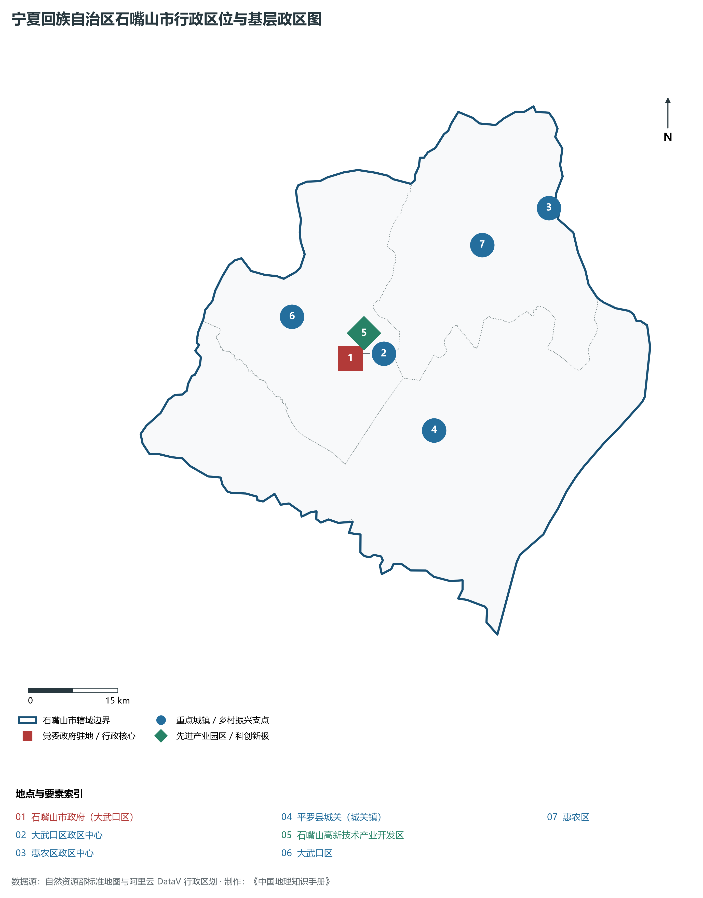
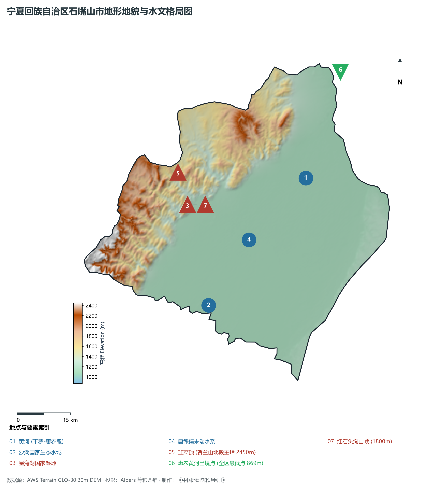
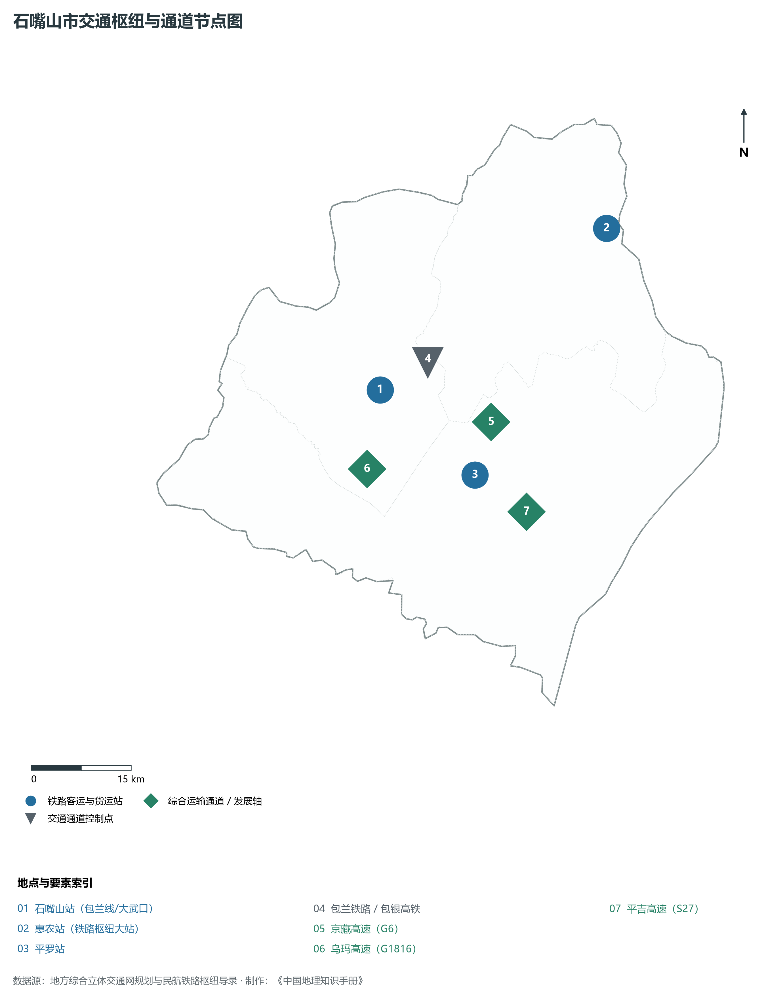
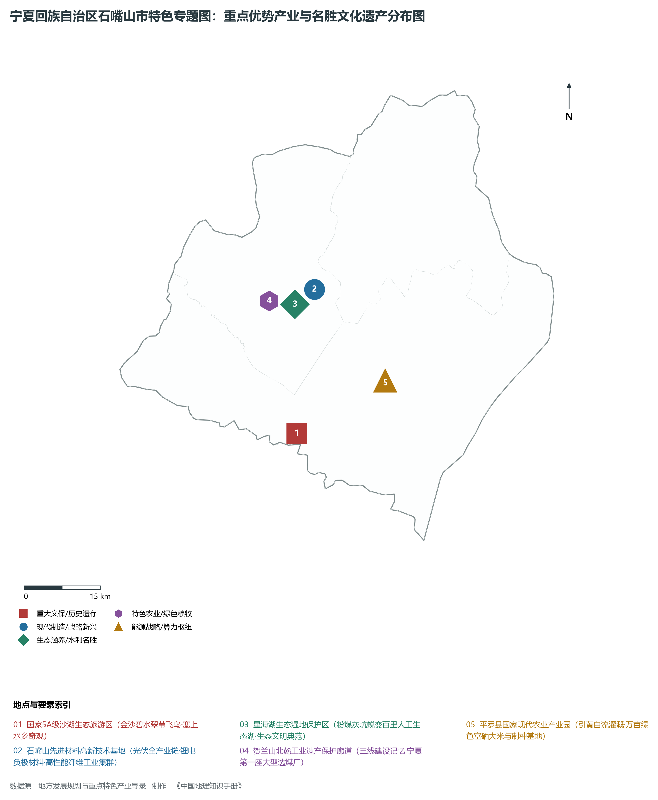
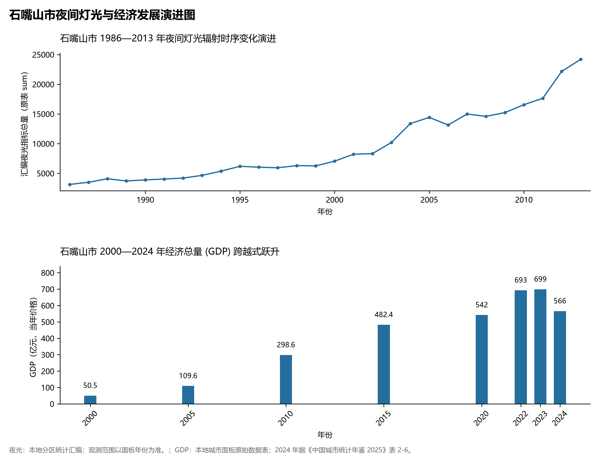

# 31.2 石嘴山市

石嘴山市，宁夏回族自治区辖地级市，地处宁夏回族自治区最北部，东临滔滔黄河与内蒙古鄂尔多斯鄂托克旗隔河相望，西依巍峨贺兰山与内蒙古阿拉善左旗毗邻，南接首府银川市贺兰县，北与内蒙古乌海市海南区相连。因黄河两岸黑石对峙如嘴、波涛击石若漱而得名“石嘴山”。地理坐标介于东经 105°58′—106°55′、北纬 38°21′—39°25′ 之间，南北长约 **119 km**，东西宽约 **75 km**。全市行政区域土地。2024 年常住人口 **74 万人**，常住人口城镇化率 **81.36%**，地区生产总值 **566 亿元**（当年价格），人均地区生产总值 **75,895 元**，三次产业构成为 **7.81 : 47.36 : 44.83**。

---

## 一、市情速览

| 核心指标 | 全市数据 | 全区位次 / 占比 / 特征 |
|:---|:---|:---|
| **土地总面积** | 5 310.0 km² | 占全区 8.0%，依山带水、平原宽广 |
| **常住人口 (2024)** | 74 万人 | 2024 年，全市；年鉴公布口径 |
| **常住人口城镇化率** | 81.36% | 2024 年，全市；年鉴公布口径 |
| **地区生产总值 (GDP)** | 566 亿元 | 2024 年，全市；年鉴公布口径 |
| **人均 GDP** | 75,895 元/人 | 2024 年，全市；年鉴公布口径 |
| **三次产业结构** | 7.81 : 47.36 : 44.83 | 2024 年，全市；年鉴公布口径 |
| **最高点 / 最低点** | 韭菜顶 2 450 m / 惠农黄河出境点 869 m | 惠农麻黄沟出境处为宁夏全区陆地最低海拔极值点 |
| **黄河过境长度** | 约 109 km | 占黄河宁夏段总长度的 27.5%，出境入内蒙古乌海 |
| **主导功能定位** | 国家先进基础材料基地、塞上水乡生态明珠、产城融合典范 | 从“煤城”向“硅都新材”与沙湖生态文旅成功转型 |

**图 31-02-1 宁夏回族自治区石嘴山市行政区位与基层政区图**：图上编号与地点、要素索引对应。

---

## 二、自然地理：贺兰北段、黄河出境与生态奇观

**图 31-02-2 宁夏回族自治区石嘴山市地形地貌与水文格局图**：图上编号与地点、要素索引对应。

### 1. 贺兰山北段与全区海拔极低点

- **贺兰山北段山岳屏障**：石嘴山西部山峰险峻，岩石裸露，主峰韭菜顶海拔 **2 450 m**，红石头沟、大武口沟等山峡深切，构成了阻隔内蒙古阿拉善荒漠风沙的第一道坚实天堑；
- **全区最低海拔点（869 m）**：黄河自平罗县向北流经惠农区麻黄沟出境进入内蒙古，出境处河床及滩地海拔仅 **869 m**，为宁夏回族自治区全区陆地地貌的最低点，与贺兰山主峰砂威坨（3 556 m）共同构成了全区 2 687 m 的巨大垂直落差。

### 2. 生态湿地奇观：沙湖与星海湖
石嘴山在全国享有“沙漠绿洲水乡”的美誉，拥有两处堪称生态奇迹的水域：

- **国家 5A 级旅游景区·沙湖**：位于平罗县西南，水域面积达 45 km²，沙漠面积 22 km²。金黄色沙丘与万亩清澈湖泊、茂密芦苇荡水乳交融，南眺巍巍贺兰雪峰，北依大漠孤烟，栖息着黑鹳、白琵鹭等百余种珍禽鸟类，是西北干旱区独一无二的“塞上明珠”；
- **星海湖国家湿地公园**：位于大武口区东侧，水域及湿地面积达 43 km²。其前身是大武口洗煤厂排放粉煤灰与排污汇集的“东大坑”，经过数十年的退殖还湿、污水截流与水系连通工程，华丽蜕变为百里水景融城的城市大型生态湖泊，成为资源枯竭型城市生态修复的国际典范。

---

## 三、建置沿革与工业记忆

石嘴山历史底蕴深厚，更是新中国重工业建设的一座丰碑：

1. **古堡烽燧与边塞商埠**：平罗古属秦汉富平县地，明代筑平罗城堡、宝丰城堡，设石嘴山巡检司与渡口水关；清代黄河水运繁盛，石嘴山码头成为宁夏通往归化城（呼和浩特）、包头与京津的大宗皮毛、煤炭、粮盐集散水运枢纽；
2. **“三线建设”与塞上煤城崛起**：20 世纪 50 年代初，国家将石嘴山列为全国十大煤炭基地之一，勘探出储量丰富、品质绝佳的“太西无烟煤”（特低灰、特低硫、高发热量，被誉为“煤中之王”）；来自全国十余个省份的数万建设大军云集贺兰山麓，建成了石嘴山矿务局、大武口洗煤厂（当时亚洲最大洗煤厂）、西北煤机厂、大武口电厂等重点工业工程，1960 年正式设立地级石嘴山市；
3. **绿色转型新征程**：随着煤炭资源走向衰竭，石嘴山坚定走上新型工业化道路，被国家列为首批资源枯竭型城市转型试点，由单一“煤城”向“山水园林新型工业城市”全面转型。

---

## 四、综合立体交通走廊

**图 31-02-3 石嘴山市交通枢纽与通道节点图**：图上编号与地点、要素索引对应。

- **高铁时空大提速**：包银高铁（包头至银川）石嘴山段于 2024 年正式通车运营，石嘴山南站、惠农南站两座现代化高铁站投入使用，使石嘴山全面接入国家“八纵八横”高速铁路网，前往银川仅需 20 分钟；
- **大宗铁路干线支撑**：包兰铁路作为国家沿黄干线普速铁路，在石嘴山站、惠农站设有大型客货运编组作业场，大武口铁路支线连接主要工业园区；
- **国家高速大通道**：京藏高速（G6）沿黄河平原纵贯南北，乌玛高速（G1816）沿贺兰山东麓延伸，连通内蒙古乌海与银川都市圈，构成了内蒙古西部与宁夏北部的大运量快速客货运通道。

---

## 五、特色优势产业与现代产业转型

**图 31-02-4 宁夏回族自治区石嘴山市特色专题图：重点优势产业与名胜文化遗产分布图**：图上编号与地点、要素索引对应。

**图 31-02-5 石嘴山市夜间灯光与经济发展演进图**：各面板按标注的观测年份、指标和单位列示。

### 1. 先进基础材料与新能源制造高地
石嘴山市坚持“科技创新赋能传统制造”，培育起百亿级现代先进材料产业集群：

- **硅基与光伏新材料**：集聚了润阳硅材料、东方希望、杉杉能源等龙头企业，形成高纯晶硅、单晶硅棒、切片及太阳能电池制造闭环；
- **特种合金与锂电负极**：利用工业副产氢气与清洁电能，大力发展锂电池人造石墨负极材料、特种耐磨合金、碳化硅精细粉体与高性能活性炭产业，成为全国最大无烟煤基活性炭生产基地；
- **高端精细化工与氰胺产业**：平罗工业园区是全球最大的氰胺及其衍生物生产基地，双氰胺、单氰胺国际市场占有率达 60% 以上。

### 2. 现代高效灌溉农业：塞上粮仓
平罗县依托得天独厚的引黄灌溉系统与富硒土壤资源，成为西北乃至全国重要的现代种业与优质粮食基地：

- **优质富硒大米与制种产业**：年产优质水稻数十万吨，玉米、瓜菜制种面积位居全国前列，获“中国富硒农业之基”认证；
- **现代沙漠瓜菜与脱水蔬菜**：平罗脱水蔬菜出口量占全国重要份额，畅销欧美日韩等多个国家和地区。

---

## 六、历年经济总量演进指标对照

| 年份 | 地区生产总值（亿元，当年价格） |
|:---|---:|
| 2000 年 | 50.5 |
| 2005 年 | 109.6 |
| 2010 年 | 298.6 |
| 2015 年 | 482.4 |
| 2020 年 | 542 |
| 2024 年 | 566 |

石嘴山市以“产业转型示范市”为总纲，正持续筑牢贺兰山北部绿色长城，在大漠碧水与现代智造间谱写高质量发展的新篇章！

2024 年统计来源：《中国城市统计年鉴 2025》表 2-1、2-6、2-7（2024 年，全市）。其他年份 GDP 据本地城市面板“原始数据”表，单位为亿元、当年价格。
