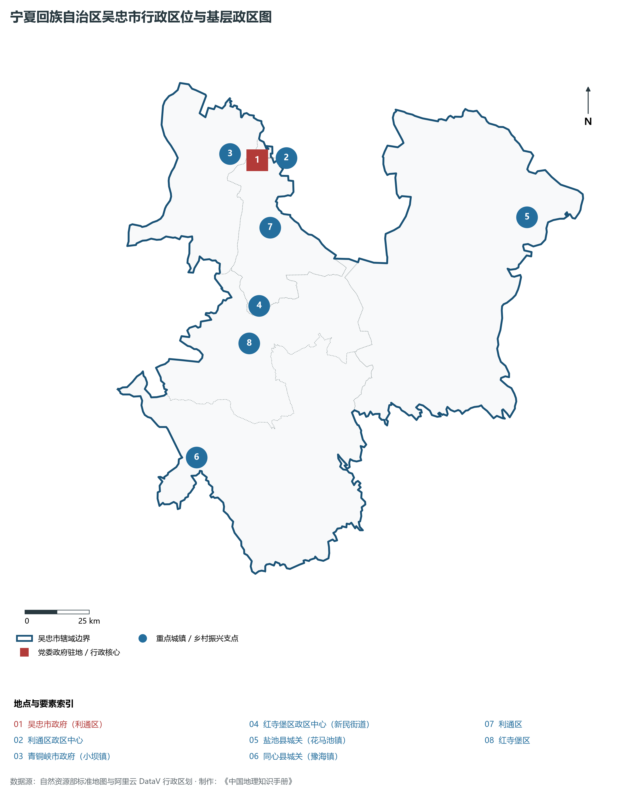
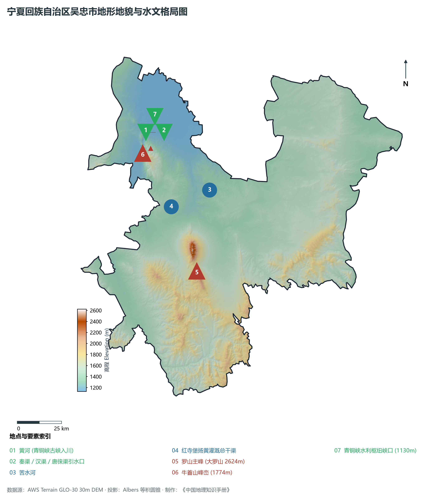
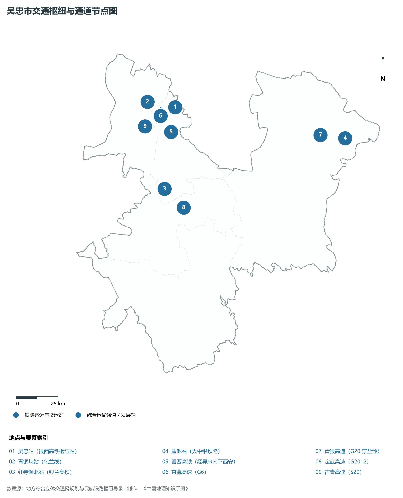
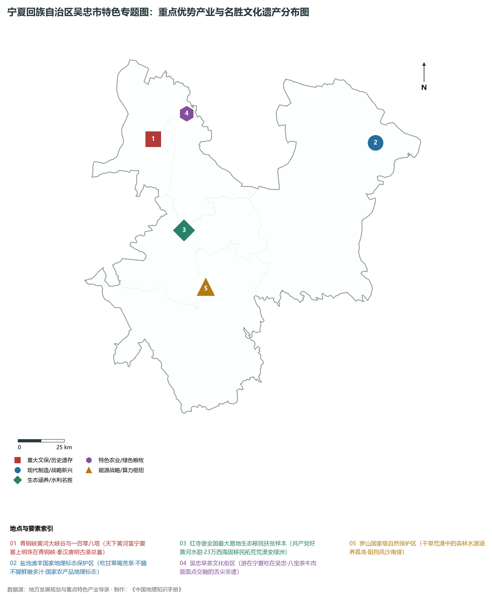
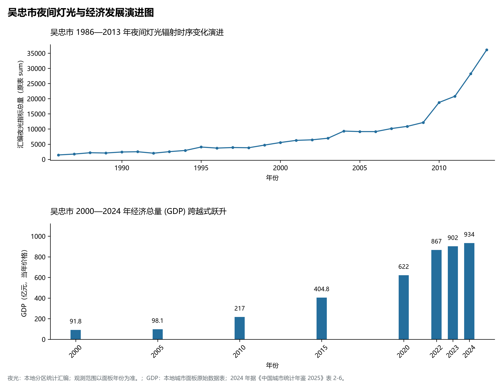

# 31.3 吴忠市

吴忠市，宁夏回族自治区辖地级市，地处宁夏回族自治区中部，北连首府银川市，南接固原市，东邻陕西省榆林市定边县及内蒙古鄂尔多斯市鄂托克前旗，西界中卫市，西北隔贺兰山余脉与内蒙古阿拉善盟相望。黄河穿境而过，是宁夏引黄灌区的核心发轫地、“塞上江南”的精华腹地，享有“中国回族之乡”、“中国早茶文化地标”、“中国滩羊之乡”等诸多美誉。地理坐标介于东经 105°45′—107°39′、北纬 36°40′—38°15′ 之间，东西横跨约 **158 km**，南北纵贯约 **177 km**。全市行政区域土地。2024 年常住人口 **142 万人**，常住人口城镇化率 **58.86%**，地区生产总值 **934 亿元**（当年价格），人均地区生产总值 **66,268 元**，三次产业构成为 **14.02 : 42.83 : 43.15**。

---

## 一、市情速览

| 核心指标 | 全市数据 | 全区位次 / 占比 / 特征 |
|:---|:---|:---|
| **土地总面积** | 21 400.0 km² | 全区第 1 位（占全区总面积约 32.2%） |
| **常住人口 (2024)** | 142 万人 | 2024 年，全市；年鉴公布口径 |
| **常住人口城镇化率** | 58.86% | 2024 年，全市；年鉴公布口径 |
| **地区生产总值 (GDP)** | 934 亿元 | 2024 年，全市；年鉴公布口径 |
| **人均 GDP** | 66,268 元/人 | 2024 年，全市；年鉴公布口径 |
| **三次产业结构** | 14.02 : 42.83 : 43.15 | 2024 年，全市；年鉴公布口径 |
| **最高点 / 最低点** | 大罗山主峰 2 624 m / 青铜峡黄河出峡处 1 130 m | 罗山为中部荒漠绿岛，黄河冲积沃野千里 |
| **黄河过境长度** | 约 69 km | 出青铜峡古峡入川，滋养秦汉唐明古渠系 |
| **重大战略样本** | 全国最大单体易地生态移民集中区（红寺堡） | “共产党好、黄河水甜”，西海固移民致富典范 |

**图 31-03-1 宁夏回族自治区吴忠市行政区位与基层政区图**：图上编号与地点、要素索引对应。

---

## 二、自然地理：九渠之首、罗山绿岛与旱生草原

**图 31-03-2 宁夏回族自治区吴忠市地形地貌与水文格局图**：图上编号与地点、要素索引对应。

### 1. 两大自然地貌单元的鲜明分野

- **西北引黄自流灌区（塞上江南核心区）**：包括利通区全境与青铜峡市平原部。黄河自牛首山与贺兰山余脉之间劈山而出，形成了举世闻名的青铜峡大峡谷。出峡后地势豁然开朗，海拔 1 130—1 150 m，土质肥沃，渠系如织，是宁夏两千年自流灌溉的核心区域；
- **中东部与南部干旱荒漠台地**：包括红寺堡盆地、盐池台地与同心黄土低丘，海拔在 1 300—1 800 m 之间。气候极度干旱（年降水量仅 200—300 mm，蒸发量达 2 000 mm 以上），地表分布大面积荒漠草原、缓坡丘陵与风沙地貌。

### 2. 生态奇观：大罗山荒漠绿岛
在大面积干旱荒漠与黄土丘陵之中，大罗山拔地而起，主峰海拔 **2 624 m**，犹如一座傲然挺立于干旱海浪中的“绿色孤岛”：

- 大罗山地势高耸，有效截留了东南季风与高空气流，年降水量达 400—500 mm，发育着大片油松、杜松、青海云杉等原始次生针叶林与高山草甸；
- 作为宁夏中部唯一的天然水源涵养林区与防风阻沙屏障，罗山国家级自然保护区阻挡了毛乌素沙地与库布齐风沙对宁夏平原腹地的侵袭，生态地位无可替代。

---

## 三、世界灌溉工程遗产与青铜峡水利枢纽

吴忠因黄河水利而生、因古渠开发而兴，被誉为“九渠之首”：

1. **世界灌溉工程遗产·宁夏引黄古渠首**：战国至秦汉时期，蒙恬在此开凿了引黄自流的**秦渠**与**汉渠**；北魏郦道元《水经注》详实记载了其渠网格局；唐代修筑长达数百里的**唐徕渠**，引水口均设于青铜峡大峡谷出口一带。古渠顺应天然地形坡降，无坝引水、排灌兼备，2 200 余年来生生不息，2017 年正式入选世界灌溉工程遗产名录；
2. **青铜峡水利枢纽（万里黄河第一期工程）**：建于 1958 年，是新中国黄河干流上最早修建的大型水利枢纽工程之一。电站大坝巍峨横锁峡谷，不仅结束了两千年无坝引水的历史，更为宁夏平原农田自流灌溉、防汛排凌和绿色水力发电立下了不朽功勋；
3. **青铜峡一百零八塔与大峡谷文保名胜**：大峡谷两岸危崖峭壁，东侧阶梯崖壁上错落分布着始建于西夏时期的**一百零八塔**，依山势自上而下按奇数排列成巨大的等边三角形塔群，是中国现存唯一的佛寺大型古塔群遗存。

---

## 四、长征红色基因与红寺堡生态移民奇迹

1. **同心红色政权发轫与清真寺会见**：1936 年 10 月，中国工农红军西征在此建立了我国历史上第一个县级少数民族自治政权——陕甘宁省豫海县回民自治政府，同心清真大寺成为红军与回族同胞团结抗战的历史见证；
2. **全国最大易地生态移民集中区·红寺堡区**：
   - 20 世纪 90 年代以前，红寺堡是一片风沙肆虐、寸草不生的荒漠戈壁；
   - 伴随着国家“八七”扶贫攻坚战略与宁夏扶贫扬黄灌溉工程的实施，黄河水通过多级大泵站提升数百米跃入红寺堡；
   - 来自西海固“苦瘠甲天下”的固原、海原、西吉、同心等县的 **23 万贫困群众** 搬迁至此。在党和政府带领下，各族群众战天斗地、平整土地、引水植树，把风沙荒原改造为沃野粮仓与万亩葡萄绿洲，被联合国专家誉为“世界减贫史上的东方奇迹”。

---

## 五、综合立体交通网络

**图 31-03-3 吴忠市交通枢纽与通道节点图**：图上编号与地点、要素索引对应。

- **银西高铁交通大枢纽**：吴忠站是银西高铁与银兰高铁的交汇转换枢纽，南下西安仅需 2.5 小时，向北至银川只需 20 分钟，向西通达兰州仅需 2 小时；
- **普铁货运纵横通达**：包兰铁路穿青铜峡而过；太中银铁路横穿盐池县，是西北煤炭与天然气外运的重载铁路动脉；
- **高速公路纵横交错**：京藏高速（G6）连接沿黄城市群，青银高速（G20）自盐池东出陕西太原直达青岛，定武高速（G2012）横贯中部红寺堡与中卫，全域高速路网密度位居自治区前列。

---

## 六、特色优势产业与现代产业演进

**图 31-03-4 宁夏回族自治区吴忠市特色专题图：重点优势产业与名胜文化遗产分布图**：图上编号与地点、要素索引对应。

**图 31-03-5 吴忠市夜间灯光与经济发展演进图**：各面板按标注的观测年份、指标和单位列示。

### 1. 盐池滩羊：国家地理标志金字招牌
盐池县拥有得天独厚的荒漠半荒漠草场，生长着甘草、苦豆子等 170 余种药用牧草，地下水矿化度高：

- 独特的自然环境赋予了“盐池滩羊”肉质鲜嫩、多汁不膻、脂肪分布均匀的优异品质；
- 盐池滩羊品牌价值超百亿元，多次被选定为二十国集团领导人杭州峰会、金砖国家领导人厦门会晤等重大国宴用肉，全产业链产值超百亿元。

### 2. 中国高端奶业之乡：黄金奶源带
吴忠地处国际公认的北纬 38° 黄金奶源带，气候干燥、牧草优质、牛只健康：

- 利通区与青铜峡市建成了全国高标准的现代化智慧奶牛养殖场，规模化养殖率达 100%；
- 引进伊利集团建成全球单体规模最大的全产业链绿色智能化液体乳加工基地，日处理生鲜乳数千吨，吴忠牛奶已成为保障全国高端纯牛奶供应的核心基地。

### 3. “游在宁夏·吃在吴忠”：早茶非遗与全域文旅
吴忠市将特色饮食与文旅消费深度融合，培育出享誉全国的“吴忠早茶”金名片：

- 利通区早茶文化集八宝茶、牛肉拉面、特色面点、手抓羊肉与各种精致小菜于一体，融合了丝路多民族饮食精粹，形成了“早茶+慢生活+文旅康养”的独特消费模式；
- 青铜峡黄河大峡谷、黄河楼、黄河坛与红寺堡葡萄酒庄集群相映成辉，全域旅游蓬勃兴旺。

---

## 七、历年经济总量演进指标对照

| 年份 | 地区生产总值（亿元，当年价格） |
|:---|---:|
| 2000 年 | 91.8 |
| 2005 年 | 98.1 |
| 2010 年 | 217 |
| 2015 年 | 404.8 |
| 2020 年 | 622 |
| 2024 年 | 934 |

吴忠市正以“绿色发展先行市”为方向，在黄河金岸绘就一幅农业现代化、工业绿色化与民族繁荣共享的壮丽画卷！

2024 年统计来源：《中国城市统计年鉴 2025》表 2-1、2-6、2-7（2024 年，全市）。其他年份 GDP 据本地城市面板“原始数据”表，单位为亿元、当年价格。
