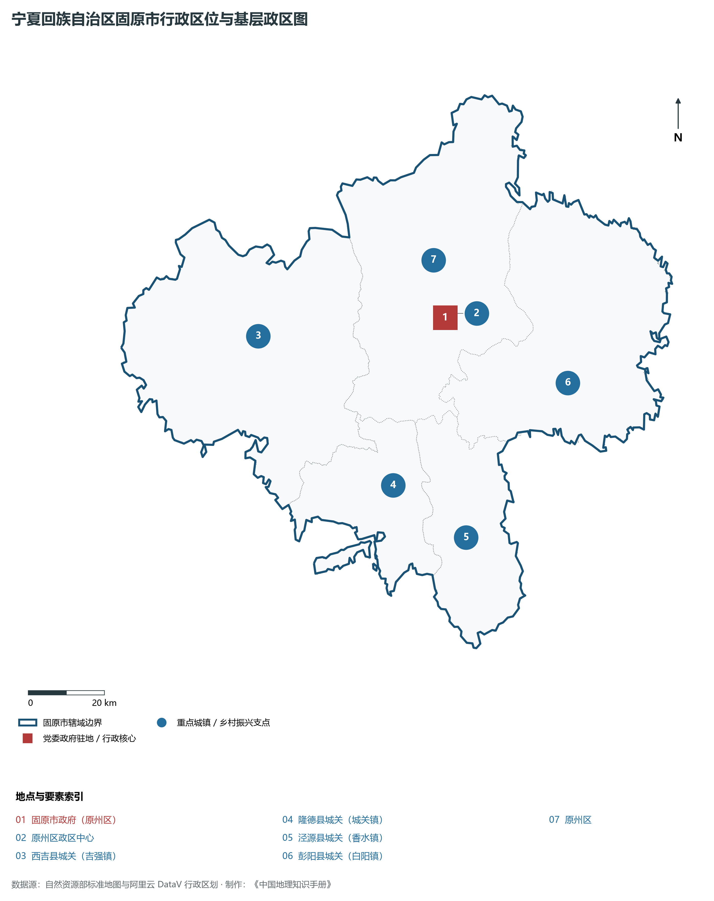
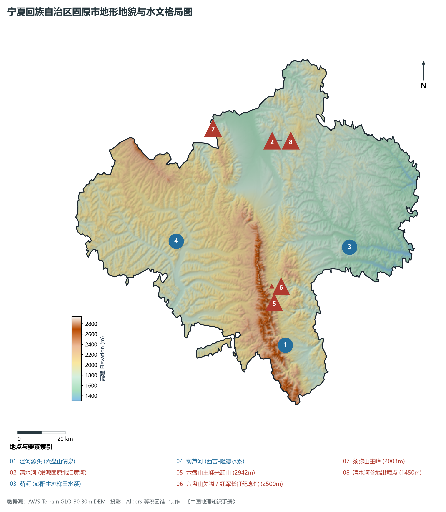
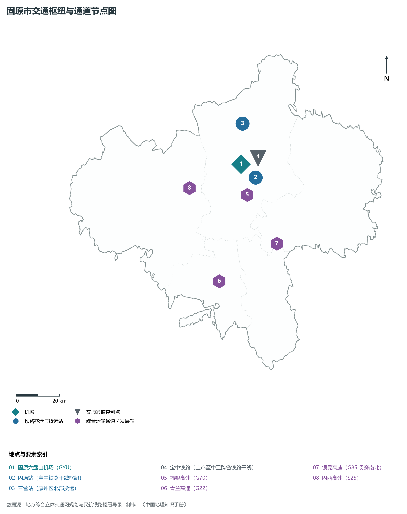
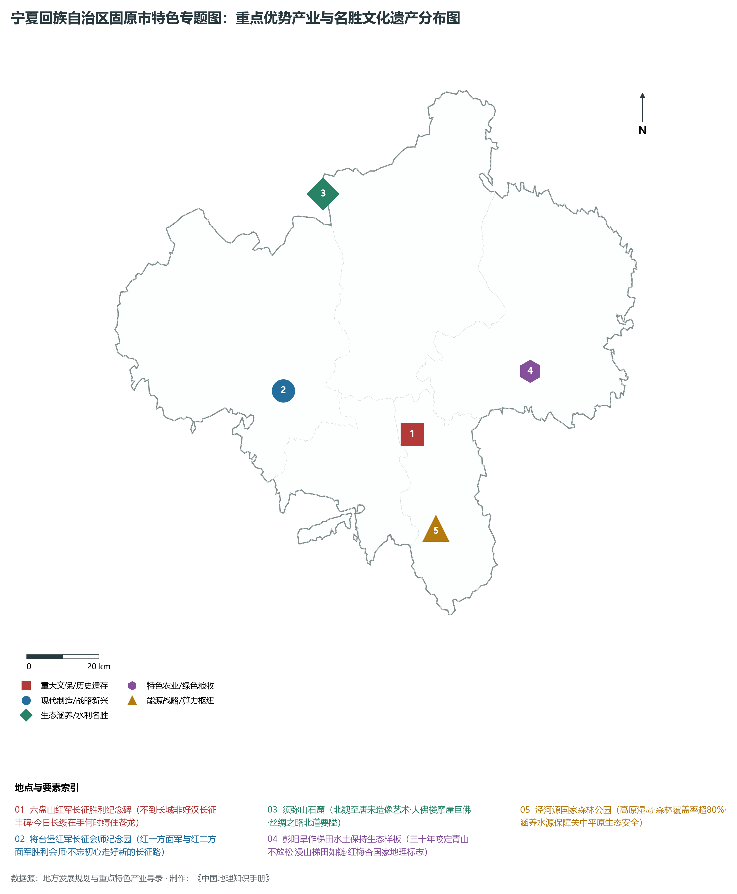
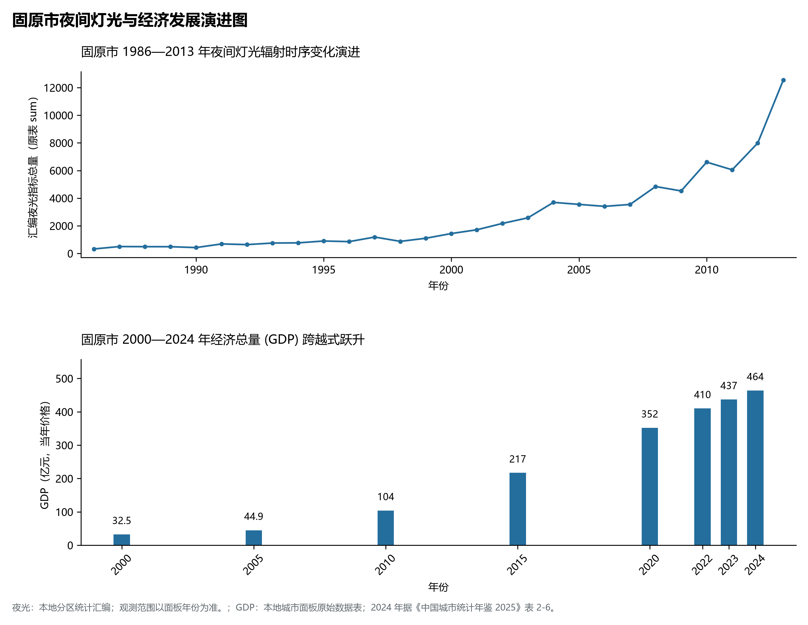

# 31.4 固原市

固原市。2024 年常住人口 **114 万人**，常住人口城镇化率 **46.95%**，地区生产总值 **464 亿元**（当年价格），人均地区生产总值 **40,527 元**，三次产业构成为 **18.51 : 23 : 58.5**。

---

## 一、市情速览

| 核心指标 | 全市数据 | 全区位次 / 占比 / 特征 |
|:---|:---|:---|
| **土地总面积** | 10 540.0 km² | 占全区 15.9%，黄土高原丘陵与六盘山水源区 |
| **常住人口 (2024)** | 114 万人 | 2024 年，全市；年鉴公布口径 |
| **常住人口城镇化率** | 46.95% | 2024 年，全市；年鉴公布口径 |
| **地区生产总值 (GDP)** | 464 亿元 | 2024 年，全市；年鉴公布口径 |
| **人均 GDP** | 40,527 元/人 | 2024 年，全市；年鉴公布口径 |
| **三次产业结构** | 18.51 : 23 : 58.5 | 2024 年，全市；年鉴公布口径 |
| **最高点 / 最低点** | 六盘山米缸山 2 942 m / 泾河峡谷出口 1 300 m | 地貌起伏剧烈，森林覆盖率在泾源县超 50% |
| **水土流失治理率** | 达到 80% 以上 | 彭阳梯田与生态修复成为全国水土保持生态范例 |
| **核心政治文化名片** | 红色长征胜利丰碑、高原湿岛生态水塔、丝路石窟明珠 | 《清平乐·六盘山》发源地、将台堡会师地、须弥山石窟 |

**图 31-04-1 宁夏回族自治区固原市行政区位与基层政区图**：图上编号与地点、要素索引对应。

---

## 二、自然地理：六盘高耸、高原湿岛与四大水系之源

**图 31-04-2 宁夏回族自治区固原市地形地貌与水文格局图**：图上编号与地点、要素索引对应。

### 1. 六盘山脉：黄土高原上的“高原湿岛”
六盘山在固原境内南北纵贯百余公里，主峰米缸山海拔 **2 942 m**，巍峨挺拔，险峻峥嵘：

- **强烈的水汽截留与丰沛降水**：六盘山山势高耸，横阻夏季东南季风，年降水量高达 600—800 mm，局部迎风坡超过 900 mm，年均气温仅 5—7 ℃，夏季凉爽宜人；
- **茂密的天然水源涵养林**：山间发育着成片的华北落叶松、青海云杉、辽东栎与红桦林，森林覆盖率居宁夏之首，被誉为黄土高原干旱海洋中的一座“绿岛水塔”。

### 2. 四大水系的发祥地与涵养中心
固原市境内山水相依，是黄河与长江中上游多条重要支流的发源地与涵养区：

- **泾河水系**：发源于六盘山东麓的泾源县老龙潭，向南奔腾出境滋养甘肃平凉与陕西关中平原，是“关中八水”的重要源头，年涵养径流量数亿立方米；
- **清水河水系**：发源于开城一带，由南向北贯穿固原盆地，沿原州区北上流经海原、同心，最终注入黄河；
- **茹河水系**：发源于六盘山东麓，横穿彭阳县全境，是彭阳百万亩梯田灌溉的生态血脉；
- **葫芦河水系**：发源于西吉县与隆德县，向西南流入甘肃汇入渭河，见证了仰韶文化与马家窑文化的古老繁衍。

---

## 三、丝路重镇、石窟瑰宝与长征丰碑

固原历史底蕴厚重，是古丝绸之路与中国革命史上的两座璀璨丰碑：

1. **丝路北道咽喉与原州古城**：固原地处中原通往西域的捷径要冲，秦昭襄王在此筑秦长城并置安定郡；汉唐时期设原州，为丝绸之路东段北道最繁盛的枢纽，出土的北周田弘墓萨珊波斯银币、鎏金银壶、罗马玻璃碗等国宝，展现了东西方商旅辐辏、使者不绝的盛景；明代设立三边总督府，置固原镇，为北方防御锁钥；
2. **世界级石窟艺术·须弥山石窟**：位于原州区西北，开凿在赭红色丹霞绝壁之上，始建于北魏，历经西魏、北周、隋、唐等朝代持续营建。现存石窟 162 座，造像千余尊。大佛楼内高达 **20.6 m** 的唐代弥勒摩崖大佛气宇轩昂，是我国古代石窟艺术的杰出代表；
3. **红军长征翻越的最后一座高山·六盘山**：1935 年 10 月，毛泽东率领中央红军冲破国民党军的重重封锁，胜利翻越六盘山。在六盘山峰巅，面对初升红日与如洗秋空，毛泽东极目远眺、豪情万丈，吟咏出气壮山河的千古词作《清平乐·六盘山》：
   > “天高云淡，望断南飞雁。不到长城非好汉，屈指行程二万。六盘山上高峰，红旗漫卷西风。今日长缨在手，何时缚住苍龙？”
4. **长征胜利大会师·西吉将台堡**：1936 年 10 月 22 日，中国工农红军第一方面军与第二方面军在西吉县将台堡举行胜利会师，标志着具有伟大历史意义的长征宣告胜利结束。2016 年 7 月，习近平总书记视察将台堡并发出“不忘初心、走好新的长征路”的伟大号召。

---

## 四、西海固脱贫攻坚与生态奇迹：彭阳梯田

固原曾是“西海固”贫困板块的核心区。这里山大沟深、干旱少雨、植被稀疏，一度陷入“越穷越垦、越垦越穷”的恶性循环：

- **绝地蝶变：彻底消灭绝对贫困**：在党中央关怀、闽宁协作对口帮扶与全区干部群众苦干实干下，固原通过实施易地搬迁、退耕还林、产业扶持、劳务输出与教育脱贫，全市 5 县区全部摘掉贫困帽，历史性解决了千百年来的绝对贫困问题；
- **生态样板：彭阳梯田生态工程**：自 1983 年建县以来，彭阳县干部群众坚持数十年如一日，战荒山、修梯田、护山林。运用科学的“改坡造梯、山顶植树、山腰梯田、沟底筑坝”水土保持综合治理模式，将昔日千沟万壑的荒山秃岭雕琢为漫山遍野的层叠梯田。彭阳全县梯田面积达 **80 余万亩**，水土流失治理率超过 80%，被誉为“中国最美旱作梯田”与国家水土保持生态文明工程典范。

---

## 五、综合立体交通走廊

**图 31-04-3 固原市交通枢纽与通道节点图**：图上编号与地点、要素索引对应。

- **宝中铁路骨干动脉**：宝中铁路穿越六盘山峡谷，北接中卫包兰线、南通陕西宝鸡陇海线，固原站作为全线最大的客货综合车站，是大宗物资出省通道；
- **国家高速公路十字大枢纽**：福银高速（G70）向西北通达银川、向东南直抵西安；青兰高速（G22）横穿南部隆德；银昆高速（G85）贯穿彭阳纵连西南，实现“县县通高速、乡乡通油路”；
- **高高原民航门户**：固原六盘山机场（GYU）海拔 1 700 m，开通直飞银川、西安、北京、上海等主要城市航线，架起了六盘山走向全国的空中金桥。

---

## 六、特色优势产业与绿色经济崛起

**图 31-04-4 宁夏回族自治区固原市特色专题图：重点优势产业与名胜文化遗产分布图**：图上编号与地点、要素索引对应。

**图 31-04-5 固原市夜间灯光与经济发展演进图**：各面板按标注的观测年份、指标和单位列示。

### 1. 高原冷凉蔬菜：直供粤港澳大湾区
得益于高海拔、无污染、日照长、夏季温凉无高温的自然气候，固原成为全国公认的高原冷凉蔬菜黄金产区：

- 西兰花、菜心、娃娃菜、芹菜等种植面积达 **50 万亩**，产品质地脆嫩、糖分高、富含硒微量元素；
- 取得供港澳蔬菜基地认证，每天数十辆冷链车直通粤港澳大湾区与长三角高端商超。

### 2. 西吉马铃薯与六盘山黄牛肉

- **中国马铃薯之乡（西吉县）**：原州与西吉黄土土层疏松、昼夜温差大，是脱毒种薯原种繁育与商品薯加工基地，“西吉马铃薯”获国家地理标志认证，淀粉、粉丝、全粉畅销海内外；
- **六盘山优质黄牛肉**：以秦川牛、安格斯牛杂交改良为主，推行科学舍饲育肥，肉质大理石花纹丰富，成为高端牛肉市场的知名名牌。

### 3. 生态康养与全域红色文旅
固原市将清凉气候资源与厚重红色文化有机融合：

- 打造“天高云淡六盘山”全域文旅品牌，避暑度假、重走长征路红色研学与长城古道探秘相得益彰，旅游综合收入年年迈上新台阶。

---

## 七、历年经济总量演进指标对照

| 年份 | 地区生产总值（亿元，当年价格） |
|:---|---:|
| 2000 年 | — |
| 2005 年 | 44.9 |
| 2010 年 | 104 |
| 2015 年 | 217 |
| 2020 年 | 352 |
| 2024 年 | 464 |

固原市正牢记“走好新的长征路”殷殷嘱托，筑牢六盘山生态安全屏障，在绿色低碳与乡村全面振兴的新征程上阔步前行！

2024 年统计来源：《中国城市统计年鉴 2025》表 2-1、2-6、2-7（2024 年，全市）。其他年份 GDP 据本地城市面板“原始数据”表，单位为亿元、当年价格。
