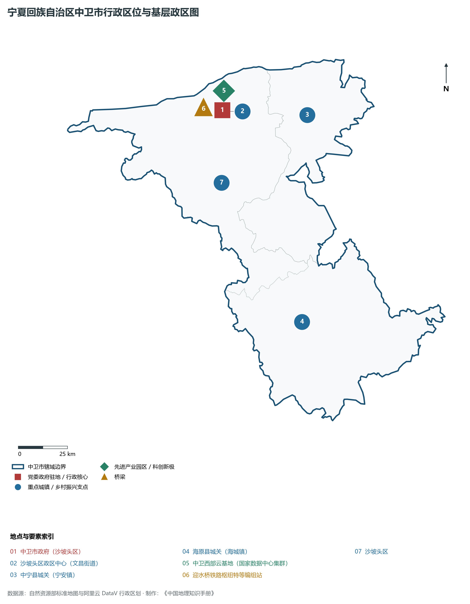
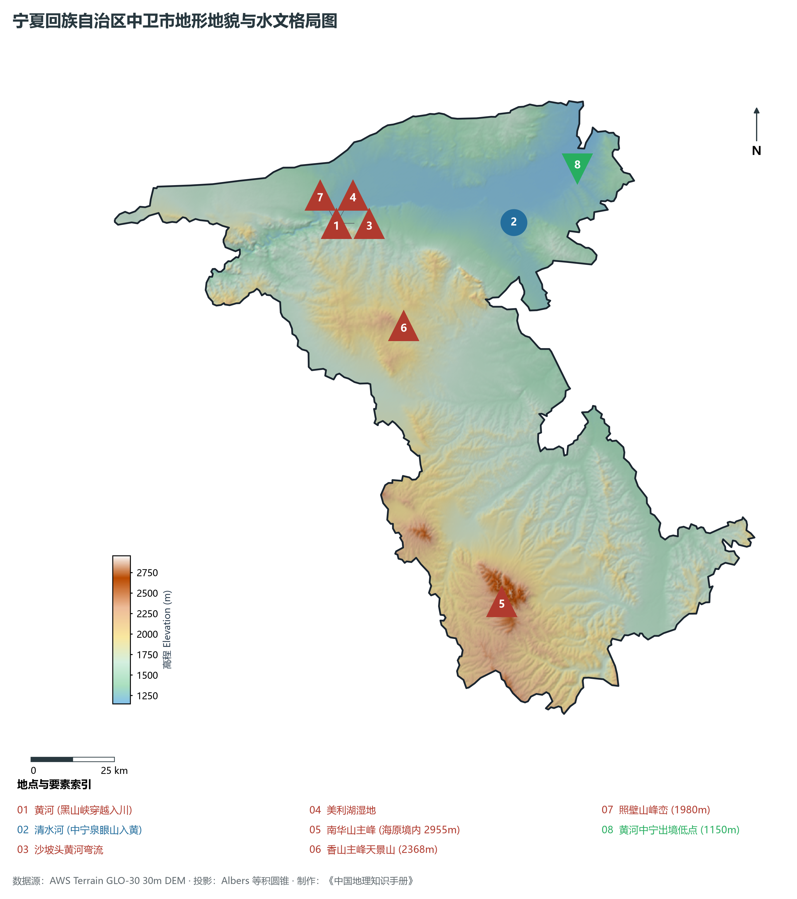
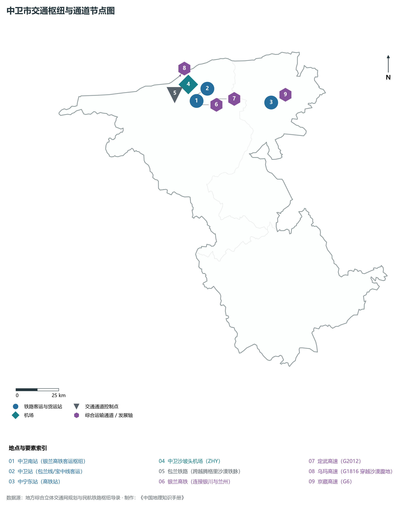
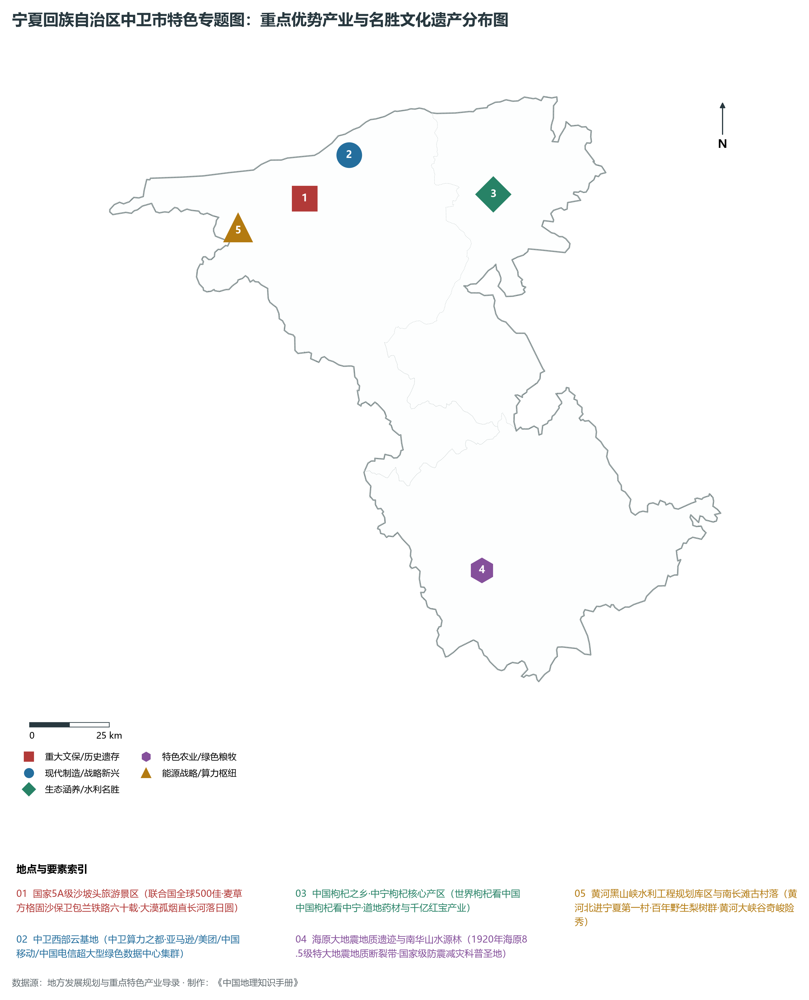
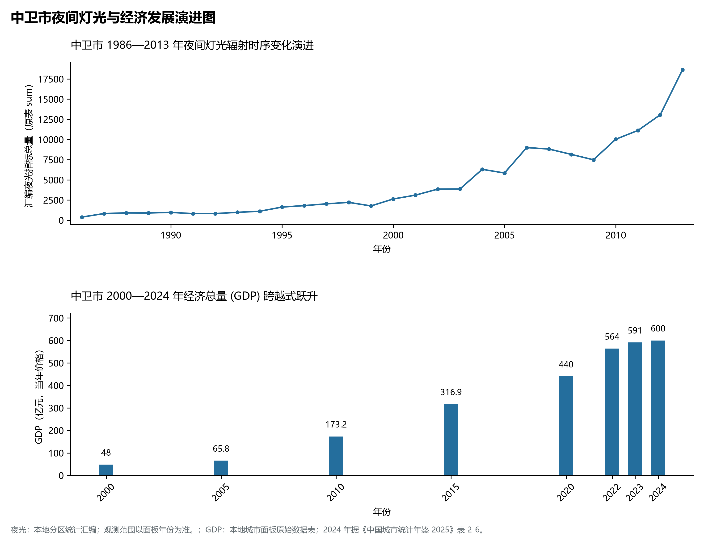

# 31.5 中卫市

中卫市。2024 年常住人口 **108 万人**，常住人口城镇化率 **52.82%**，地区生产总值 **600 亿元**（当年价格），人均地区生产总值 **55,568 元**，三次产业构成为 **14.52 : 31.52 : 53.95**。

---

## 一、市情速览

| 核心指标 | 全市数据 | 全区位次 / 占比 / 特征 |
|:---|:---|:---|
| **土地总面积** | 17 448.0 km² | 占全区 26.3%，版图辽阔，涵盖沙漠、绿洲与高原 |
| **常住人口 (2024)** | 108 万人 | 2024 年，全市；年鉴公布口径 |
| **常住人口城镇化率** | 52.82% | 2024 年，全市；年鉴公布口径 |
| **地区生产总值 (GDP)** | 600 亿元 | 2024 年，全市；年鉴公布口径 |
| **人均 GDP** | 55,568 元/人 | 2024 年，全市；年鉴公布口径 |
| **三次产业结构** | 14.52 : 31.52 : 53.95 | 2024 年，全市；年鉴公布口径 |
| **最高点 / 最低点** | 南华山主峰 2 955 m / 黄河中宁出境处 1 150 m | 地貌垂直跨度大，沙漠与黄河落差壮丽奇崛 |
| **黄河过境长度** | 约 182 km | 占宁夏全境黄河长度的 45.8%，黄河入宁第一站 |
| **核心世界级名片** | 沙坡头麦草方格治沙奇迹、国家算力网络枢纽、中宁枸杞 | 联合国“全球 500 佳”、国家一体化数据中心集群 |

**图 31-05-1 宁夏回族自治区中卫市行政区位与基层政区图**：图上编号与地点、要素索引对应。

---

## 二、自然地理：黑山峡入川、腾格里瀚海与卫宁冲积平原

**图 31-05-2 宁夏回族自治区中卫市地形地貌与水文格局图**：图上编号与地点、要素索引对应。

### 1. 黄河入宁第一站与黑山峡大峡谷
黄河自甘肃靖远下行，在南长滩切穿深邃峡谷浩荡入宁：

- **黑山峡**：两岸峭壁如削、水流湍急，保留了黄河上游极为纯净原始的大峡谷风貌与规划中的国家重大水利枢纽工程坝址；
- **南长滩与北长滩古村**：黄河北进宁夏的第一村，背靠石山、面迎黄河，村内百年野生梨树成林，土石古屋错落，入选中国历史文化名村；
- **出峡入川的卫宁平原**：黄河在沙坡头摆脱深峡束缚，进入地势开阔平坦的卫宁平原（海拔 1 150—1 250 m），泥沙沉淀、引渠密布，造就了良田连绵的“塞上小江南”。

### 2. 沙漠与绿洲相拥：腾格里沙漠边缘
中卫西北部深入腾格里沙漠腹地，沙丘起伏、广袤无垠。在沙坡头，高达百米的金黄色格状流动沙丘直接倾泻至黄河岸边，构成了“大漠孤烟直，长河落日圆”千古绝唱的真实地理图景。

### 3. 中部香山与南部南华山

- **香山（天景山）**：横亘于中卫中部，主峰海拔 **2 368 m**，山体苍凉干旱，山麓曾因富含硒砂矿物质而闻名；
- **南华山（海原水源屏障）**：位于南部海原县，主峰海拔 **2 955 m**，是中卫市最高峰。山间生长着大片天然青海云杉与灌木林，涵养水源，是海原干旱山区不可多得的生态避难所。

---

## 三、世界治沙奇迹：沙坡头麦草方格与包兰铁路

沙坡头不仅是自然风景名胜，更是人类征服流沙的科技丰碑：

1. **包兰铁路的“生死挑战”**：1958 年通车的包兰铁路是我国第一条穿越沙漠的干线铁路。在沙坡头段，铁路需要在腾格里沙漠边缘连续穿越 **55 km** 的高大流动沙丘群，沙漠狂风肆虐、沙丘年移动速度达数十米，联合国专家曾预言“包兰铁路通车不久就会被流沙吞没”；
2. **“麦草方格”生物机械固沙法**：中国科学院科研人员与中卫固沙林场职工经过成百上千次试验，创造性发明了 **1 米见方的“麦草方格”固沙技术**：
   - 职工手持铁锹将麦草对折压入沙中 10—15 cm，露出沙面 15—20 cm，结成密密匝匝的网格；
   - 麦草方格有效增大了地表粗糙度，减小风速，使沙面不易起动，同时截留微量降水，在方格内形成微结皮生物土壤层；
   - 在方格内进一步播种柠条、花棒、沙拐枣等旱生耐风沙灌木，构筑起“草方格固沙+灌木林防沙+封沙育草”的“五带一体”综合防沙治沙防护林体系；
3. **享誉世界的绿色传奇**：六十多年来，狂沙退避，包兰铁路穿越沙漠风雨无阻、从未因风沙侵袭而中断运行，创造了沙漠铁路畅通运行的国际奇迹。沙坡头治沙工程荣获国家科技进步特等奖，并被联合国环境规划署评选为“全球 500 佳环境保护奖”。

---

## 四、历史文脉与海原大地震地质丰碑

1. **中卫高庙（三教合一的建筑奇观）**：始建于明永乐年间，依山就势、层楼叠阁，集儒、释、道三教于一殿。全庙占地面积仅 4 000 多平方米，却建有楼阁殿宇 240 余间，飞檐斗拱、巧夺天工，展现了塞上古刹独特的建筑美学；
2. **海原 1920 年 8.5 级特大地震地质遗迹**：1920 年 12 月 16 日，海原发生里氏 8.5 级特大地震，震中烈度达 12 度，山崩地裂、山河改观，是人类有仪器记录以来陆内最大地震之一。至今海原县境内完整保留着长达 **237 km** 的地震地表断裂带、哨马营滑坡堵江堰塞湖、干盐池错断水系等珍贵地质遗迹，是全球防震减灾与第四纪新构造运动的“世界级活教科书”。

---

## 五、综合立体交通枢纽

**图 31-05-3 中卫市交通枢纽与通道节点图**：图上编号与地点、要素索引对应。

- **高铁加速融入西北大网**：银兰高铁中卫南站是连接银川、兰州的重要换乘节点，中卫至兰州由原先普速列车近 6 小时压缩至 1.5 小时内，至银川仅需 1 小时；
- **铁路“黄金枢纽”迎水桥编组站**：迎水桥特等货运编组站是西北地区最大的铁路枢纽编组站之一，包兰线、宝中线、太中银线交汇于此，担负着西北与华北、西南大宗物资与能源货运的重载中转重任；
- **穿越大漠的国家高速通道**：定武高速（G2012）向西直达甘肃武威接连霍高速，乌玛高速（G1816）沙漠段是我国首条穿越腾格里沙漠腹地的高速公路，中卫沙坡头机场（4C）架起通达主要客源地城市的空中航线。

---

## 六、特色优势产业与现代产业跃迁

**图 31-05-4 宁夏回族自治区中卫市特色专题图：重点优势产业与名胜文化遗产分布图**：图上编号与地点、要素索引对应。

**图 31-05-5 中卫市夜间灯光与经济发展演进图**：各面板按标注的观测年份、指标和单位列示。

### 1. “中国算力之都”：中卫西部云基地
地处全国陆地几何中心的中卫市，以其独特地理禀赋赢得了国家战略青睐：

- **天然冷凉与超低 PUE 能效**：干燥凉爽的气候使得数据中心常年可采用全自然风冷，平均电价低廉，光伏、风电等绿电供给充沛，数据中心电能利用效率（PUE）普遍控制在 1.15 以下，处于全球领先水平；
- **国家战略枢纽**：获批建设全国一体化算力网络国家枢纽节点、国家新型互联网交换中心，建成亚马逊 AWS、中国移动、中国电信、中国联通、美团、广济等数十座大型及超大型数据中心，标准机架超 8 万架，算力规模持续跃升，构建起面向京津冀、长三角、大湾区的“东数西算”强大引擎。

### 2. “中国枸杞之乡”：中宁红宝药材
中宁县是世界枸杞的发源地与核心产区，享有 600 余年的药用栽培历史：

- 得益于黄河水与清水河苦咸水交汇浇灌及碱性土壤，中宁枸杞果粒皮薄肉厚、籽少肉满、营养丰富，药用成分枸杞多糖含量极高；
- 形成集种植、原浆榨汁、冻干粉、枸杞酒、保健药品于一体的全产业链，品牌价值突破百亿元大关。

### 3. 全域文旅与“大漠星空”文旅新地标
中卫市立足黄河与沙漠的旷世奇观，创新打造文旅新IP：

- **沙坡头与“黄河宿集”**：以黄河边古村落修复为载体，引入国内顶尖野奢度假品牌，打造享誉国际的中国版高端度假宿集；
- **大漠星空旅游**：依托无光污染的通透夜空，建设“星星酒店”、“大漠帐篷营地”，让游客躺在沙海中看银河，引领西北沙漠度假新风潮。

---

## 七、历年经济总量演进指标对照

| 年份 | 地区生产总值（亿元，当年价格） |
|:---|---:|
| 2000 年 | — |
| 2005 年 | 65.8 |
| 2010 年 | 173.2 |
| 2015 年 | 316.9 |
| 2020 年 | 440 |
| 2024 年 | 600 |

中卫市正以“绿色算力之都、沙漠水城典范”为坐标，守护黄河入宁第一道生态闸门，在浩瀚大漠与绿色云海之间绽放新时代华彩！

2024 年统计来源：《中国城市统计年鉴 2025》表 2-1、2-6、2-7（2024 年，全市）。其他年份 GDP 据本地城市面板“原始数据”表，单位为亿元、当年价格。
