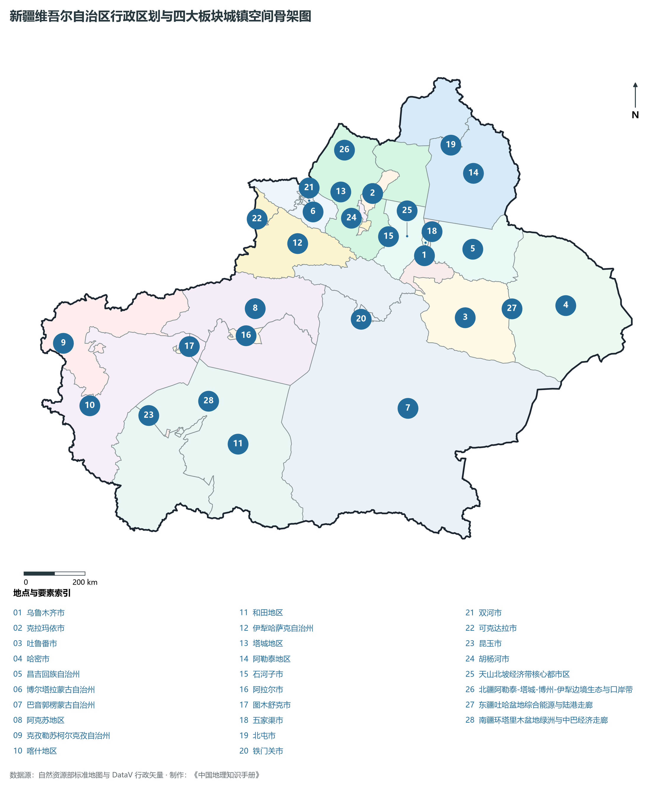
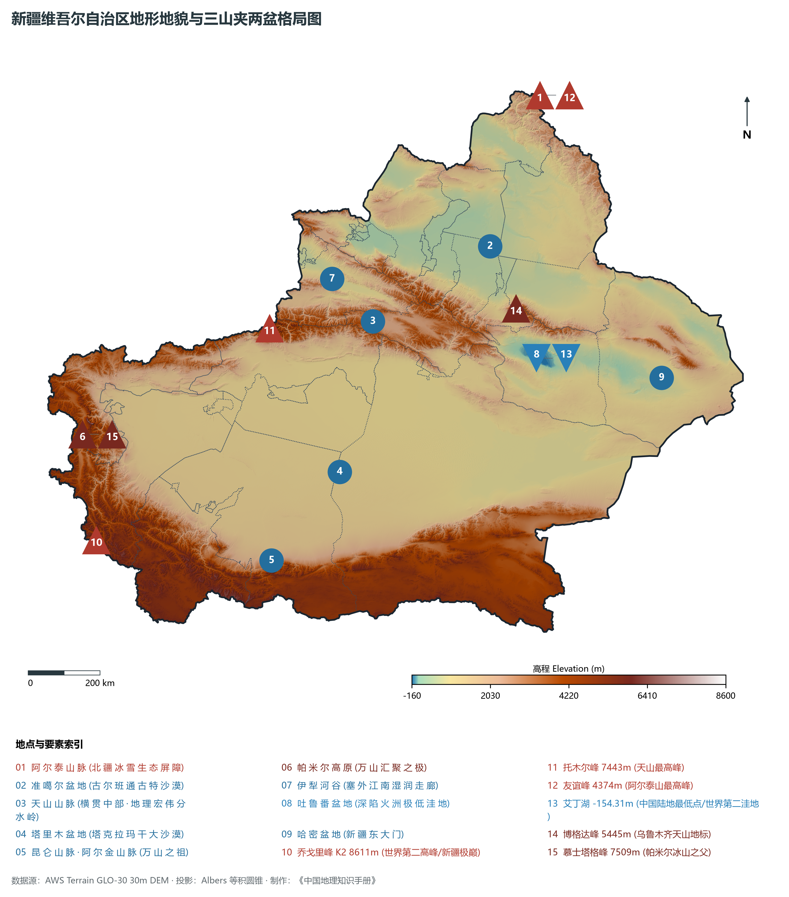
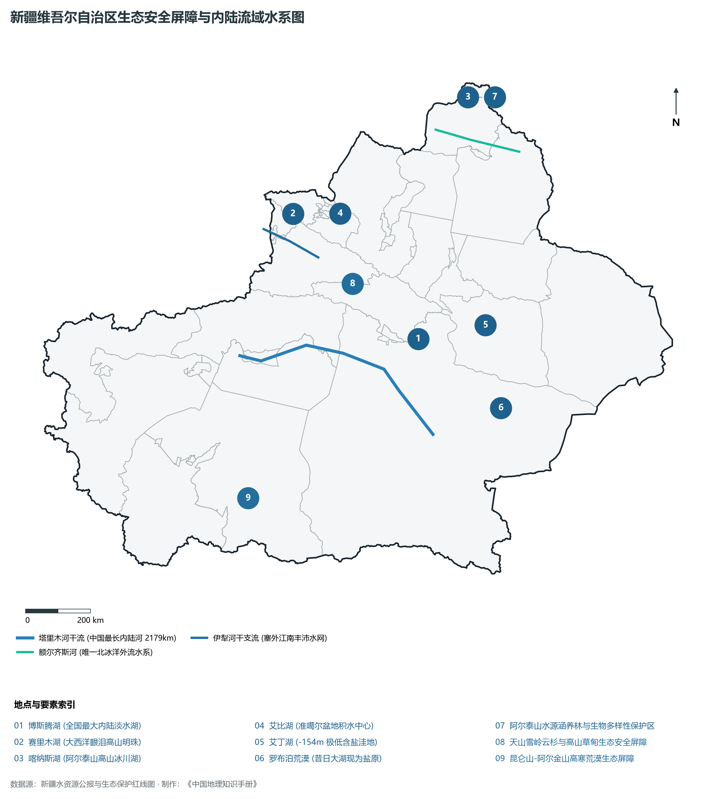
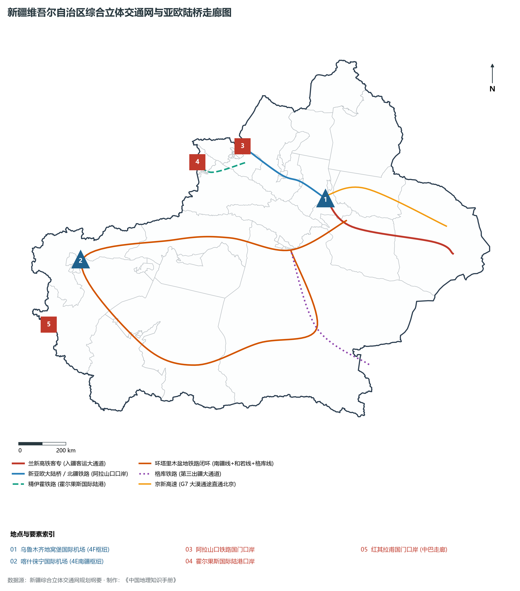
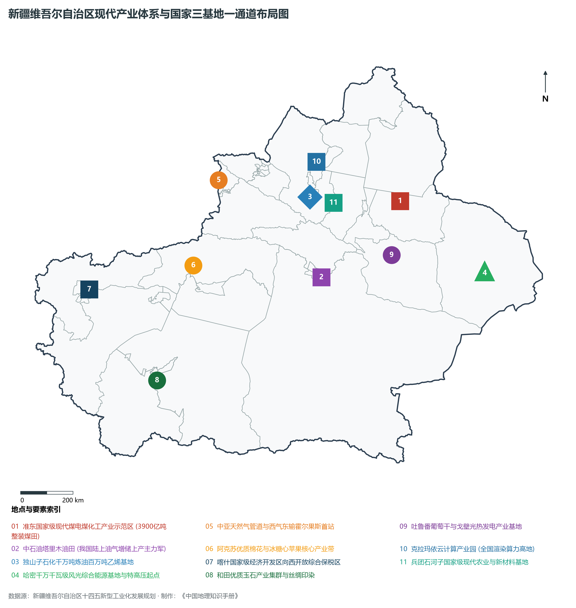

# 32.0 新疆维吾尔自治区地理统揽

在欧亚大陆的心脏地带与祖国辽阔的西北边陲，新疆维吾尔自治区宛如一方磅礴无垠的金色锦缎，雄踞于天山南北与丝绸之路核心走廊。地理坐标介于东经 73°40′—96°23′、北纬 34°25′—49°10′ 之间，东西横跨逾 **2 000 km**，南北纵贯约 **1 650 km**。全区陆地总面积达 **166.49 万 km²**，约占中国陆地国土总面积的六分之一（17.3%），是我国陆地面积最大、交界邻国最多（周边与俄罗斯、哈萨克斯坦、吉尔吉斯斯坦、塔吉克斯坦、巴基斯坦、蒙古、印度、阿富汗 8 国接壤，陆地国界线长达 **5 700 多 km**）、内陆水热分异最极致、战略纵深最辽阔的省级行政区。全区辖 4 个地级市（乌鲁木齐、克拉玛依、吐鲁番、哈密）、5 个地区（阿克苏、喀什、和田、塔城、阿勒泰）、5 个自治州（昌吉回族自治州、博尔塔拉蒙古自治州、巴音郭楞蒙古自治州、克孜勒苏柯尔克孜自治州、伊犁哈萨克自治州），以及由自治区和新疆生产建设兵团双重领导的 12 个兵团直辖县级市（石河子、阿拉尔、图木舒克、五家渠、北屯、铁门关、双河、可克达拉、昆玉、胡杨河、新星、白杨等）。2024 年末全区常住人口达到 **2 600.0 万人**，常住人口城镇化率达 **60.5%**；2024 年全区地区生产总值（GDP）突破 **20 500.0 亿元**（按不变价格计算同比增长约 6.1%），人均 GDP 跃升至 **7.88 万元**。

“三山夹两盆，万水归大漠；丝路贯东西，天山立宏屏。”新疆宏伟壮丽的地理空间，在地球构造演化史上呈现出绝无仅有的“两盆夹三山”大圈层骨架：北部阿尔泰山巍峨绵延，银装素裹、金矿蕴藉；中部天山横贯东西，雄伟的雪峰与冰川将全疆天然分野为北疆与南疆；南部昆仑山与阿尔金山、帕米尔高原巍然屹立，筑牢青藏高原北缘与西陲的坚实屏障。在这三列巨型山脉之间，紧紧环抱着中国第二大内陆盆地准噶尔盆地与第一大内陆盆地塔里木盆地。浩瀚的塔克拉玛干沙漠与古尔班通古特沙漠苍茫无垠，冰雪融水汇聚而成的塔里木河、额尔齐斯河与伊犁河蜿蜒流淌，在山麓冲积扇前滋养出璀璨如珠链的绿洲群落。从公元前 60 年西汉设立西域都护府，到唐代安西、北庭两大都护府，再到清乾隆年间定名“新疆”并于 1884 年建省；从汉代张骞凿空西域、班超投笔从戎，到左宗棠抬棺西征收复天山南北；从王震将军率十万大军“铸剑为犁”、创立新疆生产建设兵团，到新时代高质量建设丝绸之路经济带核心区、国家“三基地一通道”（大型油气生产加工和储备基地、大型煤炭煤电煤化工基地、大型风电光伏基地、国家能源资源陆上大通道）与中国（新疆）自由贸易试验区，新疆始终是国家稳固西北边陲、拓展对外开放、维护能源资源安全与维系多民族守望相助的大国重器。

---

## 一、区情速览

新疆维吾尔自治区是我国向西开放的战略前沿、丝绸之路经济带核心区、国家重要战略能源资源储备基地与西北生态安全屏障。

| 核心指标 | 全区数据 | 战略定位 / 全国位次 / 显著特征 |
|:---|:---|:---|
| **土地总面积** | 166.49 万 km² | 全国第 1 位（占全国陆地面积约 17.3%） |
| **常住人口 (2024)** | 2 600.0 万人 | 47 个民族在此生息繁衍，少数民族人口占 57% 以上 |
| **常住人口城镇化率** | 60.5% | 乌鲁木齐与克拉玛依超 95%，兵团城镇化率超 72% |
| **地区生产总值 (GDP)** | 20 500.0 亿元 (2024) | 首次跨越 2 万亿元大关，连年保持中高速增长 |
| **人均 GDP** | 78 850 元 | 克拉玛依人均居全国前列，天山北坡城市群高度富庶 |
| **三次产业结构** | 13.8 : 41.2 : 45.0 | 优质棉花与林果支柱巩固，能化支柱强劲，向西开放服务能级提升 |
| **地貌极值（最高/最低）** | 乔戈里峰 8 611 m / 艾丁湖 -154.31 m | 垂直地貌相对高差达 8 765 m，居全球各省区前列 |
| **陆地边界线 / 对外口岸** | 5 700 多 km / 20 余个国家一类口岸 | 阿拉山口、霍尔果斯为中欧班列出境两大国家级枢纽港 |
| **棉花产量 / 全国占比** | 535 万吨 / 逾 90% | 连续多年稳居全国首位，全球重要优质高产商品棉基地 |
| **油气与新能源产量** | 油气当量突破 6 600 万吨 / 新能源装机超 8 000 万 kW | 全国陆上油气增储上产主力军，大型风光火储多能互补大基地 |

**图 32-00-2 新疆维吾尔自治区行政区划与四大板块城镇空间骨架图**：图上编号与地点、要素索引对应。

---

## 二、自然地理：“三山夹两盆”构造巨幅长卷

**图 32-00-1 新疆维吾尔自治区地形地貌与三山夹两盆格局图**：图上编号与地点、要素索引对应。

### 1. 三大巨型山系与水热生态屏障

- **阿尔泰山脉（北部金色长垣）**：呈西北—东南走向斜卧于中蒙俄哈四国交界，长约 1 650 km（中国境内约 500 km），主峰友谊峰海拔 **4 374 m**。古生代褶皱断块山，受大西洋与北冰洋湿润气流迎风抬升，山地降水充沛（600—1 000 mm），发育有我国最典型的西伯利亚泰加林针叶林带（喀纳斯落叶松与云杉）以及额尔齐斯河、乌伦古河发源冰川；
- **天山山脉（横贯中部的天际巨屏）**：东西横亘 2 500 km（中国境内约 1 700 km），宽 250—350 km，主峰托木尔峰海拔 **7 443 m**，东段博格达峰海拔 **5 445 m**。天山将新疆截然划分为自然地理特征各异的南疆与北疆。天山不仅阻隔了南北气团的交绥，更截留了来自大西洋深远的水汽输送，成为新疆内陆绿洲最核心的“固体水塔”，发育现代冰川 9 000 余条，总面积超 9 200 km²；
- **昆仑山—阿尔金山脉（南部崇山险隘）**：昆仑山西起帕米尔高原，横贯南疆南部，向东接阿尔金山与祁连山，主峰公格尔峰海拔 **7 649 m**，慕士塔格峰海拔 **7 509 m**，西南段更有世界第二高峰乔戈里峰（K2，海拔 **8 611 m**）。巨型山地巍然壁立于青藏高原北缘，海拔多在 5 000—6 000 m 以上，山巅常年积雪不化，是塔里木盆地南部和田河、车尔臣河等生命之源。

### 2. 两大内陆盆地与荒漠瀚海

- **准噶尔盆地（北疆微倾盆地）**：西高东低，略呈三角形，面积约 38 万 km²。中部为古尔班通古特沙漠（面积约 4.88 万 km²），是我国第二大沙漠、最大的半固定沙漠。由于西部额敏谷地和阿拉山口有敞开缺口，大西洋水汽得以深入，年降水量 150—250 mm，冬春季积雪稳定，沙漠内部覆盖着茂密的梭梭与白梭梭荒漠灌木；
- **塔里木盆地（世界级封闭盆地）**：中国面积最大内陆盆地，面积约 53 万 km²。盆地内部被世界第二大流动沙漠——塔克拉玛干沙漠（面积 33.7 万 km²，维吾尔语意为“进得去出不来”）完全覆盖。沙丘流动性极强，形态多变，年降水量多在 50 mm 以下（盆地东部罗布泊地区不足 10 mm），而年蒸发量高达 2 500—3 400 mm，是我国乃至欧亚大陆干旱干热的核心区。

### 3. 典型内陆极端干旱区气候与立体分异
新疆远离海洋，深居欧亚大陆腹地，四周高山阻绝，形成典型的**温带温凉大陆性干旱气候**：

- **光热富集与昼夜温差**：全区年日照时数长达 2 550—3 500 小时，居全国前列。无霜期南疆达 200—240 天，北疆 150—180 天。昼夜温差常年在 12—18 ℃ 之间，“早穿皮袄午穿纱，围着火炉吃西瓜”，促使哈密瓜、吐鲁番葡萄、阿克苏苹果、库尔勒香梨等作物芳香与糖分深度沉积；
- **风区分布与风能高地**：地形狭管效应显著，全区发育有达坂城、百里风区、三十里风区、阿拉山口、额敏老风口等全国著名九大风区，年有效风时在 5 000—6 500 小时以上，孕育了全国规模最浩大的风力发电清洁能源长廊。

---

## 三、水文水系与生态安全安全屏障

**图 32-00-5 新疆维吾尔自治区生态安全屏障与内陆流域水系图**：图上编号与地点、要素索引对应。

### 1. 内陆河流网络与唯一外流水系
新疆河流总数达 570 余条，地表径流总储量约 880 亿 m³，其中 95% 以上为内流河：

- **塔里木河（中国最长内陆河）**：全长 **2 179 km**（以叶尔羌河为源全长 2 486 km），流域面积 102 万 km²。由阿克苏河、叶尔羌河、和田河汇流而成，沿盆地北部奔腾东流，在沙漠边缘发育有全球面积最大的原始胡杨林生态走廊，尾闾注入台特玛湖。自 2000 年以来实施连续 20 余次生态输水，使下游几近断流干涸的生态断带重新恢复生机；
- **伊犁河（新疆径流量最丰沛国际河流）**：发源于天山北麓，三支汇合后向西穿出伊犁河谷，注入哈萨克斯坦巴尔喀什湖。中国境内长 442 km，年径流量达 **166 亿 m³**，占全疆地表水总量的五分之一，造就了水丰草美、沃野千里的“塞外江南”；
- **额尔齐斯河（中国唯一北冰洋水系外流河）**：发源于阿尔泰山南坡，自东南向西北横穿阿勒泰地区，流经哈萨克斯坦、俄罗斯后汇入鄂毕河注入北冰洋。中国境内长 546 km，年均径流量逾 **110 亿 m³**，沿岸水草繁茂、河谷林连绵如画；
- **玛纳斯河与开都河—孔雀河**：玛纳斯河是天山北坡最大的绿洲农业内陆河；开都河穿天山峡谷流注博斯腾湖，博斯腾湖（水域面积 1 600 余 km²）溢出为孔雀河，是我国最大的内陆微咸/淡水吞吐湖。

### 2. 生态安全红线与山水林田湖草沙综合治理
新疆生态本底极度脆弱，呈现“绿洲生存、荒漠环抱、冰川维系”的严峻特征：

- **绿洲面积占比不足 10%，却承载了 95% 以上的人口与经济活动**；
- 全区建立起阿尔泰山两河源头、天山西部、塔里木胡杨林、阿尔金山国家级自然保护区等重要生态安全红线；在塔克拉玛干沙漠边缘坚决实施防沙治沙阻击战，构建环盆地锁边林网与柯柯牙百万亩荒漠绿化奇迹。

---

## 四、综合立体交通网络：亚欧陆桥黄金廊道

**图 32-00-3 新疆维吾尔自治区综合立体交通网与亚欧陆桥走廊图**：图上编号与地点、要素索引对应。

### 1. 铁路大骨架与环盆地铁路闭环

- **进出疆“三大通道”**：北通道由**临河至哈密铁路（临策线）**组成；中通道由**兰新铁路**与**兰新高铁（丝路客运专线）**组成，是客货运输的绝对主干轴；南通道由**格尔木至库尔勒铁路（格库铁路）**组成，翻越阿尔金山打通南疆直连内地的大能力货运通道；
- **世界首条环沙漠铁路网全线闭环**：以南疆铁路（吐鲁番—喀什）、喀和铁路（喀什—和田）、和若铁路（和田—若羌，全长 825 km，创造世界防沙固沙铁路建设奇迹）、格库铁路若羌至库尔勒段共同构成全长 **2 712 km** 的环塔里木盆地铁路大闭环，使南疆各族群众出行与物资外运彻底摆脱沙海阻隔；
- **中欧班列西出双枢纽**：兰新铁路向西延伸为北疆铁路与精伊霍铁路，分别通达**阿拉山口口岸**与**霍尔果斯口岸**。两大口岸中欧班列通行量占全国五成以上，累计开行量突破 7 万列。

### 2. 公路网络与沙漠公路奇观

- **高速公路主骨架**：**连霍高速（G30）**贯穿天山北坡与伊犁河谷直通中亚；**京新高速（G7）**穿越三大沙漠直抵乌鲁木齐，缩短进疆公路里程 1 300 多公里；**吐和高速（G3012）**构筑环塔里木盆地高等级公路大通道；
- **跨越瀚海的沙漠公路**：先后建成了轮台至民丰（全长 522 km，世界首条穿越流动沙漠等级公路）、阿克苏至阿拉尔至和田、尉犁至且末等四条穿越塔克拉玛干沙漠的纵向生命公路，采用芦苇栅栏结合滴灌防护林带，将昔日“死亡之海”变为通途；
- **壮美独库公路（G217）**：连接克拉玛依独山子与阿克苏库车，纵贯天山脊梁 561 km，翻越 4 个海拔 3 000 米以上达坂，集雪山、峡谷、草原、森林于一体，被誉为“中国最美国道”。

### 3. “空中丝绸之路”航空网络
新疆地域辽阔、两地距离动辄数百公里，民航运输发挥着不可替代的时空压缩作用。全区已建成运营民用运输机场达 **27 个**（乌鲁木齐、喀什、伊宁、库尔勒、阿克苏、阿勒泰等），是全国拥有民航机场数量最多的省区，实现地级市州全覆盖与多节点环飞串飞。

---

## 五、现代产业体系与国家“三基地一通道”

**图 32-00-4 新疆维吾尔自治区现代产业体系与国家三基地一通道布局图**：图上编号与地点、要素索引对应。

### 1. 国家油气增储上产与现代煤化工战略策源地

- **三大油气主力盆地**：准噶尔盆地（克拉玛依油田、玛湖十亿吨级特大砾岩油田）、塔里木盆地（克拉 2 气田、博孜—大北超深层气田，西气东输主力气源地）、吐哈盆地，全区原油产量超 3 300 万吨、天然气产量超 410 亿 m³；
- **准东与哈密现代煤炭煤化工集群**：准东煤田预测储量达 **3 900 亿吨**，是我国最大的单体整装煤田，布局有大型坑口煤电、煤制天然气、煤制烯烃基地；依托昌吉—古泉 ±1 100 千伏特高压直流输电工程（准东电厂至安徽古泉，世界上电压等级最高、输送容量最大、输电距离最长的特高压），年送电超 600 亿度。

### 2. 千万千瓦级新能源与“疆电外送”大基地

- 依托达坂城、百里风区、淖毛湖、准东及环塔里木沙漠边缘广阔沙荒地，加速推进哈密、准东、南疆若羌沙戈荒风光大基地建设；
- 累计建成哈密至郑州 ±800 千伏、准东至皖南 ±1 100 千伏、哈密至重庆 ±800 千伏特高压工程，累计实现“疆电外送”电量突破 **8 000 亿千瓦时**。

### 3. 全球优质商品棉与特色林果大农业

- **全国最大棉花生产基地**：凭借优越的光热条件与先进的膜下滴灌、机械化北斗导航采收技术，新疆棉花机采率突破 90%，长绒棉品质全球顶尖，总产量连续多年占全国 90% 以上；
- **特色优质林果谱系**：吐鲁番无核白葡萄、哈密瓜、若羌灰枣、和田骏枣、库尔勒香梨、阿克苏苹果、喀什新梅、莎车巴旦木闻名中外。

---

## 六、新疆地理综合区划与各单元分工

为了精准呈现新疆 166 万平方公里辽阔疆域内部的差异性与协同性，本手册将新疆科学划分为 **7 个分析单元** 展开深层解析：

**新疆维吾尔自治区（32-00）**

- · 32-01 乌鲁木齐市（首府极核·天山北坡中枢·国际陆港中心）
- · 32-02 克拉玛依市（黑油山石化高地·世界魔鬼城·算力名城）
- · 32-03 吐鲁番市（火洲·艾丁湖最低点·坎儿井与高昌故城）
- · 32-04 哈密市（新疆东大门·喀尔里克冰川·疆电外送大基地）
- · 32-05 天山以北地州（昌吉·博州·伊犁·塔城·阿勒泰五地州）
- · 32-06 天山以南塔里木环盆地地州（巴州·阿克苏·克州·喀什·和田五地州）
- · 32-07 新疆生产建设兵团直辖城市组团（石河子·阿拉尔·图木舒克·五家渠等）

新疆正紧抓“一带一路”核心区建设和高标准自贸试验区设立的重大机遇，立足新时代党的治疆方略，将宏大资源禀赋、区位枢纽优势与现代工业文明深度融合，昂首阔步迈向长治久安与高质量发展的壮阔未来。
