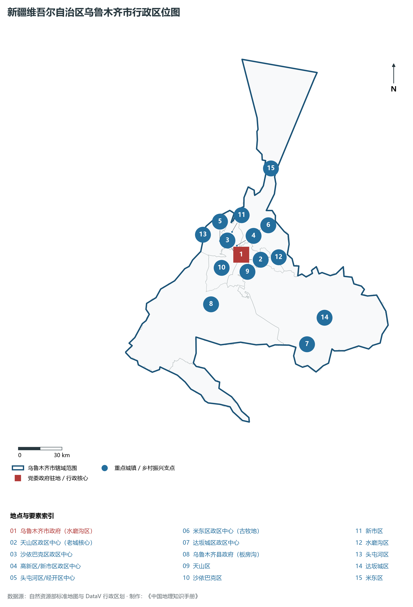
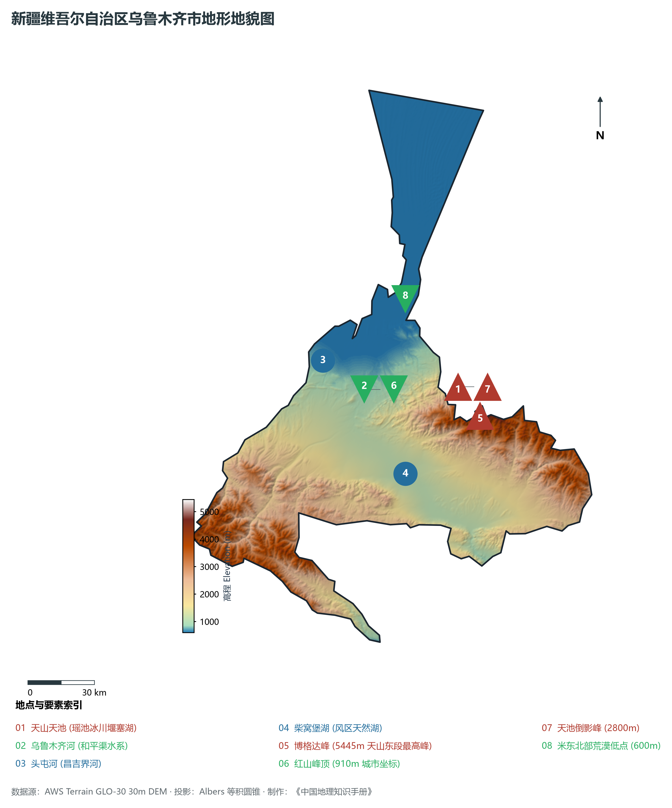
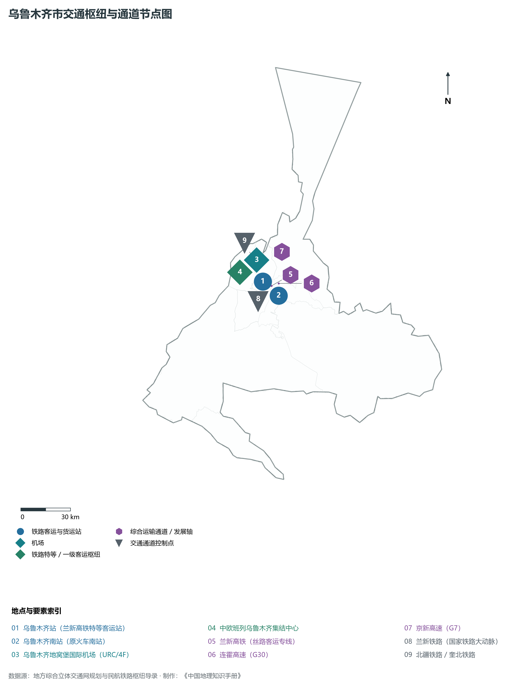
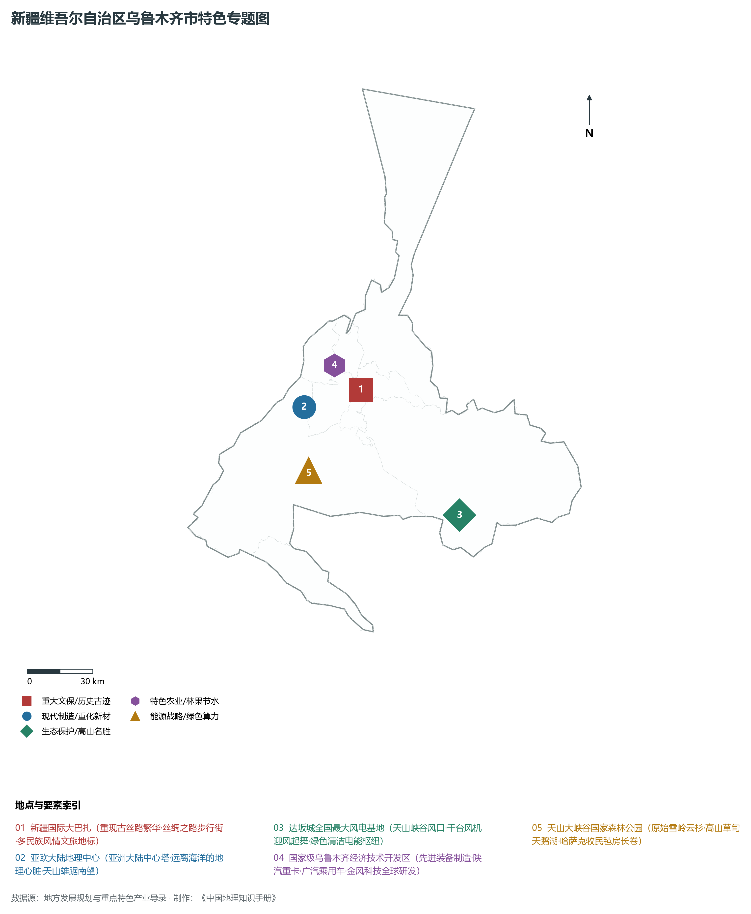
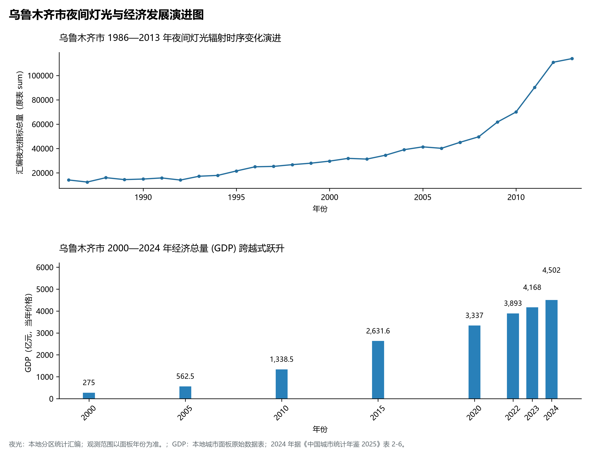

# 32.1 乌鲁木齐市

乌鲁木齐市，新疆维吾尔自治区首府，全区政治、经济、文化、科教、金融、信息与交通物流中心，国家特大城市，天山北坡城市群核心极核，丝绸之路经济带核心区高水平建设的龙头枢纽。蒙古语意为“优美的牧场”。地理坐标介于东经 86°37′—88°58′、北纬 42°45′—45°00′ 之间，深居欧亚大陆地理中心（亚洲大陆地理中心塔巍然耸立于市辖西南的永丰镇），雄踞天山山脉中段北麓、准噶尔盆地南缘。全市土地。2024 年常住人口 **413 万人**，常住人口城镇化率 **97%**，地区生产总值 **4,502 亿元**（当年价格），人均地区生产总值 **100,765 元**，三次产业构成为 **0.72 : 29.48 : 69.8**。

乌鲁木齐北倚浩瀚的古尔班通古特沙漠，南枕天山主脉东段最高峰博格达峰（海拔 **5 445 m**），城景相融、雪山掩映，形成了“城在绿中、山在城后”的独特高原峡谷与冲积扇城市景观。自汉唐设立轮台屯田、宋元商旅辐辏，到清乾隆二十八年（1763 年）筑城定名“迪化”，再到 1954 年恢复原名乌鲁木齐；从昔日驼铃悠扬的古丝路重镇，到新时代拥有全国最大陆港中欧班列集结中心、4F 级地窝堡国际航空枢纽、国家级经济技术开发区和高新技术产业开发区，乌鲁木齐已跨越式发展为联通中亚、西亚乃至欧洲的中国西部国际开放门户。

---

## 一、市情速览

| 核心指标 | 全市数据 | 全区位次 / 占比 / 战略特征 |
|:---|:---|:---|
| **土地总面积** | 13 788.0 km² | 占全区 0.83%，地形呈狭长走廊与山麓倾斜平原 |
| **常住人口 (2024)** | 413 万人 | 2024 年，全市；年鉴公布口径 |
| **常住人口城镇化率** | 97% | 2024 年，全市；年鉴公布口径 |
| **地区生产总值 (GDP)** | 4,502 亿元 | 2024 年，全市；年鉴公布口径 |
| **人均 GDP** | 100,765 元/人 | 2024 年，全市；年鉴公布口径 |
| **三次产业结构** | 0.72 : 29.48 : 69.8 | 2024 年，全市；年鉴公布口径 |
| **高程跨度极值** | 博格达峰 5 445 m / 米东北部荒漠 600 m | 市域相对垂直高差达 4 845 m，具有丰富垂直自然带谱 |
| **交通枢纽等级** | 兰新高铁特等客运站 / 地窝堡国际机场 4F | 中欧班列集结中心，全国 12 个最高等级国际航空枢纽之一 |
| **标志性地理名胜** | 亚洲大陆地理中心、国际大巴扎、达坂城风电 | 汇聚自然地理极点、多元民族风情与绿色清洁能源典范 |

**图 32-01-1 新疆维吾尔自治区乌鲁木齐市行政区位图**：图上编号与地点、要素索引对应。

---

## 二、自然地理：天山雪峰、峡谷风口与绿洲阶梯

**图 32-01-2 新疆维吾尔自治区乌鲁木齐市地形地貌图**：图上编号与地点、要素索引对应。

### 1. 垂直高差近五千米的雄浑地貌
乌鲁木齐地势由东南向西北倾斜，落差极其悬殊：

- **南部冰川高山区**：以博格达峰为制高点（海拔 **5 445 m**），分布有现代冰川、高山倒影湖（如天山天池近邻区域）及高山草甸。雪山融水是乌鲁木齐河与头屯河等城市水系的命脉发源地；
- **中部山前倾斜平原与峡谷走廊**：海拔 800—1 200 m，市区主要坐落于此。天山向北延伸的残丘红山（海拔 **910 m**）与雅玛里克山（妖魔山）夹乌鲁木齐河对峙，形成古代“扼天山之咽喉”的城市门户；
- **东南部达坂城地质断裂风谷**：处于天山博格达山与喀拉乌成山之间的断陷构造谷地，海拔约 1 100 m，由于准噶尔盆地与吐鲁番盆地间巨大的气压差，形成了闻名遐迩的狭管“风谷”，孕育了我国最早的大型风电基地；
- **北部平原荒漠低洼地**：米东区北部逐渐过渡为古尔班通古特沙漠南缘，最低海拔仅 **600 m**，地表为微起伏的冲积平原与沙丘。

### 2. 水资源与城市供水生命线

- **乌鲁木齐河水系**：全长 63 km，发源于天山一号冰川，经英雄桥出山，滋润红雁池水库、跃进水库并经由和平渠灌溉引流。乌鲁木齐河不仅是城市最初发祥的“母亲河”，更是早期农业屯垦的灌溉源头；
- **“引额济乌”战略水利工程**：由于干旱少雨（市中心年均降水量仅约 280 mm，而年蒸发量高达 2 000 mm 以上），水资源曾是城市发展的最大刚性瓶颈。国家实施的跨流域调水工程将额尔齐斯河清冽优质的融雪水源源不断引至乌鲁木齐，彻底扭转了首府水资源短缺格局，保障了数百万市民饮水安全与工业升级。

---

## 三、综合立体交通网络：亚欧大陆桥核心枢纽

**图 32-01-3 乌鲁木齐市交通枢纽与通道节点图**：图上编号与地点、要素索引对应。

### 1. 铁路干线与中欧班列集结中心

- **兰新高铁与特等客运站**：**乌鲁木齐站（新客站）**是兰新高铁的西端终点特等客运枢纽，具备每年旅客吞吐量数千万人次的现代化服务能力，使乌鲁木齐与内地省会城市的时空距离大幅压缩；
- **北疆铁路与奎北、精伊霍铁路支架**：兰新铁路向西贯通奎屯、博乐并分岔直抵阿拉山口与霍尔果斯国门；
- **中欧班列集结中心**：坐落于经开区三坪物流园与北站枢纽，是全国五大中欧班列集结中心之一。西行班列由此直发中亚五国、俄罗斯和欧洲腹地，货物品类涵盖机电产品、新能源汽车、光伏组件和优质农副产品。

### 2. 国际航空枢纽与公路骨干网络

- **乌鲁木齐地窝堡国际机场（4F 级）**：作为中国通往中西亚与欧洲的国际门户枢纽，已完成北区第三跑道与 T4 航站楼大规模扩建，国际国内航线网络覆盖国内外 180 余个城市；
- **国家高速公路双十字骨干**：**连霍高速（G30）**横贯东西，**京新高速（G7）**直穿戈壁通达北京；乌鲁木齐绕城高速（东线与西线）将七区一县和兵团第六师五家渠市紧密缝合，构筑半小时高快速都市圈。

---

## 四、特色专题与现代产业体系

**图 32-01-4 新疆维吾尔自治区乌鲁木齐市特色专题图**：图上编号与地点、要素索引对应。

### 1. 先进装备制造与新型工业集群

- **国家级乌鲁木齐经济技术开发区（经开区/头屯河区）**：汇聚了**金风科技**（全球风电整机领军企业与全球研发中心）、陕汽新疆重卡制造基地、广汽乘用车新疆基地、新疆铁建重工隧道装备等，是全疆高端装备制造与现代智能工业第一高地；
- **高新区（新市区）与米东现代化工**：聚集了现代生物医药、软件与信息技术服务、新材料产业链；米东区布局千万吨级现代石油化工延链工程与新型建材基地。

### 2. 文旅融合与多元风情地标

- **新疆国际大巴扎（世界规模最大城堡式巴扎）**：位于天山区二道桥，建筑面积超 10 万 m²，将伊斯兰建筑艺术、丝路商贸文化与现代商业步行街融为一体，是体验大美新疆民族手工艺、特色干果与风情歌舞的标志性窗口；
- **亚欧大陆地理中心（“亚心”塔）**：位于市郊永丰镇包家槽子村（东经 87°20′，北纬 43°41′），经中国科学院严谨测定，标志着这里是整个 4 400 万平方公里亚洲大陆距离各大洋最为遥远的地理几何中心；
- **天山大峡谷国家 5A 级景区**：位于乌鲁木齐县南山山麓，囊括照壁山、天鹅湖、天山坝、原始雪岭云杉林与冰川遗迹，是离城市最近的高山生态避暑天堂与哈萨克牧俗长卷。

---

## 五、夜间灯光时序变迁与经济变化

本节夜光图的观测年份为 1986—2013 年，指标为行政区汇总值（原表 sum）。

**图 32-01-5 乌鲁木齐市夜间灯光与经济发展演进图**：各面板按标注的观测年份、指标和单位列示。

### 1. 夜间灯光空间扩展的三波浪潮

- **第一阶段（1986—1996 年，商贸老城起步）**：夜间高亮度核心紧凑集聚于天山区二道桥、大西门与沙依巴克区老火车南站周边。1994 年兰新铁路复线全线贯通，奠定了商贸集散中心的地位；

### 2. 经济总量（GDP）历史性突破
2024 年乌鲁木齐市全市地区生产总值为 4,502 亿元（当年价格）。

2024 年统计来源：《中国城市统计年鉴 2025》表 2-1、2-6、2-7（2024 年，全市）。其他年份 GDP 据本地城市面板“原始数据”表，单位为亿元、当年价格。
