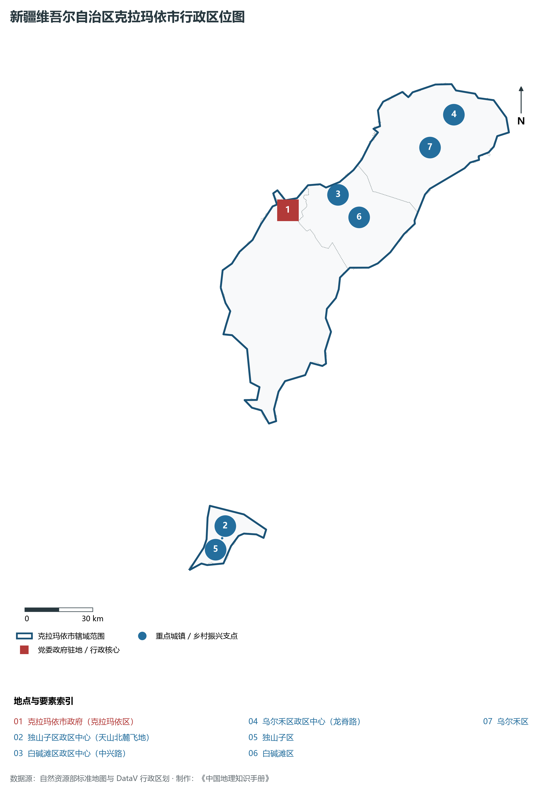
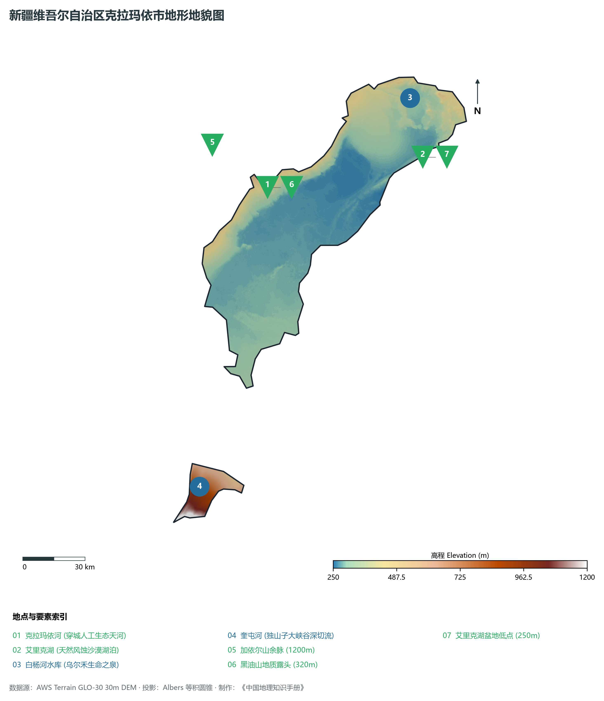
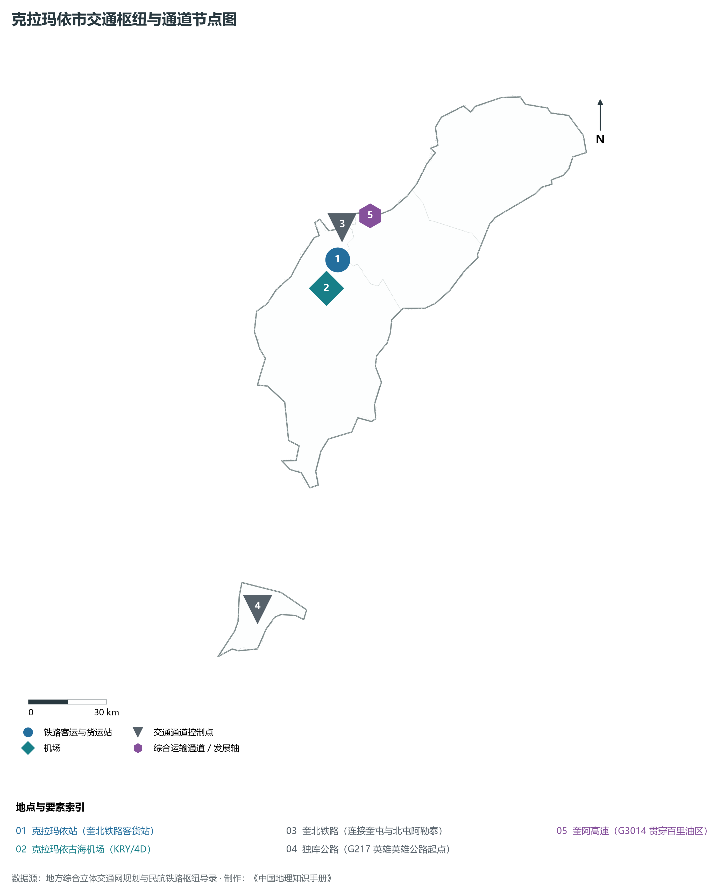
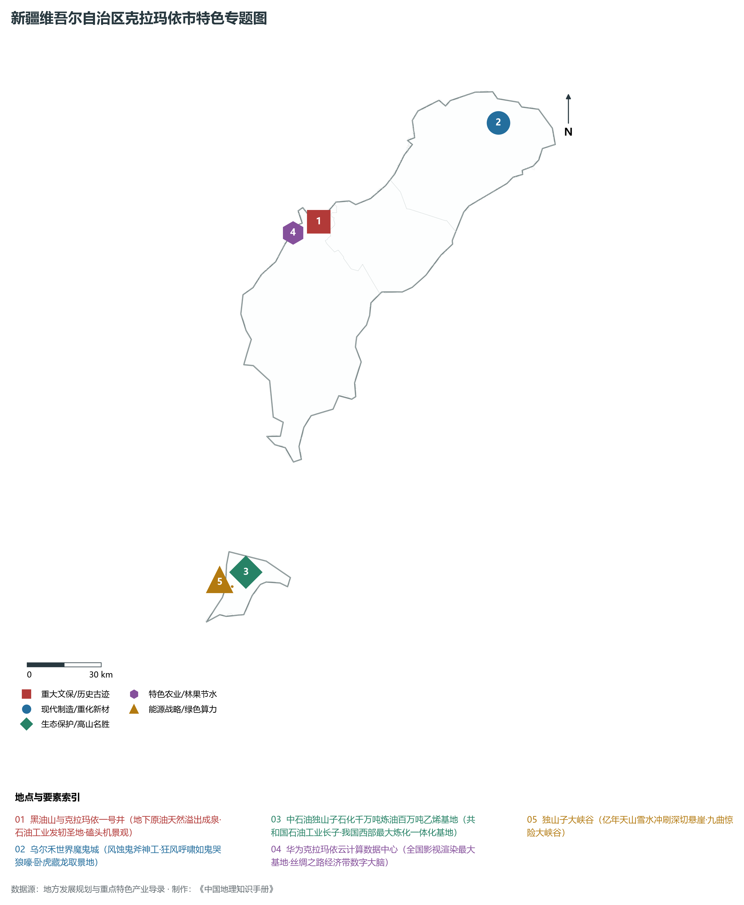
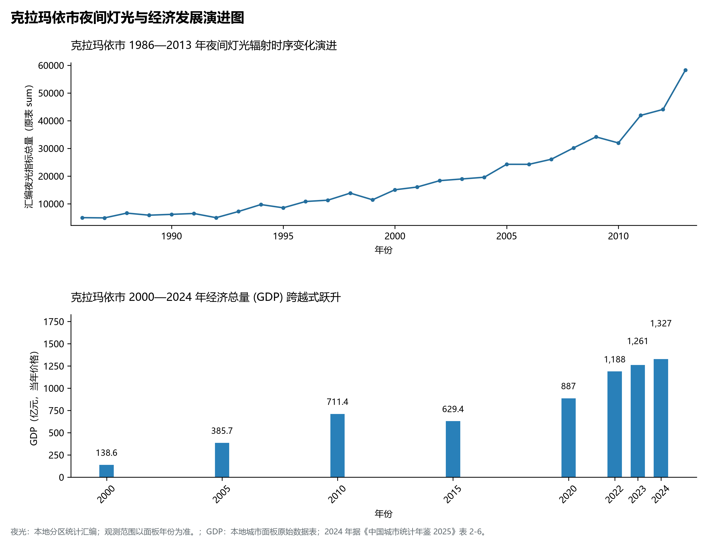

# 32.2 克拉玛依市

克拉玛依市，维吾尔语意为“黑油”，因黑油山而得名，是新中国打破“中国贫油论”勘探开发的第一个大油田诞生地，国家重要石油石化工业基地、西部现代重化产业高地与丝绸之路经济带绿色算力名城，被誉为“戈壁美人”与“石油圣地”。地理坐标介于东经 84°44′—86°01′、北纬 44°07′—46°08′ 之间，地处准噶尔盆地西北缘、加依尔山东麓，南跨奎屯市与天山北麓相连，地势西北高、东南低。全市土地。2024 年常住人口 **49 万人**，常住人口城镇化率 **99.01%**，地区生产总值 **1,327 亿元**（当年价格），人均地区生产总值 **255,116 元**，三次产业构成为 **1.59 : 70.39 : 28.02**。

克拉玛依的崛起是共和国工业史上壮怀激烈的英雄史诗。1955 年 10 月 29 日，克拉玛依一号井喷出工业油流，宣告了新中国第一个大油田的诞生。面对“没有草、没有水，连鸟儿也不飞”的极端恶劣自然环境，数万石油拓荒者凭借“有条件要上，没有条件创造条件也要上”的奉献精神，在苍茫戈壁上建起一座设施现代、生态优美、绿水穿城的全国文明城市。从百里油区抽油机（磕头机）日夜不息的律动，到独山子千万吨炼油、百万吨乙烯国家级石化基地，从乌尔禾世界魔鬼城大自然的鬼斧神工，到华为云北方基地与全国最大影视渲染云平台的数字化转型，克拉玛依正书写着由“单打一”资源型城市迈向“油气并举、数实融合、多元创新”现代工业名城的壮丽篇章。

---

## 一、市情速览

| 核心指标 | 全市数据 | 全区位次 / 全国地位 / 显著特征 |
|:---|:---|:---|
| **土地总面积** | 7 733.0 km² | 占全区 0.46%，呈狭长戈壁倾斜带与天山北麓飞地 |
| **常住人口 (2024)** | 49 万人 | 2024 年，全市；年鉴公布口径 |
| **常住人口城镇化率** | 99.01% | 2024 年，全市；年鉴公布口径 |
| **地区生产总值 (GDP)** | 1,327 亿元 | 2024 年，全市；年鉴公布口径 |
| **人均 GDP** | 255,116 元/人 | 2024 年，全市；年鉴公布口径 |
| **三次产业结构** | 1.59 : 70.39 : 28.02 | 2024 年，全市；年鉴公布口径 |
| **高程跨度极值** | 加依尔山余脉 1 200 m / 艾里克湖 250 m | 地面微向准噶尔腹地玛湖洼陷倾斜，戈壁砾石广布 |
| **油气战略地位** | 准噶尔盆地油气勘探指挥中枢 | 玛湖十亿吨级特大砾岩油田、吉木萨尔国家级页岩油示范区 |
| **地貌生态名片** | 世界魔鬼城 5A 景区、人工天河克拉玛依河 | 集壮丽风蚀雅丹、穿城清流与全国绿化模范城市于一体 |

**图 32-02-1 新疆维吾尔自治区克拉玛依市行政区位图**：图上编号与地点、要素索引对应。

---

## 二、自然地理：戈壁油盆、雅丹奇峰与引水天河

**图 32-02-2 新疆维吾尔自治区克拉玛依市地形地貌图**：图上编号与地点、要素索引对应。

### 1. 准噶尔西缘地貌构造与百里油田

- **戈壁砾石倾斜平原**：市域主体坐落于加依尔山和扎依尔山东南麓的山前洪积倾斜平原上，海拔在 250—500 m 之间，地表覆盖深厚的第四纪戈壁砾石层，植物极其稀少，以驼绒藜、红砂、琵琶柴等旱生灌木为主；
- **地下富油坳陷构造**：克拉玛依地处准噶尔盆地西北缘超剥蚀推覆断裂带，古生代及中生代沉积岩层深厚，蕴藏着极其优质轻质低凝固点原油，形成了世界上罕见的浅层超稠油、中深层轻质油与深层特大砾岩油藏共存的巨型地下能源宝库；
- **黑油山天然地质遗迹**：位于市区东北部，海拔约 320 m。地下高压原油伴随天然气沿岩层裂隙天然溢出地表，经过数万年挥发氧化，形成数十座黑如凝脂、油泉涌动的沥青丘群，是世界上极罕见的天然地表油苗露头。

### 2. 世界魔鬼城雅丹奇观与水文生态

- **乌尔禾世界魔鬼城（国家 5A 级景区）**：位于市区东北约 100 km，面积超 30 km²，属于典型的干旱风蚀雅丹地貌。亿万年前白垩纪湖相沉积的泥岩与砂岩在常年八级以上大风（百里风区与老风口分支）的烈度剥蚀下，雕琢成城堡、殿堂、巨舰、雄鹰等千姿百态的风蚀峰丛；因强风穿越狭窄岩壑时发出尖厉呼啸如鬼哭狼嚎，故得名“魔鬼城”；
- **人工奇迹克拉玛依河（穿城天河）**：历史上克拉玛依“水比油贵”，降水量仅 100 mm 左右，而年蒸发量高达 2 500 mm 以上。为彻底改变城市缺水面貌，1997 年开工建设“引额济克”调水工程，从额尔齐斯河引来融雪清泉，并在戈壁荒原中开凿出全长 8.5 km、水质达到国家二类标准的穿城人工生态河道——克拉玛依河，两岸遍植绿树繁花，使荒漠石油城一跃成为国家园林城市与中国人居环境范例奖得主。

---

## 三、道路交通与英雄公路起点

**图 32-02-3 克拉玛依市交通枢纽与通道节点图**：图上编号与地点、要素索引对应。

### 1. 骨干铁路与高速通道

- **奎北铁路（奎屯—克拉玛依—北屯）**：国家铁路二级干线，客货列车在此直达阿勒泰和乌鲁木齐，承载了百里油区巨额石油化工产品、原油原浆与工业原材料的陆路大通道；
- **奎阿高速公路（G3014）**：国家高速公路主网，由奎屯出发向北纵贯克拉玛依区、白碱滩区、乌尔禾区，直达阿勒泰市，构成北疆西部大贯通的交通主动脉；
- **克塔铁路与塔城连通**：向西分岔连通塔城市与巴克图口岸，强化向西经贸辐射力。

### 2. 独库公路（G217）始发地与航空枢纽

- **独库公路（英雄公路始发港）**：**国道 G217 独山子至库车段**在此正式启程。全长 561 km，由独山子翻越海拔 3 400 米的哈希勒根达坂与玉希莫勒盖达坂，将原本需绕行数百公里的南北疆旅程缩短近一半；沿途独山子大峡谷深切百米悬崖，是天山雪水亿万年冲刷的峡谷地质奇观；
- **克拉玛依古海机场（4D 级）**：已开通直飞北京、西安、成都、郑州及疆内喀什、伊宁等多条干支航线，客货吞吐能级显著跃升。

---

## 四、特色专题：现代石化、世界雅丹与丝路算力

**图 32-02-4 新疆维吾尔自治区克拉玛依市特色专题图**：图上编号与地点、要素索引对应。

### 1. 世界级炼化一体化与油气新大陆

- **独山子石化公司**：隶属中国石油，具备年加工原油 1 000 万吨、生产乙烯 120 万吨的超级炼化一体化生产能力，是我国西部装备水平最高、技术最先进的大型石化基地之一，其高端聚烯烃材料、合成橡胶与润滑油产品远销海内外；
- **玛湖 10 亿吨级特大砾岩油田**：近年来准噶尔盆地玛湖凹陷勘探取得历史性突破，发现三级石油地质储量超 10 亿吨的全球最大砾岩油田，为保障国家能源安全注入了磅礴动力。

### 2. 丝绸之路经济带“云端算力”高地

- **克拉玛依云计算产业园**：依托年均气温凉爽（利于数据中心自然风冷）、电网绿电供应充足可靠（风光绿电与稳定火电）的极致优势，克拉玛依前瞻布局数字经济：
- 华为云全球北方数据中心、中国移动新疆数据中心、中国电信（国家云计算）北方基地相继落户，建成机架总数超 2 万架；
- 打造了**全国规模最大的影视动漫渲染基地**，《流浪地球》、《战狼2》、《哪吒之魔童降世》等众多国产超级视效大片的后期渲染均在此完成，实现了由“采石油”向“采数据”的历史性产业跃迁。

---

## 五、夜间灯光时序变迁与经济腾飞

本节夜光图的观测年份为 1986—2013 年，指标为行政区汇总值（原表 sum）。

**图 32-02-5 克拉玛依市夜间灯光与经济发展演进图**：各面板按标注的观测年份、指标和单位列示。

### 2. 经济总量（GDP）与富民高地
2024 年克拉玛依市全市地区生产总值为 1,327 亿元（当年价格）。

2024 年统计来源：《中国城市统计年鉴 2025》表 2-1、2-6、2-7（2024 年，全市）。其他年份 GDP 据本地城市面板“原始数据”表，单位为亿元、当年价格。
