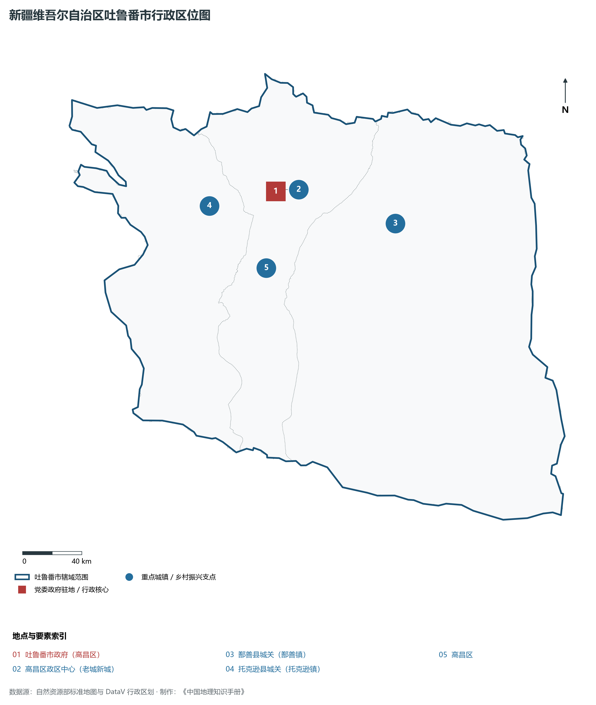
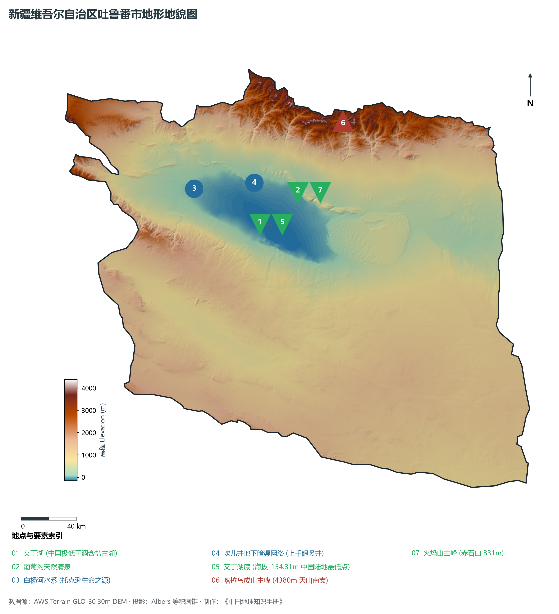
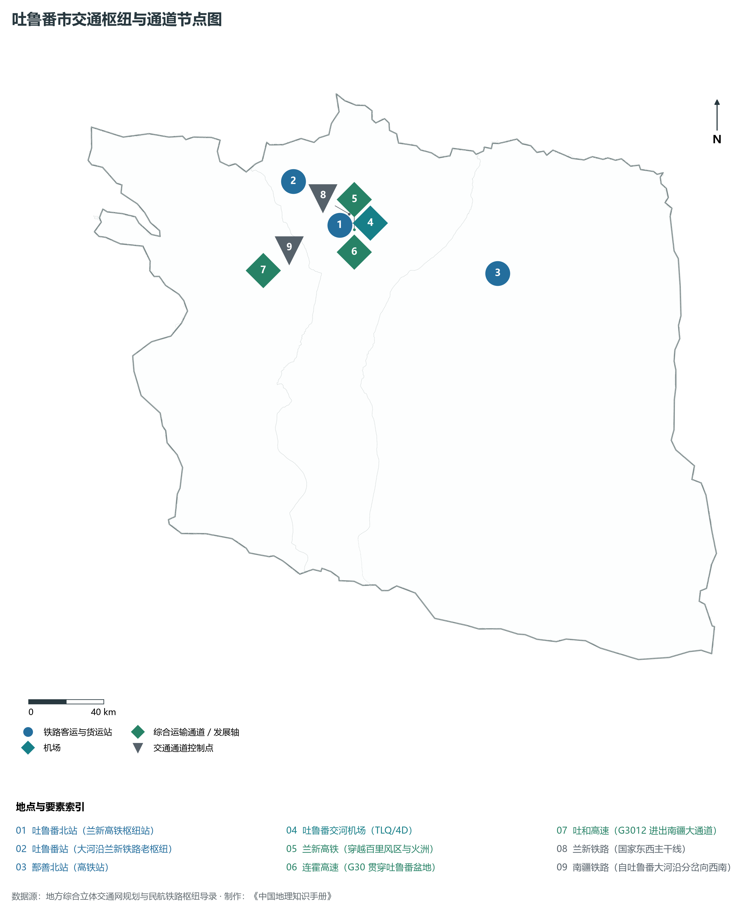
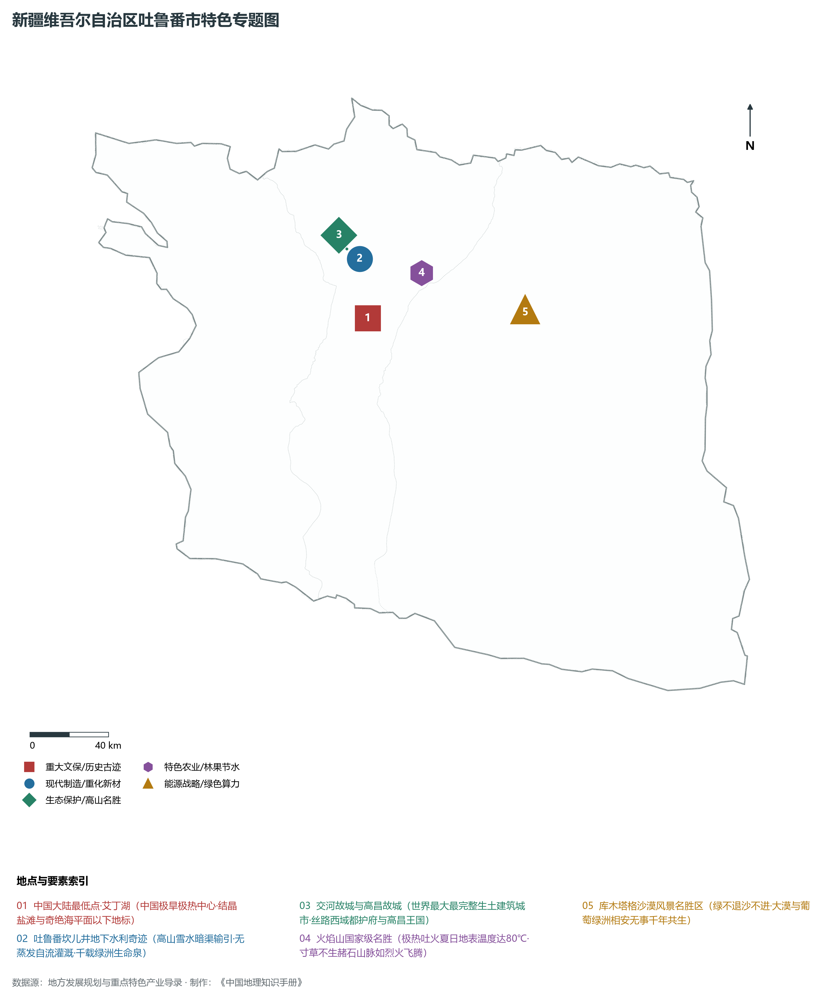
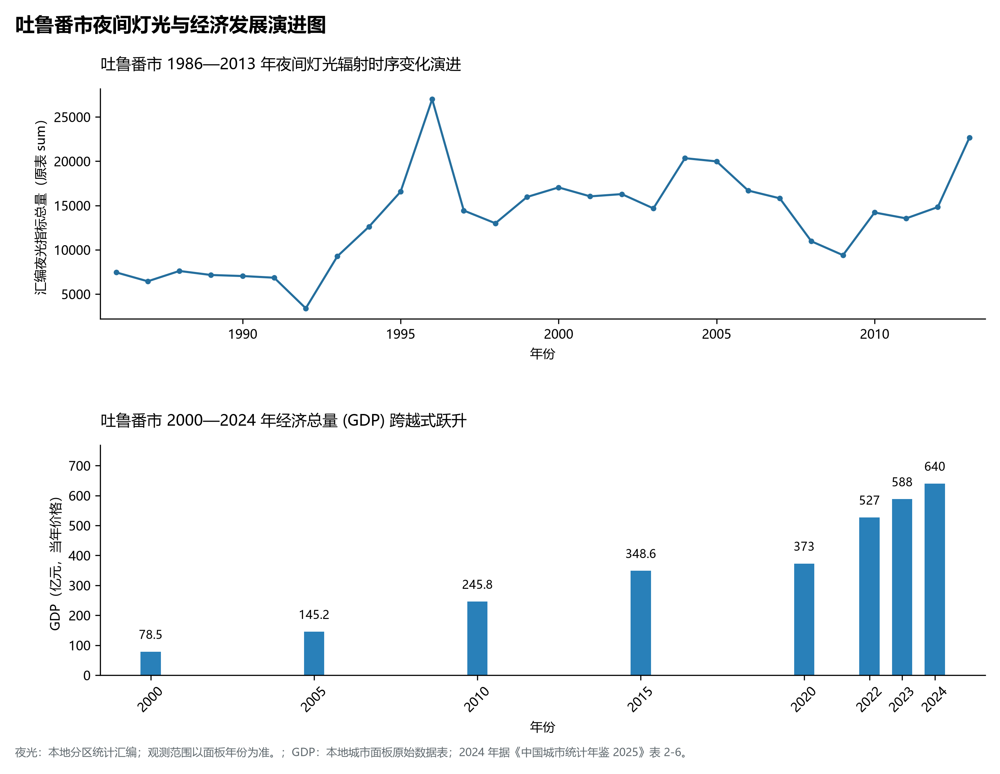

# 32.3 吐鲁番市

吐鲁番市，维吾尔语意为“富庶丰饶之地”，古称“姑师”、“高昌”、“西州”，是古丝绸之路天山南道和北道的交汇枢纽、国家历史文化名城，拥有世界文化遗产与中国陆地最低点，素有“火洲”、“风库”与“葡萄之乡”之盛誉。地理坐标介于东经 87°16′—91°55′、北纬 41°12′—43°40′ 之间，位于天山东部博格达山与喀拉乌成山南麓封闭的断陷盆地——吐鲁番盆地腹地。全市行政区域土地。2024 年常住人口 **70 万人**，常住人口城镇化率 **51.99%**，地区生产总值 **640 亿元**（当年价格），人均地区生产总值 **92,043 元**，三次产业构成为 **11.81 : 53.33 : 34.86**。

吐鲁番是一片地理反差与历史文脉交相辉映的奇迹之地。盆地中心微向南倾斜，汇聚于海拔 **-154.31 m** 的艾丁湖底，是中国陆地表面最低点、世界仅次于死海（约 -430 m）的第二大陆地低洼谷地。群山环抱形成的盆地沉陷聚热效应，造就了全国气温最高（盛夏极端高温超 49 ℃，地表温度超 80 ℃）、降水量最少（年均降水仅 16 mm，而年潜在蒸发量逾 3 000 mm）的极端干热气候。正是在这种严酷的自然考验下，古代各族劳动人民因地制宜，创造出巧借天山潜水与地势坡度自流引水的地下水利工程——**坎儿井**，与万里长城、京杭大运河并称为“中国古代三大水利工程奇迹”；而交河故城、高昌故城两座世界文化遗产城址，历经两千年风沙侵蚀依然生土犹存。新时代的吐鲁番正依托得天独厚的光热与风能资源，加速构筑国家级千万千瓦级清洁能源基地与特色林果现代化全产业链。

---

## 一、市情速览

| 核心指标 | 全市数据 | 全区位次 / 全国地位 / 显著特征 |
|:---|:---|:---|
| **土地总面积** | 69 713.0 km² | 占全区 4.19%，地处深陷的吐鲁番构造盆地 |
| **常住人口 (2024)** | 70 万人 | 2024 年，全市；年鉴公布口径 |
| **常住人口城镇化率** | 51.99% | 2024 年，全市；年鉴公布口径 |
| **地区生产总值 (GDP)** | 640 亿元 | 2024 年，全市；年鉴公布口径 |
| **人均 GDP** | 92,043 元/人 | 2024 年，全市；年鉴公布口径 |
| **三次产业结构** | 11.81 : 53.33 : 34.86 | 2024 年，全市；年鉴公布口径 |
| **陆地极值点** | 艾丁湖底 -154.31 m / 喀拉乌成山 4 380 m | 全市垂直高差达 4 534 m，中国陆地“凹地之王” |
| **世界文化遗产** | 交河故城、高昌故城（丝路申遗点） | 世界最大、保存最完好的生土建筑遗址城 |
| **农业地理标志** | 吐鲁番葡萄（无核白）、托克逊杏、鄯善哈密瓜 | 中国无核白葡萄产量占全国总产量 90% 以上 |

**图 32-03-1 新疆维吾尔自治区吐鲁番市行政区位图**：图上编号与地点、要素索引对应。

---

## 二、自然地理：火焰山体、最低洼地与盆地热聚

**图 32-03-2 新疆维吾尔自治区吐鲁番市地形地貌图**：图上编号与地点、要素索引对应。

### 1. 极致盆地构造与艾丁湖地平线下奇观
吐鲁番盆地是一个深陷于天山山系内部的典型菱形山间断陷盆地：

- **中国陆地最低点——艾丁湖（海拔 -154.31 m）**：维吾尔语意为“月光湖”，位于高昌区南约 30 km。第四纪时期曾是水面浩瀚的淡水湖，后因构造抬升阻隔与极度干旱气候，湖水强烈蒸发退缩，现已演变为含盐度极高的晶莹干涸盐滩与盐沼泽，中心设立有醒目的中国陆地最低点石碑；
- **火焰山背斜隆起（赤石山）**：东西走向横亘于盆地中部，长约 100 km，宽约 10 km，主峰海拔 **831 m**。由中生代白垩纪和第三纪的红色砂岩、泥岩构成，褶皱断裂极为强烈。山体寸草不生，在盛夏烈日炽烤下红光蒸腾，宛如熊熊燃烧的烈火，是中国古典名著《西游记》“孙悟空三借芭蕉扇”的原型舞台；
- **盆地边缘风区**：盆地西侧为著名的三十里风区和百里风区，强冷空气通过天山峡谷灌入盆地，瞬时风力常达 12 级以上，风力资源极度丰沛。

### 2. 地下水工奇迹——坎儿井生态水系
在年降水量不足 20 mm、蒸发量高达 3 000 mm 的极端环境下，吐鲁番盆地之所以能成为绿意盎然的果园绿洲，全赖天赐的地下水脉与巧夺天工的**坎儿井水利工程**：

- **构造机理**：北部博格达峰雪水大量渗入山前巨厚砾石戈壁层，汇聚为丰富的地下潜水；
- **工程结构**：由竖井、地下暗渠、地面明渠和涝坝（蓄水池）四大部分组成。劳动人民顺应自北向南的大倾斜坡度，每隔数十米开挖一眼竖井，在地下连通成数百米乃至数十公里的暗渠；
- **减蒸奇效**：暗渠在地下十几米深处自流输水，完全避免了地表强烈蒸发与风沙淤塞，实现了“零蒸发、零动力、自流灌溉”。全境历史上曾有坎儿井 1 200 余条，总长度逾 **5 000 km**，滋润出葡萄沟、高昌绿洲等沃野良田。

---

## 三、道路交通与丝路东西枢纽

**图 32-03-3 吐鲁番市交通枢纽与通道节点图**：图上编号与地点、要素索引对应。

### 1. 铁路大十字与进疆咽喉

- **兰新高铁与吐鲁番北站**：兰新高铁横贯吐鲁番盆地，吐鲁番北站是高铁进出疆的核心客运大站，乘高铁至乌鲁木齐仅需不到 1 小时，深度融入首府“一小时经济圈”；
- **兰新铁路与南疆铁路大河沿枢纽**：既有兰新铁路在大河沿设吐鲁番站；由此向西南分岔出**南疆铁路**，穿过托克逊进入天山深处峡谷直奔库尔勒与喀什，是南疆客货运输连接全疆与内地的最主要铁路咽喉。

### 2. 国家高速骨架与支线航空

- **连霍高速（G30）**：自哈密延伸入盆地，串联鄯善、高昌区，西折乌鲁木齐；
- **吐和高速（G3012）**：自高昌区启程向西南延伸，经托克逊奔赴阿克苏、喀什、和田，是环塔里木盆地高速大动脉的始发段；
- **吐鲁番交河机场（4D 级）**：作为乌鲁木齐地窝堡国际机场的主备降机场，已开通直飞西安、成都、郑州、兰州等主要枢纽机场的多条航线。

---

## 四、特色专题：世界遗产、火洲葡萄与光热高地

**图 32-03-4 新疆维吾尔自治区吐鲁番市特色专题图**：图上编号与地点、要素索引对应。

### 1. 两大丝路千年都城遗址

- **交河故城（世界文化遗产）**：坐落于吐鲁番市西 10 km 的雅尔乃孜沟柳叶形黄土台地上，长约 1 650 m，两面临深切 30 米的河谷绝壁，全城除极少数砖瓦建筑外，官署、寺院、民居乃至街道均完全从原生黄土层下掏掘削出，是世界上最大、最古老、保存最完整的**生土建筑城市**，曾为汉代车师前国都城及唐代安西都护府最初驻地；
- **高昌故城（世界文化遗产）**：位于高昌区三堡乡，曾是西域古高昌王国国都，玄奘法师西行取经曾在此开坛讲经，规模宏大，墙垣巍峨。

### 2. 葡萄之乡与库木塔格沙海共生

- **吐鲁番葡萄与荫房文化**：吐鲁番年日照达 3 200 小时，热量极其丰盈，出产的**无核白葡萄**含糖量高达 20%—24%。绿洲村落遍布土坯镂空花孔的“荫房”（维吾尔语“琼切克”），利用干热干风吹拂，短短数十天即可风干出翠绿晶莹、甘甜如蜜的顶级天然葡萄干；
- **库木塔格沙漠风景名胜区**：位于鄯善县城南端，是世界上少有的**与城市零距离接壤的沙漠**。因千年来特殊的下垫面风动力平衡，形成了“沙不进、绿不退、人不迁”的沙绿共生自然奇观。

### 3. 国家光热发电与新能源示范基地
吐鲁番盆地全年太阳辐射总量高达 6 000—6 500 兆焦耳/平方米，位居全国前列。近年来在鄯善、托克逊戈壁滩上建设了多个大型熔盐塔式光热发电站与大型光伏储能示范基地，实现了昼夜持续稳定输出清洁绿电。

---

## 五、夜间灯光时序变迁与经济变化

本节夜光图的观测年份为 1986—2013 年，指标为行政区汇总值（原表 sum）。

**图 32-03-5 吐鲁番市夜间灯光与经济发展演进图**：各面板按标注的观测年份、指标和单位列示。

### 2. 经济总量（GDP）跨越式跃升
2024 年吐鲁番市全市地区生产总值为 640 亿元（当年价格）。

2024 年统计来源：《中国城市统计年鉴 2025》表 2-1、2-6、2-7（2024 年，全市）。其他年份 GDP 据本地城市面板“原始数据”表，单位为亿元、当年价格。
