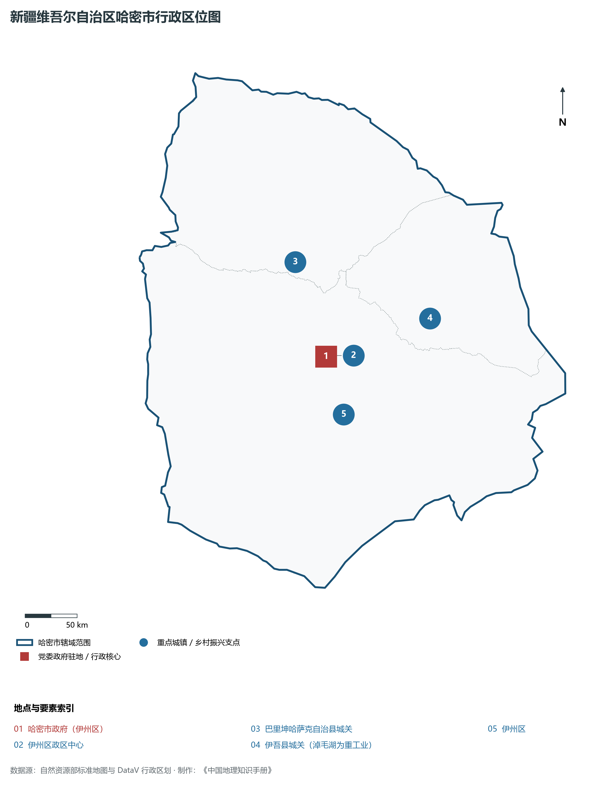
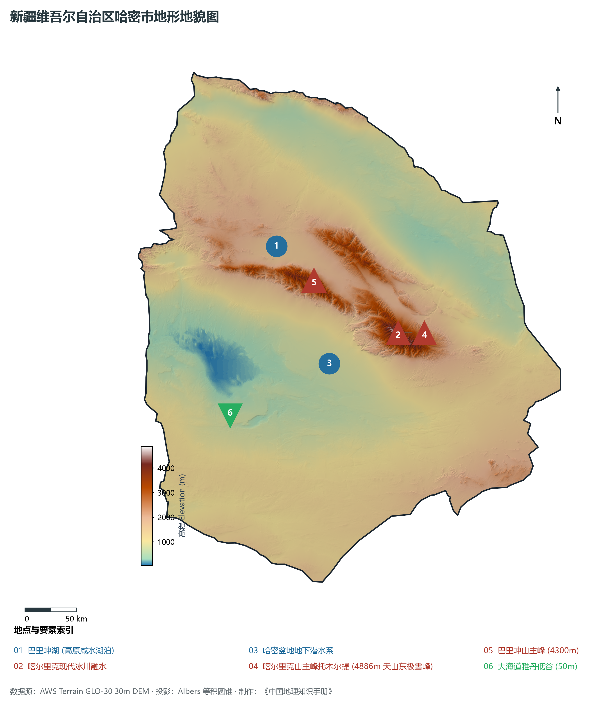
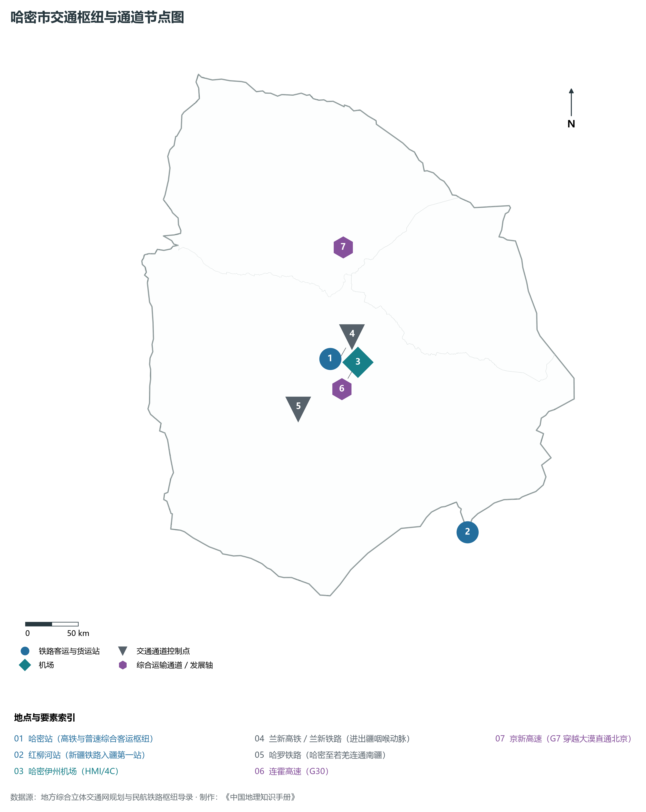
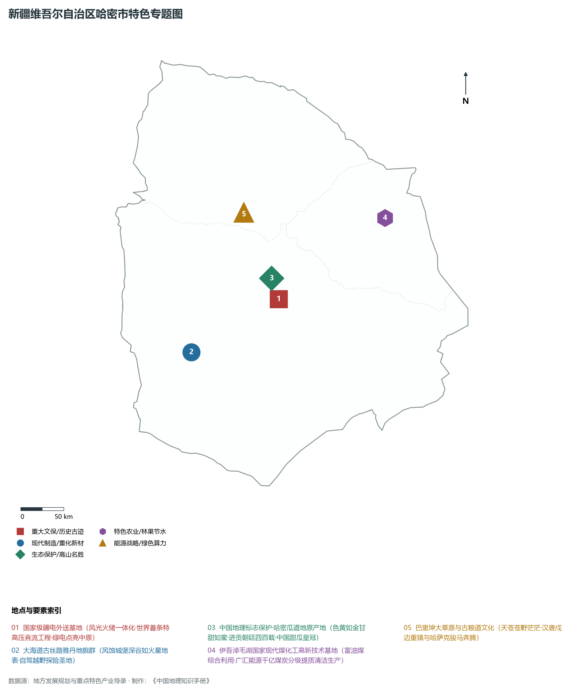
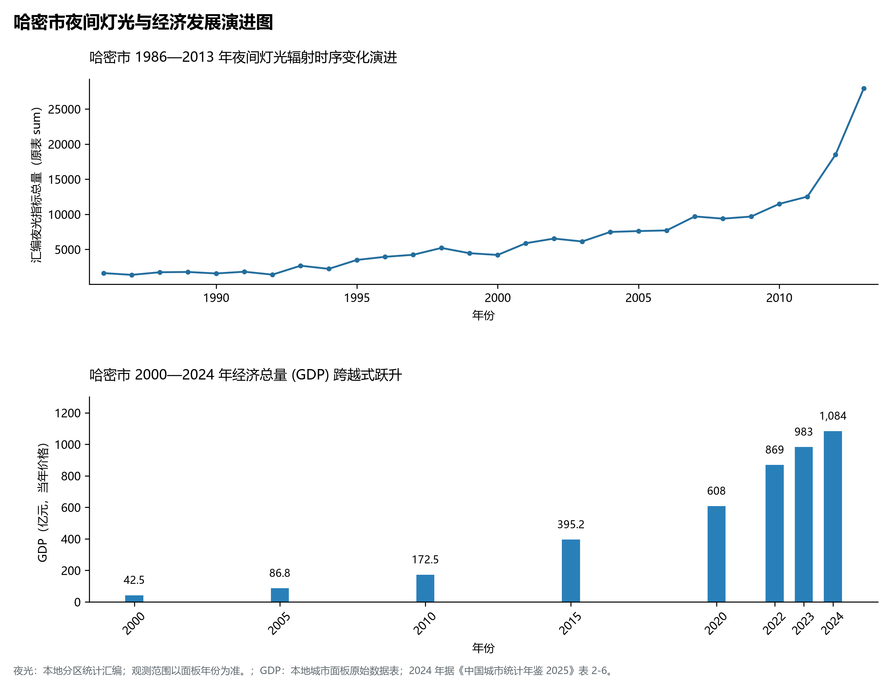

# 32.4 哈密市

哈密市，古称“昆仑”、“伊吾”、“哈密卫”，素有“新疆东大门”与“西域咽喉”之称，是进出新疆的陆路第一枢纽港、国家大型能源资源陆上大通道关键节点、享誉中外的“哈密瓜之乡”，同时也是欧亚大陆风光火储多能互补千万千瓦级特大型能源外送枢纽基地。地理坐标介于东经 91°06′—96°23′、北纬 40°52′—45°05′ 之间，东与甘肃省酒泉市毗邻，南接巴音郭楞蒙古自治州，西连吐鲁番市、昌吉回族自治州，北与蒙古国接壤（边境线长达 580 多公里）。全市土地。2024 年常住人口 **63 万人**，常住人口城镇化率 **76.18%**，地区生产总值 **1,084 亿元**（当年价格），人均地区生产总值 **162,151 元**，三次产业构成为 **4.43 : 67.67 : 27.9**。

天山山脉自西向东横贯哈密全境，以雄浑磅礴的喀尔里克山与巴里坤山将市域天然划分为南北截然不同的两大自然地理与气候单元：天山以北为巴里坤大草原、淖毛湖盆地，水草丰美、牧歌悠扬，富集了全国罕见的超大整装特种富油煤田；天山以南为山麓洪积扇与戈壁瀚海，干热光沛、瓜果飘香，孕育了甜透四海的贡品哈密瓜原产地。从汉代“置宜禾都尉于伊吾”、班超“大破匈奴于蒲类海”，到清代设哈密厅、左宗棠在此筹粮誓师光复新疆；从三道岭中国最后的工业蒸汽机车传奇，到世界首条 ±800 千伏天山—中州特高压工程将浩瀚绿电送达中原，哈密正站在新时代国家能源大战略的最前沿，绽放出由“丝路驿站”蝶变为“国家绿色电港”的雄浑气魄。

---

## 一、市情速览

| 核心指标 | 全市数据 | 全区位次 / 全国地位 / 显著特征 |
|:---|:---|:---|
| **土地总面积** | 138 919.0 km² | 占全区 8.34%，面积超过江苏省或浙江省陆地总和 |
| **常住人口 (2024)** | 63 万人 | 2024 年，全市；年鉴公布口径 |
| **常住人口城镇化率** | 76.18% | 2024 年，全市；年鉴公布口径 |
| **地区生产总值 (GDP)** | 1,084 亿元 | 2024 年，全市；年鉴公布口径 |
| **人均 GDP** | 162,151 元/人 | 2024 年，全市；年鉴公布口径 |
| **三次产业结构** | 4.43 : 67.67 : 27.9 | 2024 年，全市；年鉴公布口径 |
| **极值高程跨度** | 托木尔提峰 4 886 m / 大海道谷地 50 m | 垂直落差达 4 836 m，天山南北一山隔两景 |
| **能源外送枢纽** | ±800 千伏特高压“天中直流”起端 | 累计外送电量超 3 600 亿度，国家级综合能源基地 |
| **地理文化地标** | 喀尔里克现代冰川、大海道雅丹、哈密瓜 | 集冰川奇观、古丝路秘境与中国甜瓜皇冠于一身 |

**图 32-04-1 新疆维吾尔自治区哈密市行政区位图**：图上编号与地点、要素索引对应。

---

## 二、自然地理：天山横分南北、喀尔里克冰川与大海道雅丹

**图 32-04-2 新疆维吾尔自治区哈密市地形地貌图**：图上编号与地点、要素索引对应。

### 1. 天山东段主脊与“一山分南北”气候分异
天山山脉在哈密境内自西向东抬升为巴里坤山与喀尔里克山两大主脉：

- **喀尔里克山主峰托木尔提（海拔 4 886 m）**：天山东极最高峰，山体终年积雪不化，发育有极其壮丽的现代冰川 120 余条，总面积达 80 多 km²，是干旱内陆荒漠中极其珍贵的天然“高山固体水库”；
- **南北气候殊途**：
  - **天山北麓（巴里坤、伊吾）**：受西北冷湿气团迎风坡抬升影响，年降水量达 200—350 mm，夏季凉爽宜人，绿草如茵，属温带温凉半干旱草原气候；
  - **天山南麓（哈密盆地、伊州区）**：处于典型的雨影背风区，极度干旱干燥，年均降水量仅 30 余 mm，而年蒸发量高达 3 000 mm 以上，光照长达 3 350 小时，热量极其充沛，为哈密瓜等特色作物积淀了全中国罕见的高糖温床。

### 2. 水资源潜流与大海道火星地貌

- **冰雪融水潜流滋润绿洲**：喀尔里克山与巴里坤山的冰雪融水汇成白石头河、五堡河等短小山溪，出山后迅速渗入山前巨厚倾斜砂砾石层，在倾斜平原下端以泉水形式溢出，形成哈密盆地古老甘冽的地下潜水补给带与绿洲泉水群；
- **大海道古丝路雅丹地貌群**：位于市域西南部戈壁腹地，是古丝绸之路通往敦煌、吐鲁番最险峻的秘道。在数万年狂风剧烈风蚀与间歇性暴雨洪流冲刷下，形成了大面积如同外星球表面、火星城堡般的巨型雅丹群落，是全球著名的自驾探险与地质科普圣地。

---

## 三、道路交通：进出疆咽喉与陆路第一门户

**图 32-04-3 哈密市交通枢纽与通道节点图**：图上编号与地点、要素索引对应。

### 1. 铁路进出疆第一站

- **兰新高铁与兰新铁路**：两线并驾齐驱横穿哈密盆地。哈密站是高铁与普速综合特等客运站；市境东缘的**红柳河站**是新疆铁路的入疆第一站；
- **哈罗铁路（哈密至若羌罗布泊）**：向南贯穿大漠深入罗布泊钾盐基地并连接若羌，打通了新疆东部连通南疆的货运捷径；
- **将淖铁路与淖柳铁路**：专为准东、淖毛湖特大煤田货物外运打造的大能力重载货运铁路，形成准东—淖毛湖—红柳河外运大通道。

### 2. 公路骨干与老爷庙对外国门

- **国家级高速大通道**：**连霍高速（G30）**与**京新高速（G7）**在哈密境内交汇延伸，其中 G7 经淖毛湖穿越大漠直通北京，是国家高速路网进疆最快捷的公路走廊；
- **老爷庙陆路口岸**：位于巴里坤县境内，是中国与蒙古国双边常年开放的国家一类陆路口岸；
- **哈密伊州机场（4C 级）**：连接全国数十个重点城市，构筑便捷高效的立体空中走廊。

---

## 四、特色专题：特高压外送、原产哈密瓜与现代煤化工

**图 32-04-4 新疆维吾尔自治区哈密市特色专题图**：图上编号与地点、要素索引对应。

### 1. 国家“疆电外送”特高压第一大基地

- **±800 千伏天中特高压直流工程（天山—中州）**：起点位于哈密南换流站，终点位于河南郑州中州换流站，途经六省区，全长 2 192 km，额定输送功率 800 万千瓦。该工程是世界首条投入商业运行的 ±800 千伏特高压直流输电工程，年均送电量超 400 亿千瓦时，实现了“把新疆的煤和风光转变成电送往华中”，为国家东中部提供了源源不断的清洁能源；
- **风光大基地协同**：哈密拥有十三间房、三塘湖等多个国家千万千瓦级风电光伏大基地，清洁能源装机占比超过 65%。

### 2. 中国地理标志保护·道地哈密瓜
“吐鲁番的葡萄哈密的瓜。”哈密是世界甜瓜的真正栽培发祥地之一，栽培历史逾 2 000 年：

- **进贡朝廷四百载**：清康熙三十六年（1697 年），哈密维吾尔族达尔汗伯克额贝都拉遣使入朝进献甜瓜，康熙帝尝后龙颜大悦，赞其甘甜如蜜，御赐名为“哈密瓜”；
- **极佳品质**：独特的干热强光、大温差气候促成其含糖量高达 15%—18%，皮薄肉脆、汁浓肉厚，享有“天下甜瓜之冠”的崇高盛誉。

### 3. 伊吾淖毛湖现代煤化工奇迹
哈密预测煤炭储量逾 **5 700 亿吨**，占全国近八分之一，尤其是淖毛湖矿区煤炭富含极其珍贵的高挥发分与高焦油（含油率超 15%）。广汇能源等龙头企业在此建设了国家级特种富油煤分级分质利用、煤制清洁燃料、煤制乙二醇与大型 LNG 综合产业集群，实现煤炭全产业链高价值低碳清洁利用。

---

## 五、夜间灯光时序变迁与经济变化

本节夜光图的观测年份为 1986—2013 年，指标为行政区汇总值（原表 sum）。

**图 32-04-5 哈密市夜间灯光与经济发展演进图**：各面板按标注的观测年份、指标和单位列示。

### 2. 经济总量（GDP）历史性破千亿
2024 年哈密市全市地区生产总值为 1,084 亿元（当年价格）。

2024 年统计来源：《中国城市统计年鉴 2025》表 2-1、2-6、2-7（2024 年，全市）。其他年份 GDP 据本地城市面板“原始数据”表，单位为亿元、当年价格。
