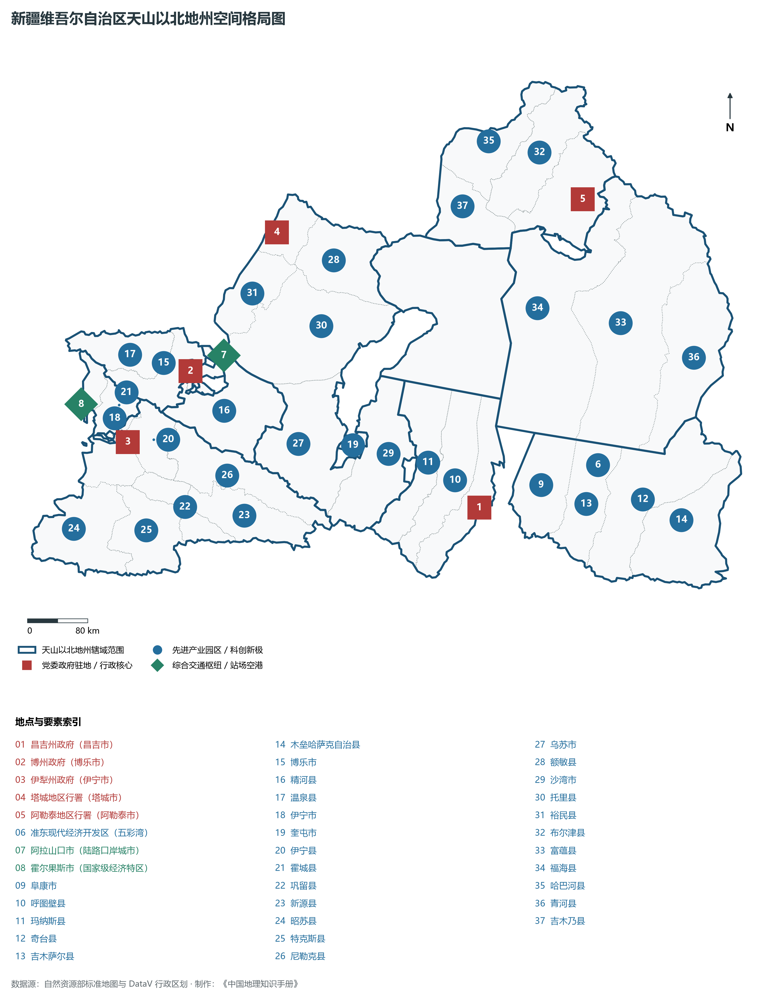
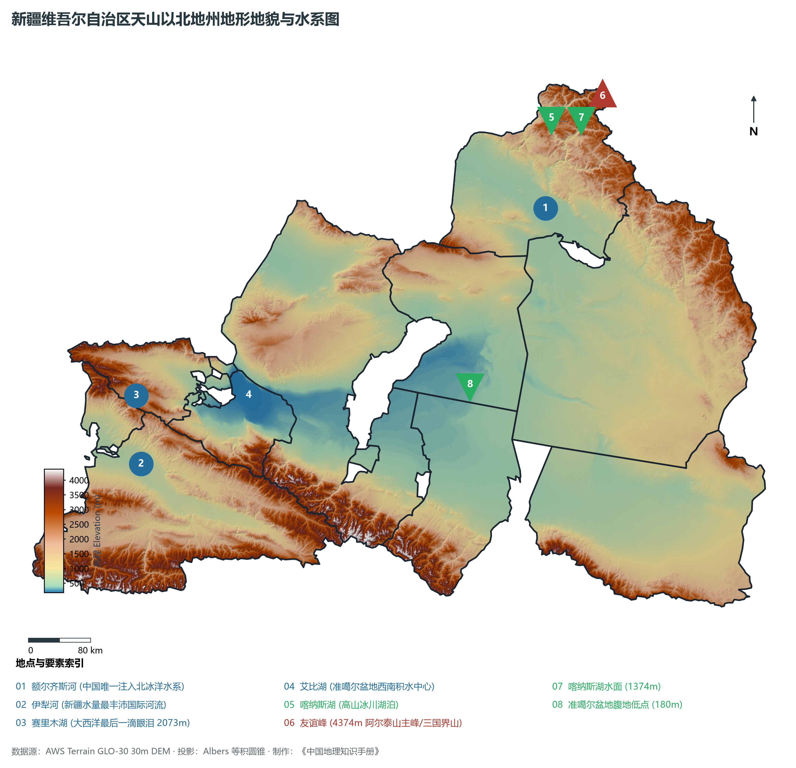
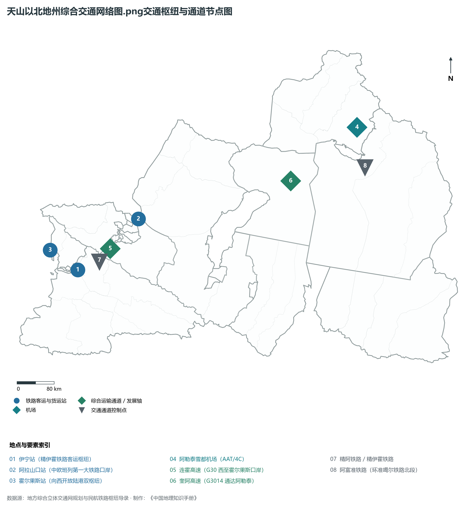
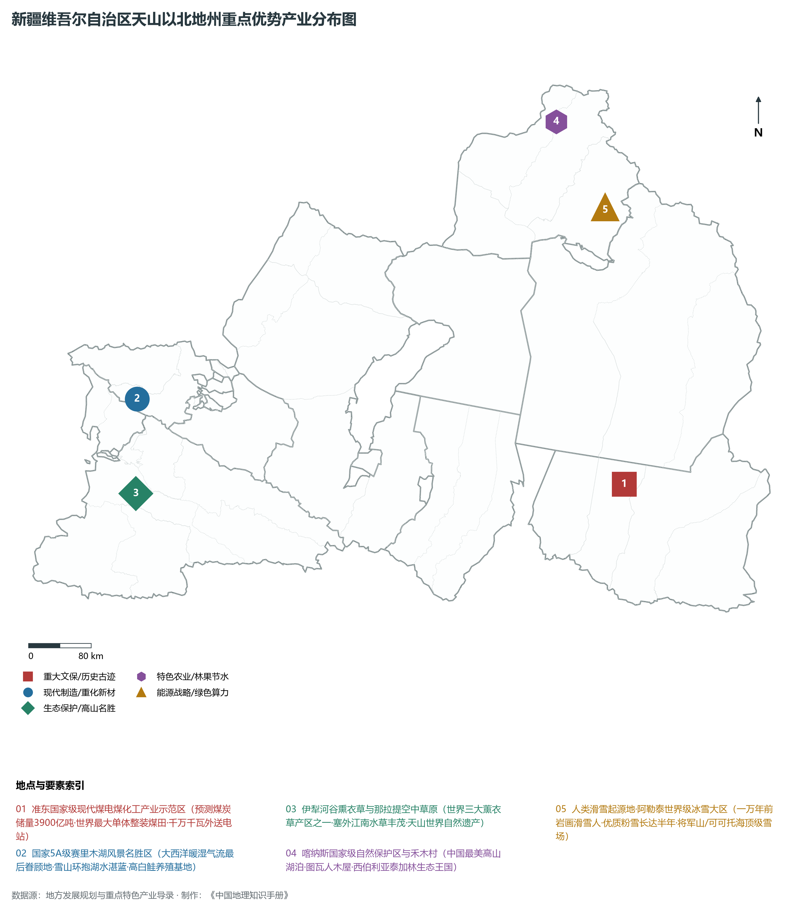
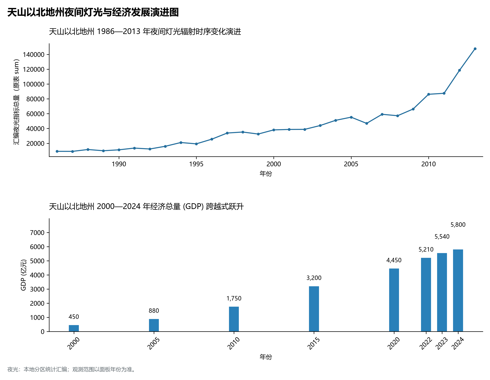

# 32.5 天山以北地州（昌吉、博州、伊犁、塔城、阿勒泰）

天山以北地州，是天山北坡经济带与“一带一路”向西开放沿边战略口岸的核心承载区，涵盖昌吉回族自治州、博尔塔拉蒙古自治州、伊犁哈萨克自治州、塔城地区与阿勒泰地区五大行政单元。地理范围广袤辽阔，南倚横贯东西的巍巍天山，北抵雄奇俊美的阿尔泰山，东连哈密与蒙古高原，西临哈萨克斯坦等中亚邻国。总面积达 **45.0 万 km²**，约占新疆总面积的 27%；2024 年末常住人口总数达 **620.0 万人**，综合城镇化率约为 **62.5%**；2024 年五地州合计实现地区生产总值（GDP）预计达到 **5 800.0 亿元**，人均 GDP 达 **93 550 元**，三次产业结构为 16.5 : 45.2 : 38.3。

北疆五地州是大自然赋予新疆最丰腴多姿的地理锦绣，也是国家能源战略储备与跨国贸易走廊的第一前沿：

- **昌吉回族自治州**：天山北坡城市群的产业腹地，拥有世界最大单体整装煤田——预测储量达 3 900 亿吨的准东煤田，建成了世界电压等级最高（±1 100 kV）的准东—皖南特高压输电工程，同时孕育了“瑶池仙境”天山天池；
- **博尔塔拉蒙古自治州**：享有“大西洋最后一滴眼泪”赛里木湖的湛蓝奇绝，坐拥国家向西开放的“黄金口岸”阿拉山口；
- **伊犁哈萨克自治州（直属县市）**：天山向西敞开的湿润喇叭口造就了降水丰沛、水草丰茂的“塞外江南”，那拉提空中草原绿浪连天，霍城薰衣草香飘万里，霍尔果斯口岸崛起为现代化国际边境合作中心与自贸特区；
- **塔城地区**：土地肥沃的“粮仓肉库”，拥有百余年通商史的国家一类陆路口岸巴克图，更以“小白杨哨所”传颂着边防战士的赤胆忠心；
- **阿勒泰地区**：“金山银水”之乡，友谊峰（海拔 4 374 m）巍然耸峙于四国交界，喀纳斯湖深藏西伯利亚泰加林秘境，中国唯一注入北冰洋的外流河额尔齐斯河奔流不息，万年前滑雪岩画更证明这里是无可争议的“人类滑雪起源地”。

---

## 一、综合区情速览

| 核心指标 | 五地州合计 / 典型数据 | 战略定位 / 区域特色 |
|:---|:---|:---|
| **土地总面积** | 450 000 km² | 占全区 27.0%，涵盖天山北麓、伊犁河谷、阿尔泰山地 |
| **常住人口 (2024)** | 620.0 万人 | 聚集汉族、哈萨克族、维吾尔族、回族、蒙古族等多元民族 |
| **城镇化率** | 62.5% | 昌吉市、伊宁市、奎屯市城镇化率超 75% |
| **地区生产总值 (GDP)** | 5 800.0 亿元 (2024) | 占全疆经济总量近 30%，北疆现代经济主引擎 |
| **人均 GDP** | 93 550 元 | 工业大州昌吉州人均 GDP 超 13 万元 |
| **三次产业结构** | 16.5 : 45.2 : 38.3 | 现代能源重化、沿边口岸经贸与生态冰雪文旅深度交融 |
| **高程极值跨度** | 友谊峰 4 374 m / 准噶尔盆地腹地 180 m | 相对落差达 4 194 m，涵盖冰川、针叶林、草原与沙海 |
| **对外陆路口岸** | 阿拉山口、霍尔果斯、巴克图、吉木乃等 | 拥有全国通关效率最高、班列开行量最大的口岸集群 |
| **水文生态地标** | 额尔齐斯河、伊犁河、赛里木湖、喀纳斯湖 | 新疆地表水资源最富集、外流与冷水湖泊最密集的地理带 |

**图 32-05-1 新疆维吾尔自治区天山以北地州空间格局图**：图上编号与地点、要素索引对应。

---

## 二、自然地理：冰川金山、湿润河谷与大西洋暖湿眷顾

**图 32-05-2 新疆维吾尔自治区天山以北地州地形地貌与水系图**：图上编号与地点、要素索引对应。

### 1. 独一无二的大气环流与“塞外江南”伊犁河谷

- **大西洋水汽的深情馈赠**：伊犁河谷三面环山（北有博罗科努山、南有哈尔克他乌山、东有那拉提山），地势自西向东呈狭长喇叭口向西敞开。自大西洋万里跋涉而来的盛行西风深入谷地，在山坡强烈抬升形成地形雨，年降水量高达 400—800 mm，局部山区突破 1 000 mm，使伊犁河谷成为干旱干热大西北腹地罕见的湿润绿洲，孕育了那拉提、喀拉峻等世界上最美丽的针叶林草甸与薰衣草黄金种植带；
- **赛里木湖——高山冷水明珠（海拔 2 073 m）**：位于博乐市西南部天山高山盆地中，水域面积 458 km²，最大水深达 106 m。因为是大西洋暖湿气流最后眷顾的高山湖泊，被诗意誉为“大西洋最后一滴眼泪”；湖水透明度达 12 米以上，湛蓝如镜，雪峰环绕，是我国著名的冷水高白鲑养殖繁育基地；
- **艾比湖湿地**：准噶尔盆地西南部的构造积水洼地，是北疆最大的咸水湖，对阻止古尔班通古特沙海向西扩张发挥着不可替代的生态屏障作用。

### 2. 阿尔泰山“金山银水”与唯一北冰洋外流河

- **阿尔泰山地与冰川泰加林**：主峰友谊峰海拔 **4 374 m**，终年冰雪覆盖。受北冰洋极地气团影响，发育有极其茂密的西伯利亚落叶松、冷杉与白桦混交泰加林；
- **喀纳斯湖（高山深水冰川湖泊）**：海拔 1 374 m，蓄水量达 53.8 亿 m³，最大水深近 190 m，是中国最深的冰川融水高山淡水湖之一，云雾缭绕、宛如童话世界；
- **额尔齐斯河（中国唯一北冰洋水系）**：自东南向西北横穿阿勒泰地区，流经哈萨克斯坦注入北冰洋。中国境内长 546 km，年均径流量逾 **110 亿 m³**，沿岸水草繁茂、河谷林连绵如画，孕育了可可托海三号矿坑（为共和国“两弹一星”立下汗马功劳的功勋矿坑）。

---

## 三、道路交通：沿边国际陆港与环准噶尔铁路闭环

**图 32-05-3 天山以北地州综合交通网络图.png交通枢纽与通道节点图**：图上编号与地点、要素索引对应。

### 1. 国际铁路口岸双双突破万列

- **阿拉山口站**：新亚欧大陆桥中国段西端起点，国家特等铁路口岸。中欧班列在此完成宽准轨换装西出国门，年过货量超千万吨；
- **霍尔果斯站**：精伊霍铁路终点，拥有全球首个跨国边境自由合作中心——中哈霍尔果斯国际边境合作中心，中欧班列通行量年年跃上新台阶；
- **北疆铁路环线全线贯通**：由北疆铁路、奎北铁路、阿富准铁路（阿勒泰—富蕴—准东）共同构成了环绕准噶尔盆地全长逾 1 400 km 的铁路大闭环，使准东煤炭、阿勒泰矿产与北疆旅游全线畅达。

### 2. 国家高速骨干与口岸畅达

- **连霍高速（G30）**：一路向西穿过赛里木湖隧道直通霍尔果斯国门；
- **奎阿高速（G3014）**：将奎屯、克拉玛依与阿勒泰完全拉入高速交通网；
- **密集支线航空群**：伊宁机场（开通国际口岸包机）、阿勒泰雪都机场、博乐阿拉山口机场、塔城千泉机场、富蕴可可托海机场等互为支撑。

---

## 四、重点优势产业：准东能源、沿边特区与人类滑雪起源地

**图 32-05-4 新疆维吾尔自治区天山以北地州重点优势产业分布图**：图上编号与地点、要素索引对应。

### 1. 准东国家级现代煤电煤化工与特高压

- **准东大型煤电基地**：地跨昌吉州吉木萨尔、奇台、木垒等县，已探明煤炭储量超 **2 100 亿吨**，预测储量 **3 900 亿吨**，为世界罕见的单体整装特大煤田；
- **昌吉—古泉 ±1 100 千伏特高压工程**：全长 3 293 km，额定输送功率 1 200 万千瓦，是世界上电压最高、输送容量最大、输电距离最长的特高压直流输电超级工程，年送电量相当于安徽省年全社会用电量的近四分之一。

### 2. 人类滑雪起源地·阿勒泰冰雪大产业

- **万年滑雪岩画**：在阿勒泰市敦德布拉克洞穴彩绘岩画中，考古专家发现了距今约 1.2 万年前人类脚踏毛皮滑雪板、手持单杆滑雪的生动岩画，国际滑雪界正式认定阿勒泰为**世界人类滑雪起源地**；
- **顶级粉雪资源**：阿勒泰冬季漫长（长达 180 天以上），降雪量大、雪质松软干燥为世界顶尖“粉雪”，布局有将军山、可可托海国际滑雪场、吉克普林国际滑雪度假区等世界级滑雪场，打造千亿级冰雪旅游胜地。

---

## 五、夜间灯光时序变迁与经济变化

本节夜光图的观测年份为 1986—2013 年，指标为行政区汇总值（原表 sum）。

**图 32-05-5 天山以北地州夜间灯光与经济发展演进图**：各面板按标注的观测年份、指标和单位列示。

### 1. 北疆大地夜间灯光的“群星闪耀”

- **1997—2008 年（准东开发与口岸扩容）**：准东五彩湾矿区破土动工，霍尔果斯口岸升级，阿拉山口换装枢纽夜间大放异彩；

### 2. 经济总量（GDP）强劲跨越
五地州合计 GDP 从 2000 年的 **450.0 亿元**，到 2010 年的 **1 750.0 亿元**，2020 年跨越 **4 450.0 亿元**，2024 年攀升至 **5 800.0 亿元**，展现出稳疆兴疆、向西开放的强大发展韧性。
