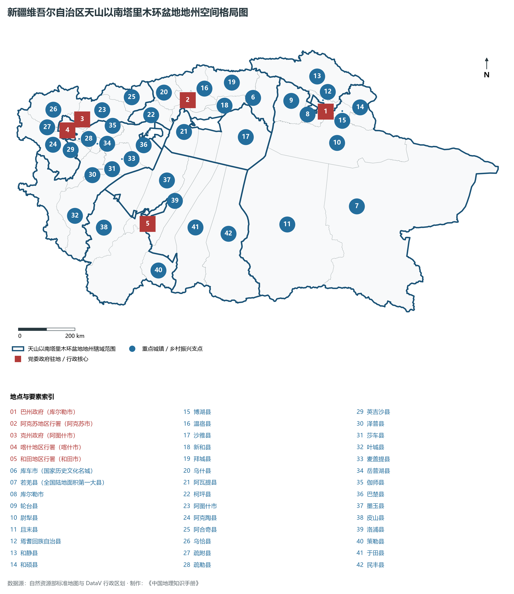
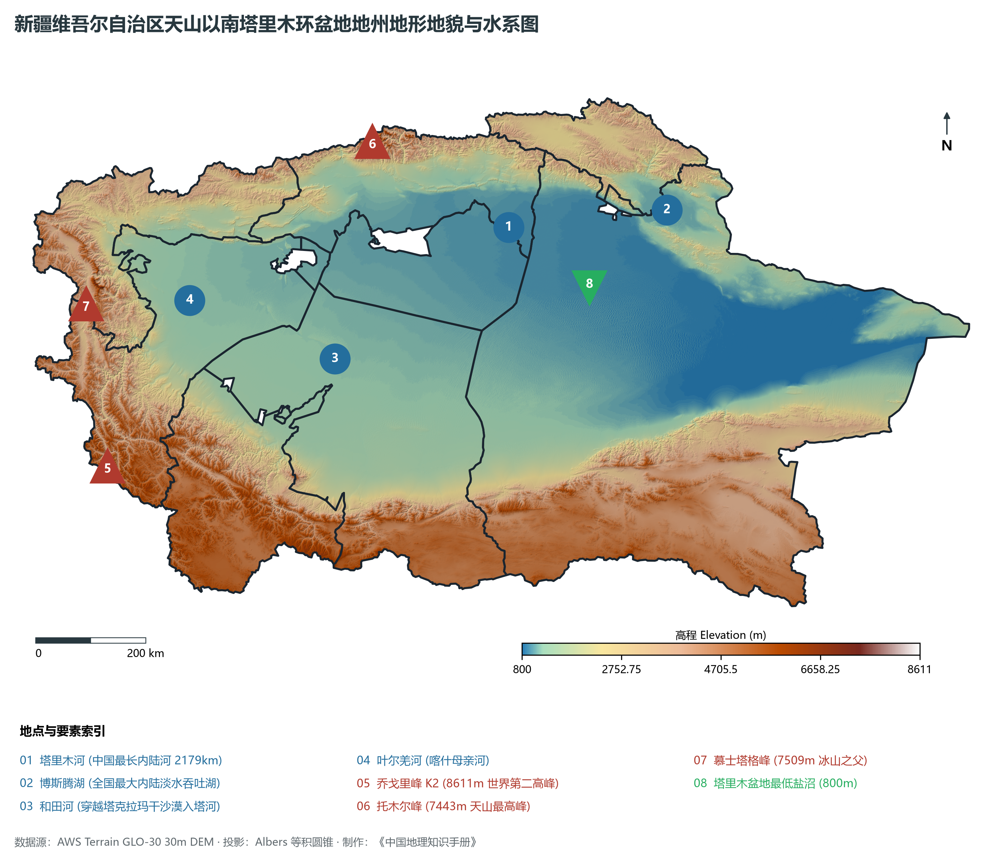
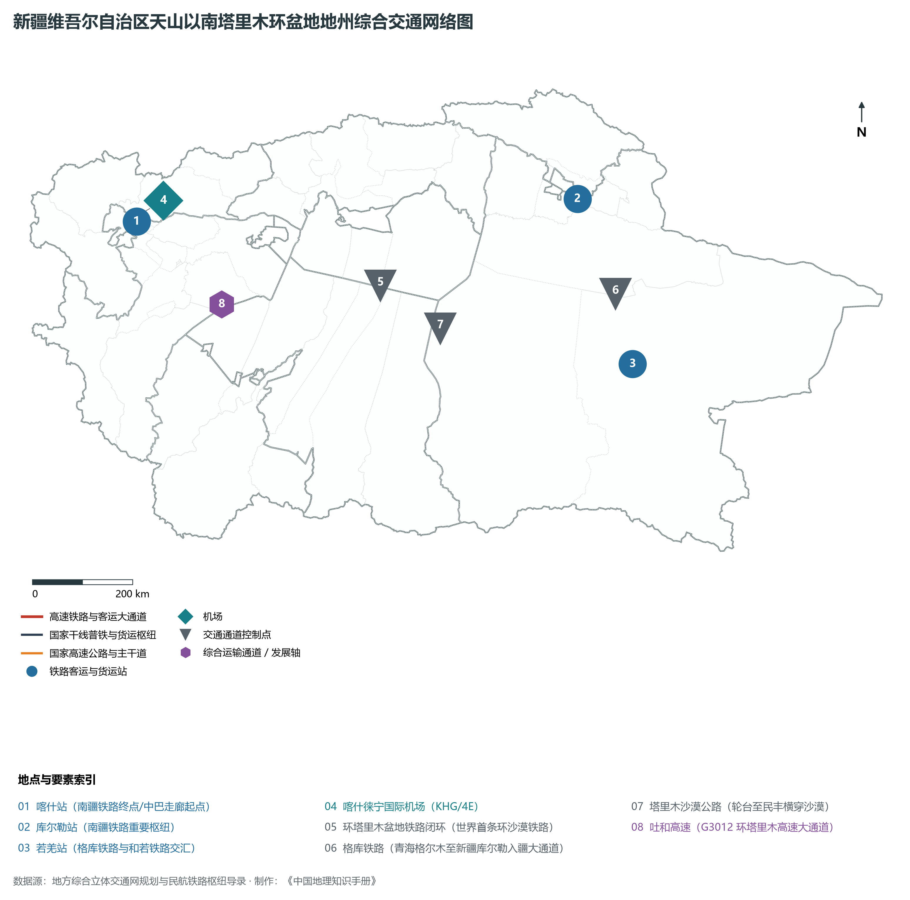
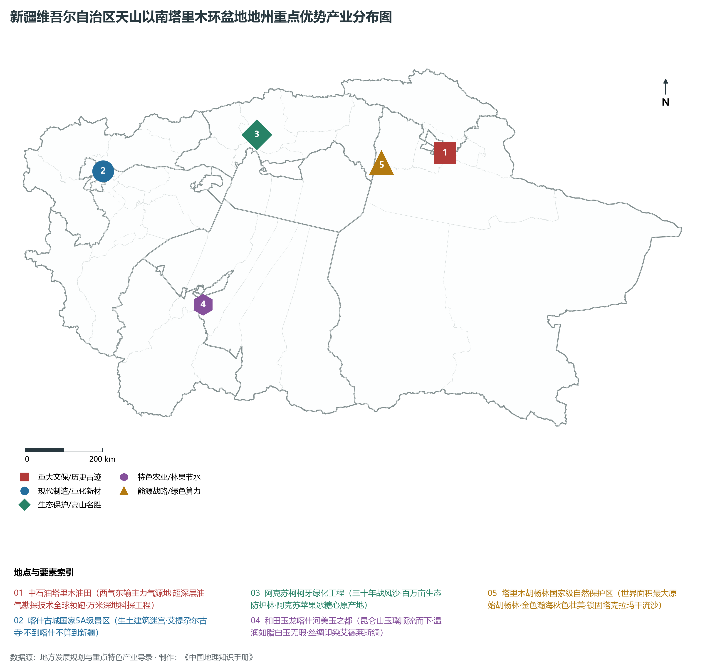
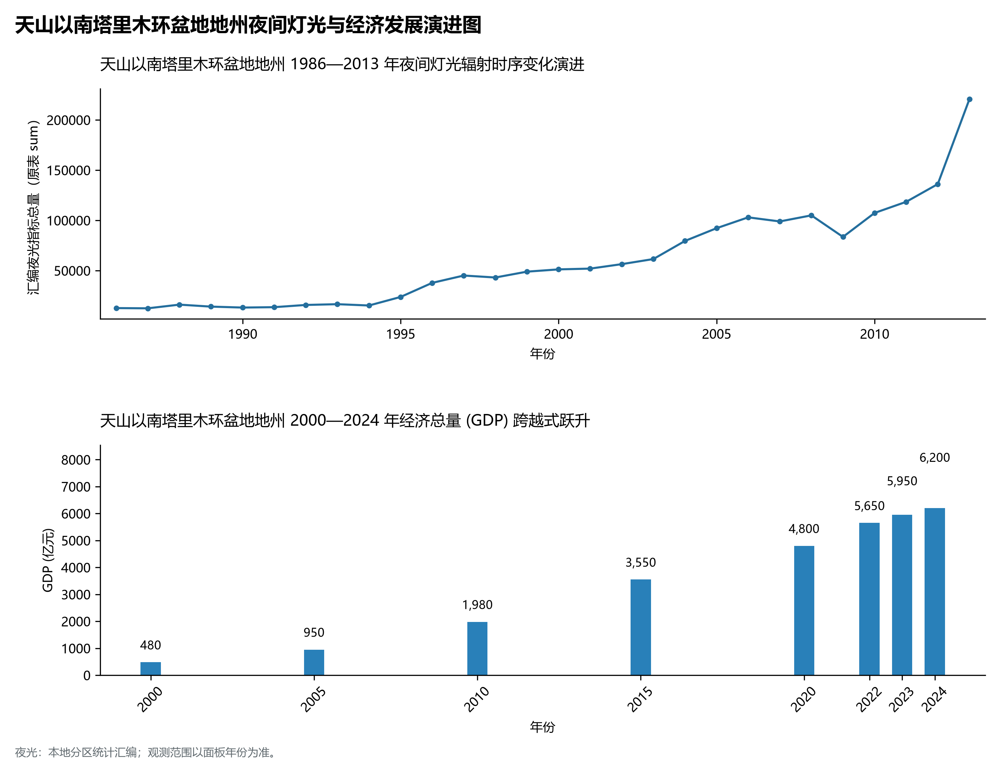

# 32.6 天山以南塔里木环盆地地州（巴州、阿克苏、克州、喀什、和田）

天山以南塔里木环盆地地州，是南疆绿洲经济带、丝绸之路南道与向西开放通达中亚南亚的核心战略版图，涵盖巴音郭楞蒙古自治州、阿克苏地区、克孜勒苏柯尔克孜自治州、喀什地区与和田地区五大行政单元。全域北屏雄浑巍峨的天山山脉，南枕横空出世的昆仑山脉与阿尔金山，西立险峻绝伦的帕米尔高原，中央环抱中国第一大盆地塔里木盆地与“死亡之海”塔克拉玛干沙漠。总土地面积近 **100 万 km²**（约占新疆总面积的 60%）；2024 年末常住人口总数达到 **1 250.0 万人**（占全疆人口近一半），少数民族人口占 80% 以上；综合城镇化率约为 **45.0%**；2024 年五地州合计实现地区生产总值（GDP）预计达到 **6 200.0 亿元**，人均 GDP 达 **49 600 元**，三次产业结构为 23.5 : 38.2 : 38.3。

南疆五地州是大国地理中尺度最壮阔、反差最极端、历史文脉最厚重的地理华章：

- **巴音郭楞蒙古自治州（巴州）**：全国陆地面积第一大州（面积达 47.15 万 km²，相当于苏浙闽三省总和），拥有中国最大内陆淡水吞吐湖博斯腾湖、塔里木油田指挥部库尔勒，深藏楼兰古城与罗布泊沧海桑田的岁月秘境；
- **阿克苏地区**：天山最高峰托木尔峰（海拔 7 443 m）巍然耸峙，各族军民历时三十余载在荒漠戈壁筑起百万亩“柯柯牙绿化奇迹”（荣获联合国全球 500 佳环境保护奖），更以阿克苏冰糖心苹果名扬天下；
- **克孜勒苏柯尔克孜自治州（克州）**：“万山之州”与帕米尔高原西陲门户，慕士塔格峰（海拔 7 509 m）与公格尔峰白雪皑皑，守卫着伊尔克什坦与吐尔尕特两大古老跨境商贸国门；
- **喀什地区**：国家历史文化名城、“不到喀什不算到新疆”的千年活态古城，中巴经济走廊的起点与向西开放的经济特区，莎车十二木卡姆流淌着维吾尔族璀璨艺术精魂；
- **和田地区**：昆仑山下美玉之源，玉龙喀什河与喀拉喀什河冲刷出温润绝伦的和田羊脂白玉，艾德莱斯绸五彩斑斓，各族群众在沙漠南缘顽强打赢防沙治沙与脱贫攻坚战役。

---

## 一、综合区情速览

| 核心指标 | 五地州合计 / 典型数据 | 战略定位 / 区域特色 |
|:---|:---|:---|
| **土地总面积** | 近 1 000 000 km² | 占全疆 60%，中国最大的内陆盆地与荒漠绿洲环带 |
| **常住人口 (2024)** | 1 250.0 万人 | 维吾尔族占主体，多民族大聚居、交往交流交融 |
| **城镇化率** | 45.0% | 库尔勒市超 75%、喀什市超 70%，乡村人口基数庞大 |
| **地区生产总值 (GDP)** | 6 200.0 亿元 (2024) | 油气开采、优质商品棉纺织与特色林果业三大支柱巩固 |
| **人均 GDP** | 49 600 元 | 资源型城市库尔勒人均近 12 万元，南疆总体加速跨越 |
| **三次产业结构** | 23.5 : 38.2 : 38.3 | 现代农业基础极深，油气重化顶天立地，文旅新业态蓬勃 |
| **极值高程跨度** | 乔戈里峰 8 611 m / 塔里木盆地最低盐沼 800 m | 垂直落差达 7 811 m，世界第二高峰耸立西南边陲 |
| **能源支柱地位** | 塔里木油田西气东输主力气源地 | 累计探明油气地质储量数十亿吨，万米深地科探井连创纪录 |
| **世界级文化遗迹** | 喀什古城、克孜尔千佛洞、楼兰故城 | 丝绸之路南道、中道多元文明碰撞融合的活态博物馆 |

**图 32-06-1 新疆维吾尔自治区天山以南塔里木环盆地地州空间格局图**：图上编号与地点、要素索引对应。

---

## 二、自然地理：天山昆仑双壁、死亡之海与冰川源流

**图 32-06-2 新疆维吾尔自治区天山以南塔里木环盆地地州地形地貌与水系图**：图上编号与地点、要素索引对应。

### 1. 世界第二高峰与超级山盆构造

- **世界第二高峰——乔戈里峰（K2，海拔 8 611 m）**：坐落于喀什地区叶城县与巴基斯坦交界的喀喇昆仑山脉中段，山势极其高耸险峻，垂直高差超 4 000 m，冰川密布，是国际登山界公认攀登难度最高、最具挑战性的极高峰；
- **天山最高峰——托木尔峰（海拔 7 443 m）**：耸立于阿克苏地区温宿县境内，天山山脉最高主峰，发育现代冰川 800 余条，冰川储量占全天山的四分之一，是南疆天山第一水塔；
- **帕米尔三雄**：克州境内的公格尔峰（7 649 m）、公格尔九别峰（7 530 m）与“冰山之父”慕士塔格峰（7 509 m）品字形耸峙，山巅积雪如白发银须，倒映在卡拉库里湖如梦如幻。

### 2. 塔里木河生命长廊与万亩胡杨林

- **塔里木河干流（中国最长内陆河）**：阿克苏河（补给径流占 70%）、叶尔羌河与和田河在阿拉尔附近肖夹克汇合始称塔里木河干流，沿盆地北部穿行 1 321 km，最终消亡于若羌台特玛湖。流域哺育了南疆 60% 以上的人口与耕地；
- **世界最大原始胡杨林生态屏障**：在巴州轮台、尉犁及阿克苏沙雅等地分布着集中连片的天然胡杨林（保护区面积达 39 万公顷）。“生而一千年不死，死而一千年不倒，倒而一千年不朽”，金色胡杨阻挡流沙侵蚀，构筑起阻隔塔克拉玛干沙漠与库姆塔格沙漠合拢的最后绿色长城。

---

## 三、道路交通：世界首条环沙漠铁路闭环与通亚陆港

**图 32-06-3 新疆维吾尔自治区天山以南塔里木环盆地地州综合交通网络图**：图上编号与地点、要素索引对应。

### 1. 2 712 km 环沙漠铁路世界工程奇迹

- **世界首条环沙漠铁路线全线贯通**：由南疆铁路（吐鲁番—喀什）、喀和铁路（喀什—和田）、和若铁路（和田—若羌，825 km）与格库铁路（若羌—库尔勒）无缝闭合，全长 **2 712 km**。特别是和若铁路采用“以桥代路”防沙治沙工法，在沙海中架设数十公里高架桥让风沙从桥下穿过，彻底改写了南疆物资与人员需绕行数千公里的历史；
- **格库铁路（南疆出疆第二大通道）**：翻越阿尔金山直抵青海格尔木，使南疆物资无需绕道乌鲁木齐，直接通达西北与西南内地；
- **喀什中欧班列集结港**：开行中吉乌公铁联运班列与中巴货运车队，打造连接南亚、中亚、欧洲的内陆开放桥头堡。

### 2. 穿越沙海的公路生命线

- **四条纵穿塔克拉玛干沙漠公路**：轮台—民丰（522 km）、阿拉尔—和田（424 km）、阿克苏—阿拉尔、尉犁—且末沙漠公路，将盆地南北两缘直接连通，成为油气勘探保障与自驾旅游的传奇走廊；
- **吐和高速（G3012）**：全长近 2 000 km，环绕盆地北缘与西缘，全线高速化通车。

---

## 四、重点优势产业：深地油气、活态古城与治沙奇迹

**图 32-06-4 新疆维吾尔自治区天山以南塔里木环盆地地州重点优势产业分布图**：图上编号与地点、要素索引对应。

### 1. 中石油塔里木油田与万米深地科探

- **西气东输主力气源地**：塔里木盆地超深层油气地质储量占全国 80% 以上，克拉 2、克深、博孜—大北等万亿方超深大气区年产天然气超 330 亿立方米，累计向国家“西气东输”工程供气逾 3 500 亿 m³，造福沿线 15 个省市、4 亿多居民；
- **万米“深地工程”**：在巴州沙雅县境内成功钻探我国首口万米科探井——“深地塔科 1 井”（井深超 10 000 m），创造了亚洲陆上最深井纪录，开启了我国万米深地油气勘探新纪元。

### 2. 活态古城与柯柯牙生态史诗

- **喀什古城国家 5A 级景区**：拥有两千多年历史，占地面积达 4.25 km²。城区完整保留了传统维吾尔生土民居建筑群与古老街巷迷宫，手工艺街铜器叮当、木雕生花。国家斥资数十亿元实施老城危旧房抗震改造，开创了在保留古城原貌与民族风情前提下兼顾现代消防与抗震安全的“联合国教科文组织人居典范”；
- **阿克苏柯柯牙绿化工程**：昔日柯柯牙狂风肆虐、漫天黄沙。从 1986 年起，阿克苏历任领导带领数百万军民开展了持续三十余年的绿化造林会战，在亘古荒原上筑起一条东西长 25 km、南北宽 4 km 的百万亩绿色生态林屏障，不仅彻底改善了区域小气候，更发展出享誉全国的**阿克苏冰糖心苹果**百亿富民产业。

---

## 五、夜间灯光时序变迁与经济变化

本节夜光图的观测年份为 1986—2013 年，指标为行政区汇总值（原表 sum）。

**图 32-06-5 天山以南塔里木环盆地地州夜间灯光与经济发展演进图**：各面板按标注的观测年份、指标和单位列示。

### 2. 经济总量（GDP）强劲跃升
五地州合计 GDP 从 2000 年的 **480.0 亿元**，到 2010 年的 **1 980.0 亿元**，2020 年跃升至 **4 800.0 亿元**，2024 年昂首突破 **6 200.0 亿元**，以澎湃的生机活力书写着南疆全面振兴与繁荣稳定的新篇章。
