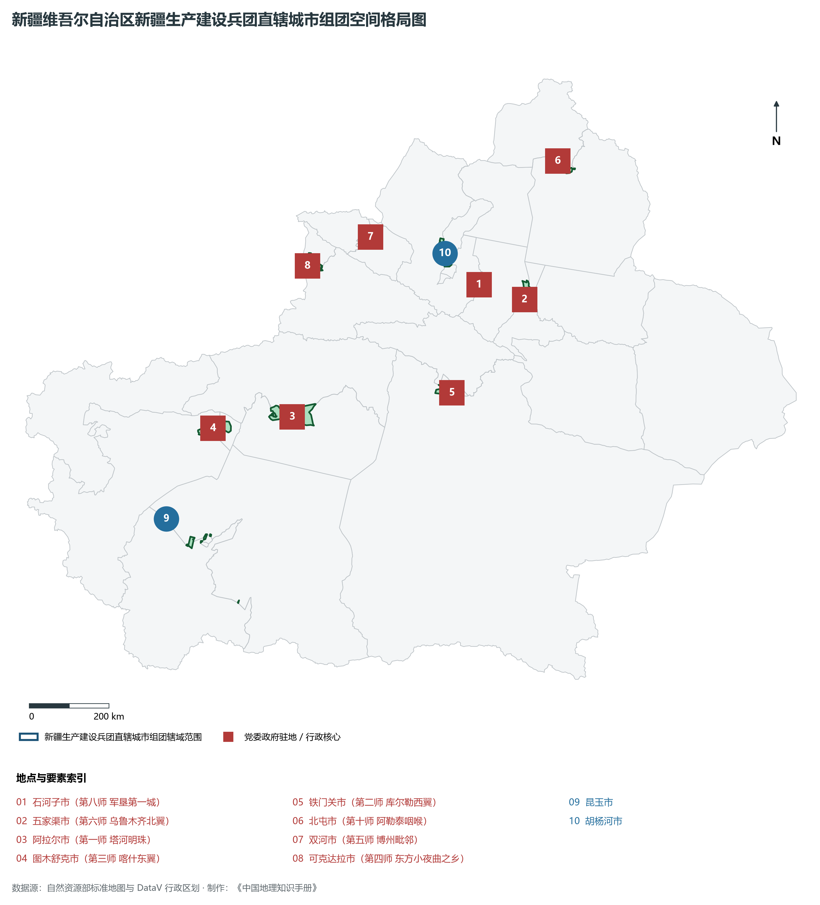
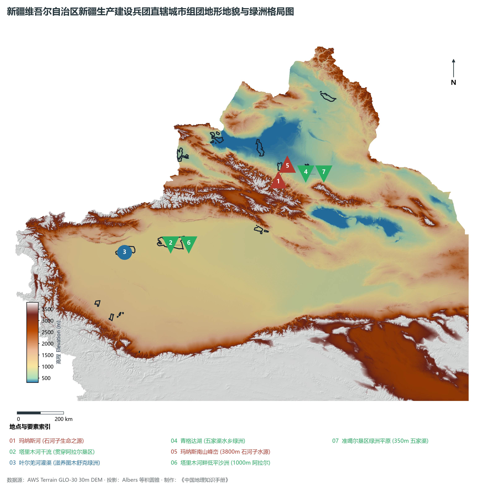
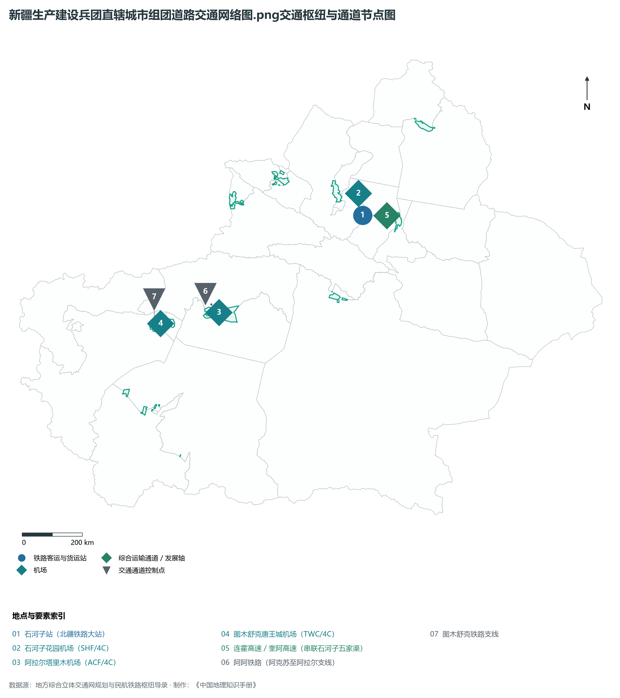
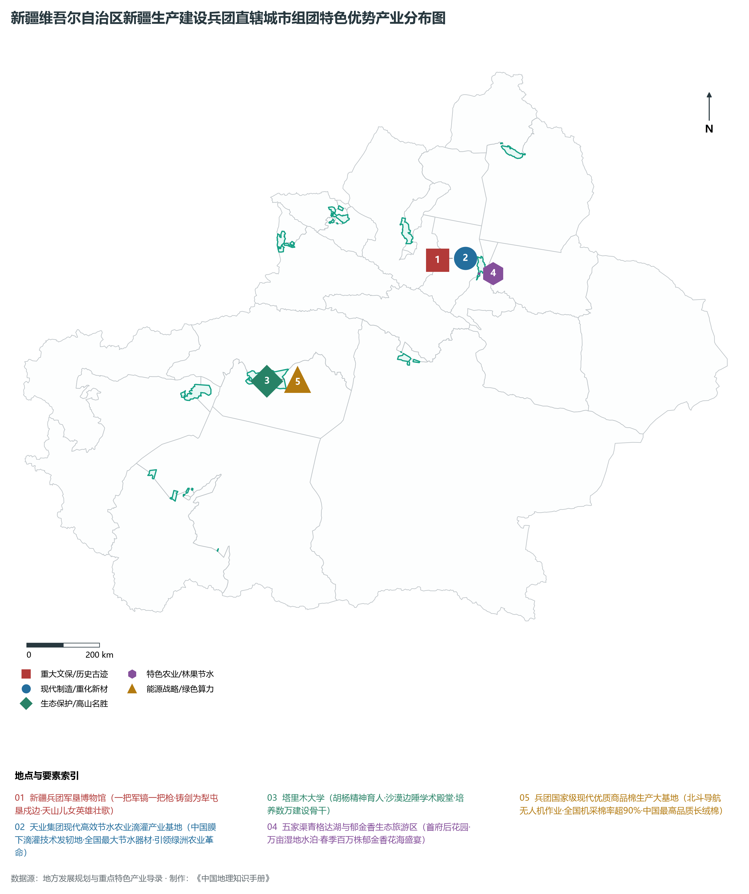
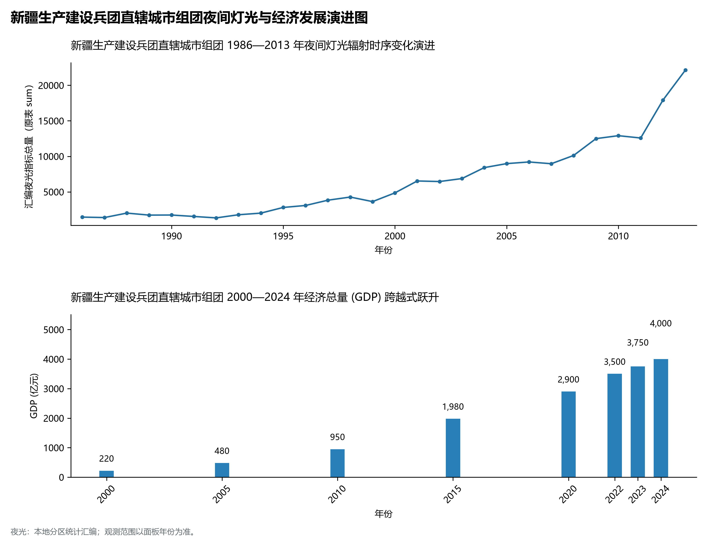

# 32.7 新疆生产建设兵团直辖城市组团（石河子、阿拉尔、图木舒克、五家渠等）

新疆生产建设兵团直辖县级城市组团，是共和国屯垦戍边伟大战略实践在天山南北催生出的现代绿洲城镇体系奇迹，是国家安边固疆的稳定器、凝聚各族群众的大熔炉、先进生产力和先进文化的示范区，也是中国城市地理中绝无仅有的“师市合一、团镇合一”特殊行政体制形态。兵团城市星罗棋布于全疆两大盆地边缘、边境线内侧与风沙前沿，总管理土地面积达 **7.06 万 km²**；2024 年末兵团直辖城市组团及其辖区常住人口达到 **350.0 万人**，综合城镇化率高达 **72.0%**；2024 年兵团直辖城市组团及其所属师部合计实现地区生产总值（GDP）预计达到 **4 000.0 亿元**，人均 GDP 跃达 **11.43 万元**，三次产业结构呈现高效率现代农牧业、新型重化工业与现代服务业均衡并进的格局（18.2 : 44.5 : 37.3）。

“戈壁惊开新世界，生荒种出万亩田。”1949 年新疆和平解放后，中国人民解放军第一野战军第一兵团等部响应党中央毛主席“自力更生、屯垦戍边”的号召，十万大军放下枪杆、拿起坎土曼，“铸剑为犁、扎根边疆”，于 1954 年 10 月正式组建新疆生产建设兵团。七十年来，几代兵团军垦人“献了青春献终身，献了终身献子孙”，在亘古荒原、碱滩沙海中阻狂风、斗严寒、引天山清泉、治流沙盐碱，用双手硬生生开垦出上千万亩现代节水高产绿洲农田，建成了以**石河子市**（第八师，“军垦第一城”）、**阿拉尔市**（第一师，“塔河明珠”）、**图木舒克市**（第三师）、**五家渠市**（第六师）、**北屯市**（第十师）、**铁门关市**（第二师）、**双河市**（第五师）、**可克达拉市**（第四师，“东方小夜曲之乡”）、**昆玉市**（第十四师）、**胡杨河市**（第七师）、**新星市**（第十三师）、**白杨市**（第九师）等为骨干的 **12 座现代化直辖城市群**。兵团不仅以全国最高水平的膜下滴灌技术和超过 90% 的北斗导航机械化采棉率引领了中国现代绿洲农业革命，更构筑起维护祖国统一、促进社会稳定与长治久安的钢铁长城。

---

## 一、综合组团速览

| 核心指标 | 兵团城市组团合计 / 典型数据 | 战略定位 / 体制特征 / 显著成就 |
|:---|:---|:---|
| **管理土地面积** | 70 600 km² | 占全区 4.24%，分布于天山南北两缘与边境战略前沿 |
| **常住总人口 (2024)** | 350.0 万人 | 兵团职工与多民族群众休戚与共、深度嵌入共居 |
| **综合城镇化率** | 72.0% | 石河子、五家渠超 80%，兵团城镇集聚功能日益强化 |
| **生产总值 (GDP)** | 4 000.0 亿元 (2024) | 现代农业贡献突出，新型煤电化与硅基新材料发展迅猛 |
| **人均 GDP** | 114 280 元 | 突破 11 万元，位列全疆前列、西北领先水平 |
| **三次产业结构** | 18.2 : 44.5 : 37.3 | 全国现代农业标杆，农产品加工与高端制造业集聚 |
| **行政管理体制** | “师市合一、团镇合一” | 师长兼任市长、师党委与市委合署，维稳戍边组织健全 |
| **农业科技指标** | 节水滴灌面积超 2 000 万亩 / 机采率 90%+ | 自主研发膜下滴灌全球领先，全国最大优质高产商品棉基地 |
| **标志性荣誉荣誉** | 联合国改善人居环境良好范例奖 (石河子) | 戈壁滩上建起的国家森林城市、园林城市与绿色奇迹 |

**图 32-07-1 新疆维吾尔自治区新疆生产建设兵团直辖城市组团空间格局图**：图上编号与地点、要素索引对应。

---

## 二、自然地理：戈壁开天、引水固沙与现代绿洲网络

**图 32-07-2 新疆维吾尔自治区新疆生产建设兵团直辖城市组团地形地貌与绿洲格局图**：图上编号与地点、要素索引对应。

### 1. 恶劣生荒地与“进军沙漠”的拓荒历程
兵团各师建城之初，所划拨的土地几乎全为地方未开发的戈壁荒滩、盐碱沼泽或沙漠前沿：

- **石河子与玛纳斯河冲积扇**：位于天山北麓，当年是“一条芦苇丛生、乱石滚滚的干涸河滩”。二十二兵团指战员依靠人拉肩扛开凿了红山嘴引水渠，引玛纳斯河高山雪水，洗碱排盐、植树造林，将昔日寸草不生的戈壁荒滩改造为阡陌纵横的绿洲之城；
- **阿拉尔与塔里木河上游平原**：维吾尔语意为“绿色的岛屿”，地处塔里木河主源叶尔羌河、阿克苏河、和田河汇合处，紧贴塔克拉玛干沙漠北缘。第一师三五九旅传人进军荒原，在塔河泛滥区筑坝修渠、驯服水患，建成南疆最大的水浇粮棉绿洲；
- **极端地形跨度**：兵团垦区高程从南部昆仑山前昆玉市的海拔 1 500 米、玛纳斯南山冲积扇的 3 800 米雪线，一直延伸至准噶尔荒漠腹地五家渠垦区的 350 米与塔河下游的 900 米沙丘，创造了人进沙退的生态神话。

### 2. 水利命脉与现代农田水利工程

- **人工灌渠与水库网络**：兵团在天山南北兴建了上百座大中型水库（如大门坎水库、大石峡水库、猛进水库等），累计开挖干支防渗防漏渠道超 7 万公里，筑起了干旱区最完整高效的人工水网体系；
- **青格达湖水乡湿地（五家渠）**：水域面积 17 km²，湿地面积超 30 km²，原本为乌鲁木齐河尾闾干涸洼地，经第六师几代军垦人引水蓄洪，演变为首府北翼著名的国家级水利风景区与“天鹅湖”。

---

## 三、道路交通：纵横边疆的军垦运输廊道

**图 32-07-3 新疆生产建设兵团直辖城市组团道路交通网络图.png交通枢纽与通道节点图**：图上编号与地点、要素索引对应。

### 1. 师市铁路专用线与骨干铁路融合

- **北疆铁路上的石河子枢纽**：石河子火车站是北疆铁路客货大站，年发运工业制成品与优质农副产品数百万吨；
- **南疆支线铁路深拓**：**阿阿铁路（阿克苏至第一师阿拉尔市）**与**图木舒克铁路支线**全线贯通运营，彻底打破了南疆兵团主力城市无铁路的历史，使其客货直通喀什与乌鲁木齐。

### 2. 兵团现代化民用支线航空集群
近年来，国家大力支持兵团支线机场建设，构筑起紧密的空中桥梁：

- **石河子花园机场（4C 级）**：立足天山北坡，开通直飞西安、郑州、成都等多条国内干线；
- **阿拉尔塔里木机场（4C 级）**：作为南疆第一师的重要航空枢纽，架起了沙漠新城通向全国的空中通途；
- **图木舒克唐王城机场（4C 级）**：辐射第三师各团场与喀什东翼，实现与乌鲁木齐、伊宁等城市的快速串飞。

---

## 四、特色优势产业：滴灌农业革命、长绒棉与军垦传承

**图 32-07-4 新疆维吾尔自治区新疆生产建设兵团直辖城市组团特色优势产业分布图**：图上编号与地点、要素索引对应。

### 1. 天业集团与中国膜下滴灌技术革命

- **节水农业发轫策源地**：传统大水漫灌导致干旱土壤次生盐渍化且水资源严重浪费。第八师石河子**天业集团**经过二十余年持续科技攻关，自主研发出适合中国国情的大田膜下滴灌成套技术，将传统进口每亩上千元的滴灌器材成本降低到几百元，水资源利用率由不足 40% 提升至 85% 以上；
- **全国及全球推广**：该技术不仅在全疆数千万亩棉田、果园和粮食种植区普及，更推广至甘肃、内蒙古、宁夏乃至中亚、非洲等干旱受水区，引发了全球干旱绿洲农业的节水技术革命。

### 2. 全国最大优质商品棉基地与北斗高标准机采

- **世界最高品质长绒棉**：阿拉尔、石河子、图木舒克等垦区是我国光热条件最优质的棉花主产区，出产的特长绒棉纤维长度、强力与色泽均居世界最高水平；
- **农业现代化与智慧农机**：兵团棉花生产已实现全程机械化，装配**北斗高精度卫星导航**的自动驾驶大马力拖拉机播种、无人机飞防植保与大型采棉打包一体机采收普及率超 90%，田间不见一人、万顷银浪瞬间归仓，展现了中国式现代化农业的硬核科技力量。

### 3. 兵团军垦文化与塔里木大学“胡杨精神”

- **新疆兵团军垦博物馆（石河子）**：国家一级博物馆，馆藏军垦第一犁、补了数百个补丁的军大衣、地窝子等珍贵文物数万件，生动再现了老一辈军垦指战员“生在井冈山、长在南泥湾、转战数万里、屯垦在天山”的波澜壮阔历史；
- **塔里木大学（阿拉尔）**：王震将军 1958 年亲自创办，扎根沙漠边陲六十余载，“用胡杨精神育人、为兴疆固边服务”，为新疆各基层战线培养输送了数以万计“留得住、用得上、干得好”的栋梁之材。

---

## 五、夜间灯光时序变迁与经济变化

本节夜光图的观测年份为 1986—2013 年，指标为行政区汇总值（原表 sum）。

**图 32-07-5 新疆生产建设兵团直辖城市组团夜间灯光与经济发展演进图**：各面板按标注的观测年份、指标和单位列示。

### 2. 经济总量（GDP）历史性跨越
兵团直辖城市组团及所属师部合计 GDP 从 2000 年的 **220.0 亿元**，到 2010 年的 **950.0 亿元**，2020 年跃升至 **2 900.0 亿元**，2024 年历史性达到 **4 000.0 亿元**。兵团各族儿女正锚定新时代维稳戍边新使命，谱写出长治久安与高质量发展的壮丽新乐章。
