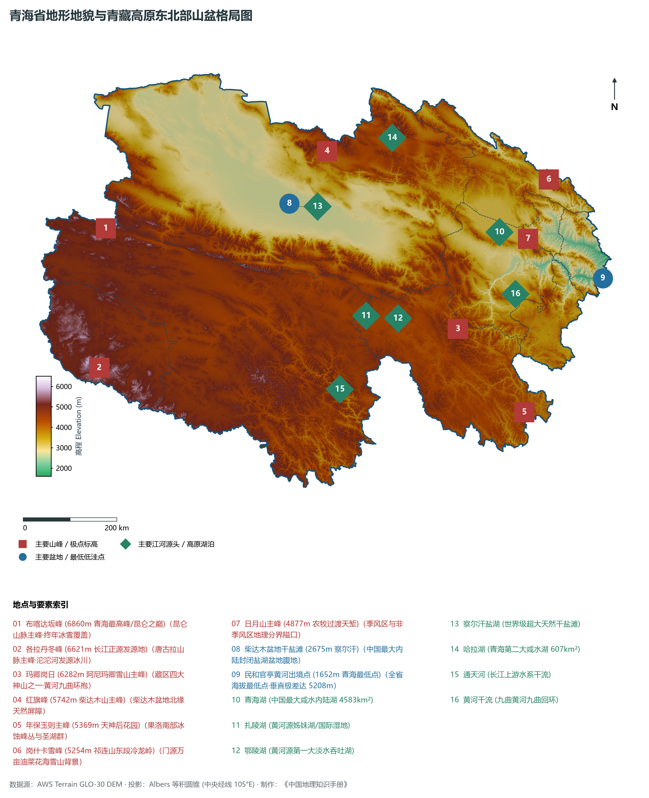
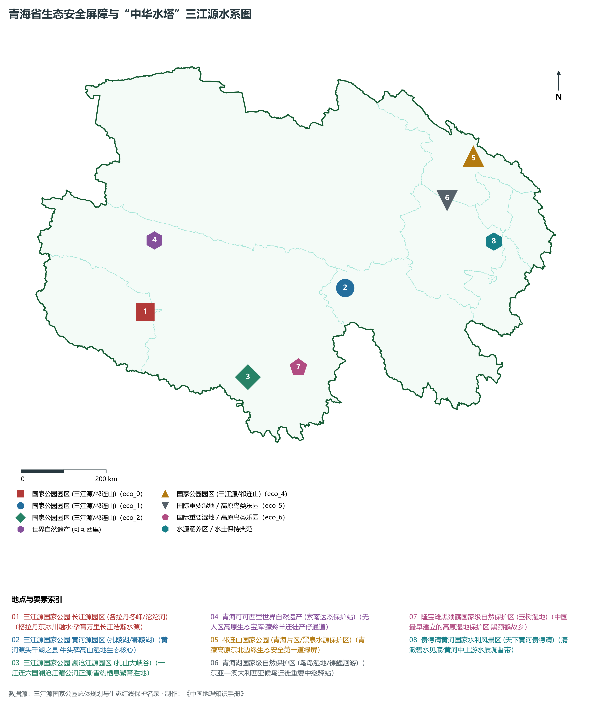
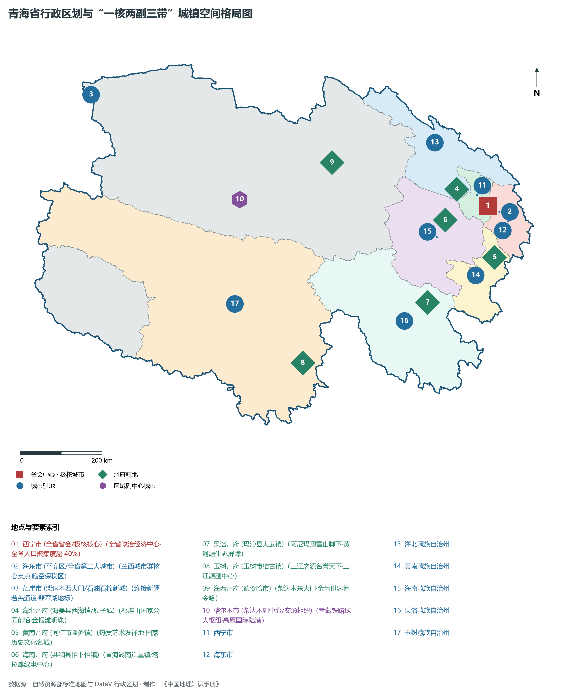
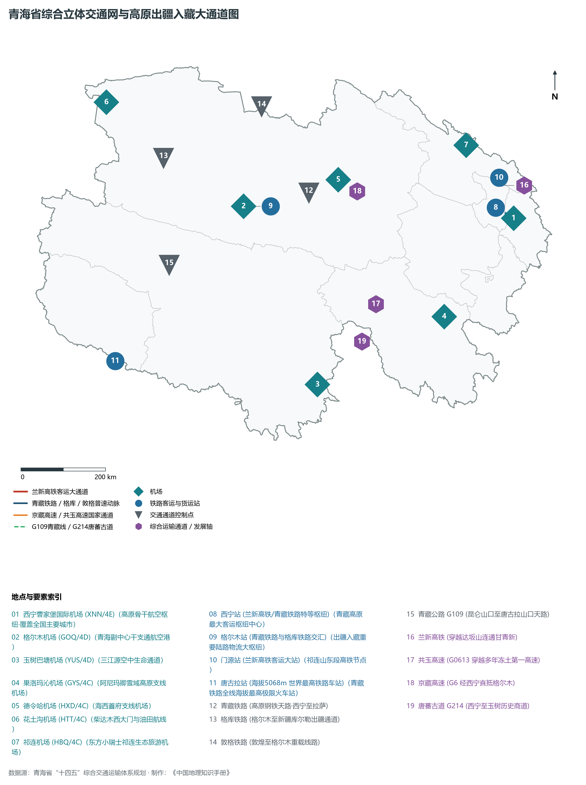
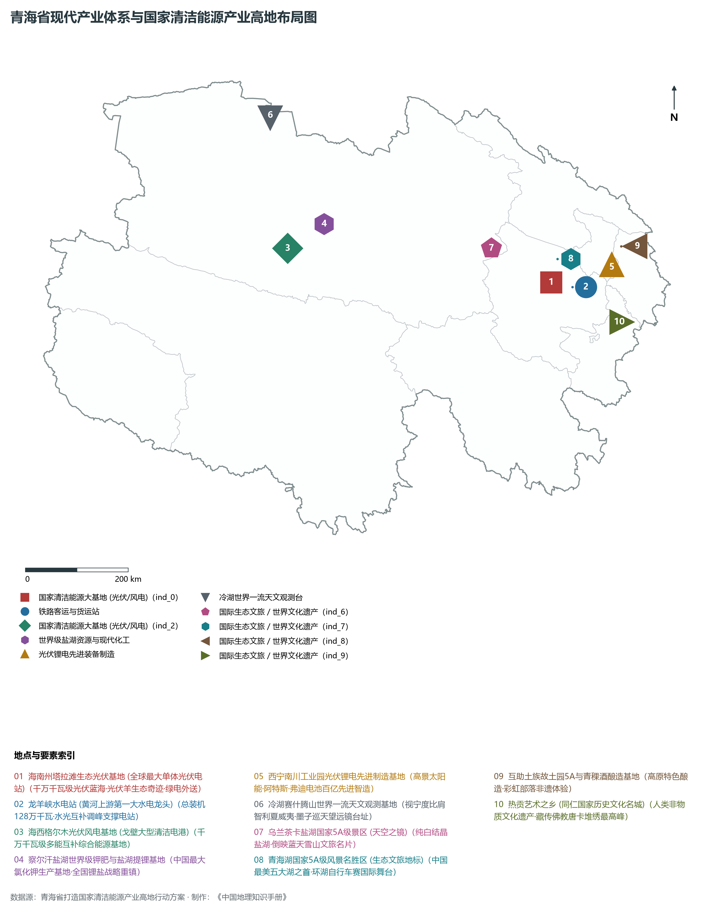

# 33.0 青海省地理统揽

青海省地处中国西北部、青藏高原东北部，介于东经 89° 35' ～ 103° 04'、北纬 31° 39' ～ 39° 19' 之间。全省东西宽约 1200 km，南北长约 800 km，辖区陆地总面积达 72.23× 10⁴ km²，位居全国各省区第 4 位（仅次于新疆、西藏和内蒙古），约占全国国土陆域总面积的 7.5%。作为“世界屋脊”的重要组成部分，青海是长江、黄河、澜沧江（湄公河）三大跨国或大流域母亲河的发源地，素有“中华水塔”、“江河之源”、“千湖之省”的美誉；其东北部镶嵌着中国最大的内陆咸水湖泊——青海湖，西北部横亘着储量极其丰富的“聚宝盆”——柴达木盆地，是我国维系国家生态安全、水源涵养安全、国土资源安全和陆路地缘战略安全的战略核心支撑屏障。

全省现辖 2 个地级市（西宁市、海东市）、6 个自治州（海北藏族自治州、黄南藏族自治州、海南藏族自治州、果洛藏族自治州、玉树藏族自治州、海西蒙古族藏族自治州），下辖 7 个市辖区、4 个县级市、25 个县、7 个民族自治县。截至 2024 年末，全省常住人口约 594 万人，常住人口城镇化率达 62.1%。青海是一个典型的多民族聚居省份，汉族、藏族、回族、土族、撒拉族、蒙古族等世居民族在此繁衍生息，其中土族和撒拉族为青海特有的世居少数民族。2024 年全省实现地区生产总值（GDP）约 3950 亿元，人均 GDP 保持在 6.6 万元以上，正全力构建以生态文明高地和产业“四地”（世界级盐湖产业基地、国家清洁能源产业高地、国际生态旅游目的地、绿色有机农畜产品输出地）为战略牵引的现代绿色高质量发展新格局。

---

## 一、自然地理与地质构造格局

青海省地处青藏高原腹地向西北干旱区和黄土高原的过渡嵌合部位，地质构造极其复杂，隶属于特提斯—喜马拉雅构造域与秦祁昆造山系交接地带。全省地势总体呈现“西部高耸深峻、西北盆地凹陷、中部平缓开阔、东部谷地深切”的三大阶梯过渡特征，全省平均海拔在 3000 m 以上，海拔超过 4000 m 的高寒山区与高原面面积占全省面积的 60% 以上。全省最高峰为坐落于海西州与新疆巴州交界处的阿尔金山主峰——布喀达坂峰（海拔 6860 m），最低点位于海东市民和回族土族自治县中川乡官亭盆地的黄河出境处（海拔 1652 m），全境相对高差达 5208 m。

在地貌宏观轮廓上，青海省被巍峨的巨型山系与断陷盆地自北向南割裂为四大各具特色的自然地貌单元：

1. **祁连山高山谷地带（东北缘）**：由一系列北西—南东走向的平行山脉与宽谷组成，主要包括走廊南山、冷龙岭、托勒山、托勒南山、疏勒南山、大通山及达坂山等，山峰多在 4000～ 5500 m 之间，冰川广泛发育，是河西走廊与柴达木盆地东北缘的天然固体水库。
2. **柴达木构造断陷盆地与阿尔金山（西北区）**：深嵌于阿尔金山、祁连山与昆仑山脉之间的巨型封闭内陆高原盆地，盆底海拔在 2670～ 3200 m 之间，面积约 25× 10⁴ km²。盆地内自外向内分布着山麓戈壁、冲洪积平原、风成雅丹地貌（如冷湖雅丹、水上雅丹）以及面积巨大的干涸盐湖与现代卤水盐湖（察尔汗盐湖、大柴旦盐湖等），地下蕴藏着惊人的钾、镁、锂、硼、石油、天然气和黄金等矿产。
3. **青南高原与三江源区（南部广大腹地）**：由昆仑山脉中段及东段（布尔汗布达山、巴颜喀拉山、阿尼玛卿山）和唐古拉山脉北翼所夹持的平缓高寒平原、丘陵与湿地草甸。海拔多在 4200～ 5000 m 之间，山间宽谷分布着数以千计的冰蚀冰碛湖群，是长江、黄河与澜沧江冰雪融水汇流而成的巨大地表淡水源泉。
4. **湟水谷地与黄河干流深切峡谷区（东部河湟农耕区）**：位于省境东部，处于黄土高原向青藏高原抬升过渡地带。湟水干支流及黄河上游切穿红层盆地与断裂带，形成宽窄相间的河谷平原与多级河流阶地，海拔在 1652～ 2600 m 之间，气候相对温和湿润，土壤肥沃，汇聚了全省约 60% 的人口与主要农业耕地。

**青海省宏观地貌与构造剖面示意表**

| 阿尔金山脉 | 柴达木高原盆地 | 昆仑山脉 | 三江源高原 |
| --- | --- | --- | --- |
| (海拔 >4500m)；极干旱岩漠戈壁 | (察尔汗盐湖底)；海拔2670-3200m | (阿尼玛卿6282)；高寒冰川雪峰 | (巴颜喀拉山)；4200-4800m草甸 |

北西 (西北) · → 南东 (东南)

---

## 二、气候水文特征与“中华水塔”生态机理

青海省地处中纬度内陆高原，气候总体隶属于**高寒大陆性高原气候**。其核心气候特征表现为：**日照充沛、辐射强烈、冬寒夏凉、温差悬殊、降水东多西少、蒸发自东南向西北剧增**。全省年日照时数在 2300～ 3600 h 之间，年总太阳辐射量达 5800～ 7400 MJ/m²，仅次于西藏自治区，居全国第二位。气温年较差小而日较差极大（常年日较差可达 15～ 22°C）。年平均降水量呈现显著的从东南向西北递减阶梯：东南部果洛与玉树部分高湿草甸区年降水量可达 600～ 750 mm，而西北部柴达木盆地中心和茫崖地区年降水量不足 25 mm，蒸发量却高达 2500～ 3500 mm，干湿分异极其剧烈。

在水文水系方面，青海是亚洲大陆水资源格局中无可替代的“中央蓄水塔”。全省水资源总量达 630× 10⁸ m³ 左右，地表径流年出省水量高达 600× 10⁸ m³ 以上。三江源区不仅哺育了下游数十亿人口与经济带，其主要水文分异格局如下：

- **黄河水系**：发源于巴颜喀拉山北麓各姿各雅山下的卡日曲，流经扎陵湖、鄂陵湖，在青海境内呈巨大的“S”形迂回蜿蜒流淌 1970 km，占黄河总长度的三分之一强。黄河干流青海出境水量占黄河全流域总径流量的 49.2%，是名副其实的黄河源泉与中游河套灌区的“水命门”。
- **长江水系**：正源沱沱河发源于唐古拉山脉主峰各拉丹冬雪山西南侧的姜根迪如冰川，流经当曲、通天河后在玉树直门达以下汇入金沙江。青海出境水量占长江流域总水量的 1.8%，但在干流源头区起着不可替代的源流维系与高寒冷水生态屏障作用。
- **澜沧江水系**：发源于杂多县北部的吉富山，在青海境内流长 448 km，出境水量占澜沧江我国境内总径流的 14.8%，是维系下游中南半岛湄公河流域跨国水安全的生态原点。
- **内陆水系与咸水湖**：柴达木盆地拥有格尔木河、柴达木河等数十条发源于周缘雪山而消失于盐湖的内陆河；位于高原东北部的青海湖是我国最大的咸水湖，水域面积保持在 4600 km² 以上，湖面海拔 3196 m，是维系青藏高原东北部水热平衡、阻隔西部荒漠化东侵的天然生态巨障。

---

## 三、行政区划、人口与“一核两副三带”空间结构

青海省下辖的 8 个地市级行政区在空间、自然本底与经济体量上呈现出极大的非均衡特征。全省国土面积的 95% 属于广袤的藏族自治州与海西蒙古族藏族自治州，而常住人口的近三分之二和经济总量的 70% 紧凑集聚在仅占全省面积不足 3% 的东部河湟谷地（西宁市与海东市）。

按照《青海省国土空间规划（2021—2035年）》与现代城镇体系发展战略，青海构建了以**“一核两副三带”**为骨架的城镇与区域空间开发新格局：

1. **“一核”：大西宁高原现代核心都市区**：以省会西宁为主城区，统筹海东互助、平安、湟中、大通等河湟一体化圈层，打造引领全省经济转型、集聚科技创新与先进制造业、辐射青藏高原的现代门户中枢。
2. **“两副”：格尔木副中心与海东区域副中心**：格尔木立足柴达木盆地南缘，依托青藏铁路和多条国道交汇枢纽，构筑联通西藏、新疆及中亚的西向物流物流商贸与盐湖现代化工副中心；海东市依托平安区和乐都区，打造承接西宁产业外溢、对接兰西城市群一体化协同的东部门户副中心。
3. **“三带”**：
   - **兰西城市群（青海段）高质量发展隆起带**：以湟水谷地为走廊，联结西宁、海东与甘肃兰州，构筑西北内陆经济最活跃的现代城镇集聚带；
   - **柴达木绿色循环资源经济带**：以格尔木、德令哈、大柴旦、茫崖为节点，构筑国家级盐湖钾钠镁锂资源全产业链综合利用示范带；
   - **泛青海湖与三江源生态文化旅游带**：环绕青海湖周边及串联黄南、海南、果洛、玉树高原风光与藏族传统文化资源，构筑世界级生态体验与游憩网络。

| 行政区划单元 | 驻地 | 陆地面积 (km²) | 常住人口 (万人) | 辖区区县构成 | 区域核心定位与产业特色 |
|:---|:---|:---|:---|:---|:---|
| **西宁市** | 城中区 | 7,606 | 248 | 5区2县 (城东/城中/城西/城北/湟中/大通/湟源) | 省会中枢、夏都、先进光伏锂电与合金新材料基地 |
| **海东市** | 平安区 | 13,161 | 133 | 2区4县 (平安/乐都/互助/民和/化隆/循化) | 河湟文化核心区、兰西副中心、拉面之乡与高原绿标农业 |
| **海北藏族自治州** | 海晏县西海镇 | 34,068 | 27.2 | 4县 (门源/祁连/海晏/刚察) | 祁连山国家公园核心区、原子城红色圣地、门源油菜花海 |
| **黄南藏族自治州** | 同仁市 | 18,226 | 28.5 | 1市3县 (同仁/尖扎/泽库/河南) | 热贡艺术之乡、坎布拉世界地质公园、黄河清洁水电 |
| **海南藏族自治州** | 共和县 | 44,500 | 44.8 | 5县 (共和/贵德/贵南/同德/兴海) | 环湖明珠、龙羊峡水电枢纽、塔拉滩千万千瓦光伏大基地 |
| **果洛藏族自治州** | 玛沁县 | 74,449 | 21.6 | 6县 (玛沁/班玛/甘德/达日/久治/玛多) | 阿尼玛卿雪山、黄河发源地、玛多千湖湿地高寒牧业 |
| **玉树藏族自治州** | 玉树市 | 267,000 | 42.6 | 1市5县 (玉树/杂多/称多/治多/囊谦/曲麻莱) | 三江源国家公园核心区、可可西里世界遗产、康巴文化名城 |
| **海西蒙古族藏族自治州** | 德令哈市 | 325,800 | 46.8 | 3市1县3行委 (德令哈/格尔木/茫崖/都兰/乌兰/天峻/大柴旦) | 柴达木盆地“聚宝盆”、察尔汗盐湖基地、冷湖世界天文台 |

---

## 四、综合交通网络与高原战略走廊

青海省自古就是古丝绸之路“南线”与“唐蕃古道”的必经之地。新中国成立以来，青海交通经历了由“驼队穿沙、绝壁栈道”向“高铁路网跨越、高速公路贯通、民航高原成网”的历史性巨变。

1. **铁路骨干骨架**：
   - **兰新高铁（兰新客专）**：穿过海东、西宁并翻越达坂山、祁连山隧道群直抵河西走廊张掖，西宁至兰州最快仅需 40 分钟，使青藏高原全面融入国家“八纵八横”高速铁路大动脉；
   - **青藏铁路（西宁—拉萨）**：全长 1956 km，被誉为“天路”。西格段完成电气化复线与高原“动车组”全线贯通；格拉段穿过昆仑山、风火山等多年冻土层与可可西里无人区，是进出西藏自治区最稳定的大运量经济生命线；
   - **敦格铁路与格库铁路**：敦格铁路北连甘肃敦煌，格库铁路西穿阿尔金山直抵新疆库尔勒，与青藏铁路在格尔木交汇，奠定了青海通往中亚和欧洲丝绸之路西出北进的“金十字”铁路网。
2. **高等级公路网**：全省公路通车总里程超过 8.9× 10⁴ km。以 **G6 京藏高速**、**G0612 西和高速**、**G0611 张汶高速**、**G0613 西丽高速**（西宁经玉树至西藏昌都）为高速主干通道；普通国道 **G109（京拉线）**、**G214（西景线）**、**G215**、**G315** 构筑了覆盖全省所有乡镇与矿区、景区的全天候公路骨架。
3. **高原民用航空网络**：形成以**西宁曹家堡国际机场（4E级）**为核心枢纽，以格尔木机场、玉树巴塘机场、德令哈机场、花土沟机场、果洛玛沁机场、祁连机场等构成的“一干六支”民用航空支线布局，极大地缩短了青藏高原极端复杂地理环境的时空距离。

---

## 五、现代产业体系与国家清洁能源产业高地

青海坚持“在保护中发展、在发展中保护”，立足资源禀赋，全力建设现代高原特色生态循环经济体系。全省产业布局聚焦于“四地”建设：

1. **国家清洁能源产业高地（全国领跑）**：青海拥有全国顶级的太阳能与水能、风能资源，全省可利用荒漠化土地超过 10× 10⁴ km²。已在海南州共和塔拉滩和海西州柴达木荒漠建成两个千万千瓦级大型清洁能源基地。截至 2024 年底，青海清洁能源装机占比超过 93%，新能源（风电、光伏）装机占比近 70%，两项指标均稳居全国第一；依托黄河上游龙羊峡（水光互补）、拉西瓦、李家峡、公伯峡梯级大型水电站调节能力，建成了世界上首条纯输送清洁电力的“青豫特高压直流工程”（青海海南—河南驻马店 ±800 kV），实现了“青海绿电点亮中原千万家”。
2. **世界级盐湖产业基地**：依托柴达木盆地察尔汗等巨型盐湖，攻克了高镁锂比老卤提锂、高纯金属镁电解与硫酸钾综合提纯技术。青海钾肥年产量达 800 万吨以上，保障了全国粮食化肥自给率的半壁江山；碳酸锂年产能超 12 万吨，成为支撑我国新能源汽车电池产业的战略资源根基。
3. **绿色有机农畜产品输出地**：充分利用高原“洁净无污染、冷凉气候、强紫外线灭菌”的纯天然本底，认证国家绿色、有机农产品超 1200 个。海北高山细毛羊、藏系羊、高原牦牛、柴达木枸杞、湟中高原冷凉蔬菜、互助八眉猪、门源小油菜等驰名中外，成为高端绿色消费市场的首选。
4. **国际生态旅游目的地**：以青海湖国家公园（创建中）、三江源国家公园、祁连山国家公园（青海片区）和昆仑山世界地质公园、坎布拉世界地质公园为龙头，融合热贡艺术、唐蕃古道、原子城两弹一星精神基地，打造享誉世界的自然生态探索与红色研学高地。

---

## 六、全省自然地理核心控制指标矩阵

**青海省主要水系径流出省贡献及生态地位**

| 流域系统 | 青海境内流长 | 年均出省水量 | 全流域生态定位 |
| --- | --- | --- | --- |
| 黄河水系 | 1,970 km | ~264 亿立方米 | 出境水量占流域49.2%，源头母亲河 |
| 长江水系 | 1,206 km | ~180 亿立方米 | 正源沱沱河、高寒冷水生境屏障 |
| 澜沧江水系 | 448 km | ~105 亿立方米 | 国际河流源头，东南亚水安全命门 |
| 青海湖内流 | 汇水面积2.96万 | 蓄水量1050亿m³ | 中国最大咸水湖，水鸟栖息迁徙站 |
| 柴达木内流水 | 40余条内陆小河 | 约50 亿立方米 | 孕育数十处盐湖与盆地人工绿洲 |

青海省横跨“三江之源”、雄踞“世界屋脊”，其极其独特的地理格局、严酷却富饶的高原生态，在中华民族永续发展与全球大江大河生态安澜的宏伟版图中，始终扮演着无可替代的“生态元勋”与“绿色基石”。

地市统计来源：《中国城市统计年鉴 2025》表 2-1、2-6、2-7（2024 年，全市）。
