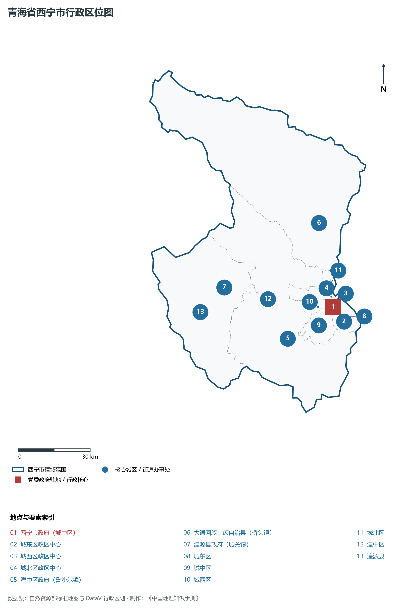
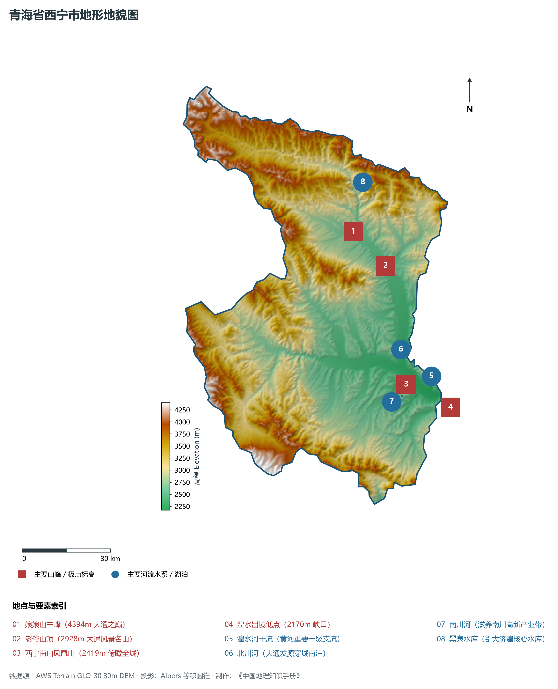
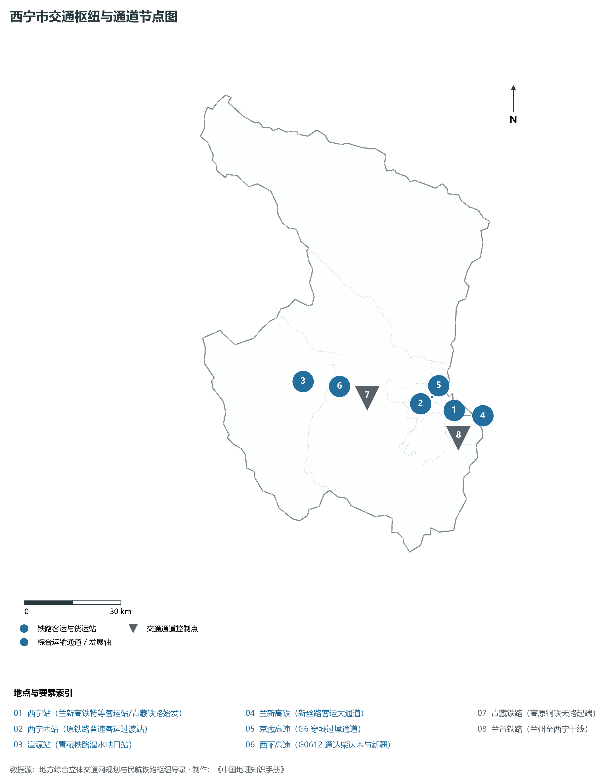
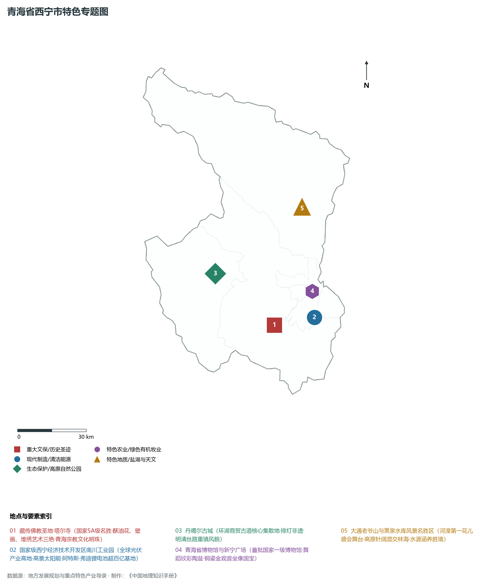
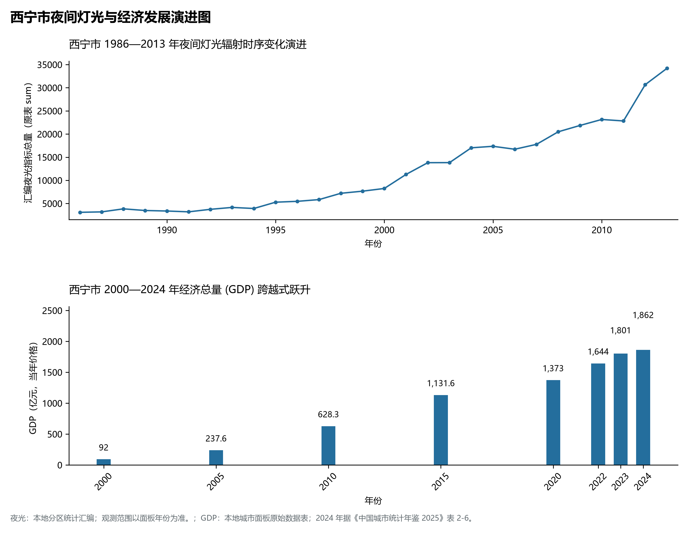

# 33.1 西宁市

西宁市是青海省省会，全省政治、经济、文化、教育、科技和综合交通枢纽中心，国务院批复确定的中国西北地区重要的中心城市。西宁地处青海省东部、湟水谷地中游，介于东经 100° 54' ～ 101° 56'、北纬 36° 13' ～ 37° 28' 之间。市区坐落于青藏高原东北部边缘断陷盆地中，平均海拔约 2261 m，东西狭长、南北受南山（南凉虎台）与北山（北禅寺土楼观）夹持，湟水干流自西向东穿城而过，南川河与北川河由南北两翼垂直注入，形成经典的“三川汇聚、四山环抱、两山夹一川”的高原河谷十字形城市空间形态。

2024 年西宁市全市地区生产总值为 1,862 亿元（当年价格）。

2024 年全市统计：常住人口 248 万人，常住人口城镇化率 80.79 %，地区生产总值 1,862 亿元，人均地区生产总值 75,116 元，三次产业构成 3.03 : 38.99 : 57.98。

2024 年全市统计：常住人口 248 万人，常住人口城镇化率 80.79 %，地区生产总值 1,862 亿元，人均地区生产总值 75,116 元，三次产业构成 3.03 : 38.99 : 57.98。

2024 年全市统计：常住人口 248 万人，常住人口城镇化率 80.79 %，地区生产总值 1,862 亿元，人均地区生产总值 75,116 元，三次产业构成 3.03 : 38.99 : 57.98。

---

## 一、地质构造与地貌分异特征

西宁市处于祁连造山带南缘拉脊山断裂与日月山断裂围限的晚新生代断陷盆地——西宁盆地内部。盆地基底由前寒武系变质岩与下古生界沉积岩构成，中生代及新生代沉积了巨厚层的红色碎屑岩（俗称“西宁红层”）以及第四纪黄土风成堆积物。

在地貌宏观划分上，全市地势总体呈现西北高、东南低的阶梯状展布：

1. **中高山侵蚀剥蚀区（边缘山区）**：主要分布在北部大通县境内的达坂山南麓以及西南部的拉脊山、日月山（海拔 3500～ 4600 m）。山体陡峻，森林与高山灌丛茂密，大通县境内的最高峰老爷山与达坂山主峰是湟水主要支流的水源涵养地。
2. **黄土丘陵沟壑区（中层过渡带）**：广泛分布于湟水河谷两侧的丘陵地带，海拔在 2400～ 3000 m 之间。第四纪马兰黄土与离石黄土深厚覆盖，冲沟密布，植被多为干草原与灌丛，水土流失曾较为剧烈，近年来经过“南北山绿化工程”的持续治理，林草覆盖率已跃升至 79% 以上。
3. **山间河谷与阶地平原（核心建成区）**：由湟水干流及北川河、南川河切割堆积而成的串珠状河谷阶地平原。自河床向两侧发育了 I 级至 IV 级阶地，阶地面平坦开阔，海拔在 2150～ 2350 m 之间。一级与二级阶地覆盖着肥沃的冲积黄土状壤土，是西宁城市核心密集建成区、工业走廊以及高效现代农业的集中承载地。

---

## 二、气候环境与水系水文机理

西宁市气候隶属于**高原半干旱大陆性季风气候**。其主要特征为：冬无严寒、夏无酷暑、日照充足、辐射强烈、降水集中在夏季、昼夜温差大。

- **气温与光照**：年平均气温 7.6°C，最热月（7月）平均气温约 17.5°C，极端最高气温极少超过 33°C；最冷月（1月）平均气温约 -7.4°C。年日照时数达 2700～ 2900 h，太阳辐射总量约 6200 MJ/m²。
- **降水与水文**：全市年平均降水量约 380～ 520 mm，由东南向西北山区逐渐递增，降水多集中在 6—9 月，占全年总降水量的 75% 以上；年潜在蒸发量达 1400～ 1600 mm。
- **水系水资源**：西宁是湟水流域水系最密集的汇流枢纽。湟水干流由湟源峡自西向东贯穿西宁主城，在市区接纳由北向南奔流的北川河（发源于达坂山）和由南向北汇入的南川河（发源于拉脊山），出境流向海东市；大通县境内的黑泉水库总库容达 1.82× 10⁸ m³，“引大济湟”调水工程总干渠穿山引大通河之水润泽西宁盆地，彻底破解了省会水资源工程性紧缺的百年瓶颈。

---

## 三、立体交通网络与青藏门户枢纽

西宁素有“海藏咽喉”之称，是全国重要的综合交通枢纽之一，是连接西藏、新疆与祖国内陆大通道的关键集散极核。

1. **铁路干线系统**：
   - **兰新高铁**：设西宁站、大通西站，使西宁融入全国 8 小时高铁生活圈，至兰州实现公交化运行（约 45 分钟）；
   - **青藏铁路**：西宁是青藏铁路的原点始发枢纽，西格段电气化复线开行时速 160 公里的“复兴号”高原动力集中动车组；
   - **西成铁路（在建）**：西宁至成都铁路正线连接海东、黄南、甘南直抵成都，将开辟青海直通西南腹地的客货大通道。
2. **高等级公路网**：形成以 **G6 京藏高速**（西宁过境段）、**G0612 西和高速**、**G0611 张汶高速** 为骨干的高速公路环线架构。国道 **G109（京拉线）**、**G227（张孟线，穿越祁连山最美国道）**、**G315（西莎线）** 在西宁多向发散。
3. **民航门户网络**：西宁曹家堡国际机场（位于海东互助与平安交界，毗邻西宁城区）开通客货运航线 140 余条，通达全国绝大多数省会与重点城市，年旅客吞吐量超 800 万人次。

---

## 四、现代产业体系与绿色制造集群

西宁立足青海“产业四地”战略部署，加快构建以绿色低碳为核心特征的现代产业体系，形成了在全国具有突出竞争优势的高新技术产业集聚地：

1. **“光伏一条街”全产业链**：依托西宁经济技术开发区（东川、南川、甘河、生物科技产业园区），已形成从“多晶硅—单晶拉棒—切片—电池—组件”的完整垂直一体化光伏制造集群。多晶硅产能突破 21 万吨，单晶硅棒超 100 吉瓦，成为全国乃至全球重要的光伏清洁能源装备制造基地。
2. **锂电与新能源新材料基地**：充分利用柴达木盆地锂卤水提取的优质碳酸锂原料，引进了比亚迪、时代新能源等领军企业，建成全球单体规模位居前列的动力锂电池与正负极材料生产集群。
3. **高原特色生物医药与轻工业**：依托三江源独特的高原动植物资源，做强冬虫夏草、藏红花、枸杞精深加工、藏药现代化创制，以及青海高原绿色乳制品与牛羊肉精细化冷链物流。
4. **文化旅游与会展商贸**：作为“大美青海”旅游第一站，塔尔寺（宗喀巴大师诞生地、藏传佛教格鲁派六大寺院之一）、东关清真大寺、青海省博物馆等文旅名胜吸引海内外游人；环青海湖国际公路自行车赛与青洽会成为具有国际影响力的品牌平台。

---

## 五、夜间灯光时空演进与空间治理

本节夜光图的观测年份为 1986—2013 年，指标为行政区汇总值（原表 sum）。

1. **时序演进特征**：
   - **1986—2000 年（点状集聚期）**：高光值区域极度集聚在城东区与城中区老十字街、大十字及西门商圈，河谷两侧山体漆黑，光斑面积狭窄；
2. **空间治理走向**：面对“两山夹一谷”的地形刚性约束，西宁坚决摈弃摊大饼思维，推行“向北拓展、向南延伸、东西优化”的空间发展策略，强力打造北川湿地公园、南川生态廊道，让森林进城、碧水穿城，实现了由传统资源消耗型重工业城市向现代生态高原花园城市的成功蝶变。

---

## 六、行政区划与核心要素统计表

| 县级行政区 | 驻地街道/镇 | 陆地面积 (km²) | 常住人口 (万人) | 区域特色与产业主导方向 |
|:---|:---|:---|:---|:---|
| **城中区** | 饮马街街道 | 127 | 32.5 | 历史文化老城核心、省委省政府驻地、南川工业园锂电新材料基地 |
| **城东区** | 周家泉街道 | 114 | 48.2 | 东关清真大寺、西宁火车站交通枢纽、东川工业园光伏新材料基地 |
| **城西区** | 兴海路街道 | 82 | 34.6 | 海湖新区、行政文化商贸中心、青海师大/青海大学高教集聚区 |
| **城北区** | 朝阳街道 | 138 | 36.8 | 北川河湿地公园、生物科技产业园区、高原绿色中藏药创新基地 |
| **湟中区** | 鲁沙尔镇 | 2,430 | 44.5 | 塔尔寺景区所在地、鲁沙尔农民画与藏文化艺术、高原冷凉蔬菜基地 |
| **大通回族土族自治县** | 桥头镇 | 3,090 | 40.3 | 老爷山景区、黑泉水库源头、煤电铝与新材料产业走廊 |
| **湟源县** | 城关镇 | 1,625 | 11.6 | 日月山唐蕃古道重镇、丹噶尔古城“茶马互市”、小高陵精神发祥地 |

2024 年统计来源：《中国城市统计年鉴 2025》表 2-1、2-6、2-7（2024 年，全市）。其他年份 GDP 据本地城市面板“原始数据”表，单位为亿元、当年价格。
