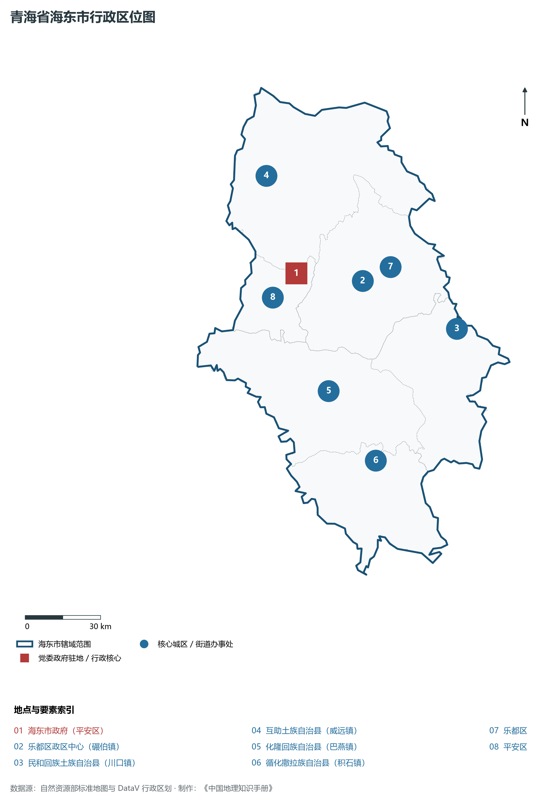
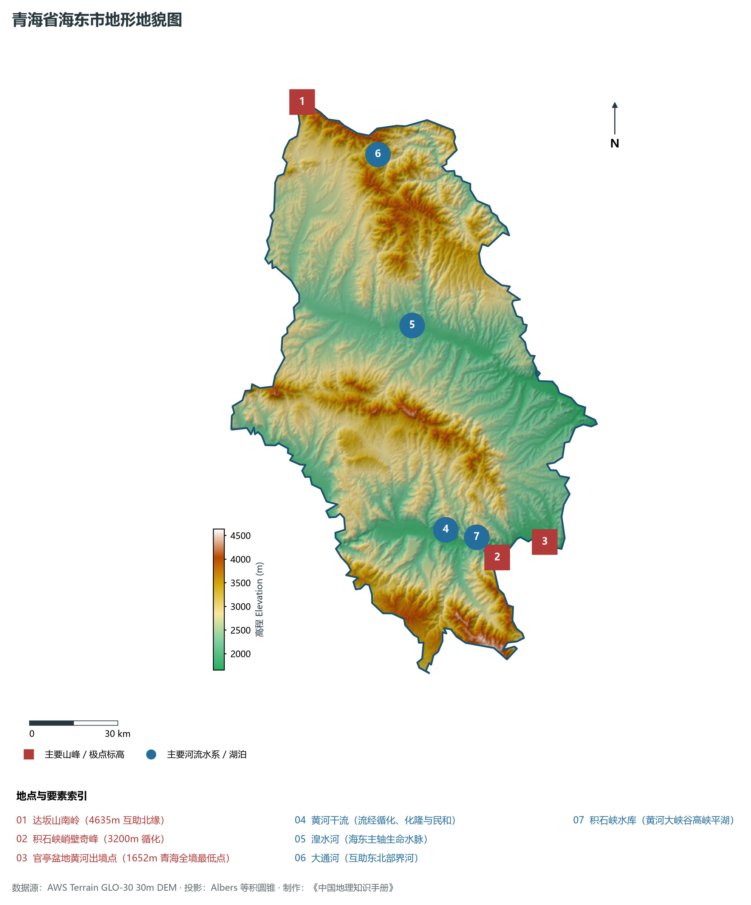
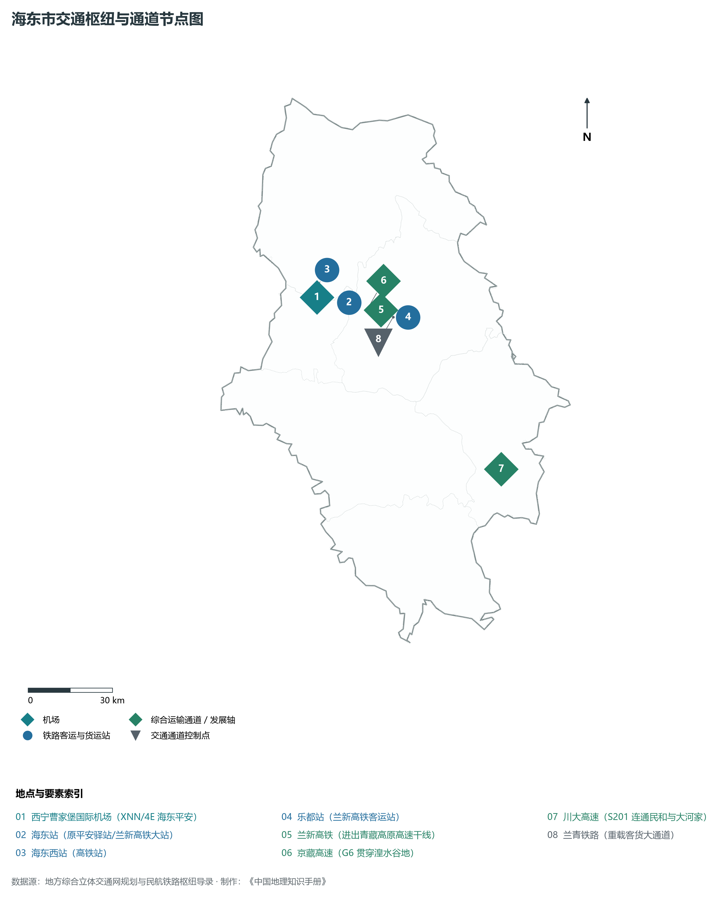
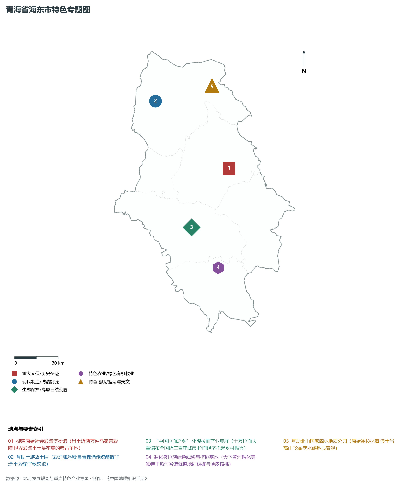
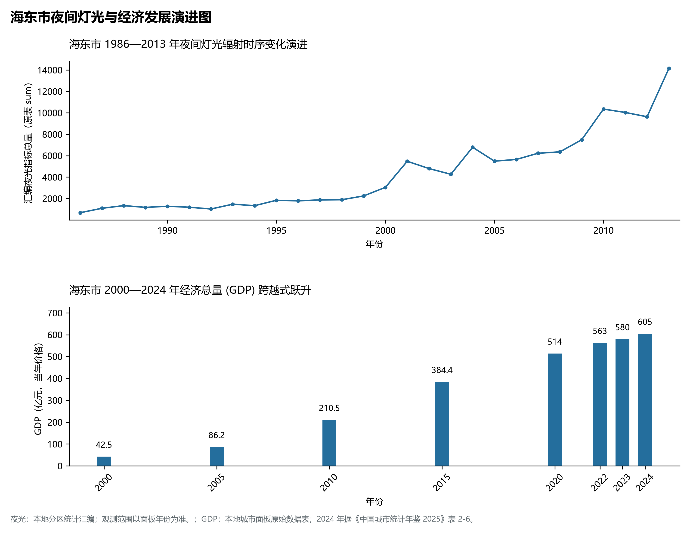

# 33.2 海东市

海东市位于青海省东部，因地处青海湖之东而得名，是青海省的“东大门”与全省第二大中心城市，在兰西城市群一体化协同发展中占据着承东启西的区域副中心枢纽地位。海东地处东经 101° 49' ～ 103° 15'、北纬 35° 26' ～ 37° 19' 之间，东与甘肃省兰州市红古区、永靖县、积石山保安族东乡族撒拉族自治县等地接壤，西与西宁市和海南州交界，南接黄南藏族自治州，北与海北州相连。

2024 年海东市全市地区生产总值为 605 亿元（当年价格）。

2024 年全市统计：常住人口 133 万人，常住人口城镇化率 46.52 %，地区生产总值 605 亿元，人均地区生产总值 45,411 元，三次产业构成 14.48 : 34.2 : 51.32。

2024 年全市统计：常住人口 133 万人，常住人口城镇化率 46.52 %，地区生产总值 605 亿元，人均地区生产总值 45,411 元，三次产业构成 14.48 : 34.2 : 51.32。

2024 年全市统计：常住人口 133 万人，常住人口城镇化率 46.52 %，地区生产总值 605 亿元，人均地区生产总值 45,411 元，三次产业构成 14.48 : 34.2 : 51.32。

---

## 一、地貌格局与海拔最低点地质背景

海东市处于祁连山造山带南缘与祁漫塔格—拉脊山断裂褶皱带交汇部位，横跨黄土高原向青藏高原过渡的强烈抬升与深切侵蚀过渡带。受湟水与黄河干流第四纪以来的强烈深切侵蚀，全市地质构造呈现“褶皱断裂发育、峡谷幽深、阶地开阔、丘陵密布”的显著特征。

在地势与地貌分异上，海东呈明显的“两山夹两谷”宏观轮廓：

1. **山系骨架**：北部为达坂山南翼支脉，中南部为拉脊山，南部边缘为积石山。山体多由古生代变质岩及花岗岩构成，平均海拔在 3200～ 4400 m 之间，形成了阻隔冷空气南下与孕育森林源泉的天然屏障。
2. **湟水河谷阶地盆地（北部经济带）**：湟水流经平安、乐都、民和，下切形成宽达 3～ 8 km 的不对称阶地，阶地面宽展平坦，土壤多为冲积灌淤土与淡栗钙土，农业极为发达。
3. **黄河干流峡谷与冲积台地（南部农林带）**：黄河自西向东穿过化隆与循化盆地，两岸发育雄奇的红层丹霞峡谷（如积石峡、公伯峡），出循化后进入甘肃。
4. **全省海拔最低点——官亭盆地**：位于民和县最南端的中川乡官亭盆地，黄河在此奔流出青海境进入甘肃积石山，出境处海拔仅为 **1652 m**，较全省最高峰布喀达坂峰（6860 m）低了 5208 m。官亭盆地热量充足，素有“青海小江南”与“瓜果之乡”的美誉，也是著名的喇家遗址（齐家文化特大地震洪水灾难现场、出土世界上第一碗面条）所在地。

---

## 二、气候暖湿优越性与河湟水文特征

得益于相对较低的海拔和深切河谷对寒流的天然屏障效应，海东市拥有青海省最为温和、热量最为丰富、无霜期最长的**温带半干旱大陆性季风气候**，历来被视作“青海粮仓”。

- **热量与气温**：年平均气温在 6.5～ 10.2°C 之间（官亭可达 10°C 以上），年无霜期长达 140～ 195 d，积温条件为全省之冠。日照时数在 2600～ 2900 h，太阳能资源丰沛。
- **降水与干湿分异**：年降水量在 320～ 550 mm 之间，自西北向东南逐渐增加；年潜在蒸发量约 1400～ 1750 mm。
- **水系网络**：海东是青海省地表径流归宿的关键流域。湟水在民和享堂注入大通河后汇入黄河；黄河干流自李家峡水库尾水进入海东，历经公伯峡、积石峡等大型水电站，年平均过境径流量超过 200 亿立方米。丰沛的地表水源与现代自流灌溉渠道系统，使海东成为青藏高原极少数能大面积开展自流灌溉的高产农耕区。

---

## 三、立体交通网络与“兰西双核”走廊

海东是联通兰州与西宁双省会城市的最前沿走廊和综合交通咽喉，境内路网密度与通行标准居全省首位。

1. **铁路大动脉**：
   - **兰新高铁**：横贯湟水谷地，在海东境内设海东站、乐都南站、民和南站三座客运车站，与兰州形成半小时同城化通勤，实现与全国高铁网的紧密衔接；
   - **兰青铁路**：作为干线普速电气化双线铁路，承担着西北向青藏高原输送粮食、化肥、矿石与民生物资的货运中枢。
2. **高速与干线公路走廊**：
   - **G6 京藏高速**：平西段、马平段穿越海东全境；
   - **G0611 张汶高速**、**G0612 西和高速**：联通互助土乡与海东南部；
   - **平阿高速**与**川大高速**：打通了湟水谷地通往黄河两岸及川甘交界的纵向大通道；
   - 国道 **G109**、**G213**、**G310**（连云港至共和）构成了市域无缝换乘的公路网。
3. **青海唯一国际航空口岸——曹家堡国际机场**：机场主体坐落于海东市互助县与平安区接壤的台地上，为 4E 级民用国际机场，已建成三期扩建工程，是青海面向全国、连接“一带一路”沿线国家的空中旗舰门户。

---

## 四、特色优势产业与现代产业升级

海东市依托富集的农业土壤、深厚的民族文化以及毗邻西宁与曹家堡机场的区位优势，大力实施“工业强市、生态立市、品牌兴市”战略：

1. **“海东拉面”现代民生产业**：海东是享誉大江南北的“拉面经济”策源地。化隆、循化等县数十万劳动力在全国 300 多个大中小城市经营拉面馆近 3 万家，年创经营收入达 180 亿元，培育出了拉面产业总部基地、中央厨房调味品生产与电商集配中心，成为“带出大山、走向全国”的脱贫致富金钥匙。
2. **“彩陶青稞酒”轻工特色名片**：互助土族自治县被誉为“中国青稞酒之乡”，依托纯净的高原雪山融水和优质青稞原料，青青稞酒等品牌采用传统古法与现代发酵工艺，成为青海享誉国内外的地理标志保护产品。
3. **高原富硒农业与特色果蔬**：海东发现并划定了全省最大的富硒土壤带（总面积达 3300 km²），规模化布局富硒马铃薯、富硒大蒜、富硒禽蛋与循化线椒、大果樱桃产业，是青藏高原高品质“菜篮子”与出口创汇农业基地。
4. **河湟新区临空经济与大数据产业**：紧扣兰西城市群一体化，依托曹家堡机场设立青海河湟新区，集聚了青海数据湖、华为云计算节点、智能终端制造、综合保税物流及生物医药产业，打造青海承接产业转移与科技转化的新兴增长极。

---

## 五、夜间灯光演化与城乡聚空格局

本节夜光图的观测年份为 1986—2013 年，指标为行政区汇总值（原表 sum）。

1. **时序演进态势**：
2. **空间治理逻辑**：海东市立足“保护生态廊道、集约集聚开发”原则，严守湟水流域与黄河流域生态红线，划定耕地与永久基本农田保护带，形成了“以湟水谷地城镇为主轴、黄河风情生态为南翼、达坂山脉特色农牧为北翼”的“一轴两翼”协调发展新空间。

---

## 六、行政区划与核心要素统计表

| 县级行政区 | 驻地街道/镇 | 陆地面积 (km²) | 常住人口 (万人) | 区域地理特色与主导产业 |
|:---|:---|:---|:---|:---|
| **平安区** | 平安街道 | 769 | 12.8 | 海东市委市政府驻地、曹家堡机场门户、富硒果蔬与河湟临空高新区 |
| **乐都区** | 碾伯街道 | 2,821 | 24.2 | 柳湾彩陶故里、瞿昙寺明代壁画、河湟文化发祥核心地、现代农产品物流 |
| **互助土族自治县** | 威远镇 | 3,424 | 33.7 | 全国唯一土族自治县、中国青稞酒之乡、北山国家森林公园、土族民俗文化 |
| **民和回族土族自治县** | 川口镇 | 1,891 | 32.8 | 喇家国家考古遗址、全省最低海拔点（官亭1652m）、青海东大门枢纽 |
| **化隆回族自治县** | 群科镇 | 2,859 | 20.1 | “中国拉面第一县”、李家峡公伯峡库区风光、黄河沿岸冷水三文鱼养殖 |
| **循化撒拉族自治县** | 积石镇 | 2,100 | 12.2 | 全国唯一撒拉族自治县、孟达天池国家级自然保护区、循化红线椒基地 |

2024 年统计来源：《中国城市统计年鉴 2025》表 2-1、2-6、2-7（2024 年，全市）。其他年份 GDP 据本地城市面板“原始数据”表，单位为亿元、当年价格。
