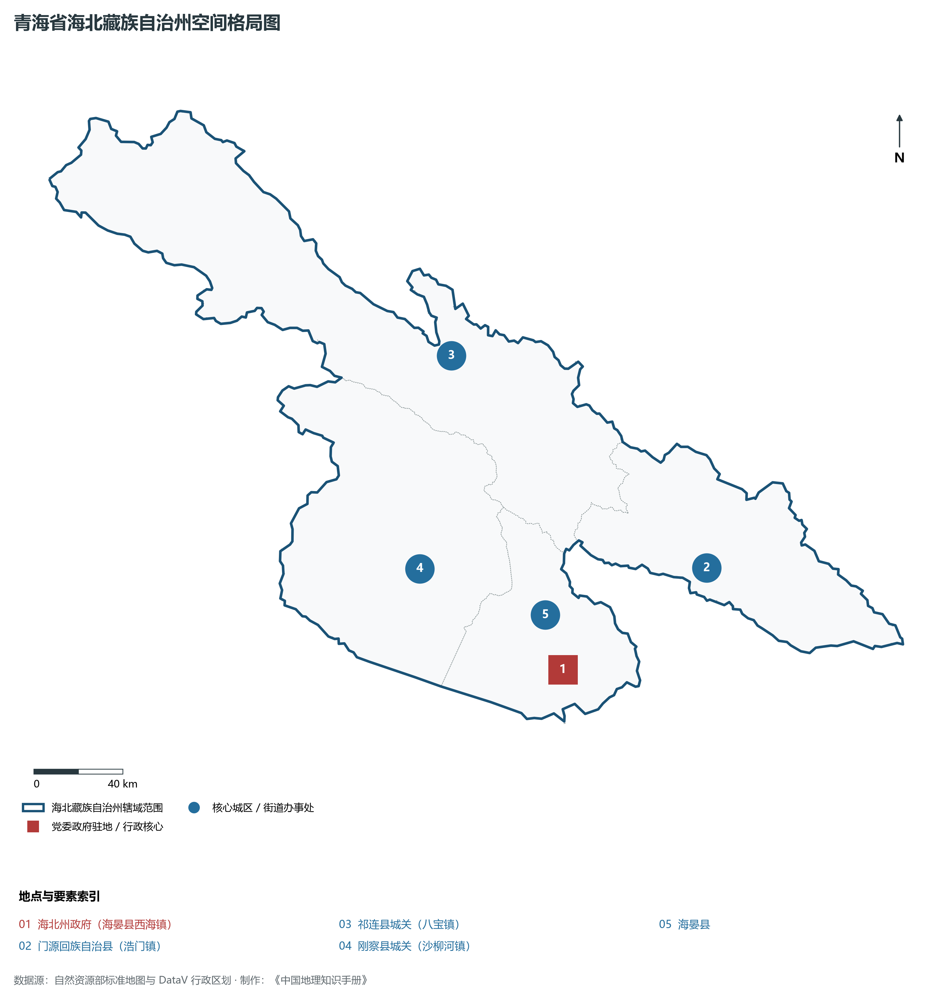
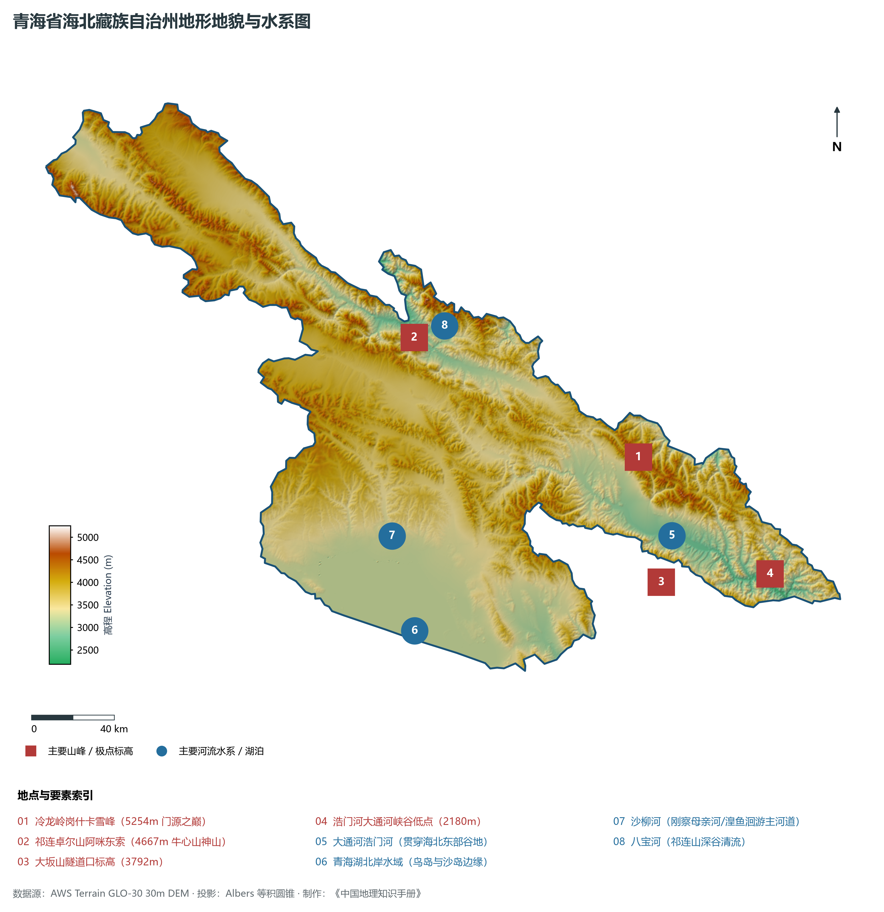
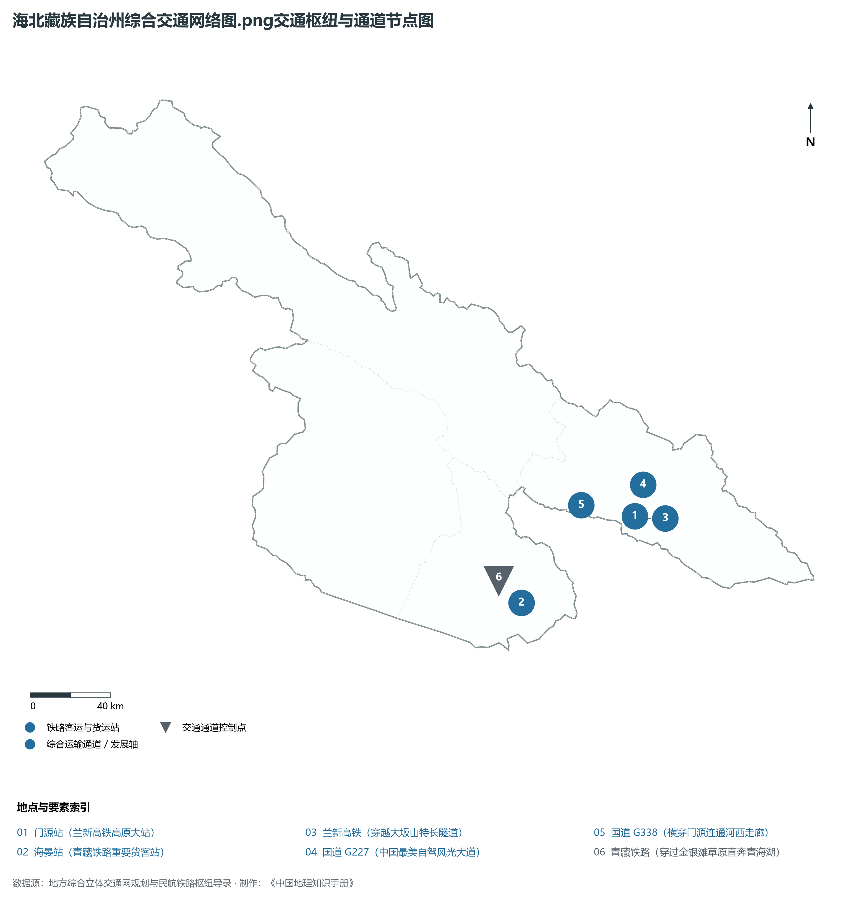
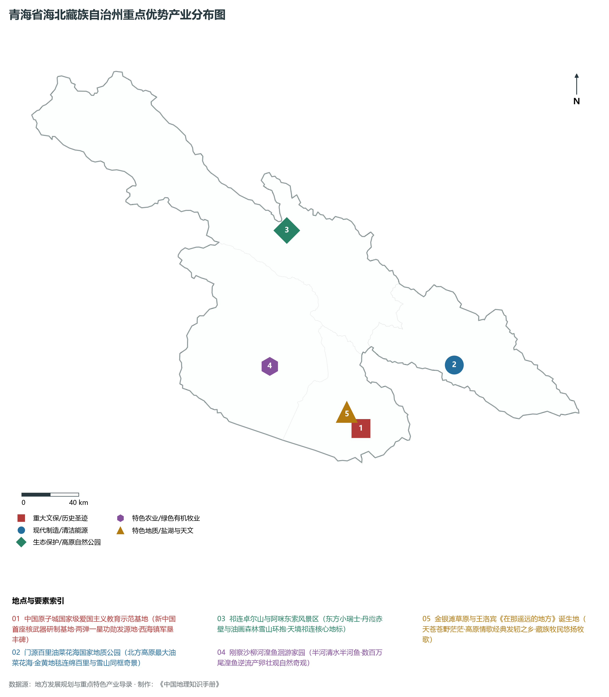
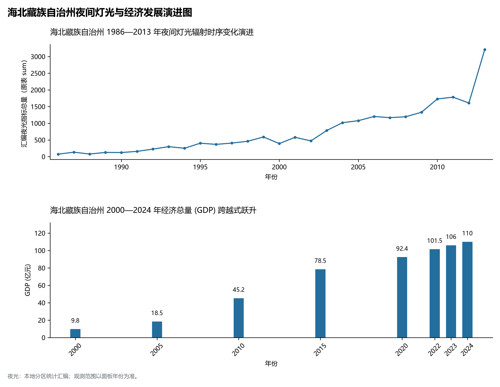

# 33.3 海北藏族自治州

海北藏族自治州位于青海省东北部，因地处青海湖之北而得名，是青藏高原东北缘祁连山国家公园的核心组成部分，也是著名的“中国原子城”所在地与“两弹一星”精神的孕育发祥地。全州地理坐标介于东经 98° 05' ～ 102° 41'、北纬 36° 44' ～ 39° 05' 之间。东北接甘肃省张掖市（山丹、民乐、肃南、甘州）、武威市（天祝、古浪）和金昌市，东南接西宁市和大通县，南邻海东市互助县，西南滨青海湖与海南州相望，西接海西蒙古族藏族自治州。

海北州地理区位十分特殊，既是青海湖流域生态保护的前沿阵地，又是黄土高原向青藏高原与河西走廊过渡的战略生态屏障。全州现辖 4 个县：海晏县、门源回族自治县、祁连县、刚察县，州人民政府驻海晏县西海镇（原二二一厂基地所在地）。全州土地总面积 3.41× 10⁴ km²。截至 2024 年末，全州常住人口 27.2 万人，汇聚藏族、回族、汉族、蒙古族、土族等多民族和谐共处。2024 年实现地区生产总值（GDP）约 118 亿元，正高标准打造生态文明高地祁连山先行区与全国红色研学教育标杆地。

---

## 一、高山峡谷地貌与祁连山生态屏障

海北州地貌发育受祁连造山带多期强烈逆冲推覆和断裂构造控制，地势总体呈现西北高、东南低，高山连绵、谷地幽深、盆地镶嵌的雄浑地貌轮廓。全州平均海拔在 3100 m 以上，最高点为祁连县境内的冷龙岭岗什卡雪峰（海拔 5254.5 m），最低点为门源县东端克先河口（海拔 2180 m），相对高差超过 3000 m。

根据地貌成因与形态特征，海北州可划分为四大主要地貌景观带：

1. **祁连山高山冰川与寒冻风化带**：包括托勒山、托勒南山、大通山、冷龙岭等高耸山脉。海拔 4200 m 以上山峰终年积雪，发育有第四纪冰川与现代冰川群，冰斗、刃脊、角峰遍布，是黑河、大通河、疏勒河等干旱区内陆河的巨大“固体蓄水池”。
2. **门源—浩门河断陷盆地与油菜花海**：由冷龙岭与达坂山南北夹持的狭长山间断陷盆地，海拔在 2600～ 3100 m 之间。浩门河横贯盆地中部，沉积了肥沃深厚的冲洪积土壤，形成了绵延数百里的“门源百里油菜花海”农业奇观。
3. **金银滩—环湖草原浅山盆地**：位于海晏县与刚察县南部，地形平缓开阔，海拔 3000～ 3300 m，水草丰美。著名民歌《在那遥远的地方》在此诞生；我国第一座核武器研制基地——二二一厂（金银滩）便隐秘坐落于这片广袤草原的深处。
4. **青海湖北岸滨湖平原与湿地**：刚察县与海晏县沿青海湖北岸延伸，岸线长达 200 余公里，分布着鸟岛、沙岛、泉吉河口和沙柳河口。每年夏季数以万计的水鸟在此繁衍筑巢，成群的“青海湖裸鲤”（湟鱼）溯河逆流而上产卵，构成世界罕见的高原湿地生物多样性奇景。

---

## 二、高寒半湿润气候与三大流域水源涵养机理

海北州横跨我国外流区与内流区的重要水文分水岭，气候受中纬度西风环流和青藏高原季风双重调制，属于**高原高寒半湿润—半干旱气候**。

- **气温与光照**：年平均气温在 -1.5～ 2.5°C 之间，大部分地区长冬无夏、春秋相连；年无霜期仅 30～ 90 d，部分高海拔草场终年无绝对无霜期。年日照时数在 2500～ 2750 h，太阳辐射能量充裕。
- **降水与水汽通道**：年降水量在 400～ 650 mm 之间，山地降水明显多于盆地。达坂山与冷龙岭形成的“地形雨漏斗”使门源盆地降水量丰沛，为高原极少数适宜大面积油菜、青稞等喜凉作物生长的温湿绿洲。
- **三大水系源头枢纽**：
  - **大通河（浩门河）水系**：发源于天峻县与刚察县交界处，流经门源全境，年径流量达 28.9× 10⁸ m³，是“引大济湟”工程的关键水源依托；
  - **黑河水系**：发源于祁连县北部走廊南山与托勒山之间的扎尕尔玛峰冰川，为甘肃河西走廊第一大内陆河，承载着额济纳旗绿洲生死的生态命脉；
  - **青海湖内流水系**：刚察境内的沙柳河、布哈河（下游注入湖区）与海晏境内的大泉河是注入青海湖的主要淡水来源，直接主导着青海湖水位的升降消长。

---

## 三、立体交通网络与出川入甘走廊

海北州自古为丝绸之路“辅道”与青甘通道的交通枢纽，如今已建立起涵盖高速铁路、高速公路与支线机场的现代立体交通格局。

1. **高速铁路跨越**：**兰新高铁**在门源县设门源站，穿越长达 13.8 km 的达坂山隧道和 11.5 km 的冷龙岭祁连山隧道，连接张掖与西宁，门源至西宁乘高铁仅需 35 分钟。
2. **铁路货运动脉**：**青藏铁路**自西宁出发经海晏县西海镇、刚察县沿青海湖北岸西行，贯通海北南部草场；支线专用线直达热水煤矿区与各产业集中区。
3. **干线公路走廊**：
   - 国道 **G227（张孟线）**：穿过西海镇、门源黑泉水库、岗什卡雪峰山麓，翻越景阳岭至张掖，被誉为“中国景观大道与生态绿廊”；
   - 国道 **G338（海兴—红其拉甫）**、**G315（西莎线）** 横贯刚察与海晏；
   - 高速公路方面，**G0611 张汶高速**海北段及门源连接线显著提升了通达效率。
4. **高原支线航空**：**祁连机场（4C级）**坐落于祁连县峨堡镇，跑道海拔 3163 m，开通至西宁、西安等主要航线，使祁连高寒深山与外界实现快速对接。

---

## 四、重点优势产业与绿色有机发展新路径

海北州坚定扛起“守护祁连山生态安全、擦亮红色原子城金名片”的政治责任，构建以绿色有机、低碳循环、文旅融合为底色的特色产业体系：

1. **“中国原子城”红色经典研学文旅**：依托西海镇二十二一厂旧址（全国重点文物保护单位、全国爱国主义教育示范基地），建设了原子城纪念馆、二分厂爆轰试验场、将军楼等核心遗址，年接待全国爱国主义教育、党性修养培训与青少年红色研学数十万人次，形成全省最具影响力的红色文旅高地。
2. **生态文化与壮美自然风光旅游**：以“大美青海·梦幻海北”为主题，布局门源百里油菜花海（国家 4A 级景区）、祁连卓尔山“东方小瑞士”丹霞景区、阿咪东索雪山景区，以及刚察“湟鱼家园”观鱼生态体验游，打造全域高原生态旅游样板。
3. **绿色有机农畜产业输出**：海北是全国优质高山细毛羊的繁育基地与青海藏系羊、牦牛主产区。“祁连藏羊”、“门源小油菜”、“刚察牦牛”获得国家地理标志农产品认证；培育高原冷凉黑青稞、菜籽油精炼、牛羊肉精细冷鲜分割全产业链。
4. **清洁能源与算力储能试点**：利用达坂山南麓与环湖高风速通道，稳妥布局分散式风电与农光互补项目，建设服务高原生态保护的绿色微电网。

---

## 五、夜间灯光演变与生态城镇化治理

本节夜光图的观测年份为 1986—2013 年，指标为行政区汇总值（原表 sum）。

1. **时空演变特征**：
2. **空间治理走向**：海北州遵循“减量提质、绿色低碳”导向，推进农牧民异地搬迁与城镇化集中居住，重点提升西海镇、浩门镇、八宝镇和沙柳河镇的基础设施韧性，全面实现生活污水垃圾集中处理与清洁取暖，构筑人与自然和谐共生的高原样板示范区。

---

## 六、行政区划与核心要素统计表

| 县级行政区 | 驻地镇 | 陆地面积 (km²) | 常住人口 (万人) | 区域特色与主导产业方向 |
|:---|:---|:---|:---|:---|
| **海晏县** | 三角城镇 | 4,853 | 4.0 | 州府所在地西海镇、“两弹一星”理想信念教育学院、金银滩大草原 |
| **门源回族自治县** | 浩门镇 | 6,896 | 13.6 | 门源百里油菜花海、岗什卡雪峰登山基地、优质菜籽油与青稞种植输出基地 |
| **祁连县** | 八宝镇 | 14,044 | 4.9 | “东方小瑞士”卓尔山景区、祁连山国家公园核心区、祁连藏羊有机养殖基地 |
| **刚察县** | 沙柳河镇 | 8,275 | 4.7 | 青海湖北岸、湟鱼洄游观赏地、仓央嘉措文化广场、环湖优质牧业基地 |
