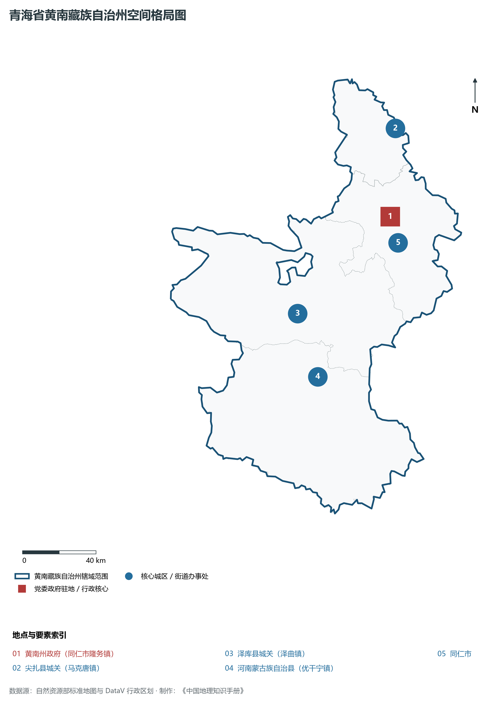
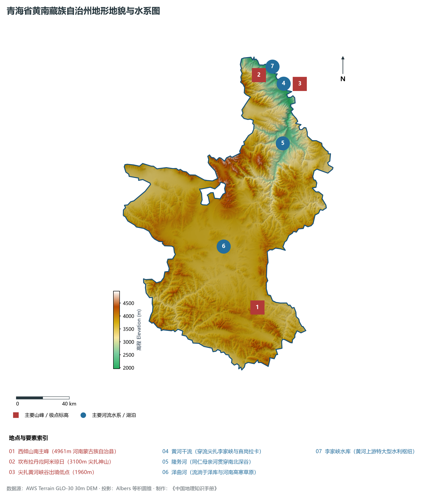
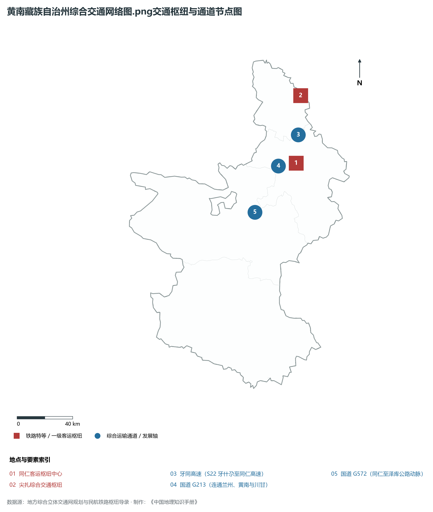
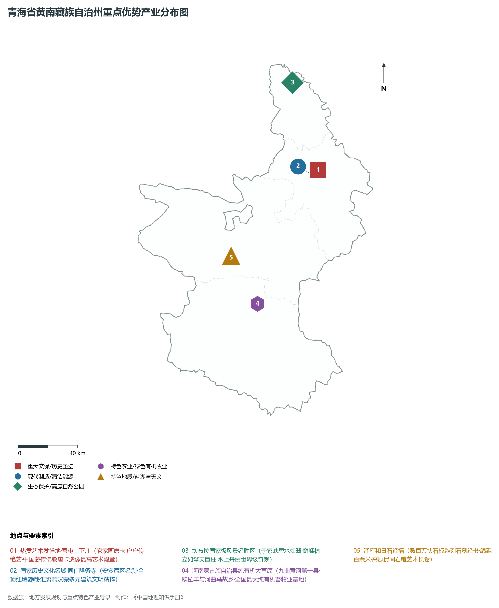
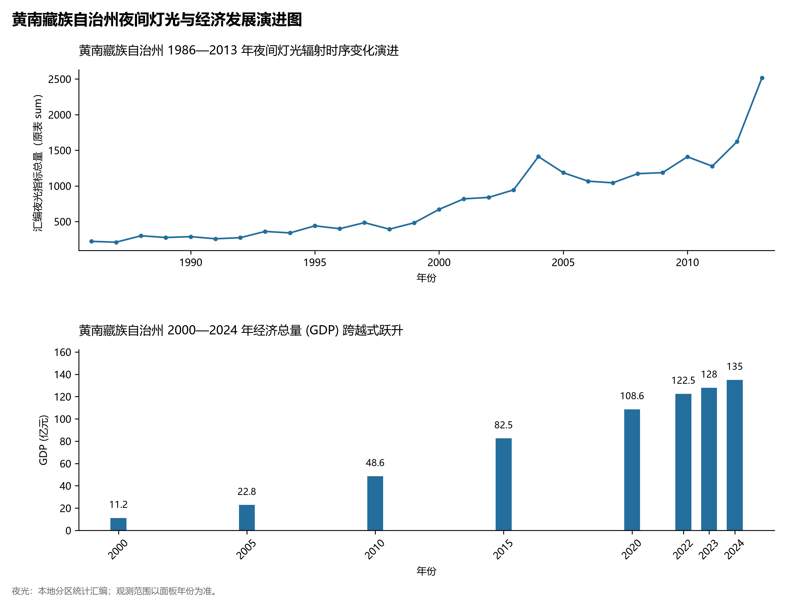

# 33.4 黄南藏族自治州

黄南藏族自治州位于青海省东南部，因地处九曲黄河之南而得名，是青南高原与陇西黄土高原、甘南山地的过渡嵌合带，素以“热贡艺术之乡”、“藏画艺术明珠”与绚丽的高原丹霞奇观闻名遐迩。全州介于东经 101° 42' ～ 102° 41'、北纬 34° 03' ～ 36° 10' 之间。东与甘肃省甘南藏族自治州（夏河县、碌曲县、玛曲县）相连，南接青海省果洛州玛沁县，西接海南州同德县、贵德县，北与海东市化隆县、循化县隔黄河相望。

全州现辖 1 个县级市（同仁市）、2 个县（尖扎县、泽库县）、1 个民族自治县（河南蒙古族自治县）。州人民政府驻同仁市隆务镇。全州陆地总面积 1.82× 10⁴ km²。截至 2024 年末，常住人口 28.5 万人，藏族占总人口的 68.5%，同时汇聚蒙古族、回族、汉族等民族。2024 年全州实现地区生产总值（GDP）约 112 亿元。作为热贡艺术的发祥地，黄南州拥有联合国人类非物质文化遗产代表作名录项目，国家级历史文化名城同仁市与坎布拉世界地质公园并蒂生辉，是青海东南部最具文化灵性与自然神韵的高原名州。

---

## 一、高山深谷与丹霞峰丛地貌格局

黄南州在地质构造上位于秦岭造山带西延部分与西倾山褶皱带交接区，新构造运动剧烈，地势南高北低、自东南向西北阶梯状倾斜。全州平均海拔在 3000 m 以上，最高峰坐落于西南部泽库县境内的麦秀雪山（海拔 4971 m），最低点位于东北部尖扎县黄河出境处牙什尕河滩（海拔 1960 m），全境相对落差超过 3000 m。

全州由北至南形成了差异鲜明的三大自然地貌分异景观：

1. **北部黄河峡谷与红色丹霞地貌带（尖扎盆地）**：黄河自西向东切穿红层盆地与断层古岩，在尖扎县境内形成了陡峭深邃的峡谷和著名的坎布拉丹霞水上峰丛（坎布拉世界地质公园）。红色砂砾岩经流水切割与风化侵蚀，呈现拔地而起、壁立千仞的丹霞柱丛与赤壁丹崖，与碧波荡漾的李家峡水库高峡平湖相互辉映。
2. **中部隆务河中高山侵蚀峡谷带（同仁盆地）**：隆务河作为黄河一级支流，自南向北深切中生代砂岩与古生代花岗岩山地，形成狭窄的断陷小盆地与多级河流冲积阶地。同仁市区（隆务镇）及吾屯村、年都乎村等历史村落紧凑依傍阶地排布，形成了兼具封闭自守与农耕灌溉便利的“热贡文化摇篮”。
3. **南部高寒宽谷与丘状高原草甸带（泽库—河南草原）**：由西倾山与阿尼玛卿山余脉围合的波状起伏高原面，海拔在 3400～ 3800 m 之间。地势开阔平缓，黑土滩湿地草甸纵横分布，泽曲、巴曲等高原河流蜿蜒蛇曲，水草极其茂美，孕育了全国闻名的河南县“欧拉羊”与“雪多牦牛”优良畜种。

---

## 二、立体气候分异与黄河源区水系机理

黄南州南北跨越 2 个纬度以上，加之海拔从 1960 m 骤升至 4900 m，造就了从**温凉半干旱河谷气候**到**高寒湿润高原气候**的完整垂直垂直气候带谱。

- **气温水热阶梯**：北部尖扎沿河谷年平均气温达 8.5°C，无霜期达 160 d，瓜果飘香；中部同仁盆地年平均气温约 5.8°C，夏无酷暑；南部泽库与河南高寒草原年平均气温降至 -1.5～ 0°C，全年无绝对无霜期，气候寒凉。
- **降水梯度分异**：全州年降水量在 360～ 680 mm 之间，自北向南随海拔升高显著增加。尖扎盆地降水量不足 400 mm，而南部泽库麦秀林区与河南蒙旗草甸年降水量达 600 mm 以上，形成了极其茂盛的高寒云杉暗针叶林与丰美草甸。
- **黄河干流与隆务河水文特征**：
  - **黄河干流青海段出境咽喉**：黄河在尖扎流经数十公里，在此建有**李家峡水电站**（装机容量 200 万千瓦），为黄河上游著名的梯级枢纽，水质湛蓝清澈，素有“天下黄河贵德清，尖扎黄河水尤碧”之说；
  - **隆务河干流**：源自泽库草原，全长 146 km，年径流量达 8.9× 10⁸ m³，两岸绿树成荫，是同仁盆地农田灌溉与居民生活的命脉母河。

---

## 三、立体交通网络与川甘青三省接合部纽带

黄南州地处青海东出甘南、南下四川的关键几何走廊，近年来公路与铁路建设取得突破性飞跃。

1. **高速公路网大跨越**：
   - **G0611 张汶高速（牙同段）**：由海东化隆牙什尕跨越黄河特大桥直抵同仁市，同仁迈入西宁 1.5 小时“都市生活圈”；同仁至泽库、河南高速公路相继连通，全州骨架高速全线成网；
   - **牙什尕至同仁至夏河（甘青走廊）**：拉近了热贡艺术之乡与甘肃拉卜楞寺的旅游交通距离。
2. **铁路大动脉突破**：
   - **西成铁路（西宁—成都，在建）**：正线穿过尖扎县并跨黄河大桥，在同仁市设立**同仁站**，穿越麦秀雪山特长隧道进入甘南夏河，黄南州将彻底结束不通铁路的历史，深度融入西南大通道。
3. **干线公路骨干**：国道 **G213（策磨线）**、**G316（长同线）** 纵横贯通全境，联通麦秀国家森林公园、坎布拉景区及各乡镇牧场。

---

## 四、文化瑰宝热贡艺术与绿色有机畜牧产业

黄南州依托世界级非物质文化遗产与纯净的高寒生态底色，形成了以“文化旅游铸魂、有机农牧强基、清洁能源赋能”为特色的现代绿色产业结构：

1. **“热贡艺术”人类非物质文化遗产**：同仁市被称为“中国藏画之乡”。境内隆务寺、吾屯上下寺、年都乎寺、郭麻日寺等构成了独特的宗教艺术集群。热贡艺术涵盖唐卡、堆绣、泥塑、木雕等，2009 年被列入联合国教科文组织《人类非物质文化遗产代表作名录》。全州画师与文化从业人员超过 3 万人，热贡文化产业年产值突破 10 亿元，作品远销全球 50 多个国家和地区。
2. **全国首个“全域有机畜牧业”示范县（河南县）**：河南蒙古族自治县平均海拔 3600 m，拥有近 1000 万亩纯天然绿色无污染有机草场，率先在全国实现全域有机畜牧业认证。盛产具有耐寒、肉质鲜美特性的“欧拉羊”与“雪多牦牛”，有机牛羊肉直供北京、上海及粤港澳大湾区高端市场。
3. **坎布拉世界地质公园生态旅游**：坎布拉以奇特的丹霞地貌、清澈的高峡平湖、古老的藏传佛教后弘期发祥地阿琼南宗寺闻名，与尖扎黄河水上运动、同仁热贡古城深度串联，打造集地学科普、民族艺术、宗教哲学于一体的高原文化旅游胜地。
4. **黄河清洁水电与水产养殖**：依托李家峡水电站库区冷凉、优质、流动的黄河冷水生态环境，规模化培育高品质三文鱼（虹鳟），成为我国优质冷水鱼绿色养殖的重要基地。

---

## 五、夜间灯光演化与生态城镇化治理

本节夜光图的观测年份为 1986—2013 年，指标为行政区汇总值（原表 sum）。

1. **时空演进特征**：
2. **空间治理走向**：黄南州严格落实麦秀林区水源涵养区与泽曲河流域湿地保护红线，坚守“一江清水向东流”的源头责任，推行城镇沿谷地集约布局，严禁在脆弱草原地带大拆大建，实现了文化遗产原真性保护与现代生态城镇宜居性的和谐共生。

---

## 六、行政区划与核心要素统计表

| 县级行政区 | 驻地镇 | 陆地面积 (km²) | 常住人口 (万人) | 区域特色与主导产业方向 |
|:---|:---|:---|:---|:---|
| **同仁市** | 隆务镇 | 3,275 | 10.3 | 州府所在地、国家历史文化名城、热贡艺术核心发祥地、隆务寺与吾屯寺 |
| **尖扎县** | 马克唐镇 | 1,714 | 5.8 | 坎布拉世界地质公园、李家峡水电站、黄河丹霞水上峰丛、黄河冷水三文鱼养殖 |
| **泽库县** | 泽曲镇 | 6,494 | 8.2 | 麦秀国家森林公园、和日石刻艺术奇观、高寒生态草甸畜牧与藏系羊输出基地 |
| **河南蒙古族自治县** | 优干宁镇 | 6,717 | 4.2 | 全省唯一纯蒙古族自治县、全国全域有机畜牧业第一县、欧拉羊与雪多牦牛之乡 |
