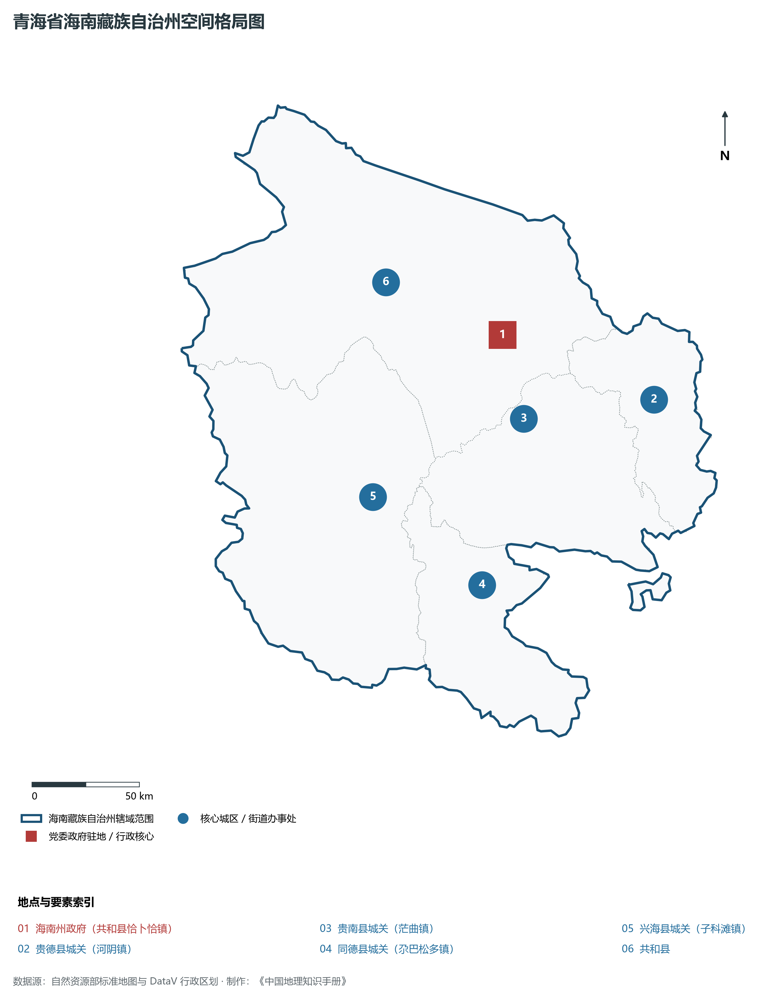
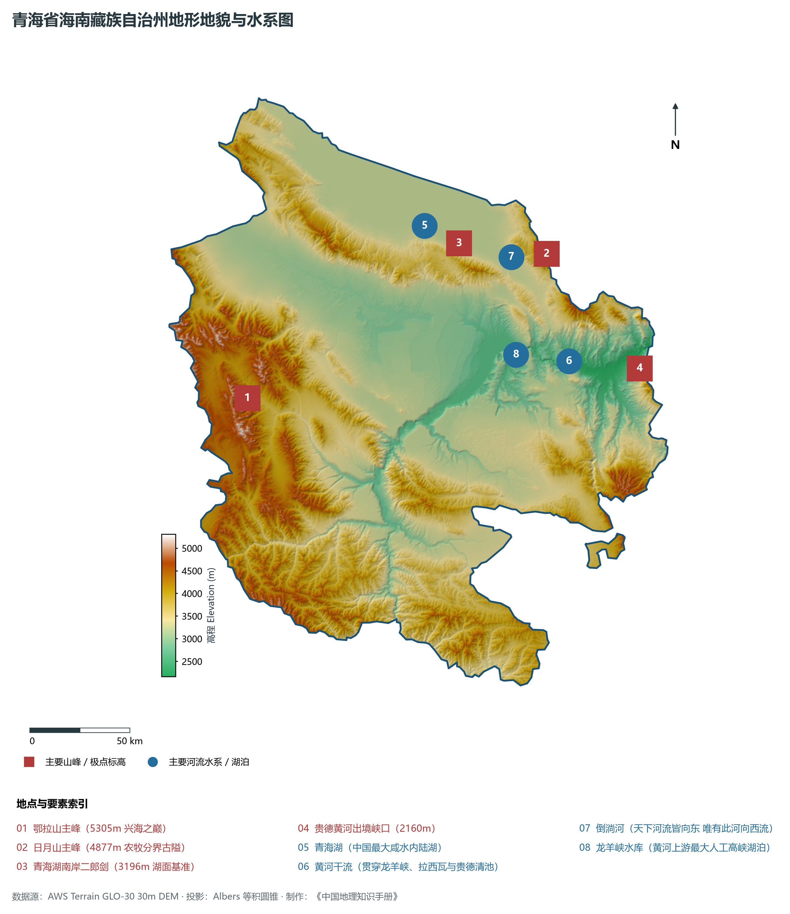
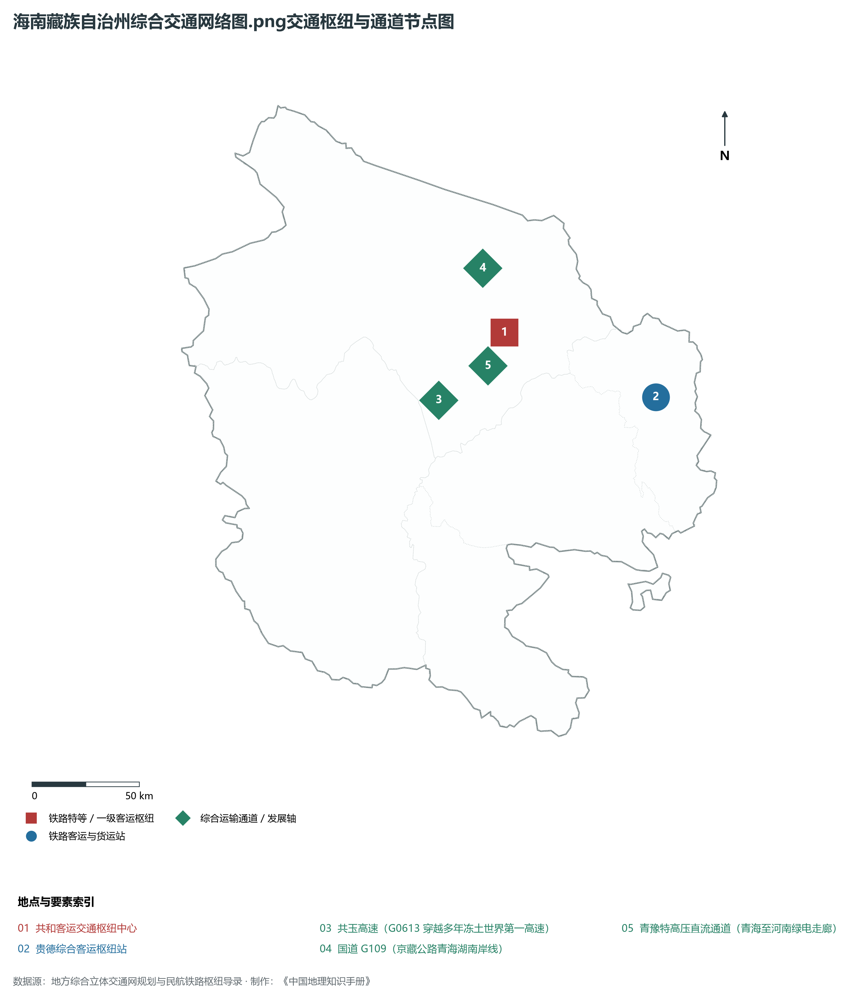
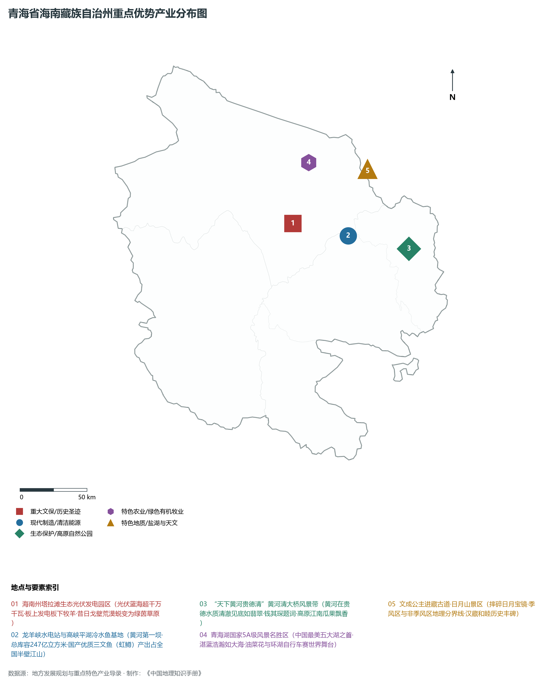
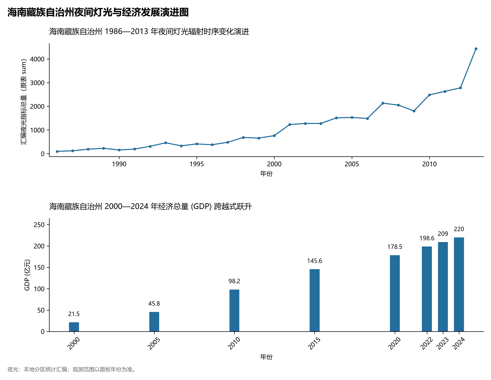

# 33.5 海南藏族自治州

海南藏族自治州位于青海省东部偏南，因地处中国最大内陆咸水湖——青海湖南岸而得名。全州地理坐标介于东经 98° 55' ～ 101° 50'、北纬 34° 38' ～ 37° 10' 之间。东与海东市、黄南藏族自治州接壤，南连果洛藏族自治州，西邻海西蒙古族藏族自治州，北滨青海湖并与海北藏族自治州相望。

全州现辖 5 个县：共和县、贵德县、贵南县、同德县、兴海县，州人民政府驻共和县恰卜恰镇。海南州陆地总面积 4.45× 10⁴ km²。截至 2024 年末，常住人口 44.8 万人，其中藏族人口占 69.2%，汉、回、蒙古、土、撒拉等各民族交融共居。2024 年全州实现地区生产总值（GDP）约 215 亿元。海南州不仅坐拥环青海湖核心景区二郎剑与万里黄河第一坝——龙羊峡水利枢纽，更是全国知名的“千万千瓦级清洁能源基地”与“天下黄河贵德清”的旅游胜地，在青海全省推进“产业四地”建设中扮演着无可替代的绿色先锋角色。

---

## 一、山原盆地嵌性格局与黄河深切侵蚀

海南州地处祁连山支脉日月山、拉脊山与昆仑山支脉阿尼玛卿山、鄂拉山相汇合的过渡地带，构造变形极为剧烈，断裂带密布，宏观地势呈现西北高、东南低的起伏山原格局。全州平均海拔在 3000 m 以上，最高点为兴海县境内的鄂拉山主峰（海拔 5305 m），最低点为贵德县松巴峡黄河出境处（海拔 2168 m），全境垂直高差超过 3100 m。

全州主要地貌骨架由以下四大典型单元构成：

1. **环青海湖南岸滨湖平原与沙丘带**：分布于共和县北部黑马河、江西沟至倒淌河一带，地势开阔平缓，海拔在 3196～ 3300 m 之间。发育有著名的二郎剑沙嘴半岛，湖滨草滩与湿地交织，是青海湖裸鲤索饵与水鸟栖息的优良生境。
2. **共和盆地与塔拉滩荒漠沙地**：位于日月山与青海南山之间的大型内陆山间断陷盆地，海拔在 2800～ 3100 m 之间。塔拉滩地势极度平坦开阔，第四纪深厚风成砂层覆盖，光热资源极度充沛，原为严重荒漠化沙化土地，如今已成为举世闻名的光伏太阳能产业“蓝色海洋”。
3. **黄河干流深切大峡谷与龙羊峡水库**：黄河自西向东流经兴海、同德、贵南、共和与贵德县。在共和县与贵南县交界处切穿坚硬的花岗岩山体，形成了长达数万米、崖壁耸立的龙羊峡；龙羊峡大坝截流形成的巨型人工水库水域面积达 383 km²，总库容 247× 10⁸ m³。
4. **贵德红层河谷断陷盆地**：黄河出龙羊峡后进入贵德盆地，两岸发育有白垩纪至古近纪红色巨厚砂砾岩构成的七彩丹霞峰林。盆地河谷海拔在 2200 m 左右，气候湿润温和，黄河干流在此水质澄澈碧绿，形成了著名的“天下黄河贵德清”地理胜景。

---

## 二、高原光热优势与黄河母亲河水文调节中枢

海南州气候兼具青藏高原高寒性与内陆盆地大陆性特征，隶属于**高原半干旱温带大陆性气候**。

- **日照与太阳辐射极值区**：全州年日照时数高达 2800～ 3200 h，年太阳总辐射量达 6500～ 7200 MJ/m²。特别是共和塔拉滩地区，空气稀薄透亮，云量少、阴雨罕见，太阳辐射强度处于我国最高梯队，是开发大型地面光伏电站得天独厚的天然圣地。
- **降水与气温分异**：年平均气温在 2.5～ 8.8°C 之间（贵德最高达 9.0°C，兴海高寒区仅 1.8°C）。年降水量在 260～ 450 mm 之间，自西北向东南逐渐递增，蒸发量高达 1500～ 2000 mm。
- **黄河龙头水利控制枢纽机理**：黄河在海南州流长达 411 km。**龙羊峡水电站**被誉为“黄河龙头电站”，其装机容量 128 万千瓦，其巨大的多年调节水库控制了黄河入库水量的 70%，承担着全流域防洪、防凌、抗旱调水、调频与水光互补的核心重任，是我国黄河流域无可替代的战略性控制中枢。

---

## 三、立体交通网络与进出青南关键通道

海南州扼守古唐蕃古道与青川通道之咽喉，是省会西宁通往玉树、果洛三江源腹地的第一道门户。

1. **高速公路大骨架**：
   - **G6 京藏高速（西宁—共和段）**：全线双向四车道高速贯通，西宁至共和县城（恰卜恰）仅需 1 小时 20 分钟；
   - **G0613 西丽高速（西宁至玉树至西藏丽江）**：沿唐蕃古道经倒淌河、恰卜恰、河卡、兴海直抵玉树，成为青南涉藏地区通往内陆的大运量生命通道；
   - **G0612 西和高速**：横贯共和盆地西出海西乌兰与都兰。
2. **干线公路体系**：国道 **G109（京拉线）** 沿青海湖南岸穿行；国道 **G214（西景线）** 纵穿南北；国道 **G310** 与 **G572**、**G573** 编织起直达龙羊峡水库、贵德温泉与同德宗日遗址的畅通路网。
3. **通用航空与过境铁路**：青藏铁路擦境而过；青海共和通用机场项目稳步推进，进一步提升高原救援与生态护航能力。

---

## 四、国家清洁能源产业高地与高原绿色循环产业

海南州深入践行“绿水青山就是金山银山”理念，创造了“生态光伏+生态畜牧”的全球荒漠化治理奇迹：

1. **塔拉滩千万千瓦级清洁能源生态大基地**：海南州累计建成光伏、风电等新能源装机超过 2500 万千瓦。在塔拉滩光伏园区，大面积光伏面板遮挡强光蒸发、汇聚凝结水滴，使草地植被覆盖度从不足 15% 飙升至 80% 以上，孕育出数以万计的“光伏羊”在板下食草除火患，形成了“板上发电、板下牧羊、荒漠变绿洲”的全球典范生态循环经济模式。
2. **青豫特高压直流工程（±800 kV）**：世界首条专门为清洁能源外送建设的特高压直流输电工程，起点坐落于海南州共和换流站，跨越数千里直抵河南驻马店，年外送绿电超 250 亿千瓦时，成为国家“西电东送”具有划时代意义的绿色大通道。
3. **水光互补智慧调节**：龙羊峡 85 万千瓦水光互补光伏电站，通过水轮发电机组的快速启闭调节，成功平抑了光伏发电“靠天吃饭、昼夜波动”的不稳定性，将断续的太阳能转化为平滑优质的基荷电能送入电网。
4. **龙羊峡冷水三文鱼全产业链**：依托龙羊峡数百平方公里无污染、常年水温在 12～ 16°C 的深层纯净冷水，建成国家级冷水鱼绿色养殖示范基地，出产的三文鱼占国产三文鱼市场份额的 50% 以上，并出口欧洲、日本及东南亚。
5. **贵德生态文化旅游与地热利用**：以贵德清清黄河、黄河奇石地质公园、扎仓温泉为抓手，发展特色康养理疗与现代设施农业。

---

## 五、夜间灯光演进与生态集约开发

本节夜光图的观测年份为 1986—2013 年，指标为行政区汇总值（原表 sum）。

1. **时空演变特征**：
2. **空间治理走向**：海南州实行严苛的“环湖禁牧限建”与“黄河流域岸线保护”机制，把青海湖岸线 3 km 范围和黄河陡坡带划入生态禁建红线，引导城镇与产业全部向盆地内部与适建阶地集约聚集，实现了高端绿色能源开发与脆弱高原生态环境的平衡共荣。

---

## 六、行政区划与核心要素统计表

| 县级行政区 | 驻地镇 | 陆地面积 (km²) | 常住人口 (万人) | 区域地理特色与主导产业方向 |
|:---|:---|:---|:---|:---|
| **共和县** | 恰卜恰镇 | 16,050 | 14.8 | 州府驻地、塔拉滩千万千瓦光伏大基地、青豫特高压起点、青海湖南岸二郎剑 |
| **贵德县** | 河阴镇 | 3,594 | 10.6 | “天下黄河贵德清”、扎仓温泉康养、红层丹霞地质公园、特色果蔬与文化旅游 |
| **贵南县** | 茫曲镇 | 6,649 | 7.6 | “中国黑藏羊之乡”、茫拉河谷绿洲农业、黄河龙羊峡库区生态牧业基地 |
| **同德县** | 尕巴松多镇 | 4,694 | 6.5 | 宗日新石器时代文化遗址、巴沟天然石林、黄河玛尔挡水电站蓄水枢纽 |
| **兴海县** | 子科滩镇 | 12,142 | 5.3 | 赛宗山藏传佛教圣地、鄂拉山主峰、高寒纯天然牦牛羊繁育与金铜矿绿色开发 |
