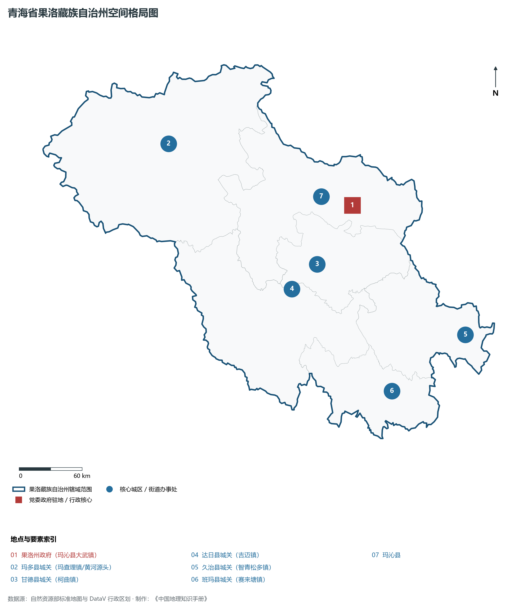
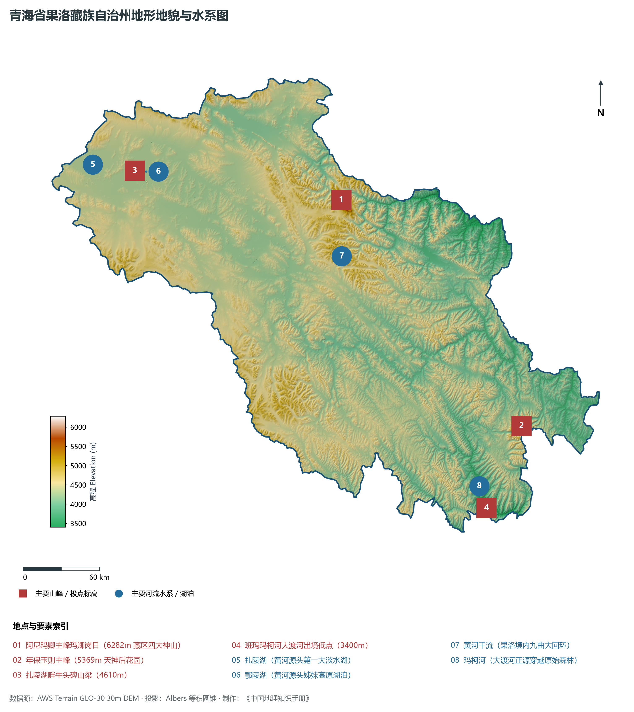
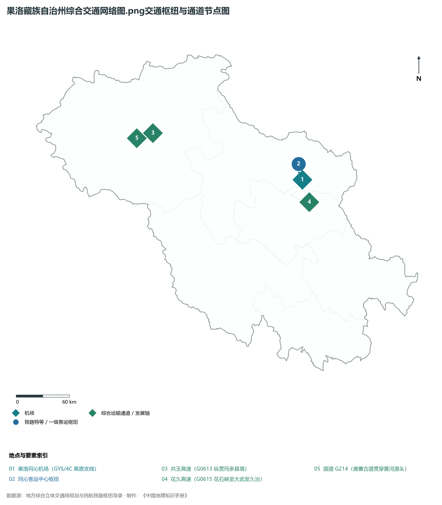
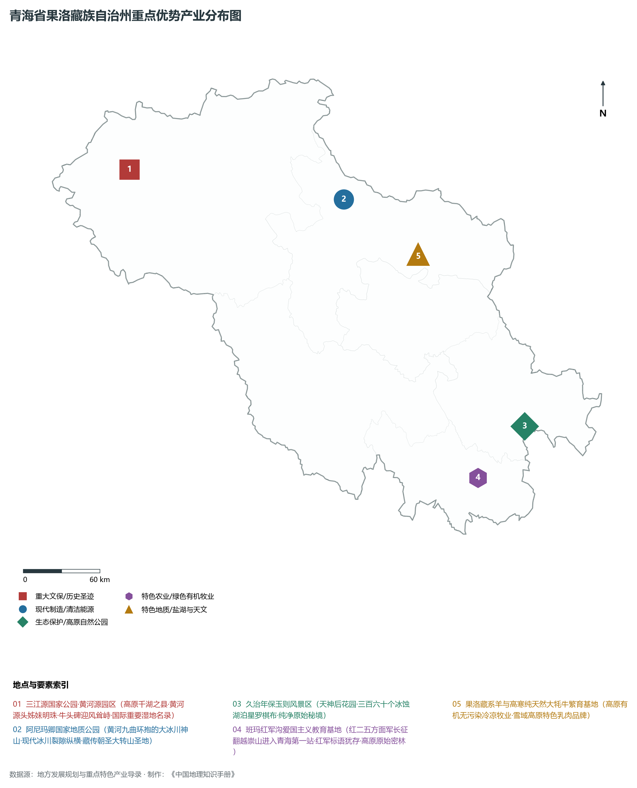
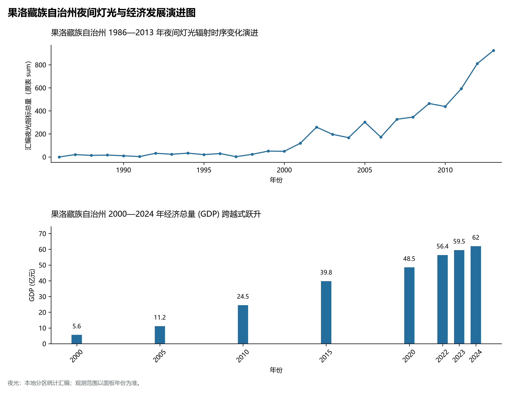

# 33.6 果洛藏族自治州

果洛藏族自治州位于青海省东南部，地处巴颜喀拉山脉与阿尼玛卿山脉环抱的青南高原腹地，是万里黄河的摇篮与三江源国家公园的生态核心功能区。全州地理坐标介于东经 97° 54' ～ 101° 50'、北纬 32° 31' ～ 35° 40' 之间。东南与四川省阿坝藏族羌族自治州（阿坝、若尔盖、壤塘、金川）相依，南与甘孜藏族自治州（色达、石渠）接壤，西连玉树藏族自治州，北接海南藏族自治州与黄南藏族自治州，西北与海西蒙古族藏族自治州毗连。

果洛自古是藏族史诗《格萨尔王传》流传的核心区域，被称为“中国格萨尔文化之乡”；红军长征期间曾踏足班玛县，留下了青海省唯一的长征红色足迹——班玛红军沟。全州现辖 6 个县：玛沁县、班玛县、甘德县、达日县、久治县、玛多县，州人民政府驻玛沁县大武镇。辖区土地总面积 7.44× 10⁴ km²。截至 2024 年末，全州常住人口 21.6 万人，藏族占总人口的 92% 以上，是全国藏族人口比例最高的自治州之一。2024 年全州实现地区生产总值（GDP）约 61 亿元。全州平均海拔在 4200 m 以上，冰川、雪峰、高原湖泊与沼泽湿地密布，肩负着为中华大地孕育“一江清水”的崇高生态使命。

---

## 一、高寒巨型山脉与冰川湖群地貌分异

果洛州地貌演化受可可西里—巴颜喀拉褶皱带与东昆仑左旋走滑断裂带控制，地形起伏雄奇险峻，宏观地势由西北向东南倾斜。全州大部分处于海拔 4000～ 5000 m 的高寒丘状高原与极高山之间。全州最高峰为玛沁县境内的阿尼玛卿雪山主峰——玛卿岗日（海拔 **6282 m**，也是青海东南部第一高峰），最低点位于东南端班玛县玛柯河出省峡谷处（海拔 2800 m），全境相对高差近 3500 m。

全州主要地貌单元包括：

1. **阿尼玛卿极高山现代冰川区**：阿尼玛卿山是东昆仑山脉的东延部分，主峰终年积雪，发育有现代冰川 57 条，总面积达 126 km²。著名的哈龙冰川长逾 7 公里，冰舌深垂至海拔 4300 m。黄河上游自玛多流出后，在此受山体强烈阻挡，形成了一个巨大的“Ω”形外凸大回折弯，环绕神山奔腾而下。
2. **玛多高寒湖泊湿地宽谷盆地（千湖之县）**：玛多县平均海拔 4300 m，盆地内地势平缓，由冰碛物与流水沉积堆积而成，分布着包括扎陵湖（面积 526 km²）、鄂陵湖（面积 610 km²）在内的星宿海沼泽湖群与大小湖泊 4000 余处，是三江源国家公园黄河源园区的战略核心。
3. **年保玉则冰川侵蚀花岗岩峰林（天神后花园）**：坐落于久治县南部巴颜喀拉山东段，由中生代黑色花岗岩岩体经强烈第四纪冰川侵蚀与寒冻风化裂解而成。刀削般的刃脊角峰拔地而起，峡谷中串联着仙女湖、妖女湖等数十个晶莹剔透的高山冰斗湖，构成举世罕见的高原冰川地貌地质奇观。
4. **玛柯河深切高山峡谷林区（班玛“三江源小江南”）**：班玛县南部处于大渡河源流玛柯河流域，海拔降至 3000 m 左右，两岸发育密集的原始暗针叶林、灌丛草甸，气候湿润多雨，植被覆盖率居全省之冠。

---

## 二、高寒严酷气候与黄河长江分水岭水系

果洛州绝大部分属于极严苛的**高寒高湿大陆性高原气候**，全境基本无绝对无霜期，长冬无夏、春秋相连，气候条件被戏称为“风吹石头跑、一年两场雪、一雪下半年”。

- **极度低温与气候寒极**：玛多县年平均气温在 -4.0°C 左右，极端最低气温可达 -38°C，是我国著名的高寒低氧严酷区；全州年平均气温仅在 -3.0～ 3.8°C 之间（班玛较低河谷达 3.8°C）。
- **降水充沛与固体水库**：年降水量在 450～ 760 mm 之间，自西北向东南递增。雨雪天气频繁，夏季降水占全年 80% 以上，丰沛的水汽补给使果洛成为青藏高原东部重要的水源涵养地和湿地蓄水池。
- **两大流域宏伟大分水岭**：
  - **黄河干流青南调蓄核心**：黄河自青海玉树发源后注入果洛玛多县扎陵湖与鄂陵湖，经黄河沿镇、玛沁县拉加峡流向海南同德。果洛境内黄河干流长达 760 km，年均出境水量达 100 亿立方米，占黄河全流域水量的五分之一；
  - **长江大渡河源流**：巴颜喀拉山主脊以南的班玛县、久治县属于长江水系，玛柯河、达柯河向南注入四川大渡河，水流湍急、落差巨大，是长江上游关键的生态涵养支流。

---

## 三、立体交通跨越与高原“天路”贯通

果洛州曾是青海交通最闭塞的高寒深山区域。近年来，随着高等级公路、特长隧道与高高原支线机场的建成，果洛交通实现了从“山阻水断”向“天堑飞渡”的历史性跨越。

1. **高速公路网骨架**：
   - **G0615 德马高速（德令哈—马尔康）**：穿越阿尼玛卿雪山特长隧道群和大武镇，向东南穿过久治县直抵四川马尔康与成都，成为青海通往西南成渝双城经济圈最便捷的快速出省大通道；
   - **G0613 西丽高速**：穿过玛多县黄河源区，向南进入玉树，打通了西宁至玉树的现代化高速生命线。
2. **干线公路体系**：国道 **G214（西景线）** 纵贯玛多；国道 **G347**、**G572**、**G573** 串接玛沁大武、甘德、达日与班玛，全州所有行政村通硬化路率达 100%。
3. **高高原支线航空——果洛玛沁机场**：机场标高 **3788 m**，为 4C 级高高原机场，开通直飞西宁、成都等定期航班，使大武至西宁航程缩短至 45 分钟，彻底打破了以往需乘车翻山越岭 7 小时的时空阻隔。

---

## 四、三江源国家公园生态本底与高寒有机畜牧业

果洛州把生态保护作为立州之本，坚决摒弃一切破坏生态的高污染产业，构建“生态管护+有机畜牧+特色文旅”的新质高原发展体系：

1. **三江源国家公园黄河源园区**：涵盖扎陵湖、鄂陵湖、星宿海及阿尼玛卿雪山等核心区。全州设立生态管护公益岗位超 1.1 万个，实现“一户一岗”，牧民转变为保护母亲河的国家公园生态管护员；通过退牧还草、黑土滩综合治理、鼠害绿色防控，三江源植被覆盖度显著提升，藏羚羊、藏野驴、雪豹、黑颈鹤等珍稀野生动物种群实现爆发式恢复。
2. **高原纯天然有机畜牧业**：依托 8000 余万亩天然草场，实施草畜平衡与轮牧休牧。“果洛牦牛”、“玛多藏羊”、“甘德牦牛”获国家地理标志认证；建立高寒有机牛羊肉冷链加工车间，打造超低温冷冻精细肉块、牦牛奶酪、有机骨粉等高附加值纯生态食品输出链。
3. **格萨尔文化与红色生态文旅**：依托玛沁格萨尔文化博物馆、达日格萨尔狮龙宫殿以及班玛红军沟爱国主义教育基地，开发以神山探秘、江河寻源、长征回望为主题的国际高端生态科考探险与红色文化研学线路。

---

## 五、夜间灯光演化与聚居空间优化

本节夜光图的观测年份为 1986—2013 年，指标为行政区汇总值（原表 sum）。

1. **时空演进特征**：
2. **空间治理走向**：果洛州推进“一核集聚、多极协同”的空间布局，将玛沁大武镇建设为全州高品质现代宜居生活中心与综合服务基地，引导生态脆弱区牧民自愿搬迁至城镇，实现生活条件改善与水源涵养地自然封育“双赢”。

---

## 六、行政区划与核心要素统计表

| 县级行政区 | 驻地镇 | 陆地面积 (km²) | 常住人口 (万人) | 区域地理特色与生态主导方向 |
|:---|:---|:---|:---|:---|
| **玛沁县** | 大武镇 | 13,636 | 6.1 | 州府所在地、阿尼玛卿主峰（6282m）、拉加寺、果洛玛沁机场高高原枢纽 |
| **班玛县** | 赛来塘镇 | 6,452 | 3.3 | 班玛红军沟、原始暗针叶林小江南、藏传佛教碉楼建筑群、黑陶工艺 |
| **甘德县** | 柯曲镇 | 7,143 | 4.0 | 格萨尔王史诗流传重地、班玛仁脱雪山、高寒高原有机草地纯牧业基地 |
| **达日县** | 吉迈镇 | 15,385 | 3.9 | 格萨尔狮龙宫殿、黄河干流横穿草甸、三江源高寒高湿草原生态保护站 |
| **久治县** | 智青松多镇 | 8,696 | 3.1 | 年保玉则国家地质公园、冰川花岗岩奇峰仙女湖、德马高速入川门户 |
| **玛多县** | 玛查理镇 | 25,253 | 1.2 | 黄河源头第一县、千湖之县、扎陵湖与鄂陵湖自然保护核心区、三江源国家公园 |
