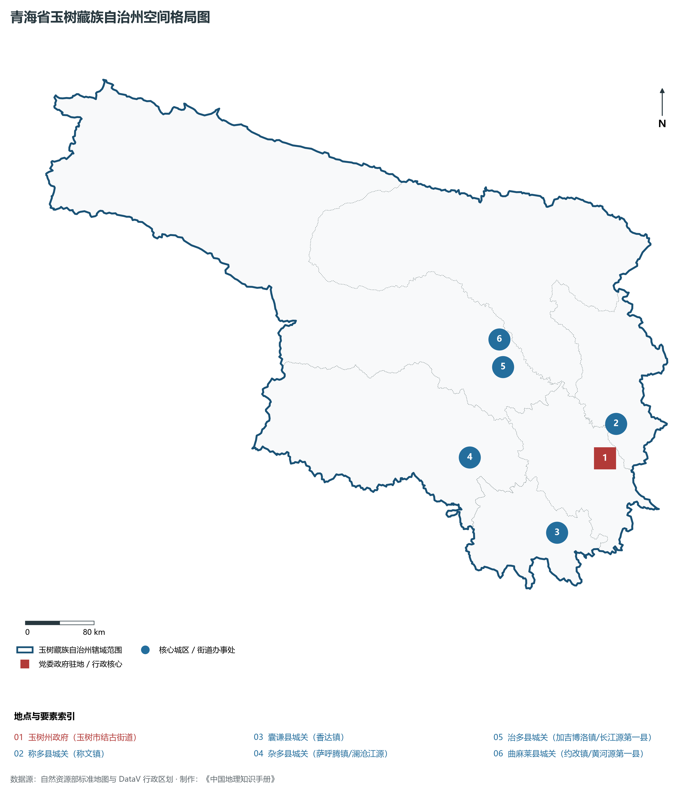
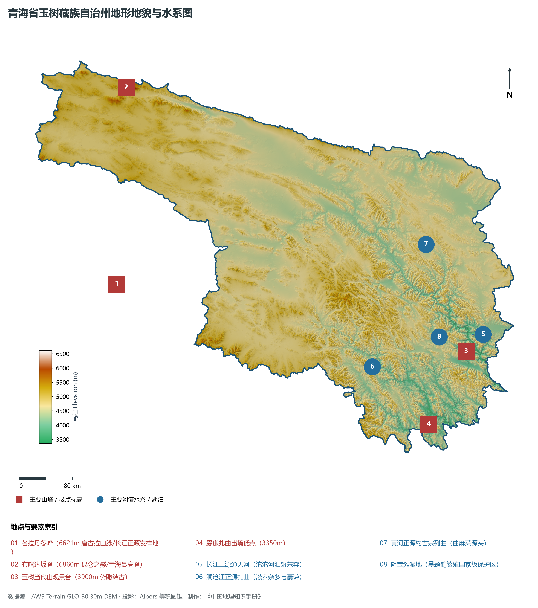
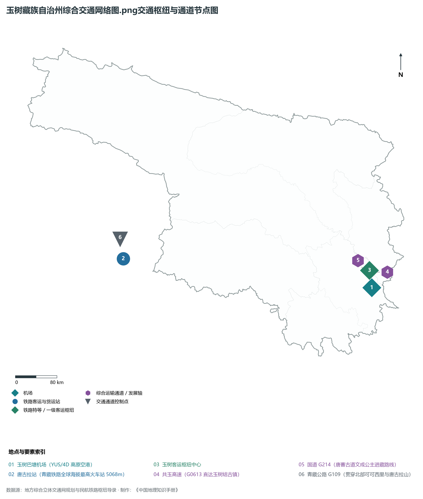
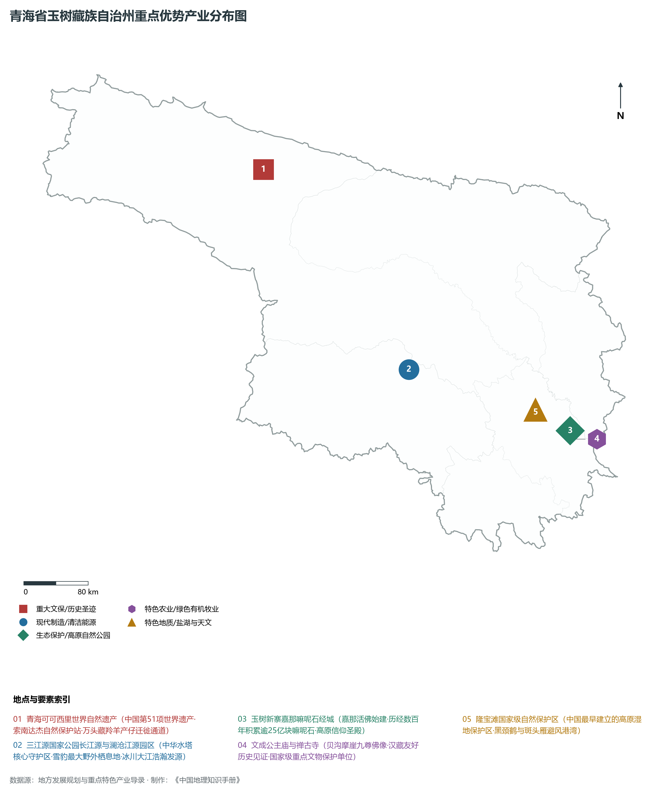
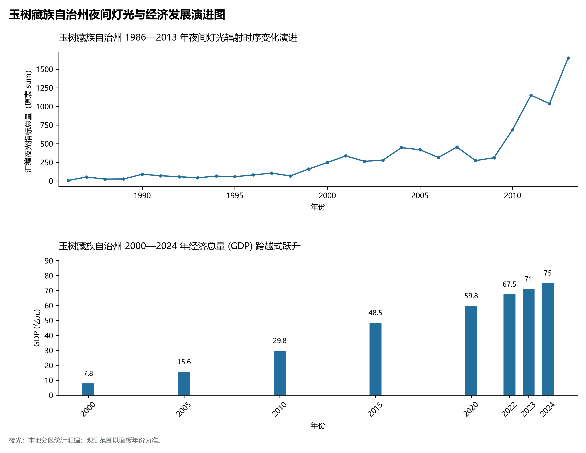

# 33.7 玉树藏族自治州

玉树藏族自治州位于青海省西南部、青藏高原腹地，是长江、黄河、澜沧江三大跨国跨区域大河的母亲发源地，素有“江河之源、名誉天下”与“中华水塔核心”之美誉。全州地理坐标介于东经 89° 27' ～ 102° 39'、北纬 31° 39' ～ 36° 10' 之间。西与西宁直管唐古拉山乡及西藏自治区那曲市（申扎、班戈、安多）、阿里地区毗邻，南接西藏昌都市（类乌齐、丁青、江达），东连四川省甘孜藏族自治州（石渠、德格），北与海西蒙古族藏族自治州及果洛藏族自治州相依。

玉树历史悠久，是古代唐蕃古道与茶马古道的战略重镇，州府所在地结古镇自古便是康巴藏区通往拉萨、西宁和内陆的商贸中枢；西部治多县境内拥有我国面积最大、海拔最高的世界自然遗产——青海可可西里。全州现辖 1 个县级市（玉树市）、5 个县（杂多县、称多县、治多县、囊谦县、曲麻莱县），州人民政府驻玉树市结古街道。全州土地总面积达 26.7× 10⁴ km²，占青海省总面积的 37%。截至 2024 年末，全州常住人口 42.6 万人，藏族占总人口的 97% 以上。2024 年全州实现地区生产总值（GDP）约 82 亿元。作为国家三江源生态保护的“命脉根基”，玉树以其不可替代的生态涵养价值和纯净高迈的人文风貌，巍然屹立于世界屋脊之巅。

---

## 一、高寒高原面与三江源头地貌地质大裂谷

玉树州地处特提斯构造域巴颜喀拉造山带与唐古拉复合造山系内部，经受了第三纪以来青藏高原强烈隆升与深切流水的剧烈改造，造就了“西北平缓辽阔、东南深切峡谷”的显著地貌分异格局。全州平均海拔在 4200 m 以上，最高点为唐古拉山脉主峰——各拉丹冬雪峰（海拔 **6621 m**，也是长江发源地所在），最低点位于南部囊谦县澜沧江出境处大峡谷（海拔 3350 m），相对高差达 3271 m。

玉树州由西北至东南依次展布四大地貌景观区域：

1. **可可西里与羌塘高原高寒荒漠平原带（西北部）**：治多县与曲麻莱县西部属于著名的可可西里无人区与羌塘高原北缘。地貌以海拔 4600～ 5100 m 的波状高原、高平原及浅丘为主，分布着大片多年冻土、热融湖塘、盐湖（如库木库里盆地南缘、卓乃湖、太阳湖）和风成沙丘，是藏羚羊、藏野驴、野牦牛的天堂。
2. **唐古拉山与各拉丹冬现代冰川群**：横亘于州境西南边缘，发育了以姜根迪如冰川为代表的巨大山谷冰川群，冰川融水汇聚成沱沱河与当曲，开启了万里长江的第一滴奔流。
3. **通天河中高山宽谷盆地带（中部玉树、称多）**：长江干流在此段被称为“通天河”，流经曲麻莱、治多、称多与玉树市。河谷由宽缓的高原盆地与局部深切基岩峡谷交替出现，发育了著名的“通天河第一湾”与晒经台古迹，是人口与城镇相对集中的农牧过渡走廊。
4. **澜沧江与金沙江深切峡谷高山林区（南部囊谦、杂多）**：地处横断山脉北端余脉，地形切割极其剧烈。澜沧江（扎曲）上游切穿红层盆地与古生代灰岩，形成雄浑险峻的尕尔寺大峡谷与麦楚河红层峰丛，降水丰沛，发育了连片的圆柏与高山灌丛森林。

---

## 二、严酷高寒气候与“三江之源”水文汇流机理

玉树州深居青藏高原内部，属于典型的**高原高寒大陆性气候与三江源冷温气候**。

- **低氧与严寒特征**：空气含氧量仅为海平面的 50%～ 60%。年平均气温在 -3.0～ 3.8°C 之间（玉树结古镇因地处避风河谷，年均温约 3.5°C，而曲麻莱与治多高原则低至 -2.5°C 以下）。全州除南部河谷外，大部分地区全年无绝对无霜期。年日照时数在 2400～ 2800 h。
- **降水时空分异**：年降水量在 300～ 650 mm 之间，自西北可可西里（不足 250 mm）向东南囊谦林区（可达 600 mm 以上）剧烈递增。降水高度集中于 6—9 月，且多以雷阵雨、冰雹与降雪形式发生。
- **“中华水塔”无可替代的汇水机理**：
  - **长江正源区**：长江水系在玉树境内流长达 1206 km，涵盖沱沱河、当曲、楚玛尔河、通天河，在玉树市直门达水文站出境水量占通天河流域的全部，年均地表水径流量达 140 亿立方米，水质长期保持在一类标准；
  - **黄河发源区**：黄河北源卡日曲与西源约古宗列曲均发源于曲麻莱县巴颜喀拉山北麓，流经曲麻莱高寒湿地后注入果洛扎陵湖；
  - **澜沧江源头区**：杂多县北部吉富山是澜沧江的正源所在地，杂多县由此被称为“澜沧江源第一县”。扎曲奔腾向南，年均出省径流量达 105 亿立方米。

---

## 三、立体交通网络与“唐蕃生命通道”

曾经“山高路远、飞鸟难渡”的玉树，在灾后重建与现代化建设中建成了集民用航空、高等级高速公路与干线公路于一体的现代化高原交通网。

1. **高速公路“天路”跨越**：
   - **G0613 西丽高速（西宁—玉树结古）**：全长 634 km，翻越日月山、鄂拉山（海拔 4688 m 隧道）、巴颜喀拉山（海拔 4824 m 查拉坪垭口），是全世界第一条跨越深厚多年冻土区的高海拔高速公路，将西宁至玉树车程从以往的两天缩短至 8 小时之内；
   - 结古至囊谦高等级公路打通了青海通往西藏昌都的便捷南下大走廊。
2. **干线公路经纬成网**：
   - 国道 **G214（西景线）**：唐蕃古道现代重构线，横贯全州主要城镇；
   - 国道 **G345**（启东至那曲）、**G215**（马鬃山至宁洱）穿过曲麻莱、治多与杂多，深入可可西里与羌塘边缘；全州所有乡镇实现 100% 通硬化路。
3. **高高原支线枢纽——玉树巴塘机场**：机场标高 **3890 m**，为 4C 级高高原机场，开通西宁、成都、北京、拉萨等直达航班，年旅客吞吐量突破 40 万人次，成为青藏高原腹地维系应急救援、公务商务与旅游往来的核心空中生命线。

---

## 四、三江源国家公园核心区保护与高原特色产业

玉树把“生态保护优先”置于一切工作的绝对首位，围绕国家公园体制试点构建绿色可持续的现代高原产业：

1. **三江源国家公园长江源与澜沧江源园区**：涵盖治多、曲麻莱、杂多三县核心保护区。建立“一户一岗”生态管护机制，组建了近 2 万人的牧民生态巡护队；全面实施黑土滩生态修复与江河源湿地封育，可可西里藏羚羊种群数量从受盗猎威胁时的不足 2 万只恢复至 7 万只以上，雪豹、金钱豹在杂多澜沧江大峡谷频频现身，成为全球著名的“雪豹之乡”。
2. **“软黄金”冬虫夏草特色原产地**：玉树地处高海拔阴坡草甸，昼夜温差大、紫外线强，所产冬虫夏草色泽金黄、条干饱满、药效极佳，尤以杂多县、治多县最为著名。全州虫草年交易量达 30 吨以上，年产值达 40 亿元，是农牧民现金收入的核心支柱。
3. **高原纯有机畜牧与黑青稞深加工**：依托玉树牦牛、扎什加羊国家级畜禽遗传资源，打造纯天然无污染有机分割肉、牦牛奶酪及高寒耐寒黑青稞系列营养食品。
4. **康巴文化名城与生态研学旅游**：以结古镇新风貌、新寨嘉那嘛呢石经堆（世界最大石经堆，历经数百年堆积超 25 亿块石刻）、文成公主庙、勒巴沟岩画为依托，办好一年一度的“中国玉树传统赛马节”，打造享誉全球的高原生态与康巴文化探秘旅游目的地。

---

## 五、夜间灯光演化与新玉树城镇重塑

本节夜光图的观测年份为 1986—2013 年，指标为行政区汇总值（原表 sum）。

1. **时空演变特征**：
   - **1986—2000 年（极其微弱）**：全州除结古镇中心有少量孤立暗淡光斑外，其余广大县乡和牧野处于完全暗夜状态；
2. **空间治理走向**：玉树州严守“可可西里世界遗产保护区”与“三江源生态保护红线”，严格禁止在江河源头区和脆弱草场盲目扩张建设，城镇发展全部集中于避风温暖的深切阶地盆地，形成了“一核（玉树市结古）引领、多点（五县城）支撑、万顷绿波”的人地协调空间格局。

---

## 六、行政区划与核心要素统计表

| 县级行政区 | 驻地镇/街道 | 陆地面积 (km²) | 常住人口 (万人) | 区域地理特色与生态定位 |
|:---|:---|:---|:---|:---|
| **玉树市** | 结古街道 | 15,361 | 14.5 | 州府所在地、康巴文化名城、通天河直门达水文断面、嘉那嘛呢石城、巴塘机场 |
| **杂多县** | 萨呼腾镇 | 35,800 | 7.3 | 澜沧江发源地、“中国雪豹之乡”、“中国冬虫夏草第一县”、查旦湿地 |
| **称多县** | 称文镇 | 14,800 | 5.8 | 嘎朵觉悟神山、通天河古渡口、拉布寺、河谷高原农牧结合带 |
| **治多县** | 加吉博洛镇 | 80,000 | 4.6 | “长江源头第一县”、可可西里世界自然遗产所在地、索南达杰保护站、野牦牛之乡 |
| **囊谦县** | 香达镇 | 12,700 | 8.8 | 澜沧江大峡谷、尕尔寺大峡谷、原始圆柏针叶林、千年古盐场白扎盐矿 |
| **曲麻莱县** | 约改镇 | 47,000 | 1.6 | “黄河源头第一县”、约古宗列曲源头、楚玛尔河红梁、高寒生态涵养先行区 |
