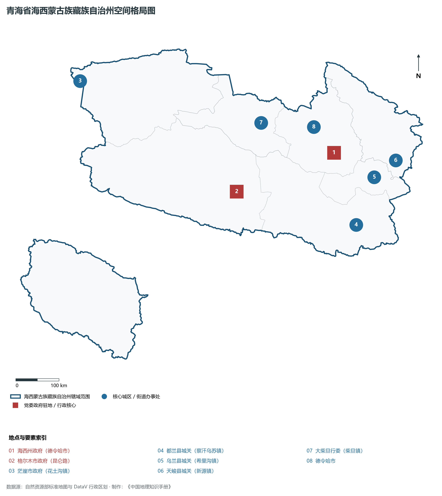
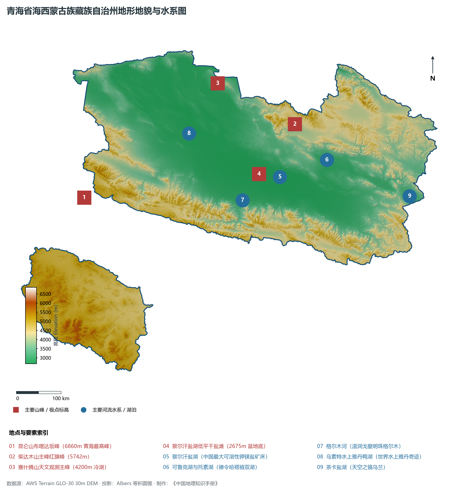
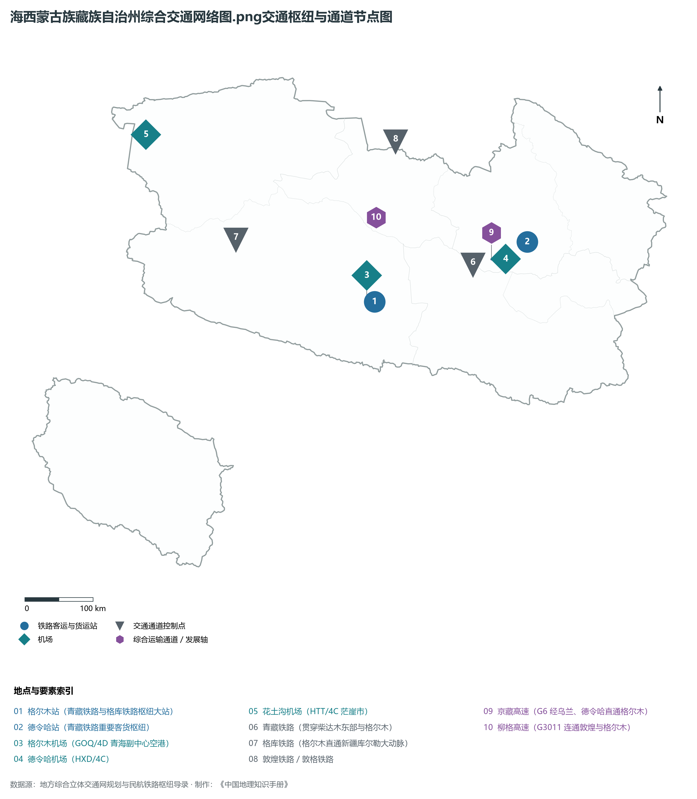
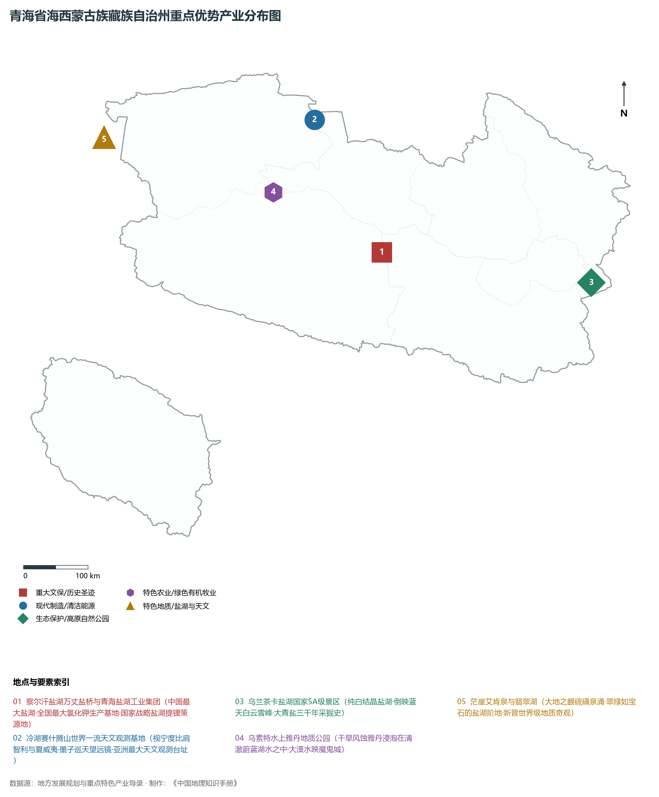
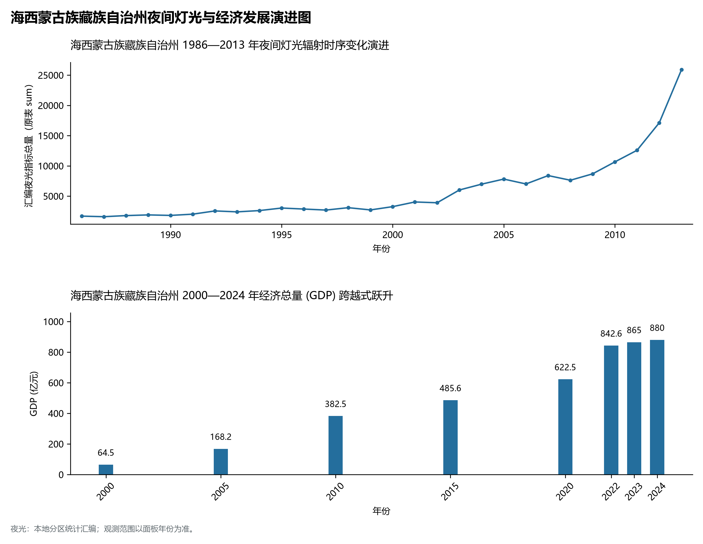

# 33.8 海西蒙古族藏族自治州

海西蒙古族藏族自治州位于青海省西北部，因地处青海湖以西而得名，是青藏高原腹地著名的“聚宝盆”——柴达木盆地的主体所在。海西州地理坐标介于东经 90° 00' ～ 99° 42'、北纬 35° 00' ～ 39° 20' 之间。北与甘肃省酒泉市（阿克塞、肃北、敦煌）接壤，西与新疆维吾尔自治区巴音郭楞蒙古自治州（若羌县）相连，西南与西藏自治区那曲市为邻，东南连接果洛藏族自治州和海南藏族自治州，东北与海北藏族自治州毗邻。

海西州是青海省幅员最辽阔、矿产资源储量最富集、新型工业化水平最高的地级行政区。全州现辖 3 个县级市（德令哈市、格尔木市、茫崖市）、3 个县（都兰县、乌兰县、天峻县）以及 1 个行政委员会（大柴旦行政委员会），州人民政府驻德令哈市。全州土地总面积达 32.58× 10⁴ km²（含格尔木代管西藏飞地唐古拉山镇），占全省总面积的 45.1%。截至 2024 年末，全州常住人口 46.8 万人，蒙古族、藏族、汉族、回族等各民族和谐相融。2024 年全州实现地区生产总值（GDP）约 880 亿元，人均 GDP 超过 18 万元，位居全省第一。作为“世界级盐湖产业基地”与“国家清洁能源产业高地”的双核心承载区，海西以其波澜壮阔的戈壁盐海、雄浑奇绝的雅丹地貌和世界一流的天文观测台址，成为西北内陆极具战略纵深与科技魅力的宏伟宝盆。

---

## 一、山盆相间的柴达木构造盆地与全省最高峰

海西州在地质构造上由阿尔金断裂带、昆仑造山带和祁连造山带三向夹持，形成了巨型的新生代内陆封闭断陷构造盆地——**柴达木盆地**。全州地势总体呈现四周高峻雄峙、盆底平坦低洼的环状与梳状展布格局，平均海拔在 3000 m 左右，盆底海拔在 2670～ 3200 m 之间。

海西州地貌形态极其雄奇多样，垂直落差与景观分异极为悬殊：

1. **全省第一极高峰——布喀达坂峰**：坐落于茫崖市与新疆巴州若羌县交界处的阿尔金山主脉，海拔高达 **6860 m**，为青海省陆地地表最高点。峰顶终年积雪皑皑，冰川面积达数万公顷，与全省最低点官亭盆地（1652 m）形成高达 5208 m 的壮阔落差。
2. **柴达木三大山脉环抱屏障**：
   - 北缘为祁连山西段及党河南山、托勒南山，山峰多在 4500～ 5500 m；
   - 西北缘为阿尔金山脉，呈北东走向巍峨耸立，阻挡塔克拉玛干沙漠的风沙入侵；
   - 南缘为横亘数千里的东昆仑山脉（包括博卡里克塔格山、布尔汗布达山），昆仑山口海拔 4767 m，是进出西藏羌塘高原的天然咽喉。
3. **察尔汗巨型盐湖与内陆盐滩群**：察尔汗盐湖位于格尔木市北部与大柴旦南缘，总面积达 5856 km²，是我国最大的可溶性钾镁盐矿床，也是世界第二大盐湖。盐层厚度达 2～ 20 m，著名的青藏铁路与 G109 国道直接铺筑于坚固的盐盖之上，形成长达 32 km 的“万丈盐桥”世界工程奇迹。此外，茶卡盐湖（天空之镜）、大柴旦翡翠湖、东台吉乃尔湖等如同翡翠蓝宝石点缀戈壁。
4. **风成雅丹地貌与冷湖赛什腾山**：盆地西北部柴达木沙漠与冷湖、茫崖一带，强劲的西北风对第四纪泥岩、粉砂岩层进行长年风蚀磨蚀，雕琢出面积达数万平方公里的风蚀雅丹柱林群，包括世界上绝无仅有的“乌素特水上雅丹”；冷湖赛什腾山海拔 4200 m，凭借干燥晴朗、空气稀薄纯净的卓越台址条件，已被建设为对标智利阿塔卡马与夏威夷莫纳克亚的世界级天文观测基地。

---

## 二、极端干旱大陆性荒漠气候与内流河水系

海西州地处深大陆腹地，四周被巨型山脉严密阻隔，大洋湿润水汽极难深入，属于极具代表性的**高原温带高寒干旱与极端干旱荒漠气候**。

- **降水与蒸发悬殊分异**：全州年降水量呈现剧烈的东多西少梯度。东部天峻草原降水量可达 350～ 400 mm，而西部茫崖冷湖核心区年降水量不足 20 mm，部分年份甚至滴水不下；全州年蒸发量高达 2200～ 3500 mm，干燥度居全国最高之列。
- **光照资源极值区**：全州年日照时数长达 3200～ 3640 h，日照百分率超 80%，居全国各省区之冠；昼夜温差常年达 15～ 22°C，长冬无夏，春秋短暂。
- **内流封闭水系网络**：海西全境属于封闭内陆水系，河流均发源于周缘雪山冰川，经出山口冲洪积扇渗入地下或注入盆底湖泊后蒸发干涸。
  - **格尔木河**：发源于昆仑山北麓，全长 324 km，年径流量达 7.8× 10⁸ m³，是格尔木绿洲与察尔汗盐湖工业区唯一的供水命脉；
  - **柴达木河与巴音河**：巴音河穿过德令哈市区，滋润着德令哈冲积平原绿洲，注入可鲁克湖与托素湖（著名的情人湖）。

---

## 三、立体交通网络与“金十字”高原枢纽

海西州是连接西藏、新疆、甘肃与青海东部的战略大十字枢纽，格尔木市更是全国性综合交通枢纽与进出西藏最重要的后勤物资总保障基地。

1. **“金十字”铁路干线网络**：
   - **青藏铁路**：横贯海西东西，西格段完成电气化复线改造，格拉段翻越昆仑山口与唐古拉山直抵拉萨，是西藏 85% 以上进出物资的铁路大动脉；
   - **格库铁路（格尔木—库尔勒）**：全长 1213 km，穿过柴达木盆地与阿尔金山，开辟了新疆通往青海与西南省份的第三条铁路入疆大通道；
   - **敦格铁路（敦煌—格尔木）**：连接甘肃河西走廊与柴达木盆地，在格尔木与青藏、格库铁路交汇，全面奠定了海西西北铁路枢纽地位。
2. **高速与干线公路走廊**：
   - **G6 京藏高速（格尔木段）**、**G3011 柳格高速**（甘肃柳园至格尔木）、**G0612 西和高速**（德令哈至都兰至格尔木）；
   - 国道 **G109（京拉线）**、**G215**、**G315** 横贯东西南北，路面宽阔平直，畅通无阻。
3. **“一州三场”高原航空网**：海西拥有**格尔木机场（4D级）**、**德令哈机场（4C级）**与**花土沟机场（4C级）**，构筑了覆盖盆地东、中、西部的空中高速走廊，实现了跨越数千公里的点对点高效通达。

---

## 四、世界级盐湖基地、清洁能源高地与冷湖天文台

海西州坚定不移推进“资源优势向产业优势、产业优势向经济高地”跃升，成为全省工业经济的“定海神针”：

1. **世界级盐湖产业基地**：察尔汗盐湖已形成全国最大的钾肥生产基地，年产氯化钾超 800 万吨，全国市场占有率达 60% 以上，为我国粮食安全构筑起坚不可摧的化肥基石；突破高镁锂比吸附提锂核心技术，碳酸锂年产能突破 10 万吨，成为全国顶级的新能源电池原料基地；金属镁一体化与高纯硼酸、钠盐系列产品形成百亿级循环化工集群。
2. **海西千万千瓦级清洁能源基地**：利用广袤戈壁荒滩与充沛日照，累计建成风光新能源装机近 2000 万千瓦。德令哈建成我国首座兆瓦级商业化熔盐塔式光热电站；格尔木打造多能互补绿色能源示范基地；格尔木乌图美仁、大柴旦风光基地加快推进，构筑千万千瓦级“风光水火储”一体化清洁电力系统。
3. **石油天然气与冷湖深层资源勘探**：柴达木盆地是我国陆上重要油气产区之一，涩北气田天然气输送甘肃、西宁并接入国家干网，茫崖英西、风西深层页岩油气勘探连续取得战略突破。
4. **冷湖世界级天文观测基地**：在冷湖赛什腾山布局建设了墨子巡天望远镜（WFST）、SONG望远镜、司天工程等十余个国内外顶尖天文巡天项目，正在成为与智利、夏威夷比肩的东半球顶级光学红外天文观测圣地。
5. **柴达木有机枸杞特色农业**：依托高日照、强温差与无污染的荒漠戈壁沙壤土，都兰、德令哈、格尔木规模化种植富硒有机枸杞近 50 万亩，有机红枸杞与黑枸杞远销欧美，享有“中国红枸杞之乡”美誉。

---

## 五、夜间灯光时空演化与绿洲工矿空间治理

本节夜光图的观测年份为 1986—2013 年，指标为行政区汇总值（原表 sum）。

1. **时空演进特征**：
   - **2016—2024 年（群星璀璨成带）**：茫崖撤县设市、格库铁路通车，柴达木盆地内部格尔木、德令哈、大柴旦、茫崖四大光斑高度明亮，光热熔盐吸热塔在夜间折射出耀眼光斑；沿 G315 与格库铁路沿线工矿仓储与风电场夜间警示灯带串联成链，形成戈壁夜空下蔚为壮观的现代化工业明珠带。
2. **空间治理走向**：海西州坚定严守祁连山国家公园（海西片区）与东昆仑生态安全屏障，坚持“以水定城、以水定地、以水定产”，严控地下水超采与盐湖乱采乱挖，全面推行盐田母液老卤循环回灌，实现了资源高强度开发与荒漠脆弱生态保护的良性循环。

---

## 六、行政区划与核心要素统计表

| 县级行政区 | 驻地镇/街道 | 陆地面积 (km²) | 常住人口 (万人) | 区域特色与主导产业方向 |
|:---|:---|:---|:---|:---|
| **德令哈市** | 河西街道 | 27,700 | 8.8 | 州府所在地、巴音河绿洲、国家首批光热发电示范基地、柴达木枸杞产业 |
| **格尔木市** | 昆仑路街道 | 119,000 | 22.5 | 青藏高原副中心、察尔汗盐湖钾肥锂盐基地、“金十字”综合交通枢纽、昆仑山口 |
| **茫崖市** | 花土沟镇 | 49,900 | 2.0 | 青海西大门、布喀达坂峰（6860m）、翡翠湖、青海油田采油基地、艾肯泉地热 |
| **都兰县** | 察汗乌苏镇 | 45,270 | 5.6 | 热水墓群（九层妖塔考古）、柴达木有机枸杞之乡、大型铅锌矿与生态畜牧 |
| **乌兰县** | 希里沟镇 | 12,800 | 3.5 | 茶卡盐湖“天空之镜”、哈里哈图国家森林公园、光伏新能源与绿色矿业 |
| **天峻县** | 新源镇 | 25,700 | 2.4 | 天峻山神山风光、布哈河源头草甸、祁连山南麓高寒优质藏系羊繁育基地 |
| **大柴旦行政委员会** | 柴旦镇 | 21,000 | 2.0 | 大柴旦翡翠湖、红崖火星村雅丹奇观、锂硼盐化工与新能源微电网枢纽 |
