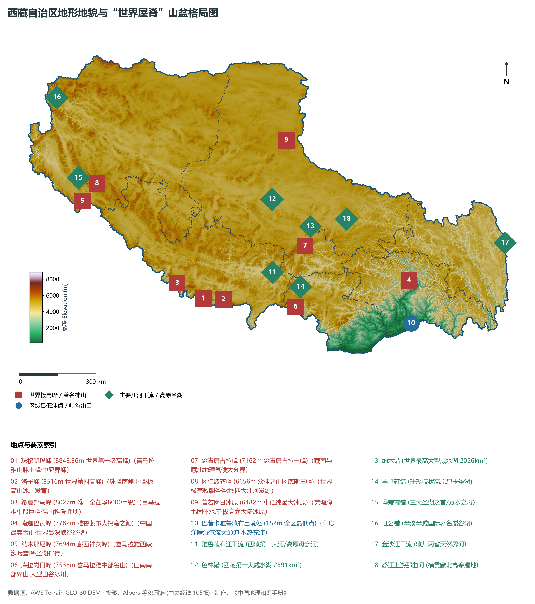
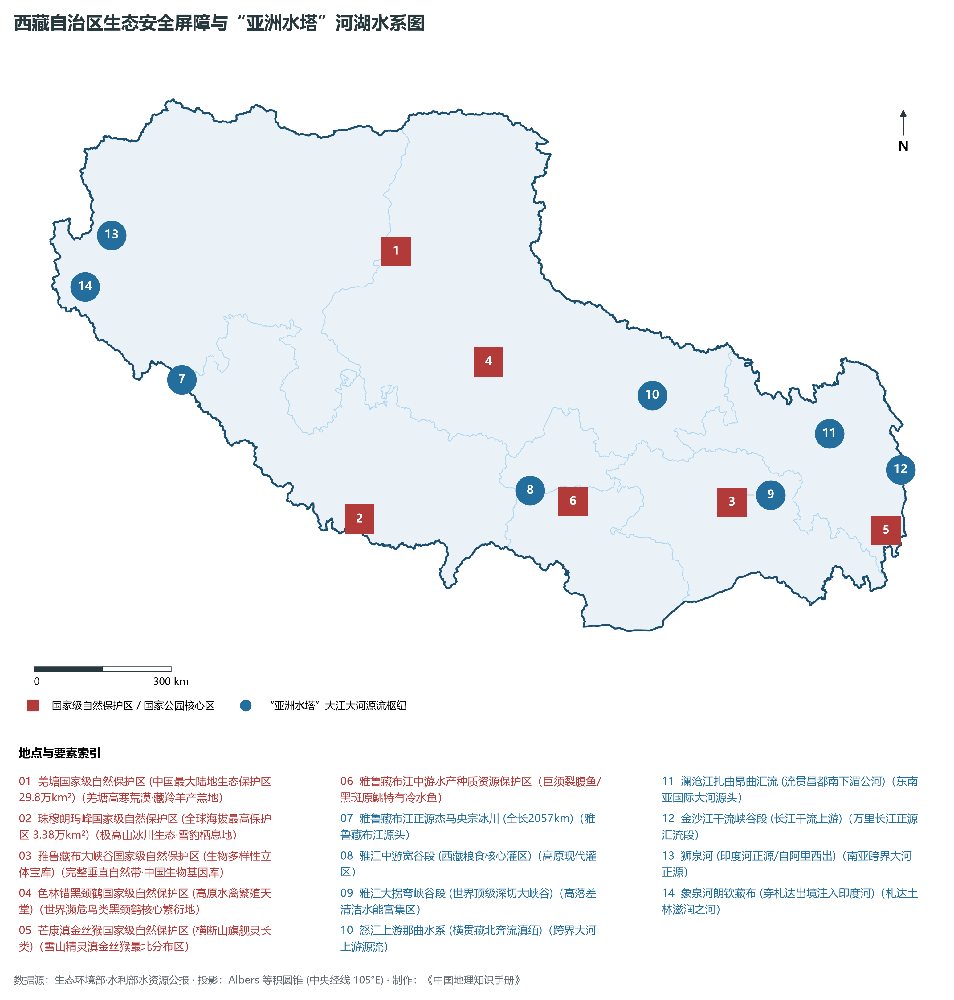
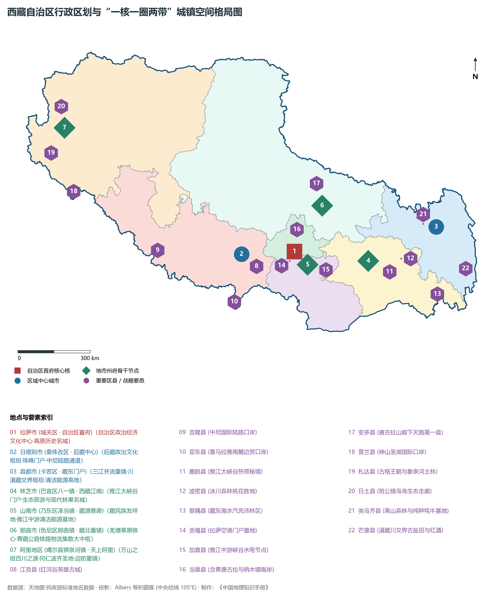
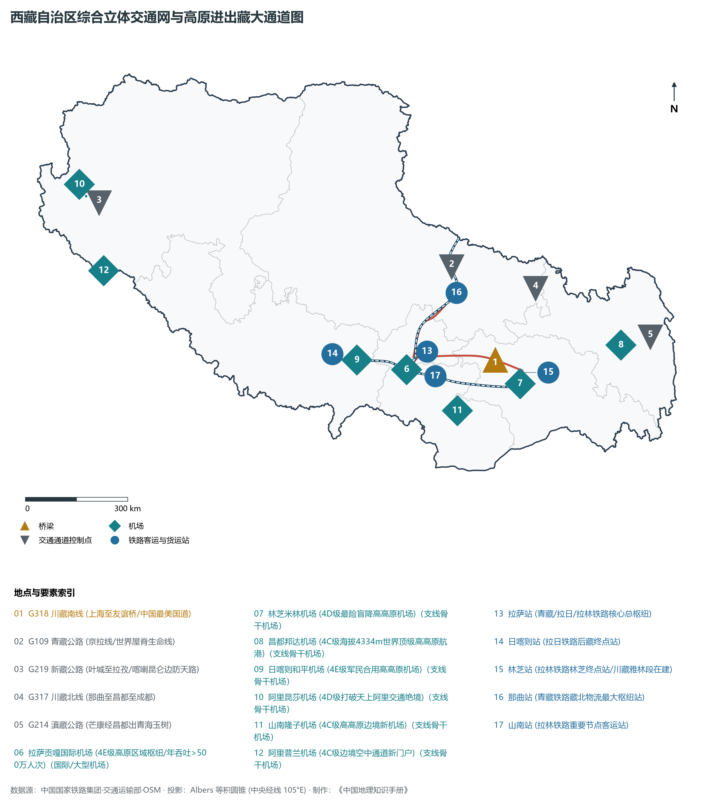
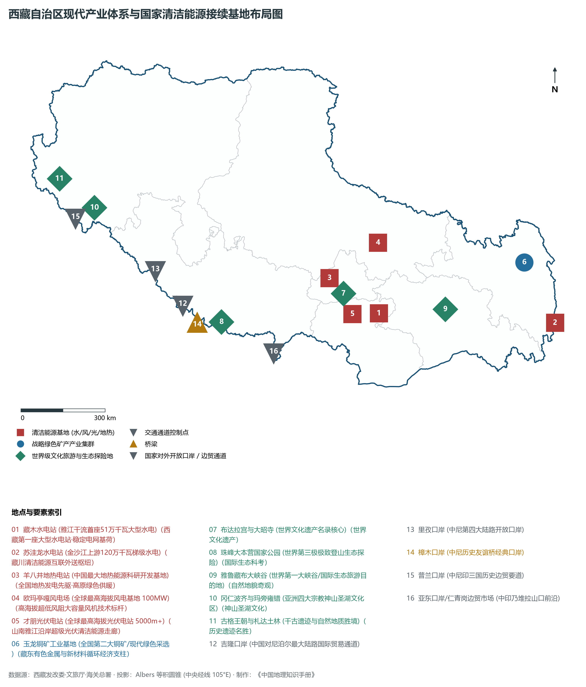

# 34.0 西藏自治区地理统揽

西藏自治区位于中华人民共和国西南边陲、青藏高原西南部，地处东经 78° 25' ～ 99° 06'、北纬 26° 50' ～ 36° 53' 之间。全区东西长约 2000 km，南北宽约 1000 km，辖区陆地面积达 122.84× 10⁴ km²，约占全国陆地国土总面积的 12.8%，居全国各省区第 2 位（仅次于新疆维吾尔自治区）。西藏北邻新疆维吾尔自治区和青海省，东连四川省，东南与云南省相接，南部和西部自东向西与缅甸、印度、不丹、尼泊尔等国接壤，国境陆地边界线长达近 4000 km，是我国西南方向极其重要的国家安全、生态安全和地缘战略屏障。

西藏被公认为“世界屋脊”的主体与“地球第三极”的核心，平均海拔在 4000 m 以上。世界最高峰——珠穆朗玛峰（海拔 8848.86 m）耸立于西藏与尼泊尔边境；亚洲多条著名跨国巨川——雅鲁藏布江（布拉马普特拉河）、印度河、恒河支流、澜沧江（湄公河）、怒江（萨尔温江）及长江源流均发源或流经此地，是维系亚洲数十亿人口水源命脉的“亚洲水塔”。全区现辖 6 个地级市（拉萨市、日喀则市、昌都市、林芝市、山南市、那曲市）和 1 个地区（阿里地区），共 7 个地级行政单元，下辖 8 个市辖区、2 个县级市、64 个县。截至 2024 年末，全区常住人口约 368 万人，藏族占总人口的 86% 以上。2024 年全区实现地区生产总值（GDP）约 2760 亿元，增速持续领跑全国，正在全力创建国家生态文明高地、国家高原经济高质量发展先行区、国家边境安全稳定示范区和国家面向南亚开放重要通道。

---

## 一、自然地理与地质构造格局

西藏自治区地质演化是地球演化史上最波澜壮阔的篇章之一，属于特提斯—喜马拉雅造山系的核心隆升带。自中生代以来，伴随印度板块与欧亚板块的强烈碰撞与持续俯冲嵌合，特提斯洋相继闭合，古老的地壳发生剧烈缩短、增厚与爆发式隆升，形成了当今世界上厚度最大（莫霍面深度可达 70～ 75 km）、海拔最高的新生代巨型高原地壳。

在地貌轮廓上，西藏自北向南由一系列大致平行的巨型弧形山系与宽阔山间盆地、深切峡谷构成，呈现极强烈的地势反差。全区最高点为珠穆朗玛峰（海拔 **8848.86 m**），最低点位于墨脱县东南部巴昔卡附近的雅鲁藏布江出境处（海拔仅 **152 m**），全境地表最大相对高差达 **8696.86 m**，形成了地球陆地上绝无仅有的极致垂直地貌剖面。

西藏宏观上可划分为三大各具特色的自然地貌区域：

1. **藏北高原与羌塘盆地（北部）**：介于昆仑山脉、唐古拉山脉与冈底斯山脉、念青唐古拉山脉之间，面积约占全区的三分之二。地势起伏平缓，平均海拔在 4500～ 5000 m 之间，广泛分布着平缓的高原面、低丘陵以及数以百计的内陆咸水湖盆（如色林错、纳木错、当惹雍错）。深厚多年冻土广布，现代大陆性冰川退缩遗留了大量冰碛地貌与热融滑塌地貌。
2. **藏南谷地（一江两河区域，中部）**：位于冈底斯—念青唐古拉山脉与喜马拉雅山脉之间，为雅鲁藏布江及其主要支流拉萨河、年楚河（合称“一江两河”）流经的高原宽谷与盆地带。平均海拔在 3500～ 4100 m 之间，地势开阔平坦，河流阶地与冲积平原肥沃，水热配置相对优越，是西藏主要的农业耕作区和城市密集集聚带。
3. **藏东横断山高山深谷区（东南部）**：主要包括昌都市与林芝市东部。金沙江、澜沧江、怒江三条大江在横断山脉间由北向南深切平行奔流，两岸高山耸入云霄，相对高差常达 2000～ 3000 m。山高谷深、绝壁千仞，水流湍急，呈现极为雄奇的“三江并流”峡谷地貌；而在林芝东南部，雅鲁藏布江切穿喜马拉雅东端，形成深达 6009 m 的**雅鲁藏布大峡谷**，是世界第一大峡谷。

**西藏自治区宏观构造与地貌剖面示意表**

| 喜马拉雅山脉 | 藏南雅江宽谷 | 冈底斯-念青 | 藏北羌塘高原 |
| --- | --- | --- | --- |
| (珠峰 8848m)；极高山现代冰川 | (拉萨 3650m)；一江两河粮仓 | 唐古拉山脉；(神山/分水岭) | (湖盆4600m+)；严寒高平原 |

南 (印度洋水汽面) · → 北 (内陆荒漠区)

---

## 二、气候环境机理与“亚洲水塔”水文分异

西藏受中纬度西风环流、青藏高原自身热力环流以及西南季风的深刻调制，形成了极具特征的**高寒高原气候**。总体气候特征表现为：**日照极其充沛、太阳辐射强烈、长冬无夏、气温偏低日较差大、干湿季界限分明、气候带空间立体分异剧烈**。

- **日照与气温**：全区年日照时数在 1500～ 3400 h 之间，拉萨素有“日光之城”之称，年日照超过 3000 h，年总辐射量高达 7000～ 8400 MJ/m²，居全国乃至全球大陆之首。年平均气温自东南向西北剧降：藏东南墨脱河谷年平均气温高达 16～ 18°C，温暖如春；拉萨河谷年平均气温为 8.5°C；而藏北羌塘高原和阿里腹地年平均气温低至 -3～ 0°C，极端最低气温可达 -44°C。
- **降水梯度与季风大峡谷水汽通道**：全区年降水量在 50～ 2200 mm 之间，自东南向西北急剧锐减。藏东南雅鲁藏布大峡谷是印度洋西南暖湿气流深入青藏高原内部的天然“水汽大通道”，迎风坡墨脱、巴昔卡年降水量高达 2000～ 3000 mm，为全区降水极值中心；向北翻越喜马拉雅山脉后，藏南谷地年降水量降至 400～ 500 mm；而西北部阿里日土、改则及藏北双湖地区降水量不足 100 mm，蒸发量却超过 2500 mm。

在水系网络与生态水文方面，西藏拥有我国最为富集的地表淡水与冰冻圈固体水源储备，被誉为“亚洲水塔”的核心枢纽：

- **地表径流输出**：全区天然水资源总量达 4394× 10⁸ m³，约占全国水资源总量的 16.5%，人均水资源占有量居全国第一。年出境水量达 3000× 10⁸ m³ 以上。
- **跨界外流水系**：
  - **雅鲁藏布江**：全长 2057 km（西藏境内），流域面积 24.6× 10⁴ km²，年径流量达 1654× 10⁸ m³。干流流经西藏 5 个地市，在米林县南迦巴瓦峰转向南流形成著名的“U”形大拐弯，奔腾注入印度阿萨姆平原后改称布拉马普特拉河；
  - **横断山三江**：金沙江西岸（属长江水系）、澜沧江上游（出境为湄公河）、怒江上游（出境为萨尔温江），滋润着西南和东南亚广袤区域；
  - **藏西国际河流源流**：狮泉河（印度河正源）、象泉河（萨特莱杰河，印度河支流）发源于冈底斯山与阿里高寒山区，自西向东汇入南亚大陆。
- **高原湖泊之冠**：西藏拥有面积大于 1 km² 的湖泊 800 余个，湖泊总面积达 2.85× 10⁴ km²，约占全国湖泊总面积的三成。其中**色林错**（面积 2391 km²，近年来随冰川融水增加持续扩张，已超越纳木错成为西藏第一大湖、全国第二大咸水湖）、**纳木错**（2026 km²，世界上海拔最高的大型湖泊）、**羊卓雍错**与**玛旁雍错**被誉为雪域三大圣湖。

---

## 三、行政区划、人口与“一核一圈两带”空间结构

西藏幅员辽阔，由于高寒、低氧、高海拔等地理环境的严苛限制，全区人口分布极不均衡。常住人口主要集聚在海拔 4000 m 以下、水热适宜的“一江两河”流域（拉萨、日喀则、山南）及藏东低海拔谷地（林芝、昌都），而占全区面积过半的藏北高原与藏西阿里地区，人口密度每平方公里不足 1 人，属于极高寒低密度聚落区。

按照《西藏自治区国土空间规划（2021—2035年）》，西藏着力构建以**“一核一圈两带”**为骨干的高原城镇空间新格局：

1. **“一核”：拉萨核心都市区**：以拉萨市主城区（城关区、堆龙德庆区、达孜区）为核心，统筹柳梧新区与高新技术开发区，打造引领全区科技创新、现代服务、高端文旅和对外交往的高原首府枢纽。
2. **“一圈”：拉萨—山南一体化同城化核心圈**：依托拉林铁路、泽贡高速与雅江沿岸便捷通道，推动拉萨市区与山南市乃东泽当、贡嘎空港组团协同联动，共建产业协同、人口集聚与综合服务现代生活圈。
3. **“两带”**：
   - **雅鲁藏布江沿岸高质量发展带**：沿雅江干流串联日喀则、拉萨、山南、林芝四座中心城市，集聚全区 70% 以上的工业、现代农业与文旅产业，打造西藏经济社会发展的黄金走廊；
   - **边境安全稳定与特色开放繁荣带**：沿喜马拉雅山脉与阿里边防线（以 G219 为依托），串联吉隆、樟木、普兰、亚东、里孜等口岸与边境城镇，推进固边兴边富民行动，筑牢边境安全与对南亚经贸开放基石。

| 行政区划单元 | 行政驻地 | 陆地面积 (km²) | 常住人口 (万人) | 辖区区县构成 | 区域核心定位与产业特色 |
|:---|:---|:---|:---|:---|:---|
| **拉萨市** | 城关区 | 29,518 | 88 | 3区5县 (城关/堆龙德庆/达孜/当雄/林周/墨竹工卡/曲水/尼木) | 自治区首府、日光之城、现代高新数字科技与净土健康产业基地 |
| **日喀则市** | 桑珠孜区 | 182,000 | 81 | 1区17县 (桑珠孜/江孜/定日/吉隆/亚东/萨迦/拉孜等) | “后藏”中心、珠峰国家公园核心区、西藏青稞粮仓与中尼陆路开放大门户 |
| **昌都市** | 卡若区 | 108,600 | 77 | 1区10县 (卡若/江达/贡觉/类乌齐/丁青/察雅/八宿/左贡/芒康等) | 藏东门户西藏东大门、横断山三江并流区、金沙江澜沧江水风光清洁能源基地 |
| **林芝市** | 巴宜区 | 117,000 | 24 | 1区1市5县 (巴宜/米林市/墨脱/波密/察隅/工布江达/朗县) | “西藏江南”、雅鲁藏布大峡谷世界地貌奇观、生态林果康养与清洁水能基地 |
| **山南市** | 乃东区 | 79,700 | 36 | 1区1市10县 (乃东/错那市/贡嘎/扎囊/桑日/琼结/加查/浪卡子等) | 藏民族之源、雅砻文化发祥地、雅江中游清洁能源基地与空港经济区 |
| **那曲市** | 色尼区 | 353,000 | 51 | 1区10县 (色尼/安多/聂荣/嘉黎/比如/索县/巴青/班戈/申扎/双湖) | 藏北重镇、羌塘高原腹地、高寒纯天然牦牛藏羊与冬虫夏草核心产区 |
| **阿里地区** | 噶尔县狮泉河镇 | 345,000 | 12.3 | 7县 (噶尔/普兰/札达/日土/革吉/改则/措勤) | “万山之祖·百川之源”、冈仁波齐神山圣湖、古格王朝遗存与白绒山羊基地 |

---

## 四、综合交通网络与高原战略走廊

在党中央和全国人民的全力支援下，西藏交通基础设施实现了从“人背畜驮、溜索度日”到“高铁路网跨越、高速通达多市、民航连贯天堑”的世纪历史巨变。

1. **高原铁路跨越**：
   - **青藏铁路（格尔木至拉萨段）**：全长 1142 km，穿越 550 km 连续多年冻土区，翻越海拔 5072 m 的唐古拉山口，被誉为“神奇的天路”，彻底终结了西藏不通铁路的历史，承担着西藏 85% 以上的进出客货运重任；
   - **拉日铁路（拉萨至日喀则）**：全长 253 km，将铁路延伸至后藏中心日喀则；
   - **拉林铁路（拉萨至林芝）**：全长 435 km，设计时速 160 公里，跨越雅鲁藏布江 16 次，开通“复兴号”高原内电双源动车组，使西藏首府与“西藏江南”迈入动车时代；
   - **川藏铁路（雅安至林芝段，在建）**：国家重大标志性工程，横穿横断山脉崇山峻岭与深邃大峡谷，全线建成后将开辟西藏连通祖国内陆经济最强劲的陆上大动脉。
2. **高等级公路网**：全区公路通车总里程超过 12.3× 10⁴ km，乡镇与建制村 100% 通硬化路。**G6 京藏高速（拉萨至那曲段）**为全球海拔最高的高速公路；**拉林高等级公路**、**泽贡高等级公路**（拉萨至山南）搭建起藏南都市圈快速通道。国道干线形成以 **G318（川藏南线/中尼公路）**、**G109（青藏线）**、**G219（新藏线）**、**G317（川藏北线）**、**G214（滇藏线）** 构成的“五纵五横”全天候进出藏骨干路网。
3. **“一干六支”高原空港航线网络**：
   - 以**拉萨贡嘎国际机场（4E级，T3航站楼建成）**为全区枢纽核心；
   - 布局日喀则和平机场、林芝米林机场、昌都邦达机场（海拔 4334 m）、阿里昆莎机场、山南隆子机场、阿里普兰机场 6 座支线机场；
   - 开辟国内外航线近 150 条，通航主要城市近 70 个，年旅客吞吐量跨越 650 万人次，筑起了连接祖国各地的金色“空中金桥”。

---

## 五、现代产业体系与国家清洁能源接续基地

西藏立足生态优先、绿色发展的战略原则，不以牺牲生态环境为代价发展经济，重点做精做强高原特色优势产业体系：

1. **国家清洁能源接续基地（战略支柱）**：西藏拥有全国最充沛的太阳能（可利用技术开发量超 10 亿千瓦）与水能（理论储量占全国近三分之一），风能与地热资源极具禀赋。
   - 梯级大型水电工程：雅鲁藏布江干流水能资源极其富集，藏木水电站（51万千瓦）已稳健运营，大古、加查等大型水电站陆续投运；金沙江上游苏洼龙（120万千瓦）、叶巴滩等清洁基地加快并网；
   - 超高海拔光伏与风电：山南才朋光伏电站（海拔超 5000 m）、那曲欧玛亭嘎风电场（100兆瓦，全球海拔最高风电示范工程）实现技术跨越；
   - 地热综合利用：羊八井地热电站技术处于全国领先地位；
   - 跨区电网互联：“藏电外送”累计输送绿电超 130 亿千瓦时，通过青藏联网、川藏联网、藏中联网及阿里联网四大超高压跨区“电力天路”，实现了全区大电网统一互联并反哺中东部。
2. **高原特色生物医药与净土健康产业**：立足青藏高原无污染、高紫外线环境，重点培育冬虫夏草、藏红花、雪莲花、红景天等高原珍稀中藏药材现代化创制；做大“西藏青稞”与“牦牛乳肉”全产业链；依托优质冰川融雪泉水，培育“西藏好水”天然饮用水高端品牌。
3. **世界级旅游目的地与高原文化产业**：以布达拉宫、大昭寺、罗布林卡等世界文化遗产为龙头，整合雅鲁藏布大峡谷、珠穆朗玛峰、纳木错、巴松错等世界级自然奇观，做强藏族唐卡、藏香、藏毯等非遗工艺品，年接待海内外游客超 5500 万人次，旅游总收入占全区 GDP 的近三成。
4. **面向南亚开放大通道与边贸口岸经济**：加快吉隆、樟木、普兰、亚东、里孜等口岸基础设施现代化建设，设立吉隆边境经济合作区，拓展面向尼泊尔、印度等南亚诸国的陆路物流与商贸转口通道。

---

## 六、全区自然地理关键指标控制矩阵

**西藏自治区主要水系与跨界外流径流贡献**

| 水系干流 | 西藏境内流长 | 年均出境径流 | 国际/跨省生态战略地位 |
| --- | --- | --- | --- |
| 雅鲁藏布江 | 2,057 km | ~1,654 亿m³ | 亚洲第一大跨界大河，下游布拉马普特拉河 |
| 金沙江(长江) | 约 600 km | ~450 亿m³ | 万里长江干流源头，南水北调西线重要水源 |
| 澜沧江(湄公) | 约 500 km | ~250 亿m³ | 东南亚跨国黄金水系，下游维系五国水安全 |
| 怒江(萨尔温) | 约 800 km | ~400 亿m³ | 中缅跨界天然水系，横断山生物廊道命脉 |
| 狮泉/象泉河 | 约 400 km | ~60 亿m³ | 印度河水系源流，南亚水塔重要发源地 |
| 藏北内流水系 | 汇水40万km² | 内流蒸发平衡 | 色林错(2391km²)、纳木错(2026km²)湖盆 |

西藏自治区巍峨雄踞于世界之巅，其极致壮丽的高山冰川、辽阔丰美的荒原湖泊以及深厚纯净的高原文明，不仅是中华民族永续发展无可替代的“生态元勋”与“战略纵深”，更在维系全球气候平衡与亚洲大江大河生态安澜的宏阔格局中，放射出无与伦比的璀璨光辉。

地市统计来源：《中国城市统计年鉴 2025》表 2-1、2-6、2-7（2024 年，全市）。
