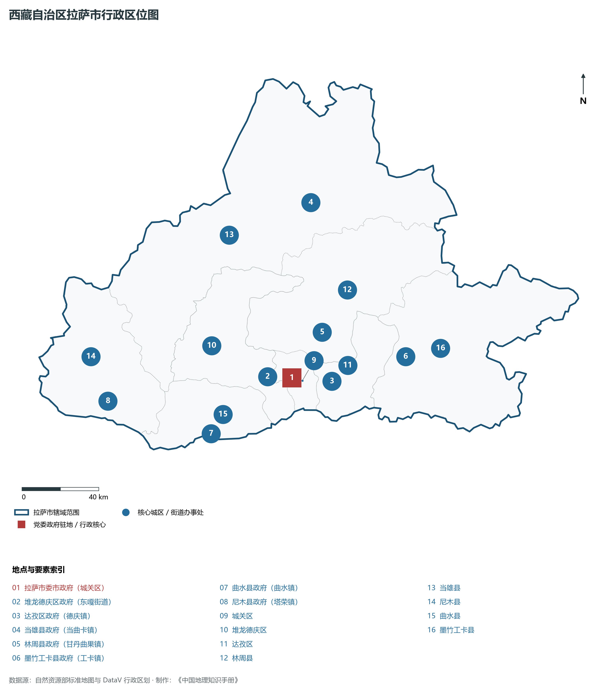
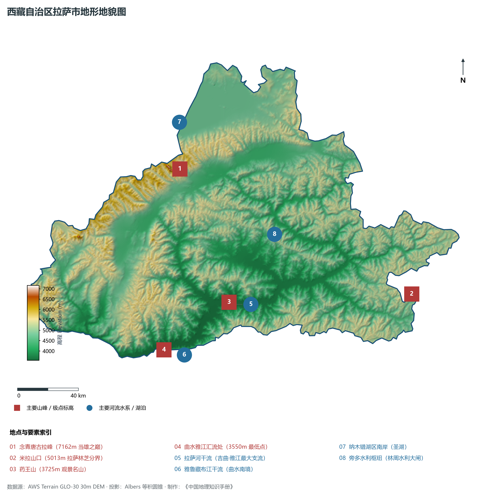
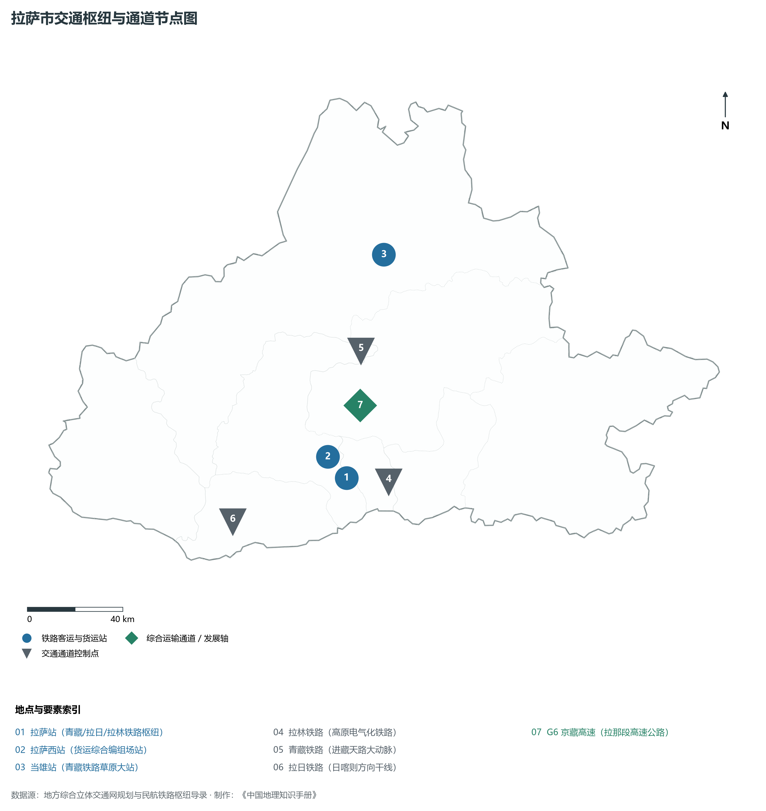
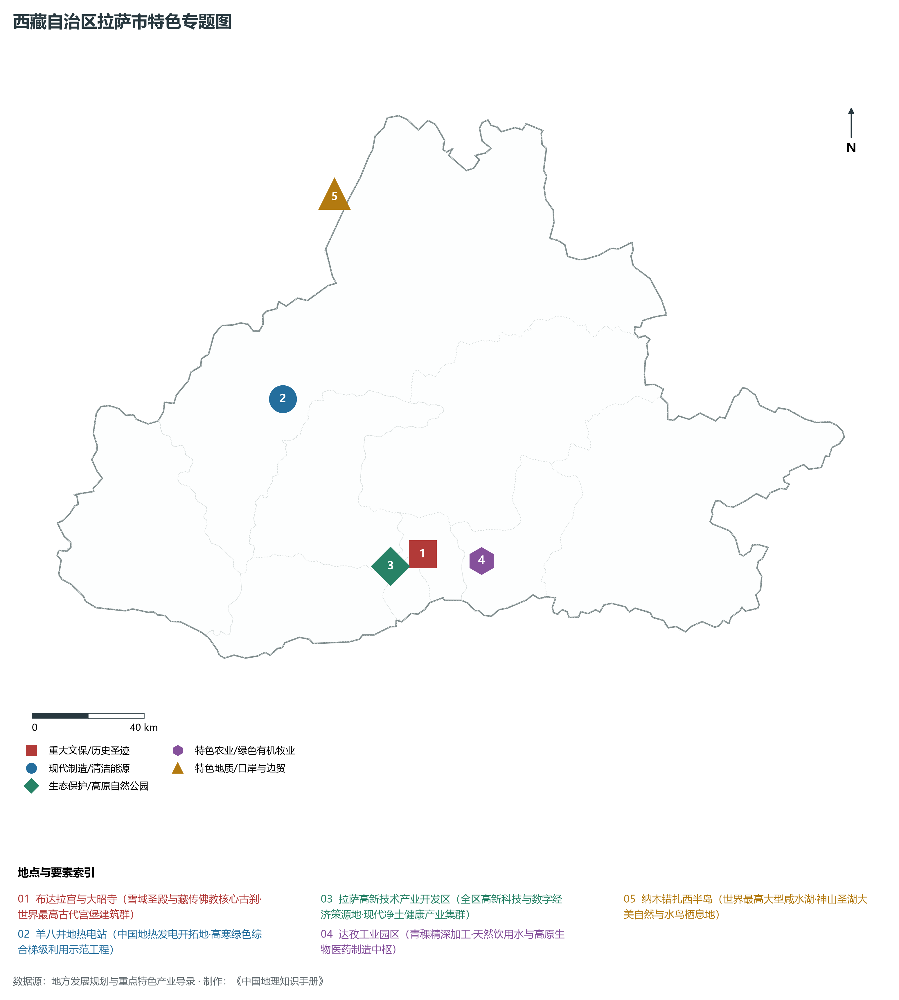
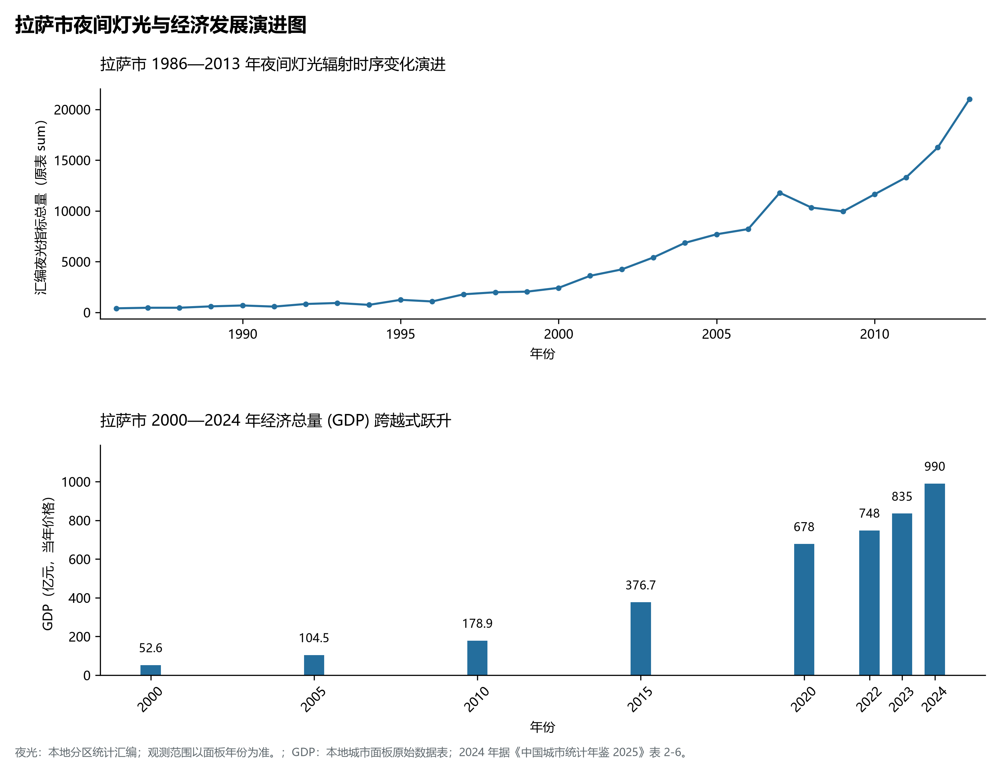

# 34.1 拉萨市

拉萨市是西藏自治区首府，全区政治、经济、文化、科教和综合交通枢纽中心，国务院批复确定的国家历史文化名城与具有雪域高原和藏传佛教特色的国际旅游城市。拉萨地处青藏高原中部、雅鲁藏布江支流拉萨河北岸断陷宽谷盆地中，地理坐标介于东经 89° 45' ～ 92° 37'、北纬 29° 15' ～ 31° 20' 之间。城市平均海拔约 3650 m，东西狭长、南北受念青唐古拉山支脉阻隔夹持，拉萨河（藏语称“吉曲”）自东北向西南穿流市区注入雅鲁藏布江，构筑了兼具避风蓄温屏障与开阔农牧灌溉阶地的高原河谷绿洲空间形态。

2024 年拉萨市全市地区生产总值为 990 亿元（当年价格）。

2024 年全市统计：常住人口 88 万人，常住人口城镇化率 73.06 %，地区生产总值 990 亿元，人均地区生产总值 113,563 元，三次产业构成 3.35 : 39.05 : 57.6。

2024 年全市统计：常住人口 88 万人，常住人口城镇化率 73.06 %，地区生产总值 990 亿元，人均地区生产总值 113,563 元，三次产业构成 3.35 : 39.05 : 57.6。

2024 年全市统计：常住人口 88 万人，常住人口城镇化率 73.06 %，地区生产总值 990 亿元，人均地区生产总值 113,563 元，三次产业构成 3.35 : 39.05 : 57.6。

---

## 一、地貌地质构架与高山宽谷地形分异

拉萨市在地质构造上隶属于冈底斯—念青唐古拉造山带中段，处于拉萨地块核心区。自中生代燕山运动以来，伴随大规模花岗岩浆侵入与强烈火山喷发，形成了厚实的火成岩与变质岩基底；新生代喜马拉雅造山运动导致地壳剧烈抬升并伴随多组东西向与北西向张性正断裂，使拉萨河与当雄盆地发生强烈断陷下沉，最终发育为今日“高山耸峙两翼、宽谷串珠镶嵌、阶地平坦开阔”的高原河谷断陷地貌格局。

全市地势总体呈现北高南低、自西北向东南倾斜的梯级特征，全境相对高差超过 3600 m：

1. **念青唐古拉极高山冰川带（北部当雄县境内）**：横亘于拉萨市北部边缘，为藏南与藏北的天然宏伟分水岭。山脊海拔多在 5500～ 6500 m 之间，主峰**念青唐古拉峰（海拔 7162 m）**终年积雪巍峨，现代山谷冰川与冰斗、刃脊发育密集。其北麓直接倾入世界海拔最高的大型咸水湖——纳木错（湖面海拔 4718 m，当雄辖区内占湖南半部）。
2. **拉萨河中下游宽谷与冲积阶地平原（中部核心区）**：拉萨河自东北向西南横贯墨竹工卡、林周、达孜、城关、堆龙德庆与曲水县。河谷宽展，宽度一般在 2～ 8 km 之间，发育了开阔的 I 级至 III 级河流冲积漫滩与阶地，地表覆盖深厚的第四纪冲积壤土，土壤肥力适中，不仅构筑了拉萨城区、柳梧新区与各工业园区的空间基底，更是西藏高产青稞、冬小麦的主要产区。
3. **南部雅江汇流深切峡谷区（曲水与尼木南部）**：拉萨河在曲水县城南侧汇入雅鲁藏布江干流。两岸山体多由坚硬的花岗岩与火山岩构成，河谷骤然缩窄为深切峡谷，江水奔腾汹涌，两岸发育陡峭的基岩边坡与局部冲洪积扇，成为西藏干线公路与铁路穿行的重要工程地质控制节点。曲水县雅江汇流处出境点海拔仅为 **3550 m**，为拉萨市全境陆地最低点。

---

## 二、气候暖温性与拉萨河水文机理

拉萨市虽雄踞于海拔 3650 m 的高原之上，但由于南部喜马拉雅山脉与东西向深切河谷的阻挡，北方寒流不易侵入，且享有极其充沛的太阳光照，使其气候隶属于**高原半干旱温带季风气候**。

- **日照充足与温和宜人**：年平均气温为 8.5°C，最热月（6—7月）平均气温在 15.5～ 16.5°C 之间，夏季凉爽无酷暑；最冷月（1月）平均气温约 -1.6°C，冬季在强烈的冬日暖阳照射下并不严寒。年日照时数达 3021 h，年总辐射量高达 7600 MJ/m²，日温差大（常年达 14～ 17°C）。
- **降水时空高度集中与“多夜雨”奇观**：全市年平均降水量约 420～ 500 mm，降水具有极其明显的干湿分异。每年 6—9 月为雨季，降水量占全年的 85% 以上；且拉萨具有著名的“夜雨”特征，由于山谷风环流机制与夜间云顶强辐射冷却，拉萨夜间降雨比例高达 80% 左右，呈现出“白天晴空万里、夜晚润物无声”的独特气候风貌。
- **拉萨河水文与水利调节**：拉萨河全长 568 km，流域面积 3.25× 10⁴ km²，年平均地表径流量达 105× 10⁸ m³。林周县境内的**旁多水利枢纽工程**总库容达 12.3× 10⁸ m³（被称为“西藏的三峡工程”），墨竹工卡境内的直孔水电站综合调蓄，使拉萨河具备了防洪、灌溉、生态补水与清洁发电的综合控制能力，全面保障了首府核心区的防洪与用水安全。

---

## 三、立体交通网络与“天路之核”枢纽地位

作为西藏自治区的交通枢纽中心，拉萨市是进出西藏各项交通方式转换与分拨的最大集散地。

1. **铁路干线核心枢纽**：
   - **青藏铁路**：进藏生命线终点站设于拉萨河西南岸的**拉萨站**，站房融藏族传统碉楼与现代建筑结构于一体，年发送旅客超过 300 万人次；
   - **拉日铁路**：自拉萨站西行，穿过曲水、尼木直通后藏中心日喀则；
   - **拉林铁路**：自拉萨站东行，经贡嘎、山南直达林芝市，开通运营“复兴号”内电双源高原动车组；
   - **拉萨西站**：全区最大的现代化铁路货运编组站，承担全区 90% 以上的入藏铁路集装箱与大宗生产生活物资中转。
2. **高等级公路与国道大通道**：
   - **G6 京藏高速（拉萨至那曲段）**：全长 295 km，全线双向四车道，是世界上海拔最高的高速公路，将拉萨至那曲车程缩短至 3 小时以内；
   - **拉林高等级公路**：沿拉萨河与尼洋河展布，被誉为“中国最美水上天路”；
   - **泽贡高速**：由拉萨市区经机场快速直抵山南市乃东区，构筑拉萨—山南 1 小时通勤圈；
   - 普通国道 **G318（川藏南线/中尼公路）**、**G109（青藏公路）** 在拉萨交汇贯通。
3. **空中门户协同纽带**：拉萨市区经专用机场高速公路与**拉萨贡嘎国际机场（4E级）**紧密相连（实际坐落于邻近的山南市贡嘎县，车程约 40 分钟），新 T3 航站楼满足年旅客吞吐量 900 万人次需求，形成覆盖全国各大主要城市的密集航线网络。

---

## 四、现代产业体系与高原高新特色基地

拉萨市全面贯彻绿色发展理念，依托自治区首府的综合要素吸纳优势，构建以数字经济、高新技术、净土健康产业和文化旅游为主导的现代绿色产业体系：

1. **高新技术产业与数字拉萨（柳梧新区）**：拉萨国家级高新技术产业开发区集聚了软件开发、大数据存储、跨境电商等新兴业态；充分发挥高原冷凉干燥、自然散热能耗低、清洁水电充足的天然优势，建设“西藏绿色大数据中心”与云计算节点，打造高原“数字丝绸之路”枢纽。
2. **高原净土健康产业与特色生物科技**：依托无污染的高原纯净环境，大力发展“净土健康产业”。做强“西藏好水”高端天然矿泉水与冰川水品牌；达孜工业园与曲水工业园规模化深加工青稞麦片、青稞精酿啤酒、牦牛乳酪、红景天与藏红花保健食品；推进传统藏医药现代化创制，奇正藏药、甘露藏药等驰名中外。
3. **世界文化遗产旅游与文化创意产业**：以**布达拉宫**、**大昭寺**、**罗布林卡**世界文化遗产和八廓街历史文化名街为核心依托，打造文旅深度融合名城；大型实景剧《文成公主》成为拉萨文旅新名片；唐卡绘制、藏毯编织、尼木藏香（国家级非物质文化遗产）等文创工艺远销海内外。
4. **清洁能源多能互补示范**：当雄县羊八井地热电站总装机超 2.5 万千瓦，开创了我国利用高低温地热发电的先河；达孜与林周大力布局农光互补与分布式光伏微电网，为首府绿色低碳运行提供源源不断的绿电动力。

---

## 五、夜间灯光演化与首府空间治理

本节夜光图的观测年份为 1986—2013 年，指标为行政区汇总值（原表 sum）。

1. **时空演进特征**：
2. **空间治理走向**：面对“南北高山夹峙、河谷耕地宝贵”的客观约束，拉萨市严格坚守拉萨河流域生态红线，推行“东延西扩、跨河发展”的空间发展布局，全力实施拉萨南北山绿化超级生态工程，使石质荒山蜕变为绿树成荫的生态屏障，构筑山水人城和谐相融的雪域高原首善之都。

---

## 六、行政区划与核心要素统计表

| 县级行政区 | 驻地镇/街道 | 陆地面积 (km²) | 常住人口 (万人) | 区域地理特色与主导产业方向 |
|:---|:---|:---|:---|:---|
| **城关区** | 吉日街道 | 525 | 49.5 | 自治区首府核心、布达拉宫与大昭寺、八廓街历史文化名街、全区商贸文旅中枢 |
| **堆龙德庆区** | 东嘎街道 | 2,672 | 12.8 | 拉萨西大门、拉萨火车站西货场枢纽、现代物流与高原特色绿色食品深加工 |
| **达孜区** | 德庆镇 | 1,373 | 3.5 | 甘丹寺所在地、达孜净土健康产业园、现代现代现代特色林果与高原休闲农业 |
| **当雄县** | 当曲卡镇 | 10,036 | 4.8 | 念青唐古拉主峰（7162m）、纳木错圣湖半岛、当雄草原牦牛牧场、羊八井地热 |
| **林周县** | 甘丹曲果镇 | 4,512 | 5.2 | 旁多水利枢纽、热振国家森林公园、西藏高产优质青稞黑小麦主产区 |
| **墨竹工卡县** | 工卡镇 | 5,620 | 5.0 | 直孔梯级水电站、甲玛沟松赞干布故里、思金拉错财神湖、大型铜铅锌矿业开发 |
| **曲水县** | 曲水镇 | 1,624 | 4.4 | 雅江拉萨河汇流处、曲水现代设施农业示范园、雅江生态保护长廊与交通要冲 |
| **尼木县** | 塔荣镇 | 3,276 | 3.3 | “尼木三绝”（尼木藏香/雪拉藏纸/普松雕刻）、高原优质核桃之乡、拉日铁路站点 |

2024 年统计来源：《中国城市统计年鉴 2025》表 2-1、2-6、2-7（2024 年，全市）。其他年份 GDP 据本地城市面板“原始数据”表，单位为亿元、当年价格。
