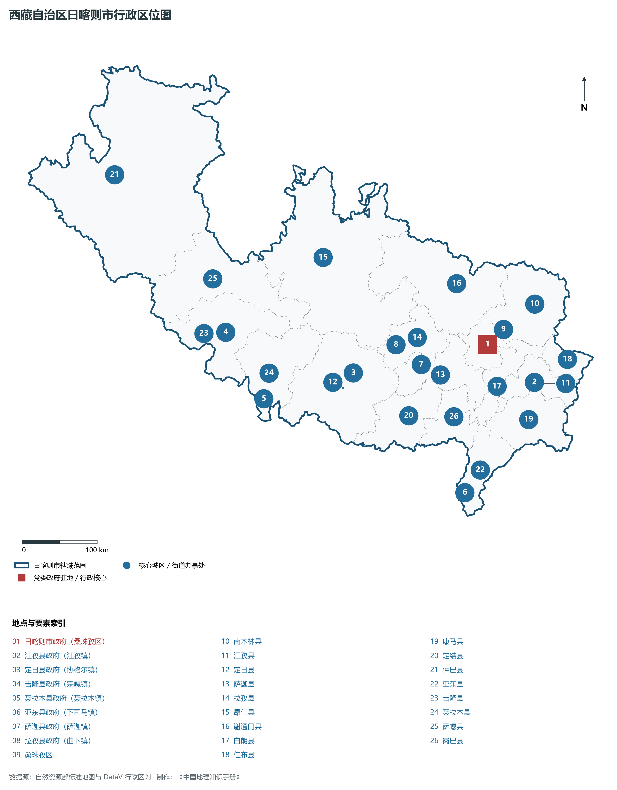
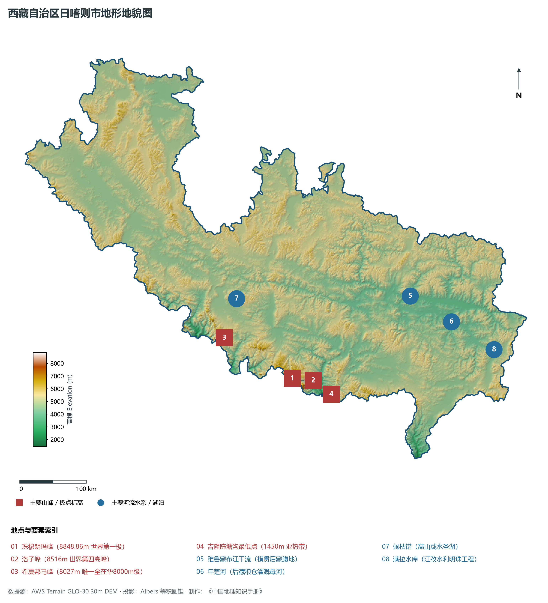
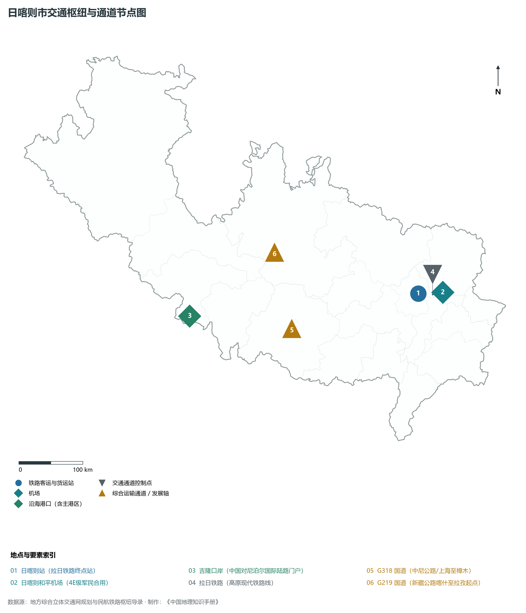
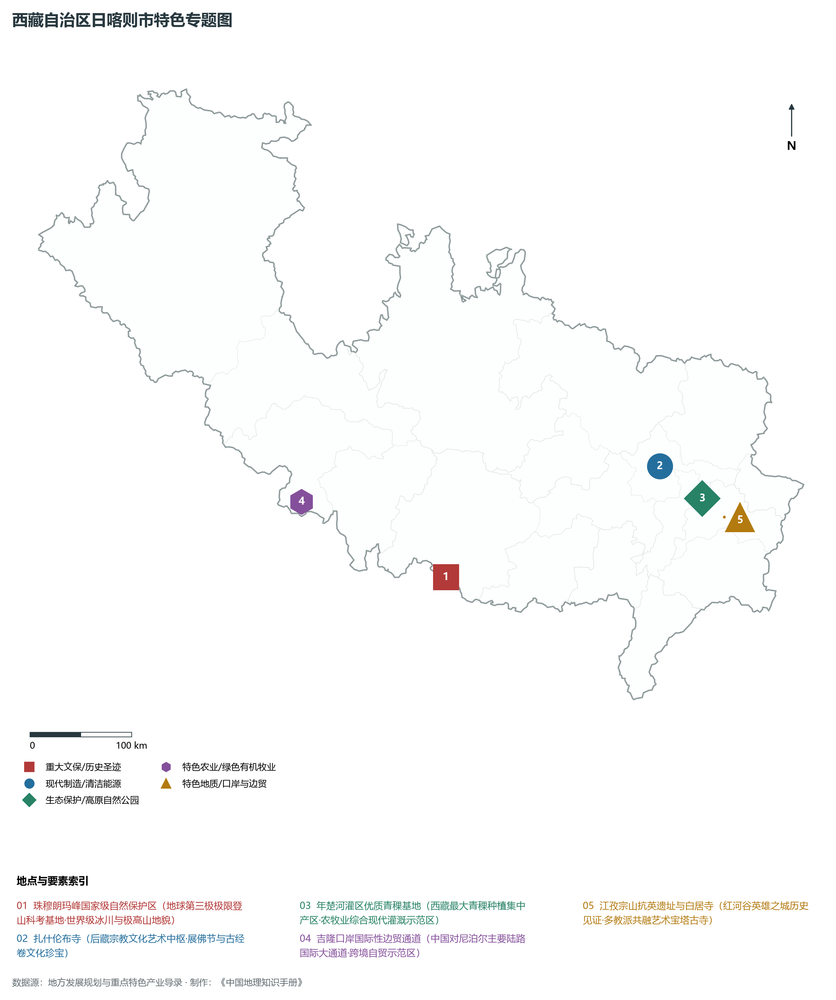
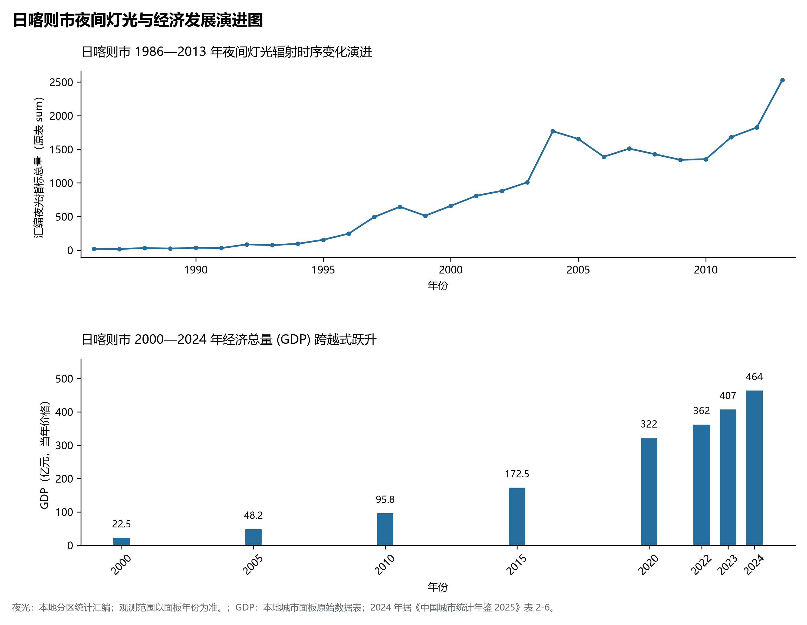

# 34.2 日喀则市

日喀则市位于西藏自治区西南部，藏语意为“土质最好的庄园”，自古以来便被尊称为“后藏”的政治、经济、宗教与文化中心，是国务院批复确定的国家历史文化名城与西藏面向南亚开放的重要陆路大通道门户。日喀则地处东经 82° 00' ～ 90° 20'、北纬 27° 23' ～ 31° 49' 之间。北连那曲市，东接拉萨市与山南市，西邻阿里地区，南部和西南部自东向西与不丹、印度、尼泊尔三国接壤，国境线长达 1753 km，占西藏全区陆地边境线总长近一半，设有吉隆、樟木、亚东、里孜 4 个国家级陆路口岸，是我国面向南亚开放的前沿阵地与地缘安全屏障。

2024 年日喀则市全市地区生产总值为 464 亿元（当年价格）。

2024 年全市统计：常住人口 81 万人，常住人口城镇化率 25 %，地区生产总值 464 亿元，人均地区生产总值 57,531 元，三次产业构成 16.32 : 29.42 : 54.26。

2024 年全市统计：常住人口 81 万人，常住人口城镇化率 25 %，地区生产总值 464 亿元，人均地区生产总值 57,531 元，三次产业构成 16.32 : 29.42 : 54.26。

2024 年全市统计：常住人口 81 万人，常住人口城镇化率 25 %，地区生产总值 464 亿元，人均地区生产总值 57,531 元，三次产业构成 16.32 : 29.42 : 54.26。

---

## 一、地球第三极山系骨架与垂直地貌反差

日喀则市地质构造极其复杂，地跨喜马拉雅造山带、雅鲁藏布江缝合带与冈底斯—念青唐古拉造山带三大构造单元，是板块碰撞构造作用最活跃、新构造运动最强烈的地质博物馆。

全市宏观地形呈现南北高、中部低的狭长构造盆地与深切峡谷复合形态，全境地势起伏极其剧烈，垂直极差达 **7398.86 m**：

1. **喜马拉雅极高山现代冰川脊梁（南部边缘）**：横亘于日喀则南部中尼边境，汇集了全球 14 座 8000 米级极高峰中的 5 座：**珠穆朗玛峰（8848.86 m，世界之巅）**、**洛子峰（8516 m，世界第四）**、**马卡鲁峰（8463 m，世界第五）**、**卓奥友峰（8201 m，世界第六）**与**希夏邦马峰（8027 m，全球唯一完全在中国境内的 8000 米级高峰）**。极高山区覆盖着面积巨大的现代山谷冰川（如绒布冰川、加布拉冰川），发育了角峰、刃脊、冰塔林、冰碛垄等极其壮丽的第四纪与现代冰川地貌。
2. **喜马拉雅南翼深切峡谷亚热带沟谷区（边境五大名沟）**：由喜马拉雅山脉山脊向南急剧跌落至尼泊尔与印度平原。因河流强烈向源侵蚀，切穿巨型山脉形成了著名的“喜马拉雅五条沟”：吉隆沟、樟木沟、陈塘沟、嘎玛沟、亚东沟。河谷深切数千米，受印度洋暖湿季风沿沟上溯影响，在数千米落差内完整展现了从热带雨林、常绿阔叶林、针阔混交林到高山冻原冰川的全球最密集垂直生态谱系。定结县陈塘沟与吉隆沟最低点海拔降至 **1450 m**，水热充沛，鸟语花香，被誉为“雪山深处的亚热带世外桃源”。
3. **雅鲁藏布江与年楚河中游冲积阶地宽谷平原（北部与东北部后藏腹地）**：雅鲁藏布江由西向东横穿日喀则北部，在其南岸接纳年楚河注入。江河长期冲积下切形成多级开阔平坦的冲积平原和阶地，海拔在 3800～ 4000 m 之间，地势平缓，土层深厚，灌溉渠道纵横，是桑珠孜区、江孜县、白朗县密集城镇与农田的集聚地带。
4. **藏北羌塘南缘高寒宽谷湖盆区（西北部仲巴、萨嘎）**：地处雅江源头马泉河流域与冈底斯山脉南翼，平均海拔在 4500 m 以上。地形多为起伏平缓的高原面与干寒盆地，分布着佩枯错等高山断陷湖泊，是高寒草原游牧业的核心基地。

---

## 二、高原大陆性半干旱气候与后藏水文动脉

日喀则市地处青藏高原南部，气候隶属于**高原温带半干旱大陆性季风气候**，气候环境垂直分异与区域干湿差异极其悬殊。

- **光温优势与高原凉夏**：年平均气温在 6.0～ 6.5°C 之间（喜马拉雅南坡河谷可达 13～ 16°C）。年日照时数长达 3100～ 3300 h，太阳总辐射量超过 7500 MJ/m²。常年昼夜温差大，春季干燥多大风，夏季无酷热，日照极其充裕，极为利于农作物光合作用与碳水化合物干物质积累。
- **降水梯度悬殊**：全市年降水量呈现自南向北、自东向西剧烈衰减趋势。南部迎风峡谷年降水量可达 1000～ 1800 mm，而翻越山脉后的桑珠孜区与江孜年降水量降至 350～ 420 mm，西北部仲巴县甚至不足 200 mm；雨季集中在 6—9 月，且常伴随局地雷暴冰雹。
- **后藏母亲河年楚河水文调控**：年楚河是雅鲁藏布江中游最大支流之一，全长 217 km，流域面积 1.11× 10⁴ km²。江孜境内的**满拉水利枢纽工程**被称为“西藏第一座大型水利枢纽”，总库容达 1.57× 10⁸ m³。满拉水库的调节消除了年楚河中下游的历史性洪水与春旱，引水灌溉保障了白朗、江孜和桑珠孜数十万亩良田旱涝保收。此外，雅鲁藏布江正源杰马央宗冰川坐落于仲巴县境内，奔流孕育了全区的大江大河。

---

## 三、立体交通网络与面向南亚开放门户枢纽

日喀则自古为茶马古道、唐蕃古道向南亚延伸的枢纽重地。如今，现代化的高原铁路、高等级公路、民航机场与边境陆路口岸形成了全方位的立体联运网络。

1. **铁路干线向西延伸**：
   - **拉日铁路（拉萨至日喀则）**：全长 253 km，2014 年全线通车，时速 120 公里，使日喀则市彻底接入全国铁路网，从拉萨乘坐火车仅需 2.5 小时即可抵达**日喀则站**；
   - 规划中的中尼铁路日喀则至吉隆段以及新藏铁路将在此交汇，奠定其作为亚洲陆路跨国大通道超级枢纽的历史地位。
2. **高等级公路与跨国干线走廊**：
   - **G318 国道（中尼公路段）**：穿过拉孜、协格尔（定日），翻越加措拉山口（海拔 5248 m）经聂拉木至樟木口岸友谊桥，是连接中国与尼泊尔最经典的陆路经济通道；
   - **G219 国道（新藏公路）**：在拉孜县与 G318 分流，途经昂仁、萨嘎、仲巴直奔阿里普兰与新疆叶城，是世界上海拔最高的边防国防大动脉；
   - **G562 国道**与**日喀则机场高速**有效连通了空港与主城区。
3. **高高原航空航线枢纽**：**日喀则和平机场（4E级军民合用）**坐落于桑珠孜区江当乡，跑道海拔 3782 m，通航成都、重庆、西安、拉萨等主要城市，有力保障了应急救援、商务往来与高端高山探险旅游。
4. **四大国家陆路对外开放口岸**：
   - **吉隆口岸**：中国对尼泊尔通关体量最大、设施最现代化的国际陆路口岸，建有中尼友谊大桥与边境经济合作区；
   - **樟木口岸**：传统历史口岸，灾后恢复货运客运功能；
   - **亚东口岸（仁青岗边贸市场）**：面向印度锡金邦乃堆拉山口；
   - **里孜口岸**：2023 年正式通关开放，成为中尼第四个陆路口岸。

---

## 四、现代产业体系与国家高原现代农牧基地

日喀则市立足“后藏粮仓、珠峰名片、南亚陆港”三大基底，全力推动农牧业现代化、文旅产业全域化与清洁能源规模化发展：

1. **国家级现代粮油基地与“西藏青稞之都”**：全市青稞常年种植面积超 100 万亩，产量占全区近一半。依托白朗县国家现代农业产业园，全面推广良种育繁推一体化；江孜与白朗培育了青稞挂面、青稞原浆啤酒、高纤饼干等深加工链条；白朗县被称为“高原果蔬之乡”，日光温室大棚规模超万座，出产反季节黄瓜、西红柿、草莓，保障全区果蔬自给。
2. **珠峰国际高山登山科考探险与生态旅游**：以**珠峰大本营**、绒布寺、嘎玛沟徒步线路为引擎，建设珠峰国家公园国际化高端生态研学基地；依托**扎什伦布寺**（国家 5A 级景区）、江孜白居寺（十万佛塔壁画艺术）、萨迦寺（“第二敦煌”，保存数万函古老梵文贝叶经与藏文经卷），打造享誉全球的高原文化探索走廊。
3. **高原特色优良畜种繁育输出**：日喀则拥有国家级畜禽遗传资源名片——“岗巴羊”（肉质鲜嫩无膻味、富硒低脂）与“亚东黑木耳”、“帕里牦牛”，规模化建设优质藏系绵羊育肥示范场与现代化冷鲜屠宰加工厂。
4. **国家级边贸通道与跨国物流园区**：日喀则国家经济技术开发区和吉隆边境经济合作区双核驱动，集聚机电产品组装、中草药保税加工、跨境商贸物流与尼泊尔手工艺品转口贸易，年对外边贸进出口总额占全区大半。

---

## 五、夜间灯光时空演进与后藏城镇重构

本节夜光图的观测年份为 1986—2013 年，指标为行政区汇总值（原表 sum）。

1. **时空演进特征**：
   - **2016—2024 年（群星璀璨跃升）**：撤地设市后桑珠孜新城区与经开区大幅向外拓展，吉隆口岸国际小镇夜间灯火通明；G318 沿线定日协格尔、珠峰小镇以及各县城全面实施市政照明和农网改造，形成后藏谷地主光斑与喜马拉雅山麓多节点辉映的夜空格局。
2. **空间治理走向**：日喀则严格划定珠峰国家级自然保护区生态核心区红线，坚决将旅游大本营下撤至绒布寺以下，推行新能源环保接驳车与垃圾污水全清运制度；城市发展引导向桑珠孜河谷阶地集约聚集，严禁侵占年楚河高产基本农田，实现了生态底线严守、边境繁荣稳定与现代文明崛起的和谐相融。

---

## 六、行政区划与核心要素统计表

| 县级行政区 | 驻地镇 | 陆地面积 (km²) | 常住人口 (万人) | 区域地理特色与主导产业方向 |
|:---|:---|:---|:---|:---|
| **桑珠孜区** | 城南街道 | 3,654 | 19.5 | 市府驻地、扎什伦布寺、拉日铁路日喀则站、和平机场、后藏政治商贸中枢 |
| **江孜县** | 江孜镇 | 3,859 | 7.2 | 红河谷抗英古城、宗山城堡、白居寺十万佛塔、满拉水库、优质青稞大县 |
| **白朗县** | 洛江镇 | 2,802 | 4.8 | “西藏果蔬之乡”、全国现代农业示范区、年楚河蔬菜大棚与青稞深加工基地 |
| **拉孜县** | 曲下镇 | 4,505 | 5.8 | G318与G219分流节点、查木钦古墓群、藏刀锻造工艺非遗、“堆谐”故里 |
| **萨迦县** | 萨迦镇 | 7,510 | 5.2 | 萨迦派祖寺萨迦寺、“第二敦煌”贝叶经宝库、高寒生态农牧业 |
| **岗巴县** | 岗巴镇 | 3,936 | 1.1 | “中国岗巴羊之乡”、曲登尼玛神泉冰川、喜马拉雅北麓纯牧业基地 |
| **定结县** | 江嘎镇 | 5,816 | 2.2 | 陈塘沟亚热带原始密林、“夏尔巴人”聚居区、金鸡峰雪山、湿地生态 |
| **定日县** | 协格尔镇 | 13,859 | 6.1 | 珠峰国家公园北门户、珠峰大本营、加措拉山口（5248m）、国际登山探险 |
| **聂拉木县** | 聂拉木镇 | 7,903 | 1.9 | 樟木国际陆路口岸、希夏邦马峰北麓、喜马拉雅樟木峡谷、中尼贸易重镇 |
| **吉隆县** | 宗嘎镇 | 9,009 | 1.8 | 吉隆口岸国际自贸走廊、吉隆沟亚热带景观、大唐天竺使出铭摩崖石刻 |
| **亚东县** | 下司马镇 | 4,240 | 1.4 | 亚东口岸边贸市场、帕里草原高寒牦牛、亚东鲑鱼与黑木耳特色林下产业 |
| **谢通门县** | 卡嘎镇 | 13,926 | 4.7 | 雄村特大型铜金矿床、卡嘎温泉地热康养、雅江北岸高原生态牧业 |
| **南木林县** | 南木林镇 | 8,113 | 8.8 | 湘河水利枢纽工程、艾玛土豆地理标志产品、雅江北岸防沙治沙生态示范 |
| **康马县** | 康马镇 | 6,165 | 2.3 | 冲巴雍错高山湖泊、乃钦康桑雪山边缘、边境生态畜牧与光伏清洁能源 |
| **仲巴县** | 帕羊镇 | 43,594 | 2.6 | 雅鲁藏布江正源杰马央宗冰川、马泉河湿地草原、西藏版图西陲边境牧场 |
| **萨嘎县** | 加加镇 | 12,411 | 1.6 | G219新藏公路重要驿站、达吉岭寺、雅鲁藏布江上游高寒草原牧场 |
| **昂仁县** | 卡嘎镇 | 27,625 | 5.8 | 金刚环山雪峰、秋窝日甲遗址、藏戏鼻祖唐东杰布故里、高山畜牧基地 |
| **仁布县** | 德吉林镇 | 2,123 | 3.4 | 仁布玉石雕刻工艺之乡、强钦寺、雅江深切峡谷拉日铁路过境段 |

2024 年统计来源：《中国城市统计年鉴 2025》表 2-1、2-6、2-7（2024 年，全市）。其他年份 GDP 据本地城市面板“原始数据”表，单位为亿元、当年价格。
