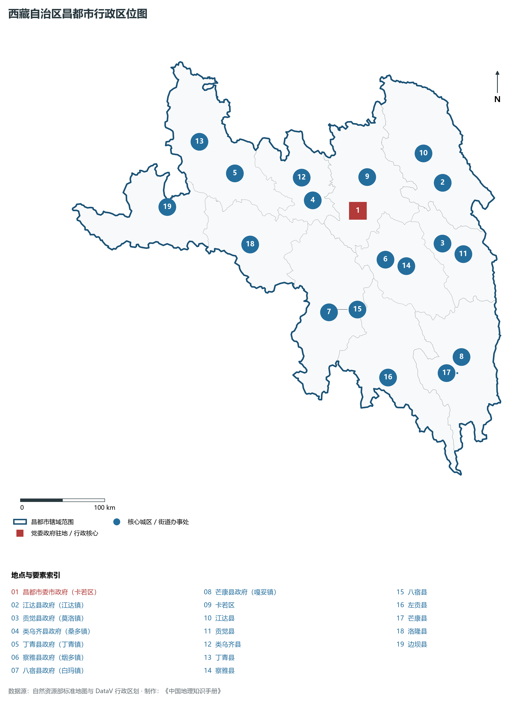
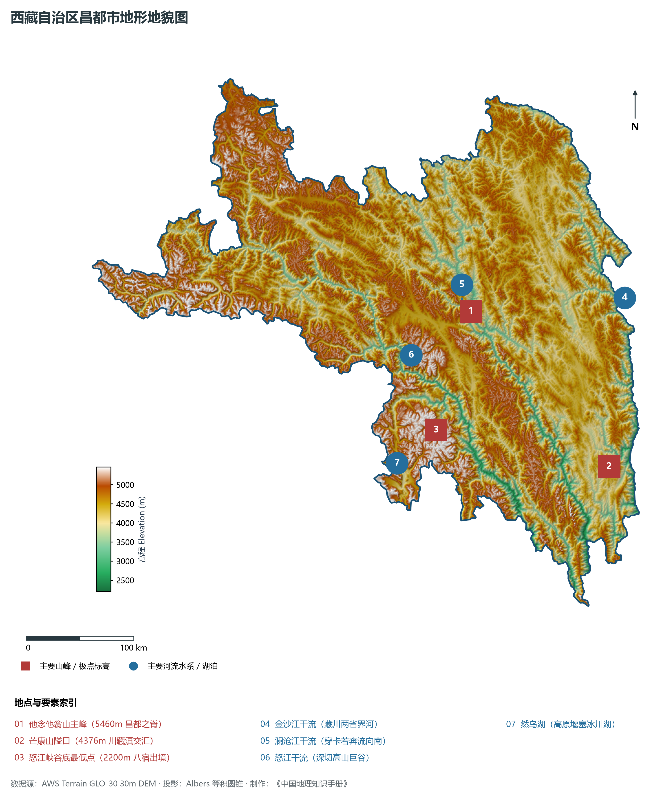
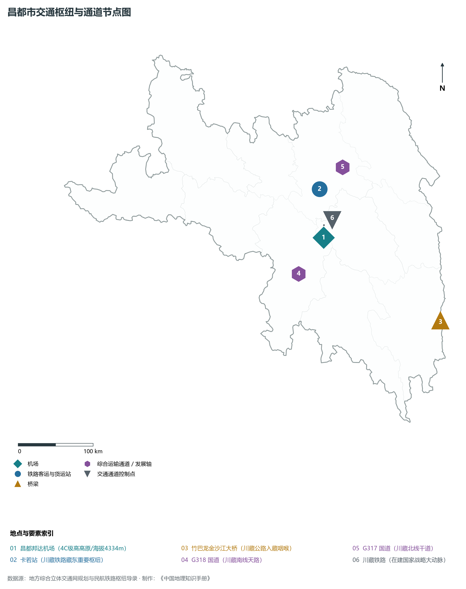
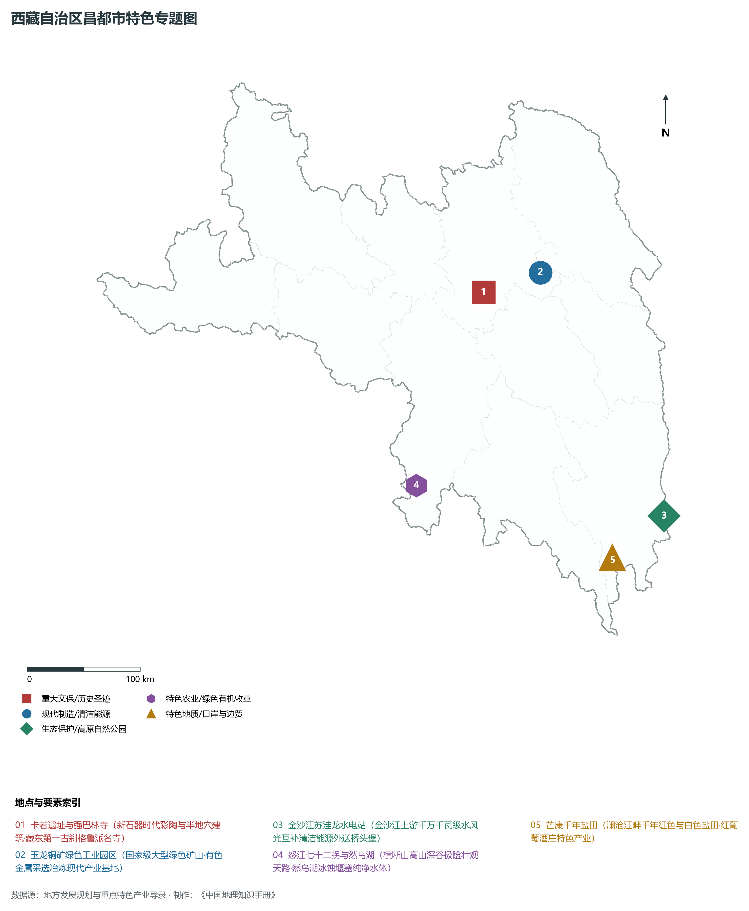
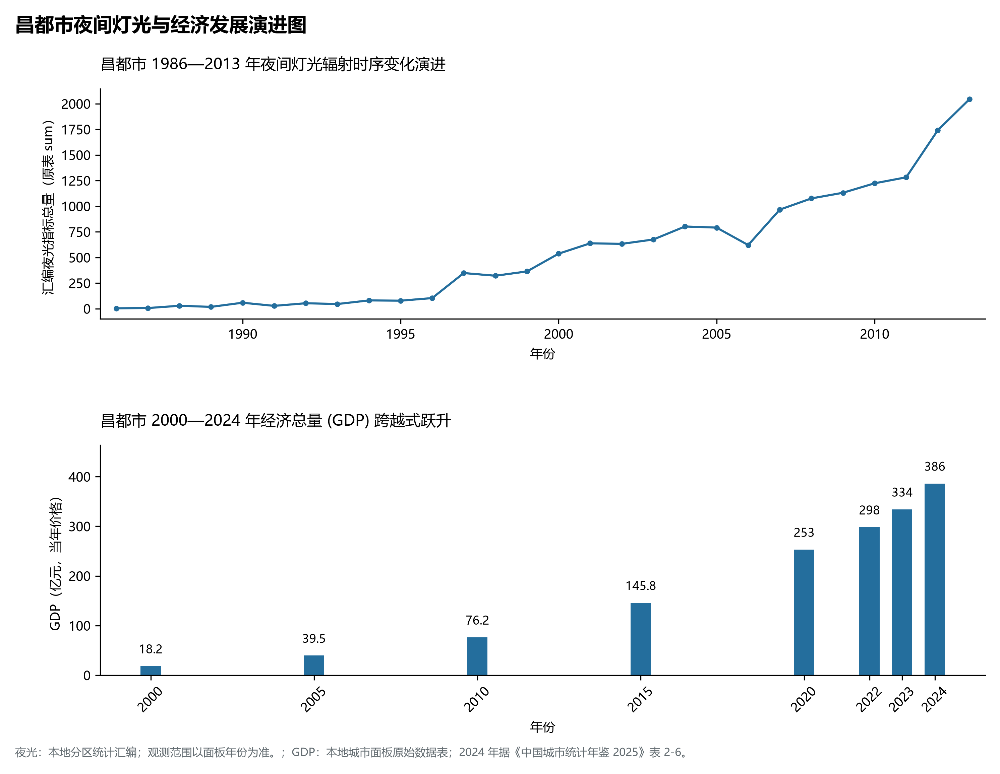

# 34.3 昌都市

昌都市位于西藏自治区东部，地处横断山脉深处与金沙江、澜沧江、怒江“三江并流”的褶皱峡谷地带，被誉为“藏东明珠”、“西藏东大门”与连接藏、川、滇、青四省区的战略枢纽咽喉。昌都地理坐标介于东经 93° 06' ～ 99° 06'、北纬 28° 35' ～ 32° 43' 之间。东与四川省甘孜藏族自治州（德格、白玉、巴塘、得荣）隔金沙江相望，东南与云南省迪庆藏族自治州德钦县接壤，南接林芝市，西连那曲市，北邻青海省玉树藏族自治州，是古代著名的“茶马古道”与“唐蕃古道”交汇重镇，也是新中国第一面五星红旗在西藏升起的地方（1950 年昌都战役胜利解放）。

2024 年昌都市全市地区生产总值为 386 亿元（当年价格）。

2024 年全市统计：常住人口 77 万人，常住人口城镇化率 27.13 %，地区生产总值 386 亿元，人均地区生产总值 50,464 元，三次产业构成 12.71 : 38.67 : 48.61。

2024 年全市统计：常住人口 77 万人，常住人口城镇化率 27.13 %，地区生产总值 386 亿元，人均地区生产总值 50,464 元，三次产业构成 12.71 : 38.67 : 48.61。

2024 年全市统计：常住人口 77 万人，常住人口城镇化率 27.13 %，地区生产总值 386 亿元，人均地区生产总值 50,464 元，三次产业构成 12.71 : 38.67 : 48.61。

---

## 一、横断山脉侵蚀地貌与“三江并流”巨型峡谷

昌都市地质构造属于青藏高原特提斯构造域东缘昌都地块与横断山北段碰撞褶皱带。自新生代青藏高原隆升以来，强烈的喜马拉雅造山挤压伴随大规模南北向走滑断裂，迫使金沙江、澜沧江、怒江自北向南以近乎平行的态势紧密并切奔流，造就了地球陆地上最为密集的高山深谷与纵向岭谷地貌奇观。

全市地势总体呈现西北高、东南低的梯级展布，山高谷深、绝壁悬崖密布，全境相对高差超过 3200 m：

1. **纵向岭谷山系骨架**：自西向东平行横亘着伯舒拉岭、他念他翁山、芒康山、宁静山和沙鲁里山支脉。山脉走向多为南北或北北西走向，海拔普遍在 4500～ 5500 m 之间。山峰挺拔尖锐，现代冰川与第四纪冰蚀冰碛地貌广泛分布，最高峰为坐落于八宿与察雅交界处的**他念他翁山主峰（海拔 5460 m）**。
2. **“三江”深切峡谷与红层丹霞（东部与中部）**：
   - **金沙江峡谷（东界）**：金沙江沿江达、贡觉、芒康东侧深切而下，构成西藏与四川省长达数百公里的天然省界，峡谷深达 1500～ 2000 m，水流如万马奔腾，两岸发育古生代硬质岩石与巨型断崖；
   - **澜沧江流域（中部）**：扎曲与昂曲在卡若区两江汇流处交汇，始称澜沧江，穿过昌都市区向南切穿中生代红色砂泥岩盆地，两岸发育了形态壮丽的红层峡谷与丹霞赤壁；
   - **怒江大峡谷（西部）**：流经丁青、边坝、洛隆、八宿，在八宿县境内下切形成长达数十公里的怒江特大深切峡谷，谷底水流湍急，八宿县怒江出境处海拔降至 **2200 m**，为昌都市陆地地表最低点。
3. **冰川堰塞湖与高原宽谷草甸（西南部八宿与西北部类乌齐）**：八宿县境内的**然乌湖**是川藏南线上著名的狭长高原冰川堰塞湖（海拔 3850 m），由山体滑坡崩塌堵塞帕隆藏布河道蓄水成湖，湖水清澈蔚蓝，四周环抱雪山与密林；西北部类乌齐与丁青盆地则发育了地势较平坦的古夷平面宽谷草场，水草丰美。

---

## 二、高原温带亚湿润季风气候与三江水能富集区

昌都市由于受横断山脉南北走向深切峡谷对西南季风与东南季风北上的“引导与导流”作用，气候呈现明显的**高原温带亚湿润—半干旱季风气候**，垂直立体气候带谱层次极为丰富。

- **水热时空梯级**：年平均气温在 7.5～ 8.2°C 之间（卡若区约 7.6°C，南部低谷可达 10°C 以上，高寒山区低至 -2°C）。年日照时数在 2100～ 2700 h，太阳辐射总量达 6200～ 6800 MJ/m²。
- **降水空间分异剧烈**：全市年降水量在 400～ 650 mm 之间，自西北向东南逐渐增加。由于深切河谷的焚风效应，谷底干燥少雨、蒸发强烈（年蒸发量常在 1600～ 2000 mm），发育了干热河谷多刺灌丛；而海拔 3200～ 4200 m 的迎风山坡雨雪充沛，发育茂密的高原云杉、冷杉原始暗针叶林。
- **三江水系水能极其富集**：金沙江、澜沧江、怒江三江在昌都境内的天然落差均在 1000 m 以上，平均径流深达 200～ 400 mm。金沙江干流年出境径流量超 400 亿立方米，澜沧江干流年出境水量达 250 亿立方米，峡谷狭窄、水量充沛、基岩坚固、淹没损失小，是国家规划建设“金沙江上游”与“澜沧江上游”千万千瓦级大型清洁水电基地最理想的战略选址。

---

## 三、立体交通网络与“川藏天堑变通途”

昌都地处川藏、滇藏要冲，曾以“山似刀削、江若沸汤、行路难于上青天”闻名。近年来，随着铁路攻坚、公路隧道化与支线民航的提质，昌都构建起了全方位的高原现代化立体交通体系。

1. **川藏铁路国家战略大动脉（在建攻坚）**：
   - **川藏铁路雅林段**：正线穿越昌都市八宿县与左贡县，跨越怒江特大桥、金沙江特长隧道群，工程难度被公认为全球铁路建设史上之最；
   - 设站八宿等站点，将使昌都深度融入成渝双城经济圈与全国高铁货运大网。
2. **干线公路“双天路”贯穿全境**：
   - **G318 国道（川藏南线）**：自四川巴塘跨竹巴龙金沙江大桥进入芒康，翻越拉乌山、脚巴山、东达山（海拔 5130 m），经左贡、八宿，越过著名的**怒江七十二拐**与然乌湖进入林芝，是自驾游与进藏物资运输的最繁忙大通道；
   - **G317 国道（川藏北线）**：自四川德格跨岗托金沙江大桥入江达，穿过卡若区、类乌齐、丁青直奔那曲，为藏东北物资主干线；
   - **G214 国道（滇藏线）**：纵贯昌都南北，连接云南香格里拉、芒康、卡若区并北出青海玉树。
3. **世界海拔最高民用机场之一——昌都邦达机场**：坐落于八宿县邦达草原，跑道标高 **4334 m**，为 4C 级高高原机场，建有世界最长的 5.5 公里民用跑道之一。常年开通至成都、重庆、拉萨、西安等直达航班，年旅客吞吐量突破 40 万人次，有效化解了高山深谷造成的地理隔离。

---

## 四、国家清洁能源接续基地与藏东优势产业集群

昌都市立足“资源换产业、绿色促发展”，围绕国家清洁能源、优势矿产采选与特色文旅农牧，加快打造藏东现代绿色产业高地：

1. **金沙江澜沧江千万千瓦级清洁能源基地**：
   - 金沙江上游川藏段：**苏洼龙水电站（120万千瓦）**已全容量投产发电，叶巴滩（224万千瓦）、巴塘（75万千瓦）、拉哇（200万千瓦）等世界级高坝电站加快推进，与水风光一体化千万千瓦级清洁可再生能源互补，通过特高压直流工程直送华中；
   - 澜沧江上游梯级：果多水电站保障昌都本地工业基荷，清洁能源成为昌都地方财政与工业经济的第一支柱。
2. **玉龙特大型铜矿绿色循环采选工业**：坐落于江达县境内的**玉龙铜矿**是中国已探明第二大铜矿床，铜金属储量超过 650 万吨。采用先进的绿色生物浸出与智能露天采剥工艺，年产铜精矿含铜金属量突破 12 万吨，建成了藏东百亿级有色金属循环经济示范园区。
3. **卡若史前文化与茶马古道文化旅游**：以距今 4000—5000 年的**卡若遗址**（西藏三大原始文化遗址之一）为文化基石，依托昌都强巴林寺（藏东格鲁派第一古刹，藏有千尊佛像壁画与传统酥油花）、芒康千年盐田（世界上唯一保持最原始人工晒盐手工技艺的地方）以及然乌湖冰川国家公园，打造藏东康巴文化探秘旅游高地。
4. **高原纯天然林牧与特色农业输出**：类乌齐县被称为“西藏纯种牦牛之乡”，选育出的类乌齐牦牛耐寒强壮、肉质紧实；芒康县依托澜沧江干热河谷微气候，规模化发展有机赤霞珠红葡萄酒庄园，成为西藏高品质特色林果地理标志名片；洛隆县优质青稞与良种繁育基地驰名全区。

---

## 五、夜间灯光时空演化与河谷城镇空间重构

本节夜光图的观测年份为 1986—2013 年，指标为行政区汇总值（原表 sum）。

1. **时空演进特征**：
2. **空间治理走向**：昌都受“地无三尺平、两岸皆悬崖”的极端地形制约，严格落实地质灾害避险与江河水土保持机制，推行“沿江阶地集约紧凑布局、生态敏感区全面封育”的城镇空间发展策略，严禁在滑坡泥石流隐患区盲目建设，构筑了生态安全与城镇繁荣兼备的现代绿色峡谷新城。

---

## 六、行政区划与核心要素统计表

| 县级行政区 | 驻地镇 | 陆地面积 (km²) | 常住人口 (万人) | 区域地理特色与主导产业方向 |
|:---|:---|:---|:---|:---|
| **卡若区** | 城关镇 | 10,794 | 14.8 | 市府驻地、两江交汇、卡若文化遗址、强巴林寺、藏东商贸物流与经济技术开发区 |
| **江达县** | 江达镇 | 13,160 | 6.8 | 西藏解放第一站（岗托村）、玉龙特大型铜矿采选基地、金沙江上游水电门户 |
| **贡觉县** | 莫洛镇 | 8,367 | 4.2 | 三岩片区帕措独特民俗文化、金沙江峡谷水风光蓄能基地、高原生态牧业 |
| **类乌齐县** | 桑多镇 | 6,355 | 5.8 | “西藏纯种牦牛之乡”、类乌齐查杰玛大殿（藏汉蒙融合建筑）、高山森林草甸 |
| **丁青县** | 丁青镇 | 12,408 | 8.5 | 著名的“神山”孜珠寺（海拔4800m苯教古刹）、尺牍黑青稞种植、怒江深切峡谷 |
| **察雅县** | 烟多镇 | 8,251 | 6.3 | 仁达摩崖造像、香岩寺、澜沧江支流麦楚河宽谷现代林果与优质冬小麦示范基地 |
| **八宿县** | 白玛镇 | 12,564 | 4.4 | 邦达高高原机场、怒江七十二拐险道、然乌湖冰川堰塞湖、川藏铁路重要站点 |
| **左贡县** | 旺达镇 | 11,835 | 4.6 | 怒江东达山垭口（5130m）、碧土原始森林、特色高原优质核桃与藏猪养殖 |
| **芒康县** | 嘎妥镇 | 11,576 | 8.6 | 千年古盐田活化石、曲孜卡高品质温泉度假、藏东优质赤霞珠红葡萄酒产区 |
| **洛隆县** | 孜托镇 | 8,048 | 5.3 | 硕督古镇茶马古道清代粮仓、“洛隆糌粑”国家地理标志保护产品、农牧结合区 |
| **边坝县** | 草卡镇 | 8,771 | 4.1 | 三色湖（黑湖白湖黄湖地质奇观）、边坝高山冰川生态、冬虫夏草特色采集输出 |

2024 年统计来源：《中国城市统计年鉴 2025》表 2-1、2-6、2-7（2024 年，全市）。其他年份 GDP 据本地城市面板“原始数据”表，单位为亿元、当年价格。
