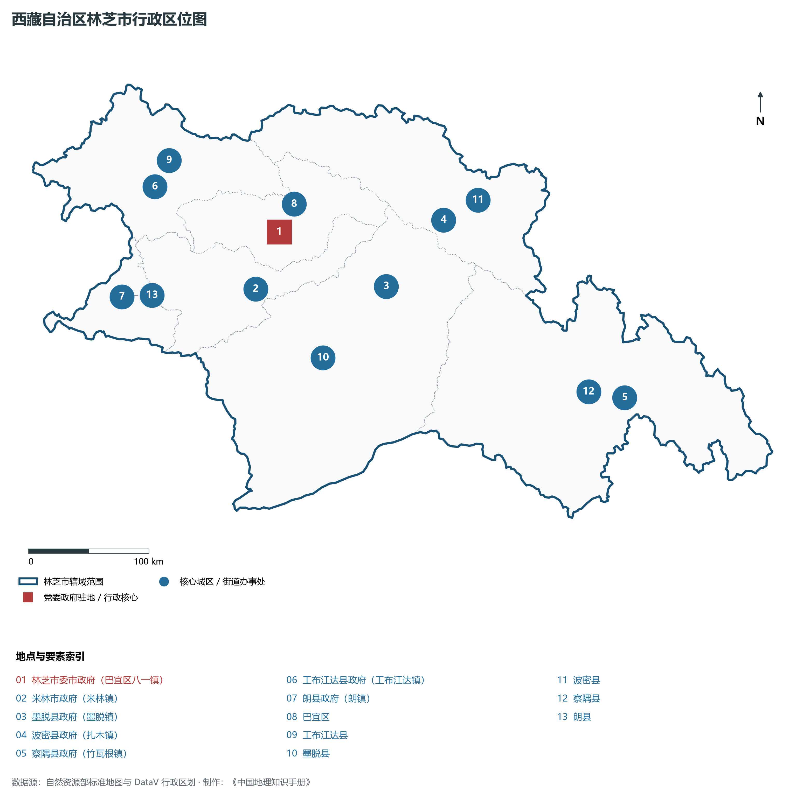
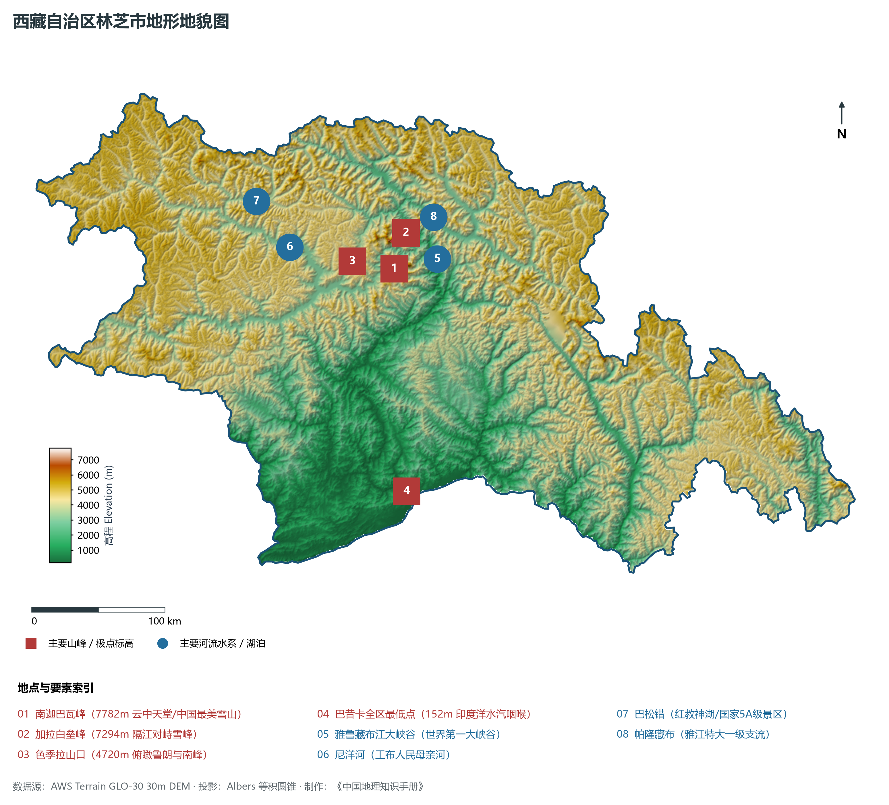
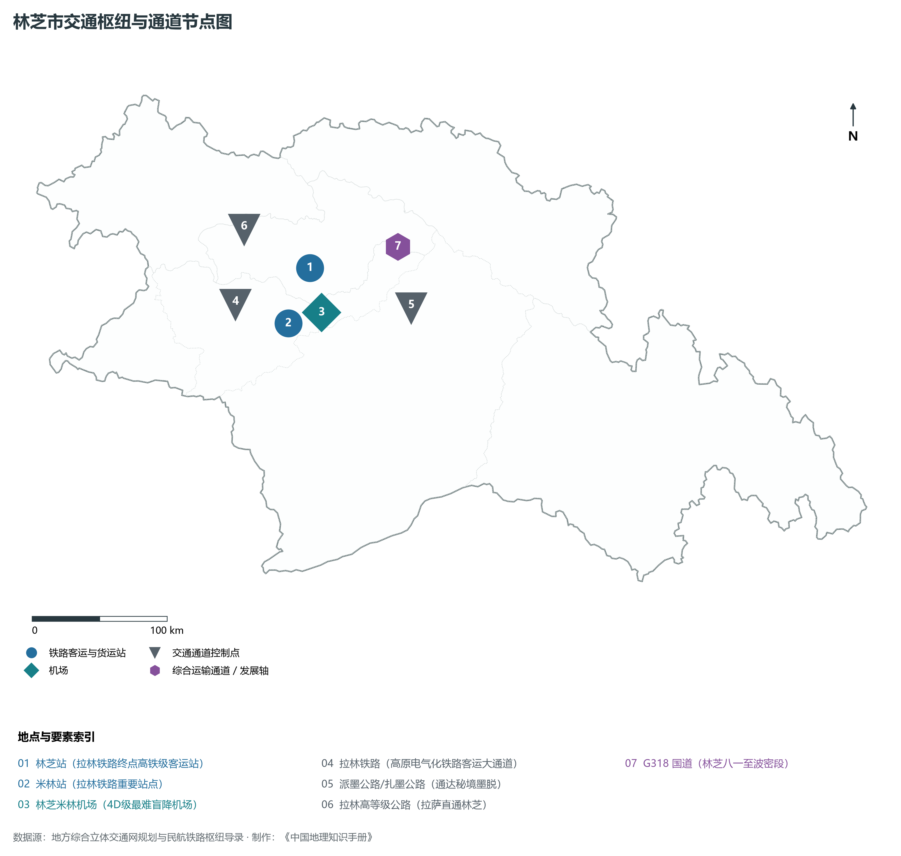
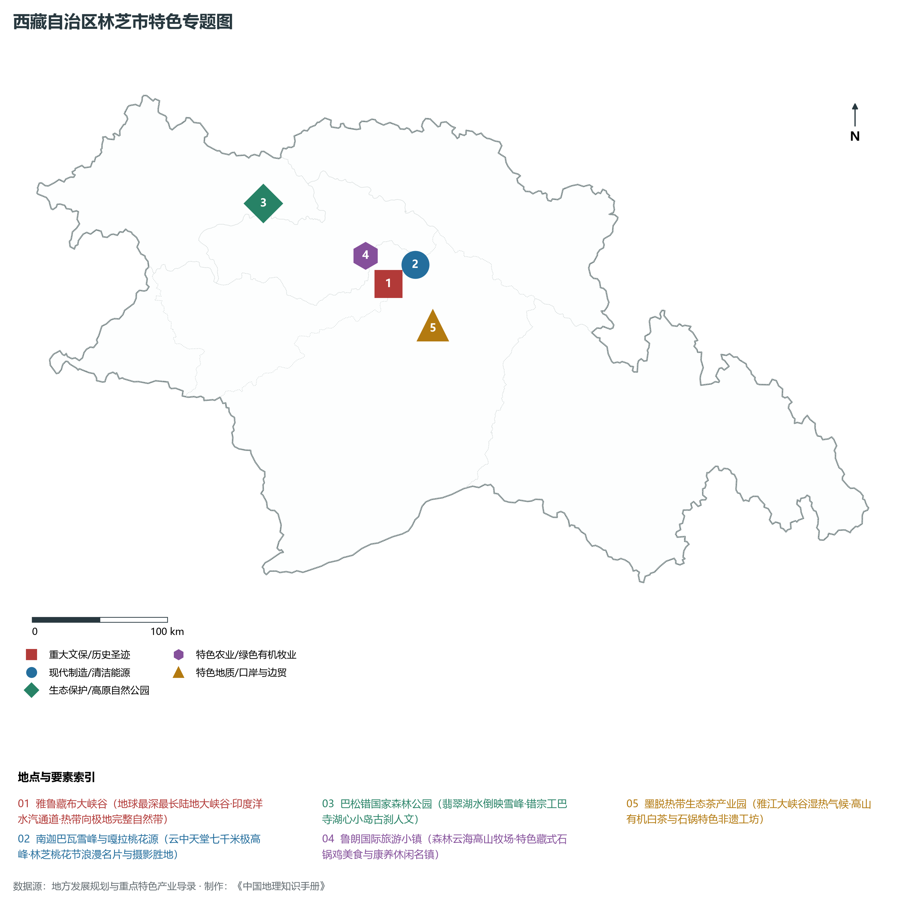
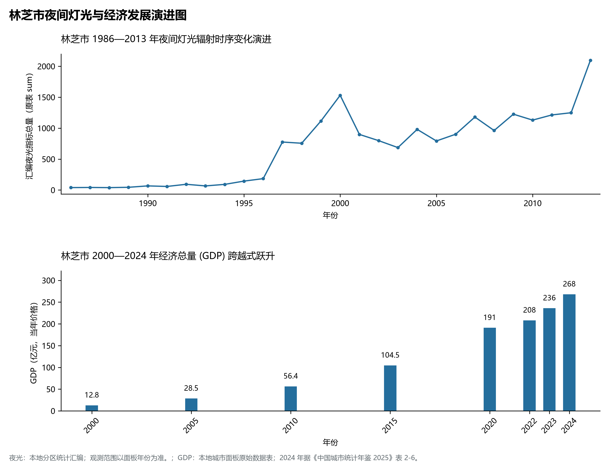

# 34.4 林芝市

林芝市位于西藏自治区东南部，藏语意为“太阳宝座”，因地处雅鲁藏布江中下游大拐弯峡谷两岸、受印度洋西南季风深度滋养而森林密布、水热丰美，自古被誉为“西藏江南”、“雪域明珠”与“高原生态基因库”。林芝地理坐标介于东经 92° 09' ～ 98° 47'、北纬 26° 52' ～ 30° 40' 之间。西与山南市、拉萨市接壤，北连那曲市，东接昌都市，南部自西向东与印度、缅甸接壤，边境线长达千余公里。

2024 年林芝市全市地区生产总值为 268 亿元（当年价格）。

2024 年全市统计：常住人口 24 万人，常住人口城镇化率 43.4 %，地区生产总值 268 亿元，人均地区生产总值 111,261 元，三次产业构成 6.75 : 33.52 : 59.72。

2024 年全市统计：常住人口 24 万人，常住人口城镇化率 43.4 %，地区生产总值 268 亿元，人均地区生产总值 111,261 元，三次产业构成 6.75 : 33.52 : 59.72。

2024 年全市统计：常住人口 24 万人，常住人口城镇化率 43.4 %，地区生产总值 268 亿元，人均地区生产总值 111,261 元，三次产业构成 6.75 : 33.52 : 59.72。

---

## 一、地球极限垂直高差与大峡谷地貌奇观

林芝市地质构造处于喜马拉雅造山带东端顶角与冈底斯—念青唐古拉造山带、横断山造山带三向汇聚的构造结部位（著名构造地质学“东构造结”核心区）。地壳在此发生剧烈的弧形弯折与高角度挤压隆升，深部构造变形极为剧烈，断裂带密布，造就了地球上无与伦比的极高山深谷与垂直微地貌景观。

全市地势总体呈现西北高、东南低的剧烈倾斜剖面，具有三大极其鲜明的地貌控制单元：

1. **东喜马拉雅巨型雪峰对峙与东构造结（中部核心）**：雅鲁藏布江在此切穿喜马拉雅山脉东端，江水两岸矗立着两座相距仅数十公里的七千米级擎天巨峰：南岸为**南迦巴瓦峰（海拔 7782 m，西藏东南部第一高峰，被《中国国家地理》评为中国最美雪山）**，北岸为**加拉白垒峰（海拔 7294 m）**。双峰隔江对峙，峰顶终年冰雪皑皑，发育了规模巨大的山谷冰川与冰瀑布，山谷深切处几乎直立。
2. **世界第一大峡谷——雅鲁藏布大峡谷（全长 504.6 km）**：雅鲁藏布江在此绕南迦巴瓦峰作了一次惊心动魄的 180° 大马蹄形回折，切出平均深度达 2268 m、最深处达 6009 m 的深邃峡谷。其长度与深度全面超越美国科罗拉多大峡谷，成为名副其实的“世界第一大峡谷”。峡谷核心段流水落差高达数千米，水流如奔腾万马，蕴藏着全球密度最高的水能资源。
3. **藏东南低海拔热带亚热带河谷（墨脱与察隅南部）**：江水穿出大峡谷后，在墨脱县南部与察隅县南部进入开阔低缓的山地河谷。墨脱县巴昔卡附近的雅鲁藏布江出境处海拔仅 **152 m**，为西藏全境地表最低点；察隅河下游海拔亦降至数百米，两岸分布着繁茂的雨林阶地与热带冲积台地。
4. **冰川森林与高山湖泊宽谷（波密与工布江达）**：波密县境内分布着我国著名的海洋性冰川群——**米堆冰川**与卡钦冰川（卡钦冰川长达 35 公里，是我国最大的海洋性山谷冰川），冰舌直接深入森林灌丛；工布江达县境内的**巴松错**（海拔 3480 m）为典型的冰碛堰塞高山红教神湖，水质晶莹翡翠，被群山环抱。

---

## 二、“水汽大通道”暖湿气候与立体生态宝库

林芝市拥有青藏高原全域绝无仅有的温暖湿润气候，这得益于雅鲁藏布大峡谷形成的“**水汽超级大通道**”。来自孟加拉湾的西南暖湿气流顺峡谷长驱北上，深入青藏高原腹地数百公里，使其气候从极低地的**热带季风雨林气候**，平滑过渡为河谷的**亚热带湿润季风气候**与中高山的**高原温带湿润气候**。

- **温度与无霜期**：巴宜区（八一镇）年平均气温为 8.7°C，最热月（7月）均温 16.0°C，最冷月（1月）均温 0.6°C，长冬无严寒、长夏无酷暑。而南部墨脱与察隅低谷年平均气温高达 16.5～ 18.5°C，年无霜期长达 330 d 以上，终年无霜雪，完全具备种植香蕉、甘蔗、茶叶与水稻的热量条件。
- **水汽充沛与降水极值**：全市年降水量在 650～ 2200 mm 之间，是西藏降水最为丰沛的区域。墨脱迎风坡年均降水量高达 2200～ 3000 mm，为全区“湿极”；雨季自 4 月延续至 10 月，降水日数多、空气相对湿度长年保持在 70%～ 85%。
- **全球最完整的垂直自然带谱与生物基因库**：从海拔 152 m 的热带季雨林带，随着海拔爬升依次演替为亚热带常绿阔叶林带、暖温带针阔混交林带、寒温带暗针叶林带（高山云杉冷杉林）、高山杜鹃灌丛草甸带、高山流石滩冰缘植被带，直至极高山永久积雪带。森林蓄积量超过 8 亿立方米，占全区森林总蓄积量的一半以上；孕育了巨柏（世界柏树王林芝巨柏，树龄超 3200 年）、雅鲁藏布江雪豹、孟加拉虎、白颊猕猴等海量国家珍稀濒危动植物。

---

## 三、立体交通网络与“动车进林芝、天堑变通途”

林芝曾因高山大川阻隔，被称为西藏进出最艰难的区域之一（尤其是墨脱曾为全国最后一个通公路的县）。近年来，高铁、高等级公路与支线航空的全面贯通，让林芝成为西藏综合交通最为畅达的现代化枢纽。

1. **拉林铁路高原动车时代**：
   - **拉林铁路**：全长 435 km，2021 年 6 月开通运营，全线 16 次跨越雅鲁藏布江，桥隧比高达 75%。终点站设于**林芝站**（巴宜区），“复兴号”高原内电双源动车组让林芝至拉萨仅需 3.5 小时，日客货运输量成倍增长；
   - **川藏铁路雅林段（在建攻坚）**：西起林芝站，东穿波密、八宿直通四川雅安，建成后林芝将成为联通西南成渝经济圈的东向铁路干线中枢。
2. **高等级公路与“中国最美景观大道”**：
   - **拉林高等级公路**：全长约 400 km，双向四车道，沿尼洋河与拉萨河蜿蜒铺展，全线免费通行，被称为“中国颜值最高的高速天路”；
   - **G318 国道**：横贯林芝全境，穿过米拉山隧道、色季拉山口、通麦特大桥（彻底终结通麦天险历史）与波密冰川群，是世界级生态旅游自驾走廊；
   - **墨脱公路双贯通**：**扎墨公路**（波密至墨脱）与**派墨公路**（米林派镇至墨脱）相继建成，穿过嘎隆拉隧道和多雄拉隧道，使“高原孤岛”墨脱实现全天候常年畅通。
3. **林芝米林机场（4D级）**：机场坐落于雅鲁藏布江河谷，跑道标高 2949 m。因地处深山峡谷，气候气流多变，被公认为全球飞行难度与盲降难度最高的机场之一。现已开辟北京、成都、重庆、广州、深圳、西安等数十条直飞航线，年旅客吞吐量突破 60 万人次。

---

## 四、生态文化旅游名城与高原绿色特色产业

林芝市坚持“生态立市、旅游强市、产业兴市”，将生态优势转化为强劲的经济发展胜势：

1. **国际生态旅游目的地与“林芝桃花节”**：林芝拥有国家 5A 级景区**巴松错**和世界级奇观**雅鲁藏布大峡谷**。每年三四月间，百年野生古桃林在尼洋河畔和雪山脚下漫山遍野竞相怒放，形成著名的“中国西藏林芝桃花节”，年吸纳海内外游客数百万人次；鲁朗国际旅游小镇引进现代瑞士生态小镇规划理念，成为高端林海休闲与康养度假目的地。
2. **西藏优质特色林果与高原有机农业**：巴宜与米林发展优质苹果、核桃与高原白梨；察隅县凭借温暖湿润的气候，规模化建设猕猴桃、软枣猕猴桃与高山有机茶叶基地；朗县出产优质高原辣椒与枸杞；墨脱大力推广高山有机绿茶、红茶与热带水果。
3. **珍稀中藏药材与林下绿色经济**：依托广袤的原始针叶林与丰沛湿度，波密县发展为全国知名的“波密天麻之乡”（仿野生林下天麻种植规模超万亩）；林芝灵芝、冬虫夏草、藏红花、羊肚菌等林下名贵生物产业产值持续攀升。
4. **高原特色藏猪养殖与精深加工**：“林芝藏猪”（国家级畜禽遗传资源保护品种）终年在原始针阔混交林中放养，食天然野果草本，肉质富含氨基酸、细嫩醇香，成为供应全国高端餐饮市场的顶级特色肉品。
5. **清洁水能与林芝经济技术开发区**：依托雅鲁藏布江极其充沛的水资源，推进绿色低碳水电消纳与微电网储能建设；林芝经开区重点集聚藏药创制、天然饮用水、民族特色手工艺品与高原康养设备研发。

---

## 五、夜间灯光时空演化与生态城镇布局

本节夜光图的观测年份为 1986—2013 年，指标为行政区汇总值（原表 sum）。

1. **时空演进特征**：
2. **空间治理走向**：林芝市始终坚守“生态保护第一”的红线底线，对雅鲁藏布大峡谷国家级自然保护区、察隅慈成水系自然保护区实行最严格的生态空间用途管制；城市开发建设严格限定在八一盆地与米林阶地内部，严禁蚕食两岸原始林地，构建了“一核两翼、依山傍水、林在城中、水在城旁”的国际级生态园林城市空间范本。

---

## 六、行政区划与核心要素统计表

| 县级行政区 | 驻地镇 | 陆地面积 (km²) | 常住人口 (万人) | 区域地理特色与主导产业方向 |
|:---|:---|:---|:---|:---|
| **巴宜区** | 八一镇 | 8,536 | 8.8 | 市府驻地、拉林铁路林芝终点站、嘎拉村桃花源、尼洋河湿地、林芝经开区 |
| **米林市** | 米林镇 | 9,471 | 2.8 | 县级市、林芝米林机场、南迦巴瓦峰西麓、拉林铁路米林站、生态果蔬基地 |
| **墨脱县** | 墨脱镇 | 31,440 | 1.5 | 雅鲁藏布大峡谷核心区、巴昔卡最低点（152m）、热带季雨林、高山有机茶叶 |
| **波密县** | 扎木镇 | 16,578 | 3.4 | “冰川之乡”、米堆冰川、卡钦冰川、波密天麻地理标志产品、川藏公路要道 |
| **察隅县** | 竹瓦根镇 | 31,659 | 2.8 | 藏东南湿润亚热带谷地、察隅有机猕猴桃基地、慈成水系、边境特色商贸 |
| **工布江达县** | 工布江达镇 | 12,960 | 3.2 | 巴松错5A级生态湖泊景区、太昭古城唐蕃古道重镇、特色林下养殖与生态草甸 |
| **朗县** | 朗镇 | 4,114 | 1.8 | 雅鲁藏布江峡谷红层、朗县高原辣椒与核桃基地、拉林铁路过境、水能资源开发 |

2024 年统计来源：《中国城市统计年鉴 2025》表 2-1、2-6、2-7（2024 年，全市）。其他年份 GDP 据本地城市面板“原始数据”表，单位为亿元、当年价格。
