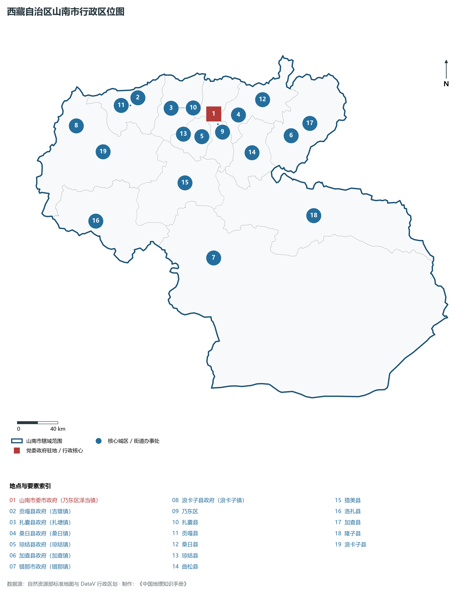
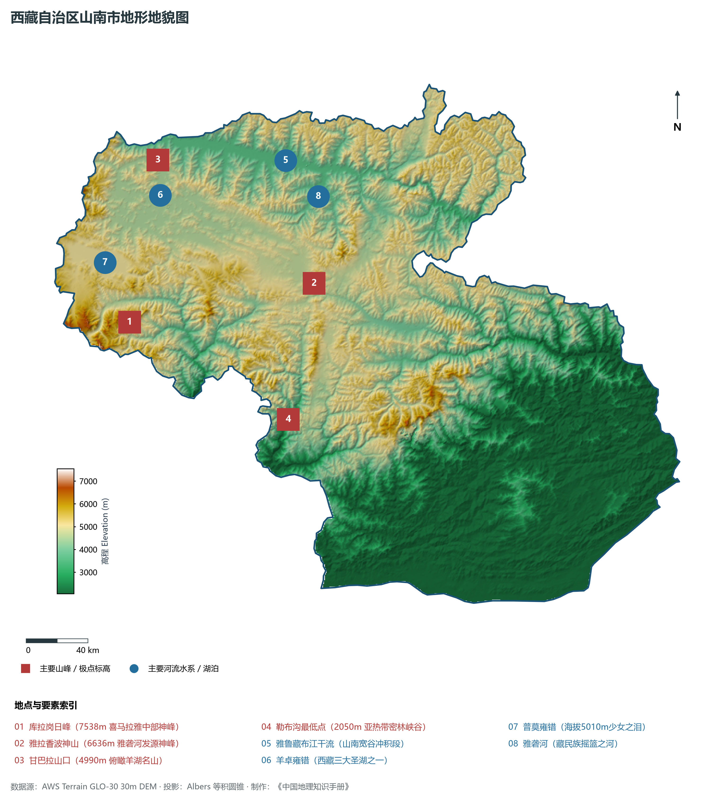
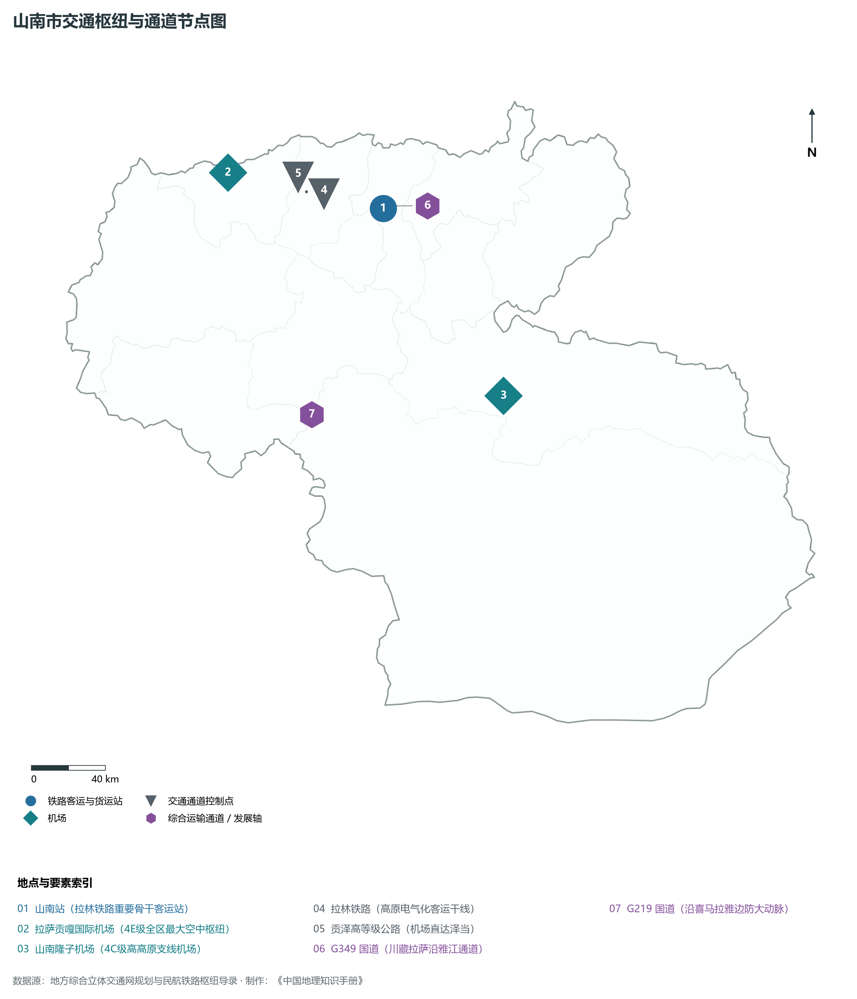
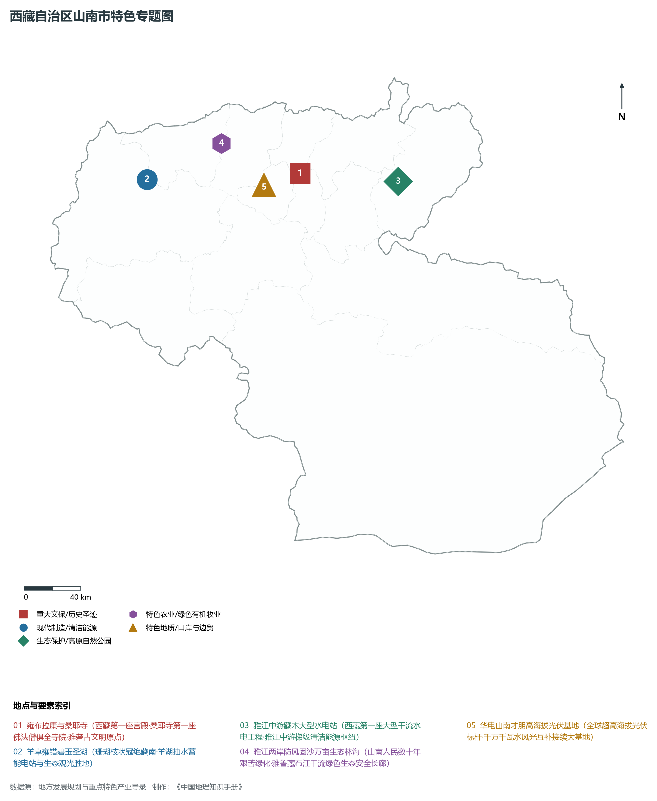
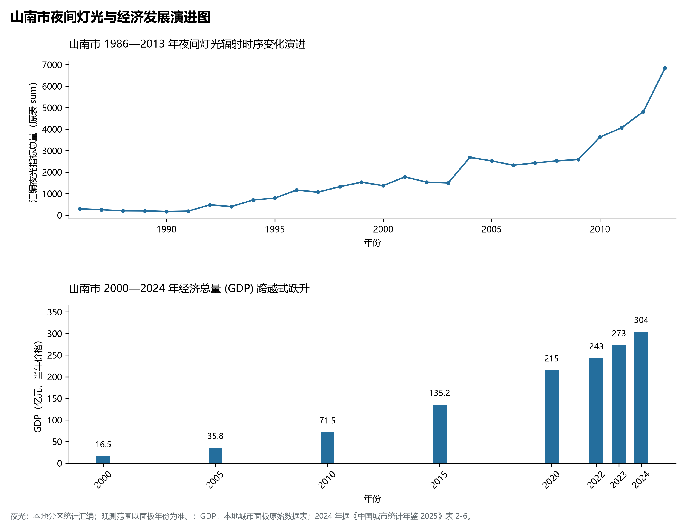

# 34.5 山南市

山南市位于西藏自治区南部、冈底斯山脉与喜马拉雅山脉之间，雅鲁藏布江中游及其重要支流雅砻河谷纵贯全境，被公认为藏民族的发祥地与藏文化的核心根基，素有“藏源山南、圣境雅砻”之崇高历史声誉。山南地理坐标介于东经 90° 14' ～ 94° 22'、北纬 27° 08' ～ 29° 47' 之间。北与拉萨市为邻，东接林芝市，西连日喀则市，南与印度、不丹两国接壤，边境线长达 630 km，战略地位举足轻重。

2024 年山南市全市地区生产总值为 304 亿元（当年价格）。

2024 年全市统计：常住人口 36 万人，常住人口城镇化率 34.06 %，地区生产总值 304 亿元，人均地区生产总值 85,607 元，三次产业构成 6.04 : 42.79 : 51.17。

2024 年全市统计：常住人口 36 万人，常住人口城镇化率 34.06 %，地区生产总值 304 亿元，人均地区生产总值 85,607 元，三次产业构成 6.04 : 42.79 : 51.17。

2024 年全市统计：常住人口 36 万人，常住人口城镇化率 34.06 %，地区生产总值 304 亿元，人均地区生产总值 85,607 元，三次产业构成 6.04 : 42.79 : 51.17。

---

## 一、高山峡谷与雅砻盆地地貌格局

山南市在地貌地质上横跨喜马拉雅造山带中部与雅鲁藏布江构造结合带，地质构造复杂多变，地表侵蚀切割极其深剧，宏观地势呈现北倾南高、山峦起伏的复杂山原峡谷格局。全州平均海拔在 3700 m 左右，全境相对高差达 **5488 m**。

山南市由南向北可清晰划分为四大地貌类型区：

1. **喜马拉雅极高山现代冰川与湖盆带（南部中不边境）**：横亘于洛扎、措美、错那、隆子县南部。山脊海拔多在 6000～ 7500 m，最高峰为洛扎县境内的**库拉岗日峰（海拔 7538 m）**，主峰终年积雪晶莹，巨大的山谷冰川深垂山谷；其北侧山间洼地分布着**普莫雍错**（海拔 5010 m，被誉为“少女之泪”，为西藏海拔最高的淡水大湖）。
2. **喜马拉雅南翼亚热带深切湿热峡谷带（错那市勒布沟）**：喜马拉雅主脉向南陡降进入勒布沟，由于印度洋季风长年顺深谷北上，谷深壁陡、林海苍茫、瀑布成群，错那市勒布沟最低点海拔降至 **2050 m**，气候湿润温和，分布着大片原生亚热带针阔混交林与高山有机茶叶基地。
3. **羊卓雍错内陆断陷构造湖盆带（西部浪卡子县）**：**羊卓雍错**（藏语意为“碧玉湖”，湖面海拔 4441 m，水域面积约 638 km²）与拉萨河、年楚河水系仅隔一道狭窄分水岭。湖水呈极其复杂的珊瑚枝状蜿蜒在群山怀抱之中，岸线长达 250 公里，湖岛星罗棋布，为藏南第一大内陆微咸水圣湖。
4. **雅鲁藏布江中游宽谷平原与雅砻河盆地（北部乃东、贡嘎、扎囊、桑日）**：雅鲁藏布江由西向东流贯山南北部，长达数百公里。江面宽展，两岸发育长达数十公里的冲积漫滩与阶地，最宽处达 4～ 7 km；雅砻河自南向北由雅拉香波雪山发源，穿过琼结、乃东在泽当汇入雅江，堆积出开阔肥沃的雅砻河冲积扇平原（海拔 3500～ 3600 m），水流清缓、土壤疏松，孕育了西藏最早的定居农耕文明。

---

## 二、高原温和季风气候与雅江中游水力大动脉

山南市北部河谷受东西走向高山屏障庇护，具有日照充足、气温相对温和、冬春干风、夏秋温湿的**高原温带半干旱季风气候**特征。

- **光热条件优良**：乃东泽当与雅江宽谷年平均气温在 8.0～ 8.8°C 之间，极端最高气温可达 30°C；年无霜期长达 140～ 160 d，积温条件良好。年日照时数在 2800～ 3000 h，太阳辐射能量充裕，极其适宜发展温棚设施农业与高寒光伏发电。
- **降水时空分异**：全州年降水量在 300～ 550 mm 之间（南部边境勒布沟可达 1000 mm 以上）。雨季主要集中在 6—9 月，且多在夜间降落；冬春季节降水稀少，干旱多风，雅江宽谷曾饱受风沙侵袭。
- **雅江干流水利龙头控制中枢**：雅鲁藏布江干流流经山南境内的贡嘎、扎囊、乃东、桑日、加查等县区，水量丰沛平稳。加查峡谷落差巨大、基岩坚实，国家在此投巨资建设了**藏木水电站**（总装机 51 万千瓦，雅鲁藏布江干流首座大型水电工程）、大古水电站（66万千瓦）以及加查水电站，构成了西藏电网骨干支撑基荷，是名副其实的“高原电力心脏”。

---

## 三、立体交通网络与“拉山同城、空铁一体”新格局

山南市紧邻自治区首府拉萨，是西藏内联外通、融入成渝与全国干线交通网络的核心走廊。

1. **高原动车跨越——拉林铁路**：
   - 铁路沿雅江两岸穿行，在山南市设立**山南站**（乃东区泽当）、贡嘎站、扎囊站、桑日站、加查站，实现了全线电气化复线运行；
   - “复兴号”高原动车使山南至拉萨仅需 1 小时，至林芝仅需 2.5 小时，全面融入全区高速铁路客运主干线。
2. **西藏最大空中交通门户——拉萨贡嘎国际机场**：
   - 机场主体行政管辖隶属于山南市贡嘎县，距山南乃东泽当城区约 70 km，距拉萨市区约 55 km；
   - 作为全区唯一的 4E 级大型枢纽机场，新建成的 T3 航站楼宛如金色莲花盛开，开辟通航航线近 150 条，年吞吐量突破 500 万人次；
   - **山南隆子机场（4C级）**：高高原边境新机场建成通航，填补了山南南部边防航空空白。
3. **高等级公路与“拉山半小时经济圈”**：
   - **泽贡高等级公路（贡泽高速）**：沿雅江南岸将拉萨贡嘎机场与乃东泽当主城区高标准连通，车程缩减至 40 分钟；
   - **G349 国道**（沿雅江北岸）与 **G219 国道**（喜马拉雅沿边国防大动脉穿行措美、洛扎、错那）全面成网，所有建制村公路硬化率达 100%。

---

## 四、藏源文化底蕴与国家绿色清洁能源基地

山南市坚持“文化润市、绿电兴市、生态筑基”，打造具有全国标杆效应的高原特色绿色现代产业：

1. **千亿级水风光互补清洁能源产业基地**：山南立足雅江梯级水电与高原荒漠极强日照优势，打造千万千瓦级清洁能源清洁高地。以藏木、大古水电为调峰中枢；在琼结与措美建成了华电山南才朋光伏电站（海拔超 5000 m，全球海拔最高的光伏示范项目）与高海拔风电场，清洁电力外送与就地消纳协同发力。
2. **藏源历史文脉与全域文化旅游**：以“藏民族发祥地”为主题，布局**雍布拉康**（依山而建的第一座古堡王宫）、**桑耶寺**（严格按照曼陀罗宇宙观建筑群格局设计的吐蕃圣寺）、**藏王墓群**（松赞干布与文成公主陵墓）、青朴修行地等国家级重点文物；串联羊卓雍错环湖风光游与勒布沟门巴族、珞巴族民俗风情游，文旅年接待规模超过 800 万人次。
3. **雅江两岸防风固沙超级生态工程**：面对昔日“飞沙走石、天无三日晴”的荒漠化威胁，山南干部群众数十年如一日在雅江两岸绝壁荒滩种树，建成了一条长达 160 km、宽达 1.8 km 的“雅江两岸绿色生态长廊”，封育造林逾 45 万亩，筑牢了阻挡风沙侵袭拉萨和山南盆地的坚固绿色屏障，创造了世界高寒干旱区防沙治沙的生态奇迹。
4. **高原特色有机现代农业与林果深加工**：扎囊县与乃东区规模化种植矮化苹果、车厘子、鲜食葡萄与高原草莓；加查县出产国家地理标志产品“加查核桃”与富硒青稞；隆子县大力推广黑青稞优良品种与牦牛精细化分割冷链物流。

---

## 五、夜间灯光演化与拉山同城化空间重塑

本节夜光图的观测年份为 1986—2013 年，指标为行政区汇总值（原表 sum）。

1. **时空演进特征**：
2. **空间治理走向**：山南市严密划定羊卓雍错生态环境保护红线与雅鲁藏布江沿岸湿地红线，严格限制沿江陡坡盲目开垦；推行城镇紧凑布局，推进乃东中心城区品质提档与贡嘎临空经济协同发展，构建了人水相亲、古今辉映的现代高原宜居生态典范。

---

## 六、行政区划与核心要素统计表

| 县级行政区 | 驻地镇 | 陆地面积 (km²) | 常住人口 (万人) | 区域地理特色与主导产业方向 |
|:---|:---|:---|:---|:---|
| **乃东区** | 泽当街道 | 2,185 | 8.2 | 市府驻地、西藏第一座宫殿雍布拉康、雅砻河谷核心、拉林铁路山南站、商贸文旅 |
| **错那市** | 错那镇 | 35,191 | 1.6 | 县级市、勒布沟亚热带原始雨林（2050m最低点）、门巴族聚居区、高山生态茶园 |
| **贡嘎县** | 吉雄镇 | 2,286 | 5.3 | 拉萨贡嘎国际机场所在地、拉林铁路贡嘎站、空港现代物流区、高原设施农业 |
| **扎囊县** | 扎塘镇 | 2,142 | 3.8 | 敏珠林寺、雅江两岸防沙治沙万亩林核心区、扎囊矮化苹果基地、羊毛氆氇非遗 |
| **桑日县** | 桑日镇 | 2,634 | 1.8 | 沃卡温泉康养地、赤康宗古堡遗址、雅江干流水电基建带、高原特色优质葡萄基地 |
| **琼结县** | 琼结镇 | 1,057 | 1.8 | 吐蕃赞普藏王墓群、青瓦达孜宫殿遗址、才朋超高海拔光伏大基地、青稞良种 |
| **加查县** | 加查镇 | 4,495 | 2.4 | 藏木大型水电站（51万千瓦）、加查千年核桃之乡、达香拉神湖、拉林铁路大站 |
| **洛扎县** | 洛扎镇 | 5,033 | 2.1 | 喜马拉雅主峰库拉岗日雪峰（7538m）、色卡古托寺九层碉楼、边境生态畜牧业 |
| **措美县** | 措美镇 | 4,530 | 1.3 | 哲古草原风光、哲古错高山湖泊、高海拔风电清洁能源、藏系绵羊育肥基地 |
| **隆子县** | 隆子镇 | 10,566 | 3.5 | 隆子高高原支线机场、玉麦乡“爱国守边”时代楷模故里、黑青稞酒酿造基地 |
| **浪卡子县** | 浪卡子镇 | 7,982 | 3.6 | 羊卓雍错圣湖所在地、普莫雍错（5010m）、卡若拉冰川观景地、高寒生态畜牧 |
| **曲松县** | 曲松镇 | 1,960 | 1.6 | 拉加里王宫国家级重点文保、下江梯级小水电、高原优质藏鸡散养与黑青稞种植 |

2024 年统计来源：《中国城市统计年鉴 2025》表 2-1、2-6、2-7（2024 年，全市）。其他年份 GDP 据本地城市面板“原始数据”表，单位为亿元、当年价格。
