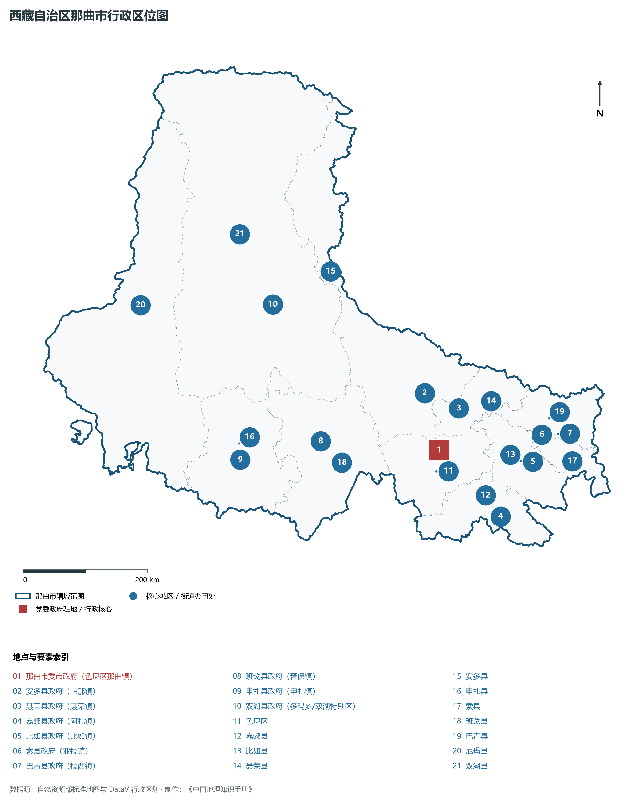
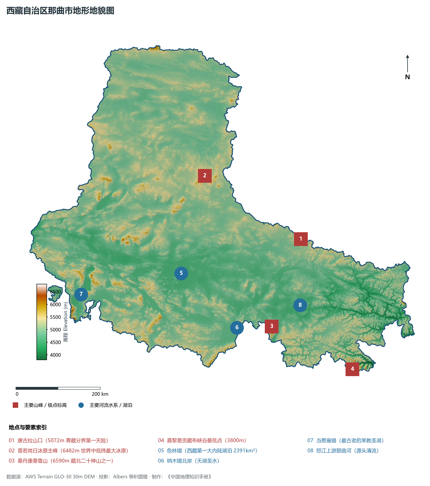
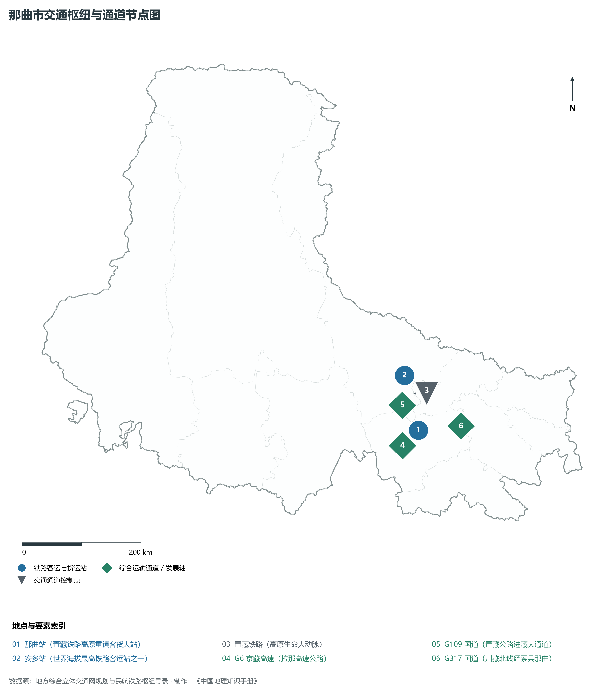
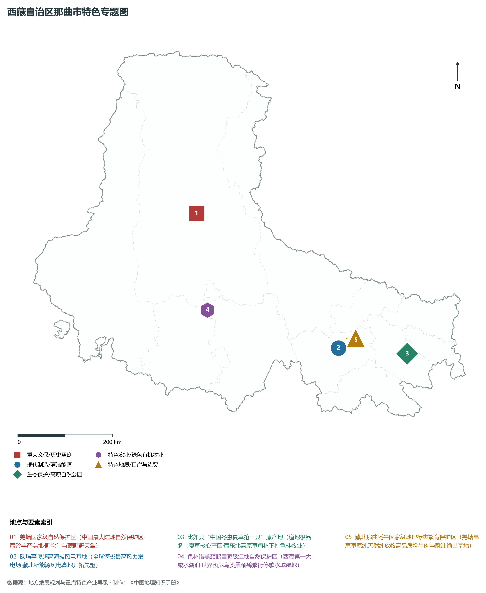
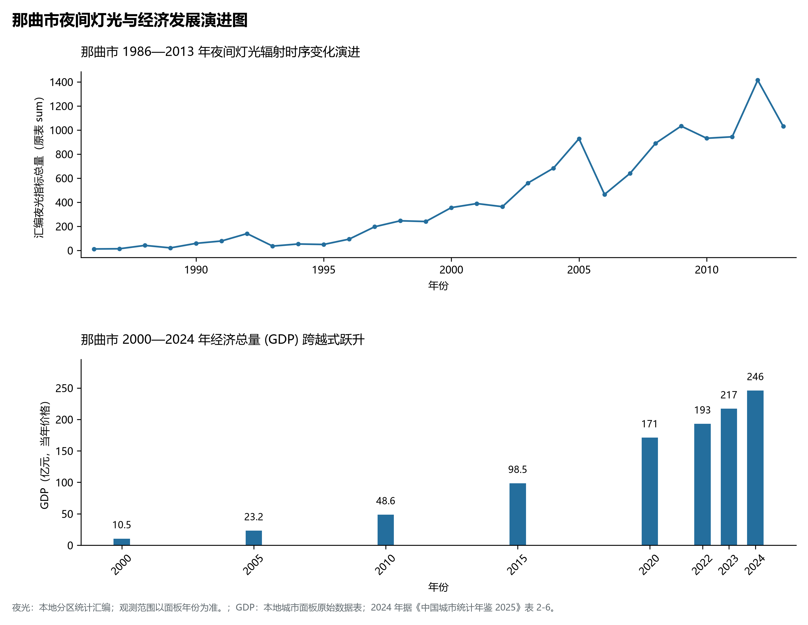

# 34.6 那曲市

那曲市位于西藏自治区北部、青藏高原腹心腹地，东西横跨羌塘内流湖区与藏东三江峡谷源流区，被公认为西藏生态环境最严苛、草原最为辽阔、高寒特色最鲜明的“藏北重镇”与“高原畜牧第一大市”。那曲地理坐标介于东经 83° 55' ～ 95° 05'、北纬 29° 55' ～ 36° 30' 之间。北与新疆维吾尔自治区巴音郭楞蒙古自治州、青海省海西蒙古族藏族自治州与玉树藏族自治州相连，东接昌都市，南界林芝市、拉萨市与日喀则市，西邻阿里地区，区位跨度极其宏大，是连接西藏与青海、新疆两大自治区的北向陆路交通战略大门。

2024 年那曲市全市地区生产总值为 246 亿元（当年价格）。

2024 年全市统计：常住人口 51 万人，常住人口城镇化率 25.9 %，地区生产总值 246 亿元，人均地区生产总值 42,445 元，三次产业构成 17.16 : 23.36 : 59.47。

2024 年全市统计：常住人口 51 万人，常住人口城镇化率 25.9 %，地区生产总值 246 亿元，人均地区生产总值 42,445 元，三次产业构成 17.16 : 23.36 : 59.47。

2024 年全市统计：常住人口 51 万人，常住人口城镇化率 25.9 %，地区生产总值 246 亿元，人均地区生产总值 42,445 元，三次产业构成 17.16 : 23.36 : 59.47。

---

## 一、羌塘高原、大湖盆地与冰川冻土地貌格局

那曲市在构造地貌上横跨冈底斯—念青唐古拉造山带与羌塘高原断陷盆地带，微地形以宽展的高原丘陵、开阔盆地与古老夷平面为主，整体地貌呈现“高而不陡、平展辽阔、大湖罗列”的典型高原腹地面貌形态。全境相对高差达 **3000 m** 以上。

那曲市由北向南、自西向东可划分为四大地貌类型区：

1. **北部唐古拉山脉极高山冰川冻土带**：绵亘于安多县北部及双湖县东北缘，平均海拔在 5000～ 6000 m 之间。青藏两省区分界天险**唐古拉山口（海拔 5072 m）**横贯其中；深厚的大片连续多年冻土与现代冰川极为发育，主脊常年银装素裹。
2. **羌塘腹地古老冰原与高寒荒漠丘陵区（北部双湖、尼玛）**：地处羌塘国家级自然保护区核心腹地，地表起伏平缓，平均海拔超过 4800 m。其中双湖县北部分布着**普若岗日冰原**（主峰海拔 **6482 m**，冰原面积超过 420 km²，厚度达数十米至百米，是除了南极和北极之外世界中低纬度地区面积最大的大陆性冰原），四周沙漠、湖泊与冰原奇迹般伴生交织。
3. **藏北中部巨型断陷大湖盆地群（申扎、班戈、色尼）**：位于念青唐古拉山脉北麓。由于断陷沉降作用，发育了一系列平展宽阔的封闭内陆湖盆，聚集了**色林错**（湖面海拔 4530 m，水域面积达 **2391 km²**，超过纳木错成为西藏第一大湖泊、中国第二大咸水湖）、错鄂、恰规错、达则错以及纳木错北半部水域，形成了蔚为壮观的“千湖之源”高原内陆湖泊群。
4. **藏东怒江高山深切峡谷过渡带（比如、索县、巴青、嘉黎）**：向东进入怒江流域及横断山脉北段延伸带，地势向东向南急剧倾斜。怒江上游那曲河在此汇纳百川切穿深山，形成山高谷深、植被丰茂的峡谷地貌。嘉黎县东南部易贡藏布峡谷出口处海拔降至 **3800 m** 左右，发育着大片暗针叶原始森林与高寒灌丛草甸。

---

## 二、极寒半干旱高原气候与内外流复合水系

那曲市气候受高纬度高原寒极与西风环流主导，属于典型的**高原亚寒带/寒带半干旱季风气候**：

- **高寒严酷与无霜期缺失**：全州绝大部分区域年平均气温在 -3.0°C～ 1.5°C 之间，极端最低气温可下探至 **-41.2°C**；全境几乎无绝对无霜期，年大风（≥ 8级）日数达 100～ 150 d，冬春季节常伴随狂风呼啸与漫天飞雪（“白灾”与“黑灾”对牧区牲畜越冬构成天然严峻考验）。
- **光照充裕与降水阶梯递减**：年日照时数在 2800～ 3100 h，太阳辐射能量极强；年降水量自东南向西北急剧递减——东南部嘉黎、比如县可达 500～ 600 mm，而西北部双湖、尼玛荒漠区降水量不足 150 mm，降水高度集中于 6—9 月的短暂温凉暖季。
- **“亚洲水塔”分流枢纽**：
  - **外流水系（怒江源头）**：怒江正源发源于安多县唐古拉山南麓的错那湖周边及那曲河，自西北向东南流经色尼、比如、嘉黎等地，水流清冽汹涌，是长江以南重要跨国水系的发源命门；
  - **内流水系（藏北内流区）**：汇入色林错、当惹雍错（古苯教三大圣湖之一）等内陆盆地，构成我国最庞大的高原微咸水与咸水内陆湖泊生态群落。

---

## 三、立体天路廊道与高原智慧物流枢纽

昔日被称为“鸟飞不到尽头、马跑断了腿”的辽阔藏北荒原，在国家基础设施重点倾斜下，已构建起全域畅达的立体交通网络：

1. **高原钢铁巨龙——青藏铁路与那曲大站**：
   - 青藏铁路格拉段由北向南穿透唐古拉山口，纵贯安多、色尼两县区；
   - 境内设有安多站（世界海拔最高的铁路客运大站之一，海拔 4702 m）与**那曲站**（海拔 4513 m，全区规模最大的客货运输兼顾高等级编组站）；
   - 铁路的开通使藏北由封闭游牧转变为全区货物进出藏的中转大站。
2. **“天路”高速化跃升——G6 京藏高速与拉那大动脉**：
   - **G6 京藏高速那曲至拉萨段（拉那高速）**：全长 295 km，平均海拔逾 4500 m，是世界上海拔最高的高速公路；
   - 拉那高速使那曲至自治区首府拉萨的车程由昔日 6 小时大幅缩减至 **3 小时以内**，实现了藏北与拉萨都市圈的无缝高效并轨；
   - **G109 国道（青藏公路）**与 **G317 国道（川藏北线）**在色尼城区交汇形成“大十字”，向西连通阿里、向东直抵四川成渝。
3. **那曲现代物流中心**：
   - 依托青藏铁路那曲站布局建设的全区最大现代综合铁路货运物流园区，具备集装箱吞吐、散堆装货物堆存、冷链仓储与大宗建材中转功能，年货物周转量占全区内陆铁路货运的三分之一以上。

---

## 四、纯净生态牧业、极品冬虫夏草与全球最高风电大基地

那曲立足“世界屋脊”独特的纯净自然禀赋，培育出极具全国竞争力的现代生态特色产业：

1. **全国高寒纯生态畜牧业高地**：
   - 全市拥有可利用天然草场近 4 亿亩，主要植被为营养价值极高的高山嵩草高寒草甸；
   - 孕育了国家地理标志产品**“那曲牦牛”**与**“藏北藏系绵羊”**。那曲牦牛体格健硕、耐寒性极强、肉质纯净鲜美，牦牛肉、拉拉（奶酪）、牦牛酥油与高原羊绒远销内地大中城市；
   - 推行草畜平衡、划区轮牧与人工饲草料种植，实现生态保护与牧民增收双赢。
2. **“中国冬虫夏草第一县”核心产区**：
   - 藏东深谷的**比如县**、索县、巴青县、嘉黎县，因海拔介于 4000～ 4800 m 之间、土壤湿润且高寒冷凉，出产的**那曲冬虫夏草**以草体饱满、色泽金黄、虫草素与活性多糖含量极高享誉全球；
   - 比如县被称为“中国冬虫夏草第一县”，建立起了从采挖溯源、规范交易到现代生物精深加工的完整高端产业链。
3. **全球超高海拔清洁能源标杆——欧玛亭嘎风电场**：
   - 位于色尼区欧玛亭嘎，风机最高安装海拔达 **4650 m**，总装机容量 **10 万千瓦（100MW）**，安装了 25 台适应低气压、超强紫外线、极寒大温差的定制化抗高寒抗风沙风电机组；
   - 作为**全球海拔最高的风电示范项目**，该电站年上网电量达 2 亿度，每年可节约标煤约 6 万吨，彻底改写了藏北冬春枯水季节电力短缺的历史。
4. **羌塘野生动物王国与极地生态保护**：
   - **羌塘国家级自然保护区**（面积达 29.8× 10⁴ km²）被誉为“地球第三极的诺亚方舟”，是藏羚羊、野牦牛、藏野驴、雪豹等珍稀濒危野生动物的核心繁衍栖息地；
   - 建立了由 120 余个专业管护站、近万名农牧民野保员组成的网格化巡护体系，藏羚羊种群数量恢复至 30 余万只，野牦牛突破 2 万头。

---

## 五、夜间灯光演化与高寒游牧城镇化空间重塑

本节夜光图的观测年份为 1986—2013 年，指标为行政区汇总值（原表 sum）。

1. **时空演进特征**：
2. **高寒生态搬迁治理典范**：针对北部双湖县等海拔超 5000 m、自然条件极端恶劣、严重缺乏宜居条件的高海拔区域，西藏自治区稳步实施了“极高海拔生态搬迁工程”，将双湖县数千名农牧民整建制迁移至低海拔雅鲁藏布江河谷（山南森布日），既让高海拔生态脆弱区得到了彻底休养生息，又从根本上解决了高寒群众就医、上学与品质生活问题，开创了世界高原人口与生态协同治理的典范。

---

## 六、行政区划与核心要素统计表

| 县级行政区 | 驻地镇 | 陆地面积 (km²) | 常住人口 (万人) | 区域地理特色与主导产业方向 |
|:---|:---|:---|:---|:---|
| **色尼区** | 那曲镇 | 16,195 | 11.2 | 市府驻地、青藏铁路客货大枢纽、欧玛亭嘎全球最高风电、那曲现代物流港 |
| **安多县** | 帕那镇 | 43,410 | 4.3 | 青藏公路第一镇、世界最高铁路客运站安多站、唐古拉山极地门户、错那湖生态 |
| **聂荣县** | 聂荣镇 | 10,037 | 3.5 | 藏北高寒草甸牧业腹地、纯种藏北牦牛良种繁育、天然地热温泉与藏医药加工 |
| **嘉黎县** | 阿扎镇 | 13,056 | 3.6 | 易贡藏布上游峡谷林海、高山冬虫夏草良种产区、阿扎湖高山湿地生态旅游 |
| **比如县** | 比如镇 | 11,686 | 6.8 | “中国冬虫夏草第一县”、怒江深切大峡谷、达木寺骷髅墙罕见人文、特色林果 |
| **索县** | 亚拉镇 | 6,022 | 4.6 | 藏东北交通要道、赞丹寺（布达拉宫式古堡寺院）、优质冬虫夏草与特色高原商贸 |
| **巴青县** | 拉西镇 | 10,326 | 5.2 | 川藏北线重要驿站、麦地卡高寒湿地（国际重要湿地）、天然牧场与藏香草药 |
| **班戈县** | 普保镇 | 30,138 | 3.9 | 色林错与纳木错大湖区、纳木错北岸圣象天门自然名胜、高寒生态游牧示范 |
| **申扎县** | 申扎镇 | 25,546 | 2.2 | 色林错黑颈鹤国家级自然保护区腹心、鸟类迁徙天堂、高原特色高寒生态畜牧 |
| **双湖县** | 多玛乡 | 116,637 | 1.4 | 全国陆地面积第二大县、普若岗日巨型冰原（6482m）、极高海拔生态搬迁示范 |
| **尼玛县** | 尼玛镇 | 72,499 | 3.4 | 羌塘保护区核心腹地、当惹雍错苯教圣湖与文部南村古村落、藏羚羊繁衍乐园 |

2024 年统计来源：《中国城市统计年鉴 2025》表 2-1、2-6、2-7（2024 年，全市）。其他年份 GDP 据本地城市面板“原始数据”表，单位为亿元、当年价格。
