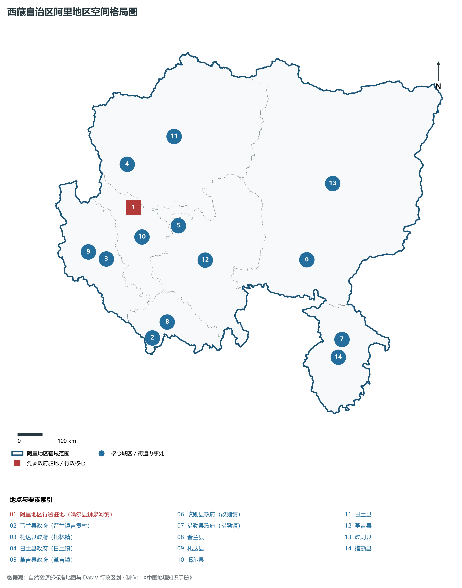
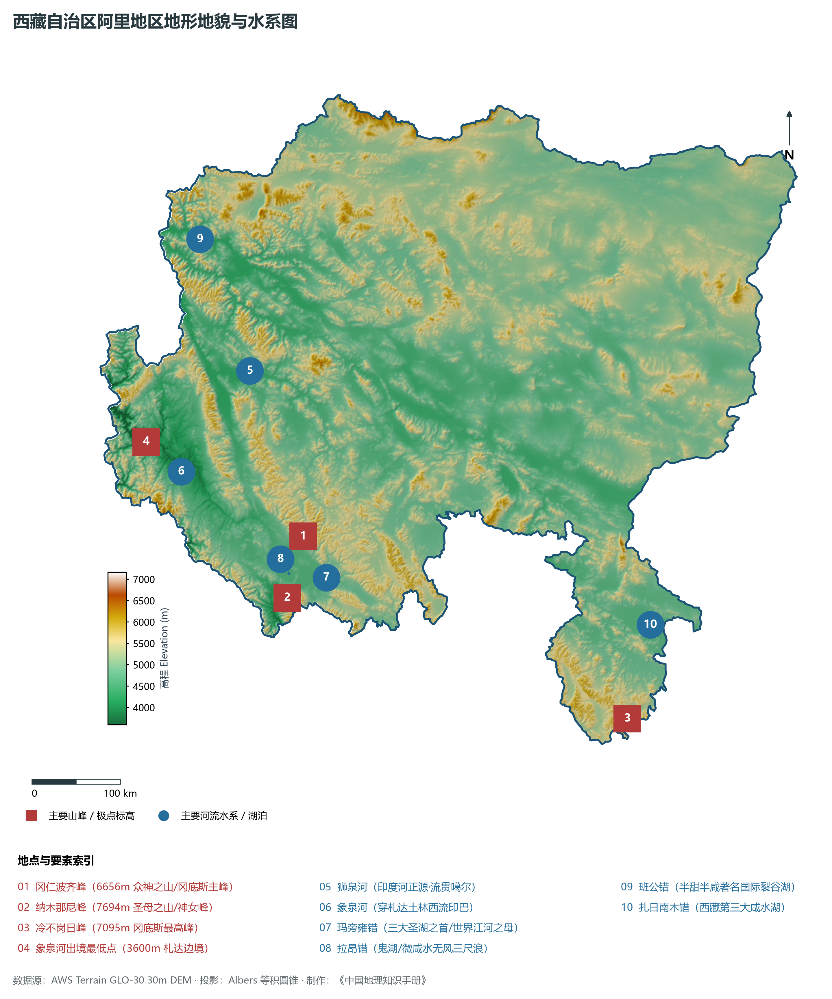
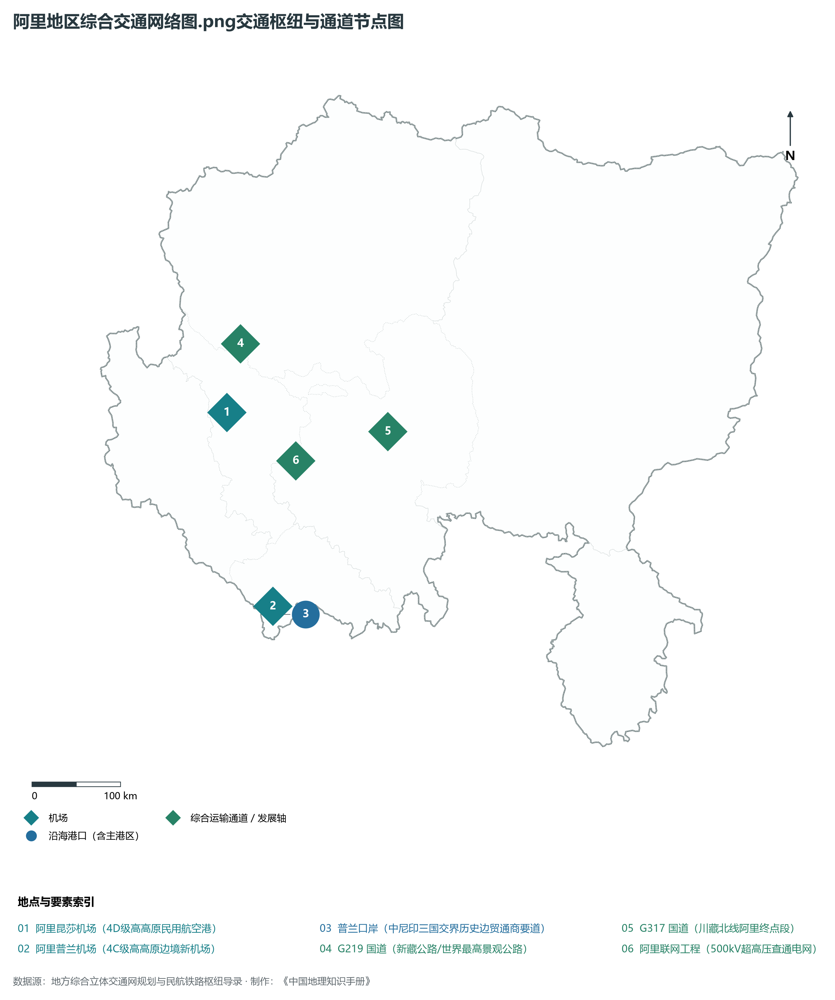
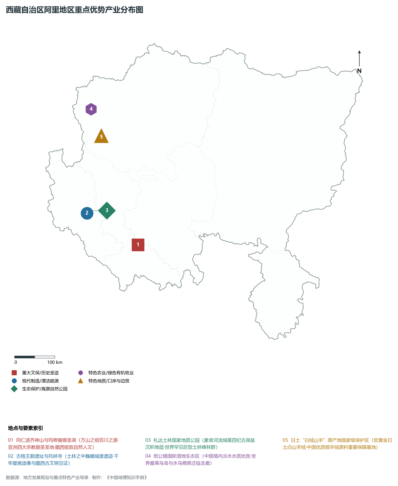
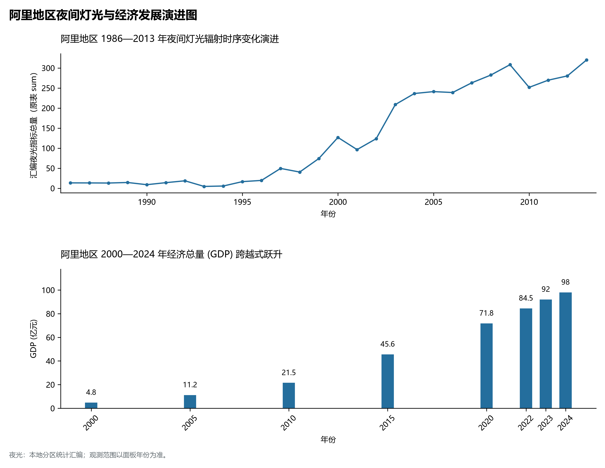

# 34.7 阿里地区

阿里地区位于西藏自治区最西端、青藏高原西南部，地处喜马拉雅山脉、冈底斯山脉与喀喇昆仑山脉的汇聚之所，是冈底斯山脉之主脊与藏西内陆大湖盆地交织的辽阔极地，素有“万山之祖、百川之源”、“世界屋脊的屋脊”与“天上阿里”之崇高赞誉。阿里地理坐标介于东经 78° 25' ～ 86° 20'、北纬 29° 40' ～ 35° 50' 之间。北与新疆维吾尔自治区巴音郭楞蒙古自治州、和田地区相连，东接那曲市与日喀则市，西南与印度、尼泊尔两国接壤，边境线长达 **1116 km**，是我国守卫西南陆疆、对印对尼交往极其重要的国家安全屏障与边防重地。

阿里地区行政公署驻地设在**噶尔县狮泉河镇**。全区陆地总面积达 **34.5× 10⁴ km²**，占西藏全区面积的四分之一强；全境平均海拔在 **4500 m** 以上，高寒干旱、地广人稀。截至 2024 年末，全区常住人口仅 12.3 万人，是我国人口密度最低的行政单元之一（每平方公里不足 0.4 人）；实现地区生产总值（GDP）约 98.0 亿元，人均 GDP 接近 8.0 万元，位居自治区前列。阿里不仅坐拥亚洲宗教圣山之王——冈仁波齐、三大圣湖之首——玛旁雍错、奇绝天下的第四纪巨型地质遗存——札达土林、世界著名半甜半咸裂谷湖——班公错，更孕育了辉煌千年的古象雄文明与神秘的古格王朝，正在加快建设国家级边疆高质量发展先行区、世界级高山神圣生态文旅胜地与世界暗夜天文观测高地。

---

## 一、巨脉交织、古老土林与冰蚀湖盆地貌格局

阿里地区处于青藏高原板块内部受印度板块持续俯冲挤压隆起的最剧烈断陷隆起区，喜马拉雅、冈底斯与喀喇昆仑三大宏伟山脉在西南部与西北部纵横交错，地貌构造宏大深邃，地势总趋势由西北、东南向中部倾斜，形成了“山原高耸、盆地宽阔、峡谷深切、土林奇秀”的极端壮美地貌。全区相对高差达 **4094 m**。

阿里地区由西向东、自南向北可清晰划分为四大地貌类型区：

1. **喜马拉雅西段与冈底斯极高山冰川带（南部普兰、噶尔、措勤）**：普兰县境内的喜马拉雅山脉与冈底斯山脉遥相呼应，耸立着被印度教、藏传佛教、苯教和古耆那教共同奉为“世界中心”的神山之王——**冈仁波齐峰（海拔 6656 m）**，山体形如巨型水晶金字塔，四壁严格对称；南侧则矗立着喜马拉雅巨峰**纳木那尼峰（海拔 7694 m）**，峰顶冰原高悬，两侧深垂着巨大的山谷冰川与冰碛垄。东部措勤县耸立着冈底斯山脉最高峰——**冷不岗日峰（海拔 7095 m）**。
2. **象泉河流域第四纪古湖盆巨型札达土林群（西部札达）**：发源于冈底斯山脉西段的象泉河穿切札达盆地，在数百万年前曾为浩瀚的古湖泊，伴随青藏高原整体急剧抬升，湖底深厚的新近系至第四纪黄褐色砂砾岩与泥岩地层被暴雨洪流与强风深度切割剥蚀，形成了方圆数百平方公里的**札达土林国家地质公园**（象泉河出境处海拔降至 **3600 m**，为阿里全区陆地最低点）。千峰竞秀、宛如古代罗马城墙与巨型城堡，为世界罕见的古湖相地貌奇观。
3. **藏西北高寒干旱裂谷与冰蚀大湖区（西北部日土）**：日土县地处喀喇昆仑山东段南翼，发育长达数百公里的构造断陷裂谷，镶嵌着著名的**班公错**（湖面海拔 4242 m，水系呈长达 150 km 的东西向狭长珊瑚带）。湖体形态奇特：中国境内为清澈甘洌的淡水，水草丰美、鸟岛密集；向西流出境外部则演变为咸水与苦咸水，岸边寸草不生，形成独特的“一湖两水”世界奇观。
4. **羌塘西缘宽谷高寒荒漠区（北部革吉、改则、措勤）**：海拔大多在 4600～ 5100 m 之间，地表平坦起伏平缓，分布着大片荒漠草原、盐碱滩地与内陆封闭湖泊，包括西藏第三大咸水湖**扎日南木错**（湖面面积达 1021 km²），是荒漠野生动物自由奔驰的辽阔极地。

---

## 二、“百川之源”水系枢纽与极端大陆性干旱高寒气候

阿里被誉为**“百川之源”**，是亚洲四大著名跨国国际河流的共同摇篮：

- **四大名河发源地**：
  - **狮泉河（藏语森格藏布）**：发源于革吉县冈底斯山北麓，流经噶尔县狮泉河镇，向西北注入克什米尔，是南亚第一大河**印度河的正源**；
  - **象泉河（藏语朗钦藏布）**：发源于冈底斯山西南麓，贯穿札达土林，西流进入印度后称为**萨特莱杰河**（印度河最大支流）；
  - **马泉河（藏语当却藏布）**：发源于仲巴与阿里普兰交界冰川，向东奔涌万里，成为**雅鲁藏布江的正源**（流经印度为布拉马普特拉河）；
  - **孔雀河（藏语马甲藏布）**：发源于普兰县纳木那尼雪峰冰川，南切喜马拉雅峡谷出境进入尼泊尔，最终汇入**恒河**。
- **神山圣湖的极致纯净**：冈仁波齐峰脚下并峙着**玛旁雍错**（海拔 4588 m，面积 412 km²，“三大圣湖之首”，湖水透明度达 14 m，是我国透明度最高的天然高原淡水湖）与**拉昂错**（“鬼湖”，咸水微涩，湖水呈深邃幽蓝且无风三尺浪），两者仅隔一条宽约数十米的人文水渠，堪称地球自然地理的绝妙造化。
- **高原极端干旱少雨气候**：阿里深受内陆西风急流与青藏高原热力高压控制，远离海洋水汽，属于典型的**高原极高寒干旱大陆性气候**：
  - 全区年平均气温在 -2°C～ 2.5°C，日温差常达 20°C 以上；
  - 年降水量仅 **50～ 150 mm**，主要靠极高山冰雪融水与局地夏雨补给；
  - 年日照时数高达 **3200～ 3500 h**，年晴夜数达 300 天以上，大气纯净透明，空气中水汽与尘埃含量极低，是全球屈指可数的光学与亚毫米波天文观测胜地。

---

## 三、“天上阿里”综合立体交通与大电网联通奇迹

曾经与世隔绝、进藏行车需数周的“天上阿里”，如今已全面跃入公路、航空与超高压电网并进的现代化立体时代：

1. **新藏公路生命线——G219 国道与 G317 终点汇聚**：
   - **G219 国道（新藏公路）**：全长数千公里，穿越喀喇昆仑与冈底斯群山，将新疆叶城、和田与阿里日土、噶尔、普兰及日喀则拉孜紧密缝合，是世界上平均海拔最高、路况极其险峻的国防与旅游大通道；
   - **G317 国道（川藏北线）**：西行终点在噶尔县与 G219 相接，形成了贯穿藏东、藏北至藏西的贯通性横向大动脉。
2. **高高原“双机场”战略航空枢纽**：
   - **阿里昆莎机场（4D级高高原机场）**：位于噶尔县昆莎乡，跑道海拔 **4274 m**，开通直飞拉萨、乌鲁木齐、喀什、成都等航线，彻底终结了阿里与外界陆路长途跋涉的隔绝历史；
   - **阿里普兰机场（4C级高高原边境新机场）**：海拔 **3970 m**，于 2023 年正式通航，有效覆盖冈仁波齐神山圣湖旅游区与中印尼三国交界口岸边防。
3. **普兰国际边贸口岸**：作为国家一类陆路开放口岸，普兰口岸历史上就是中、尼、印三国传统的边民互市集散地，现代唐嘎国际边贸市场商贾云集，是西藏面向南亚开放的重要西大门。
4. **世纪工程——阿里与藏中电网联网工程**：
   - 2020 年底正式竣工投运的**阿里联网工程**，起于日喀则桑珠孜区、止于噶尔县狮泉河镇，全长 1689 km，穿越 380 公里高寒冻土与多座海拔超 5000 米达坂，是目前**世界上海拔最高、运距最远的 500 千伏超高压输变电工程**；
   - 工程彻底打破了阿里长期孤网运行、季节性缺电的瓶颈，使藏西 38 万农牧民用上了源源不断、稳定安全的“大网电”。

---

## 四、古象雄千年文脉、“软黄金”白绒山羊与暗夜天文

阿里依托独一无二的历史遗产、纯净高原地理与星空资源，打造具有全球识别度的特色战略产业：

1. **象雄古国与古格王朝世界级文旅高地**：
   - **古格王朝遗址**：耸立在札达象泉河南岸的巨大土林红砂岩山丘上，拥有 400 余间房舍、300 余座洞窟、3 座佛殿与 1 座巍峨王宫，红庙、白庙中保存完好的珍贵壁画融合了中亚、印度与吐蕃艺术精华，堪称旷世建筑奇迹；
   - **托林寺**：始建于北宋时期（公元 996 年），由古格王益西沃主持修建，大译师仁钦桑布在此翻译大量梵文经卷，阿底峡尊者在此讲经传法，是藏传佛教“后弘期”上路弘传的发源中枢；
   - **冈仁波齐神山与玛旁雍错圣湖环线**：每年吸引数以万计的海内外学者、登山探险家与信众前来科考探险与转山朝圣，构成了藏西高原最具震撼力的文化旅游IP。
2. **“软黄金”日土白绒山羊良种繁育基地**：
   - 日土县独特的荒漠高寒气候使得高寒草场出产的**“日土白绒山羊”**皮毛极为珍贵；
   - 其所产的羊绒细度小于 **13.5 μm**、自然长度超 40 mm、纯白无杂，单纤强力高，在国际市场上被公认为顶级的“开司米之王”与“纤维宝石”，是国家重点保护的优良地方畜禽基因库。
3. **世界级天文观测台址与暗夜星空公园**：
   - 阿里噶尔县设立了海拔 **5100 m** 的**国家天文台阿里观测基地**，建设了我国首个原初引力波探测望远镜、高精度亚毫米波望远镜与量子卫星地面接收站；
   - 设立了亚洲首个“暗夜星空保护区”（阿里暗夜公园），以零光污染、高透明度的纯净天幕吸引了全球天文科研工作者与星空摄影爱好者，发展起现代科技研学新兴产业。

---

## 五、夜间灯光演化与藏西绿洲城镇空间重塑

本节夜光图的观测年份为 1986—2013 年，指标为行政区汇总值（原表 sum）。

1. **时空演进特征**：
   - **1986—2000 年（极点孤灯）**：夜间遥感影像中除狮泉河镇政府驻地存在微弱微光外，其余六县全境几乎处于连片纯黑状态；
   - **2001—2015 年（骨干成型）**：阿里昆莎机场通航、新藏公路全线黑色化铺装，狮泉河城区沿狮泉河两岸拉开骨架，水文气象、边防哨所与县城道路亮化逐步显现；
2. **生态安全红线与边境固边兴边**：阿里严格将冈仁波齐、玛旁雍错、班公错湿地与羌塘荒漠划入国家生态红线保护范围，推行草畜平衡；同时在边境一线全面建设现代化“边境小康示范村”，使水、电、路、讯、网直达国界线最前沿，实现了“神圣国土守护者、幸福家园建设者”的边疆长治久安与高质量协调发展。

---

## 六、行政区划与核心要素统计表

| 县级行政区 | 驻地镇 | 陆地面积 (km²) | 常住人口 (万人) | 区域地理特色与主导产业方向 |
|:---|:---|:---|:---|:---|
| **噶尔县** | 狮泉河镇 | 17,179 | 3.1 | 阿里行署驻地、狮泉河现代绿洲新城、阿里昆莎机场、国家天文台阿里观测站 |
| **普兰县** | 普兰镇 | 12,647 | 1.3 | 神山冈仁波齐与圣湖玛旁雍错、普兰高高原机场、普兰国际陆路口岸、纳木那尼峰 |
| **札达县** | 托林镇 | 24,601 | 0.9 | 古格王朝遗址、托林寺千年名刹、札达土林地质公园、象泉河最低点（3600m） |
| **日土县** | 日土镇 | 75,400 | 1.2 | 班公错国际湿地（一湖两水奇观）、日土白绒山羊“软黄金”良种基地、日土古岩画 |
| **革吉县** | 革吉镇 | 46,117 | 1.6 | 狮泉河正源流经地、羌塘西部高寒草原生态畜牧、盐湖矿产资源探采储备 |
| **改则县** | 改则镇 | 135,025 | 2.5 | 阿里陆地面积第一大县、先遣连纪念馆红色文旅、羌塘腹地藏羚羊与野牦牛家园 |
| **措勤县** | 措勤镇 | 22,865 | 1.7 | 扎日南木错大湖区、冈底斯山最高峰冷不岗日（7095m）、高寒纯天然草场牧业 |
